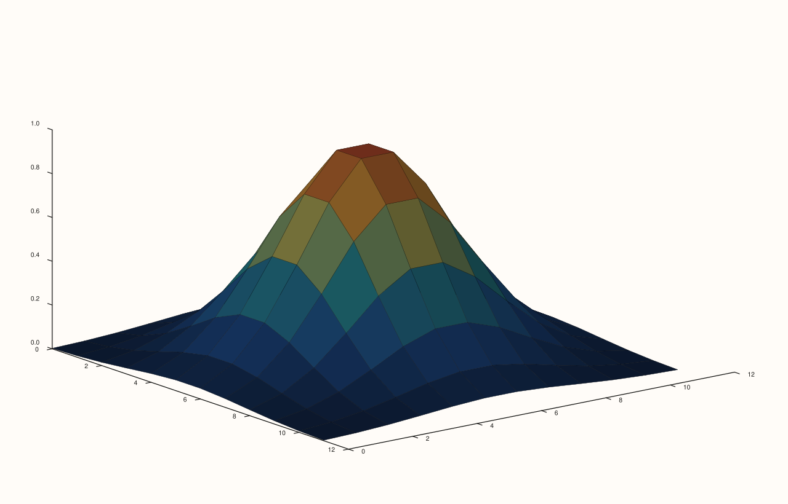
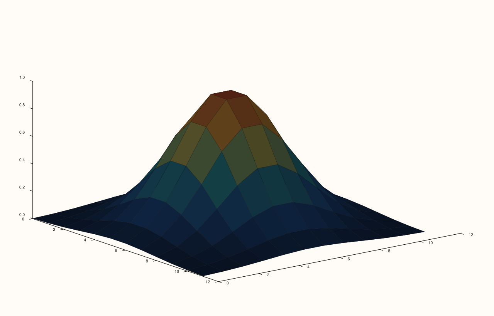
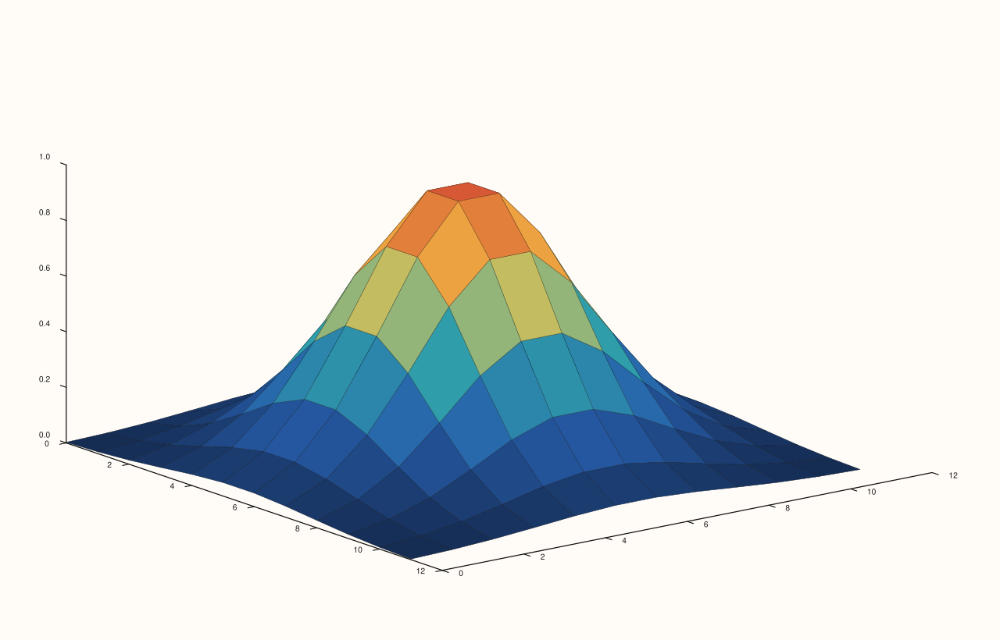

<!-- pluss-hand-authored -->

# Trace::material / Trace::material_profile

[Back to Trace API Reference](../../trace_api_reference)

## Signatures

```cpp
MaterialProfile Trace::material_profile() const noexcept

Trace& Trace::material(MaterialProfile profile) noexcept
```

## What It Does

Gets/sets a per-trace surface material profile: `MaterialProfile::Default` (the
constructor default), `Dull`, `Shiny`, or `Metal`. Each profile is a fixed bundle of
ambient/diffuse/specular/exponent/specular-color coefficients consumed by the same
lighting calculation as [`Trace::lighting`](lighting.md).

```{important} Requires at least one light configured on the pane
Like lighting() (see its important callout for the full explanation),
material() only has an observed effect once the owning Pane has at least one
light added via Pane::lights(). With no lights configured, every material
profile was directly verified to render byte-for-byte identical output --
Dull and Metal (the two most different profiles) included. Add a light first
and the identical toggle produces a genuinely different render, also directly
verified below. As with lighting(), this was corrected during this
documentation effort after being initially miscategorized as "no observed
effect" from testing without any lights configured.
```

## Parameters

**profile** (`MaterialProfile`)
    `Default`, `Dull`, `Shiny`, or `Metal`.

## Returns

`MaterialProfile` (getter)
    The current material profile.

`Trace&` (setter)
    A reference to `*this`, for chaining.

## Examples

Example 1. **With `pane.lights().sun_key()` configured** (a strong two-light directional
rig) and `LightingMode::Gouraud`, `MaterialProfile::Dull`.

```cpp
using namespace pluss::pl;

constexpr std::int64_t grid_n = 12;
auto coord = pluss::series::linspace(0.0, grid_n - 1.0, grid_n, pluss::ScalarType::Float64);
std::vector<double> peak(static_cast<std::size_t>(grid_n * grid_n));
for (std::int64_t i = 0; i < grid_n; ++i) {
  for (std::int64_t j = 0; j < grid_n; ++j) {
    const double x = (i - (grid_n - 1) / 2.0) / ((grid_n - 1) / 2.0);
    const double y = (j - (grid_n - 1) / 2.0) / ((grid_n - 1) / 2.0);
    peak[static_cast<std::size_t>(i * grid_n + j)] = std::exp(-(x * x + y * y) * 3.0);
  }
}
auto z = pluss::make_series(peak, {grid_n, grid_n});

auto fig = studio("trace_material_with_lights_dull");
auto& pane = fig.pane3();
pane.lights().sun_key();
pane.sheet(coord, coord, z).material(MaterialProfile::Dull).lighting(LightingMode::Gouraud);
fig.show();
```



Example 2. The identical scene, `pane.lights().sun_key()` still configured,
`MaterialProfile::Metal` instead. Verified via direct SVG diff to render **genuinely
different** output from Example 1 — confirming `material()` does have a real,
correctly-wired effect once a light exists.

```cpp
using namespace pluss::pl;

constexpr std::int64_t grid_n = 12;
auto coord = pluss::series::linspace(0.0, grid_n - 1.0, grid_n, pluss::ScalarType::Float64);
std::vector<double> peak(static_cast<std::size_t>(grid_n * grid_n));
for (std::int64_t i = 0; i < grid_n; ++i) {
  for (std::int64_t j = 0; j < grid_n; ++j) {
    const double x = (i - (grid_n - 1) / 2.0) / ((grid_n - 1) / 2.0);
    const double y = (j - (grid_n - 1) / 2.0) / ((grid_n - 1) / 2.0);
    peak[static_cast<std::size_t>(i * grid_n + j)] = std::exp(-(x * x + y * y) * 3.0);
  }
}
auto z = pluss::make_series(peak, {grid_n, grid_n});

auto fig = studio("trace_material_with_lights_metal");
auto& pane = fig.pane3();
pane.lights().sun_key();
pane.sheet(coord, coord, z).material(MaterialProfile::Metal).lighting(LightingMode::Gouraud);
fig.show();
```



Example 3 (edge case). **No lights configured** — `MaterialProfile::Dull`.

```cpp
using namespace pluss::pl;

constexpr std::int64_t grid_n = 12;
auto coord = pluss::series::linspace(0.0, grid_n - 1.0, grid_n, pluss::ScalarType::Float64);
std::vector<double> peak(static_cast<std::size_t>(grid_n * grid_n));
for (std::int64_t i = 0; i < grid_n; ++i) {
  for (std::int64_t j = 0; j < grid_n; ++j) {
    const double x = (i - (grid_n - 1) / 2.0) / ((grid_n - 1) / 2.0);
    const double y = (j - (grid_n - 1) / 2.0) / ((grid_n - 1) / 2.0);
    peak[static_cast<std::size_t>(i * grid_n + j)] = std::exp(-(x * x + y * y) * 3.0);
  }
}
auto z = pluss::make_series(peak, {grid_n, grid_n});

auto fig = studio("trace_material_no_lights_dull");
auto& pane = fig.pane3();
pane.sheet(coord, coord, z).material(MaterialProfile::Dull);
fig.show();
```



Example 4 (edge case). The identical scene, still **no lights configured**,
`MaterialProfile::Metal` instead. Verified via direct SVG diff to render
**byte-for-byte identically** to Example 3.

```cpp
using namespace pluss::pl;

constexpr std::int64_t grid_n = 12;
auto coord = pluss::series::linspace(0.0, grid_n - 1.0, grid_n, pluss::ScalarType::Float64);
std::vector<double> peak(static_cast<std::size_t>(grid_n * grid_n));
for (std::int64_t i = 0; i < grid_n; ++i) {
  for (std::int64_t j = 0; j < grid_n; ++j) {
    const double x = (i - (grid_n - 1) / 2.0) / ((grid_n - 1) / 2.0);
    const double y = (j - (grid_n - 1) / 2.0) / ((grid_n - 1) / 2.0);
    peak[static_cast<std::size_t>(i * grid_n + j)] = std::exp(-(x * x + y * y) * 3.0);
  }
}
auto z = pluss::make_series(peak, {grid_n, grid_n});

auto fig = studio("trace_material_no_lights_metal");
auto& pane = fig.pane3();
pane.sheet(coord, coord, z).material(MaterialProfile::Metal);
fig.show();
```


## Notes

- Both getter and setter are `noexcept`.
- The gating dependency on [`Pane::lights()`](../pane/lights.md) is the single most
  important fact about this setting — see the important callout above.
- `MaterialProfile::Default` and `MaterialProfile::Shiny` share the exact same underlying
  coefficients in the renderer (both `{ambient=0.3, diffuse=0.6, specular=0.9,
  exponent=20.0, specular_color=1.0}`) — expect `Default` and `Shiny` to render
  identically to each other under any lighting configuration; this wasn't separately
  isolated as its own example here, but follows directly from reading the renderer's
  material-coefficient table.

## See Also

- [`Pane::lights`](../pane/lights.md): must have at least one light added for this setting
  to have any observed effect — read this page first if `material()` appears to do
  nothing.
- [`Trace::lighting`](lighting.md): the paired lighting-response control with the
  identical `Pane::lights()` gating dependency.
- [`Trace::shade`](shade.md): the one 3D-surface-appearance control on `Trace` confirmed
  to have an observed effect regardless of whether any lights are configured.

<div class="pluss-inline-prev-next">
  <a class="prev-link" href="lighting.html">
    <span class="label">Previous</span>
    <span class="title">lighting</span>
  </a>
  <a class="next-link" href="transparent.html">
    <span class="label">Next</span>
    <span class="title">transparent</span>
  </a>
</div>
