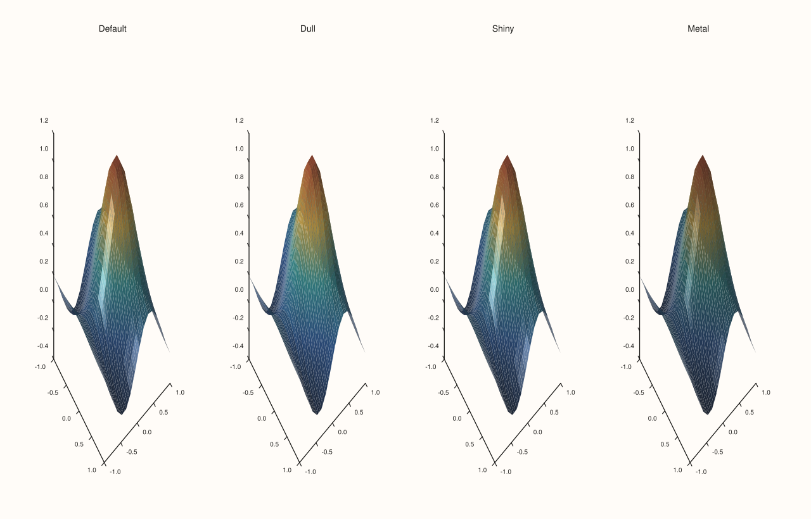
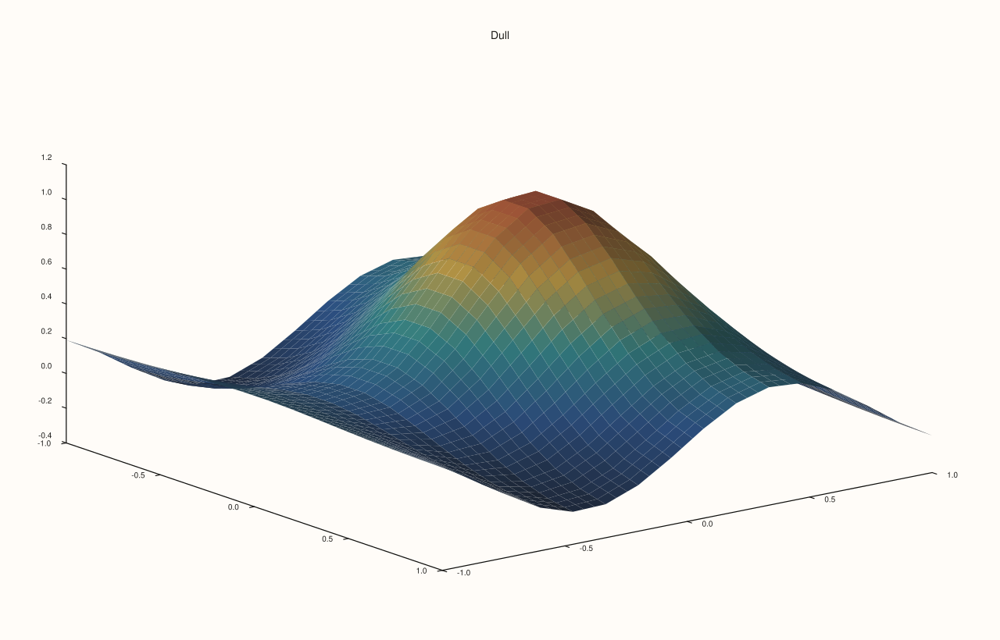
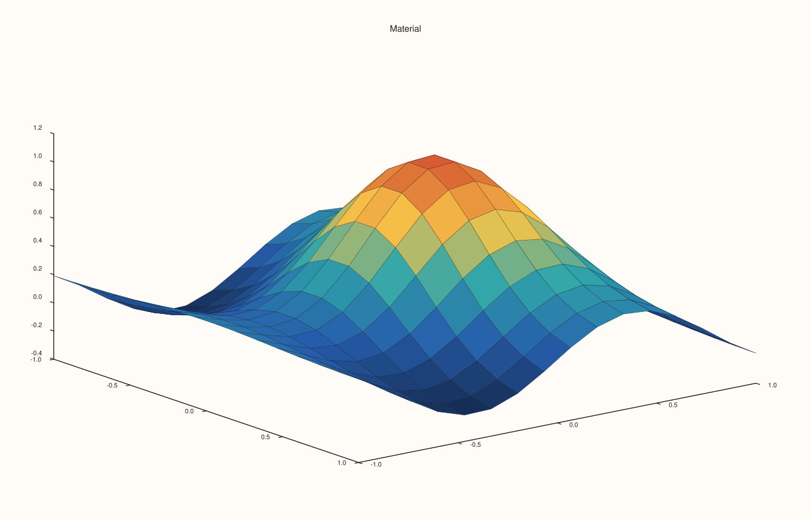
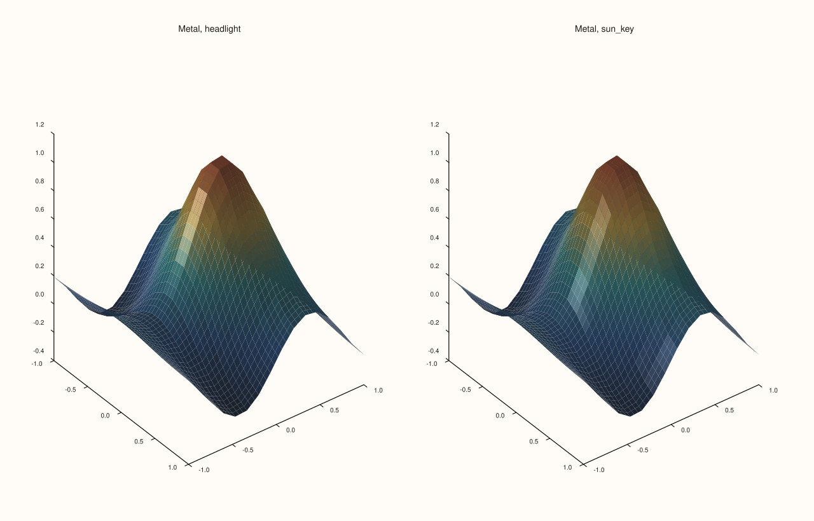

<!-- pluss-hand-authored -->

# Trace::material

[Back to Trace API Reference](../../trace_api_reference)

## Signature

```cpp
MaterialProfile Trace::material_profile() const noexcept

Trace& Trace::material(MaterialProfile profile) noexcept
```

## What It Does

Chooses how a lit 3D surface responds to light, and `material_profile()` reads the choice back. The four profiles, `Default`, `Dull`, `Shiny` and `Metal`, are described and compared on the [`MaterialProfile`](../types/MaterialProfile.md) page; the point to know here is that `Default` is exactly `Shiny`, so a surface that never calls `material` already has a glossy highlight, and `Dull` is how to remove it.

A material only shows on a lit surface: the trace needs a [lighting mode](lighting.md) other than `None` and the pane needs lights. Without them every profile draws the same figure. It applies to the surface kinds `sheet`, `spire3` and `isoshell`.

## Parameters

**profile** (`MaterialProfile`)
    `Default`, `Dull`, `Shiny` or `Metal`.

## Returns

`MaterialProfile` (getter)
    The current profile, `Default` by default.

`Trace&` (setter)
    The same trace, for chaining.

## Examples

Example 1. The four profiles under one sun-like rig with Gouraud lighting. `Default` and `Shiny` are the same; `Dull` has no highlight and `Metal` a tight one on a darker surface.

```cpp
constexpr std::int64_t n = 16;
auto coord = pluss::series::linspace(-1.0, 1.0, n, pluss::ScalarType::Float64);
std::vector<double> peak(static_cast<std::size_t>(n * n));
for (std::int64_t i = 0; i < n; ++i)
  for (std::int64_t j = 0; j < n; ++j) {
    const double x = -1.0 + 2.0 * i / (n - 1), y = -1.0 + 2.0 * j / (n - 1);
    peak[static_cast<std::size_t>(i * n + j)] = std::exp(-3.0 * (x * x + y * y)) + 0.25 * std::sin(4.0 * x);
  }
auto z = pluss::make_series(peak, {n, n});

const MaterialProfile profiles[] = {MaterialProfile::Default, MaterialProfile::Dull, MaterialProfile::Shiny, MaterialProfile::Metal};
const char* names[] = {"Default", "Dull", "Shiny", "Metal"};
auto fig = studio("material_gallery");
fig.mosaic(1, 4);
for (int i = 0; i < 4; ++i) {
  auto& pane = fig.pane3(names[i]);
  pane.lights().sun_key();
  pane.sheet(coord, coord, z).shade(ShadeMode::Smooth).lighting(LightingMode::Gouraud).material(profiles[i]);
}
fig.save_svg("figure.svg");
```



Example 2. A material needs light. The four profiles on a surface with no lighting are the same figure: all three comparisons with the first are true.

```cpp
constexpr std::int64_t n = 16;
auto coord = pluss::series::linspace(-1.0, 1.0, n, pluss::ScalarType::Float64);
std::vector<double> peak(static_cast<std::size_t>(n * n));
for (std::int64_t i = 0; i < n; ++i)
  for (std::int64_t j = 0; j < n; ++j) {
    const double x = -1.0 + 2.0 * i / (n - 1), y = -1.0 + 2.0 * j / (n - 1);
    peak[static_cast<std::size_t>(i * n + j)] = std::exp(-3.0 * (x * x + y * y)) + 0.25 * std::sin(4.0 * x);
  }
auto z = pluss::make_series(peak, {n, n});

std::string svg[4];
const MaterialProfile profiles[] = {MaterialProfile::Default, MaterialProfile::Dull, MaterialProfile::Shiny, MaterialProfile::Metal};
for (int i = 0; i < 4; ++i) {
  auto fig = studio("material_unlit");
  fig.pane3("Unlit").sheet(coord, coord, z).material(profiles[i]);
  svg[i] = fig.to_svg();
}
std::cout << "Default == Dull:  " << (svg[0] == svg[1]) << "\n";
std::cout << "Default == Shiny: " << (svg[0] == svg[2]) << "\n";
std::cout << "Default == Metal: " << (svg[0] == svg[3]) << "\n";
auto fig = studio("material_unlit_out");
fig.pane3("Unlit, Metal").sheet(coord, coord, z).material(MaterialProfile::Metal);
fig.save_svg("figure.svg");
```

### Output

```text
Default == Dull:  1
Default == Shiny: 1
Default == Metal: 1
```


Example 3. `Default` is `Shiny`. Under light the two give the same figure (the first comparison is true), while `Dull` and `Metal` differ from `Default` (false). To make a surface matt, ask for `Dull`.

```cpp
constexpr std::int64_t n = 16;
auto coord = pluss::series::linspace(-1.0, 1.0, n, pluss::ScalarType::Float64);
std::vector<double> peak(static_cast<std::size_t>(n * n));
for (std::int64_t i = 0; i < n; ++i)
  for (std::int64_t j = 0; j < n; ++j) {
    const double x = -1.0 + 2.0 * i / (n - 1), y = -1.0 + 2.0 * j / (n - 1);
    peak[static_cast<std::size_t>(i * n + j)] = std::exp(-3.0 * (x * x + y * y)) + 0.25 * std::sin(4.0 * x);
  }
auto z = pluss::make_series(peak, {n, n});

std::string svg[4];
const MaterialProfile profiles[] = {MaterialProfile::Default, MaterialProfile::Shiny, MaterialProfile::Dull, MaterialProfile::Metal};
for (int i = 0; i < 4; ++i) {
  auto fig = studio("material_default");
  auto& pane = fig.pane3("p");
  pane.lights().sun_key();
  pane.sheet(coord, coord, z).shade(ShadeMode::Smooth).lighting(LightingMode::Gouraud).material(profiles[i]);
  svg[i] = fig.to_svg();
}
std::cout << "Default == Shiny: " << (svg[0] == svg[1]) << "\n";
std::cout << "Default == Dull:  " << (svg[0] == svg[2]) << "\n";
std::cout << "Default == Metal: " << (svg[0] == svg[3]) << "\n";
auto fig = studio("material_default_out");
auto& pane = fig.pane3("Dull");
pane.lights().sun_key();
pane.sheet(coord, coord, z).shade(ShadeMode::Smooth).lighting(LightingMode::Gouraud).material(MaterialProfile::Dull);
fig.save_svg("figure.svg");
```

### Output

```text
Default == Shiny: 1
Default == Dull:  0
Default == Metal: 0
```



Example 4. Reading the profile back. The default reads `Default`; each call stores its profile and returns the trace.

```cpp
constexpr std::int64_t n = 16;
auto coord = pluss::series::linspace(-1.0, 1.0, n, pluss::ScalarType::Float64);
std::vector<double> peak(static_cast<std::size_t>(n * n));
for (std::int64_t i = 0; i < n; ++i)
  for (std::int64_t j = 0; j < n; ++j) {
    const double x = -1.0 + 2.0 * i / (n - 1), y = -1.0 + 2.0 * j / (n - 1);
    peak[static_cast<std::size_t>(i * n + j)] = std::exp(-3.0 * (x * x + y * y)) + 0.25 * std::sin(4.0 * x);
  }
auto z = pluss::make_series(peak, {n, n});

auto fig = studio("material_readback");
auto& pane = fig.pane3("Material");
Trace& t = pane.sheet(coord, coord, z);
std::cout << "default: " << static_cast<int>(t.material_profile()) << "  (Default = 0, Dull = 1, Shiny = 2, Metal = 3)\n";
for (MaterialProfile m : {MaterialProfile::Dull, MaterialProfile::Shiny, MaterialProfile::Metal}) {
  t.material(m);
  std::cout << static_cast<int>(m) << " -> " << static_cast<int>(t.material_profile()) << "\n";
}
fig.save_svg("figure.svg");
```

### Output

```text
default: 0  (Default = 0, Dull = 1, Shiny = 2, Metal = 3)
1 -> 1
2 -> 2
3 -> 3
```



Example 5. The same material under two rigs. A `Metal` surface lit by a headlight (a light at the viewer) shows little of its character, and the same surface under the angled `sun_key` shows the highlight: the choice of material and the choice of lights are made together.

```cpp
constexpr std::int64_t n = 16;
auto coord = pluss::series::linspace(-1.0, 1.0, n, pluss::ScalarType::Float64);
std::vector<double> peak(static_cast<std::size_t>(n * n));
for (std::int64_t i = 0; i < n; ++i)
  for (std::int64_t j = 0; j < n; ++j) {
    const double x = -1.0 + 2.0 * i / (n - 1), y = -1.0 + 2.0 * j / (n - 1);
    peak[static_cast<std::size_t>(i * n + j)] = std::exp(-3.0 * (x * x + y * y)) + 0.25 * std::sin(4.0 * x);
  }
auto z = pluss::make_series(peak, {n, n});

auto fig = studio("material_rigs");
fig.mosaic(1, 2);
auto& head = fig.pane3("Metal, headlight");
head.lights().headlight();
head.sheet(coord, coord, z).shade(ShadeMode::Smooth).lighting(LightingMode::Gouraud).material(MaterialProfile::Metal);
auto& sun = fig.pane3("Metal, sun_key");
sun.lights().sun_key();
sun.sheet(coord, coord, z).shade(ShadeMode::Smooth).lighting(LightingMode::Gouraud).material(MaterialProfile::Metal);
fig.save_svg("figure.svg");
```



## Notes

- `material` is `noexcept` and accepts every value.
- Material and lighting are per trace; the lights are per pane ([`LightRig`](../types/LightRig.md)).

## See Also

- [`MaterialProfile`](../types/MaterialProfile.md): the four profiles, compared.
- [`Trace::lighting`](lighting.md), [`Trace::shade`](shade.md): the other appearance options.
- [`LightRig`](../types/LightRig.md): the lights a material responds to.

<div class="pluss-inline-prev-next">
  <a class="prev-link" href="lighting.html">
    <span class="label">Previous</span>
    <span class="title">lighting</span>
  </a>
  <a class="next-link" href="palette.html">
    <span class="label">Next</span>
    <span class="title">palette</span>
  </a>
</div>
