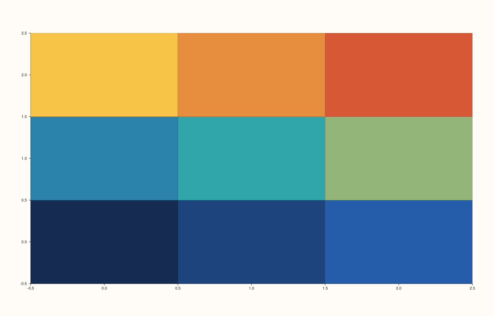
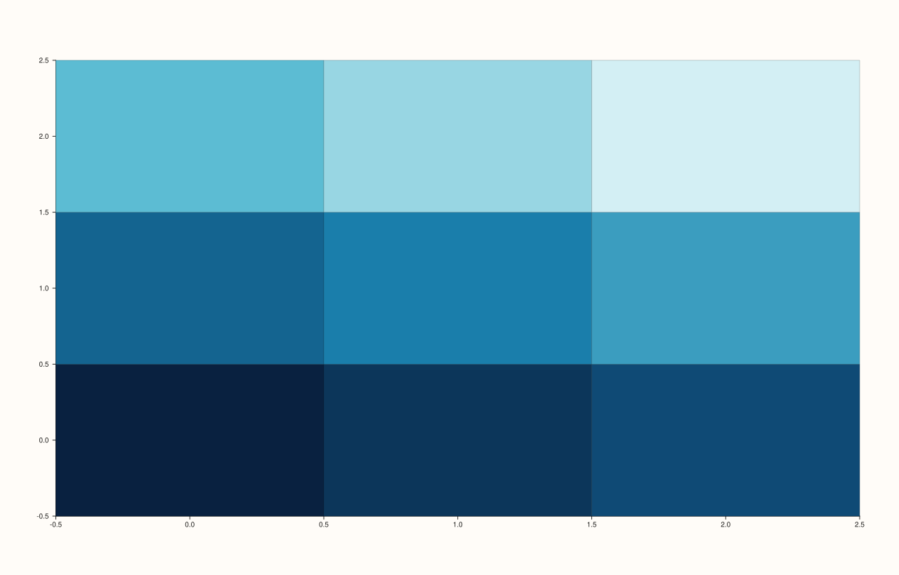

<!-- pluss-hand-authored -->

# Trace::palette / Trace::palette_ramp

[Back to Trace API Reference](../../trace_api_reference)

## Signatures

```cpp
const PaletteRamp& Trace::palette_ramp() const noexcept

Trace& Trace::palette(PaletteRamp palette)
```

## What It Does

Gets/sets the color gradient used by scalar-field-colored trace kinds — most visibly
[`fieldmap`](../pane/fieldmap.md), [`sheet`](../pane/sheet.md),
[`lattice`](../pane/lattice.md), and [`contour`](../pane/contour.md). Default
`PaletteRamp::thermal()`. `PaletteRamp` provides five built-in presets as static
factories: `neutral()`, `thermal()`, `lagoon()`, `ocean()`, `meadow()`.

## Parameters

**palette** (`PaletteRamp`, setter only)
    The new color ramp. Construct one of the five presets, or build a custom
    `PaletteRamp(std::string name, std::vector<Rgba> stops)` directly.

## Returns

`const PaletteRamp&` (getter)
    The current palette ramp. Query its `.name()`, `.stops()`, `.empty()`, or sample a
    position along it with `.sample(double position)`.

`Trace&` (setter)
    A reference to `*this`, for chaining.

## Examples

Example 1. The default `thermal()` palette on a `fieldmap()` trace.

```cpp
using namespace pluss::pl;

// `grid_n` is the single source of truth for the grid's row/col count -- the axis length,
// z's element count, and z's reshape dimensions all derive from it, so they can never
// drift out of sync with each other.
constexpr std::int64_t grid_n = 3;
auto coord = pluss::series::linspace(0.0, grid_n - 1.0, grid_n, pluss::ScalarType::Float64);
auto z = pluss::series::linspace(0.0, 1.0, grid_n * grid_n, pluss::ScalarType::Float64).reshape({grid_n, grid_n});

auto fig = studio("trace_palette_default");
auto& pane = fig.pane2();
pane.fieldmap(coord, coord, z);
std::cout << "default palette name: '" << fig.panes()[0].traces()[0].palette_ramp().name() << "'\n";
fig.show();
```

Output:

```text
default palette name: 'thermal'
```



Example 2. Switching to `PaletteRamp::ocean()`. Verified via direct SVG diff to render
genuinely different fill colors from Example 1.

```cpp
using namespace pluss::pl;

constexpr std::int64_t grid_n = 3;
auto coord = pluss::series::linspace(0.0, grid_n - 1.0, grid_n, pluss::ScalarType::Float64);
auto z = pluss::series::linspace(0.0, 1.0, grid_n * grid_n, pluss::ScalarType::Float64).reshape({grid_n, grid_n});

auto fig = studio("trace_palette_ocean");
auto& pane = fig.pane2();
pane.fieldmap(coord, coord, z).palette(PaletteRamp::ocean());
std::cout << "after palette(ocean()) name: '" << fig.panes()[0].traces()[0].palette_ramp().name() << "'\n";
fig.show();
```

Output:

```text
after palette(ocean()) name: 'ocean'
```



## Notes

- The getter is `noexcept`; the setter is **not** (it takes `palette` by value and moves
  it in — constructing or copying a `PaletteRamp`, which owns a `std::vector<Rgba>`, can
  throw `std::bad_alloc`), unlike [`width()`](width.md) and [`stroke()`](stroke.md),
  which are both `noexcept` setters.
- Only meaningfully affects scalar-field-colored trace kinds; setting a palette on, say, a
  [`trend()`](../pane/trend.md) trace has no expected visual effect since that kind is
  colored by [`stroke()`](stroke.md) alone — not separately verified for every trace kind
  in this documentation pass.
- The five presets (`neutral`, `thermal`, `lagoon`, `ocean`, `meadow`) are the same
  palette family used elsewhere in PlussPl wherever a gradient is needed (e.g.
  [`Studio::theme`](../studio/theme.md)'s `surface_palette()`).

## See Also

- [`Trace::color_limits`](color_limits.md): controls which data range the palette's `0.0`–`1.0`
  span is mapped across.
- [`Trace::stroke`](stroke.md): a single flat color, as opposed to this multi-stop
  gradient.

<div class="pluss-inline-prev-next">
  <a class="prev-link" href="stroke.html">
    <span class="label">Previous</span>
    <span class="title">stroke</span>
  </a>
  <a class="next-link" href="color_limits.html">
    <span class="label">Next</span>
    <span class="title">color_limits</span>
  </a>
</div>
