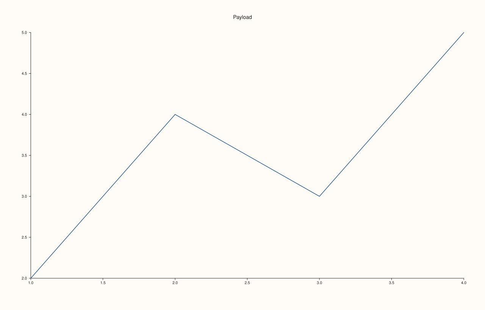
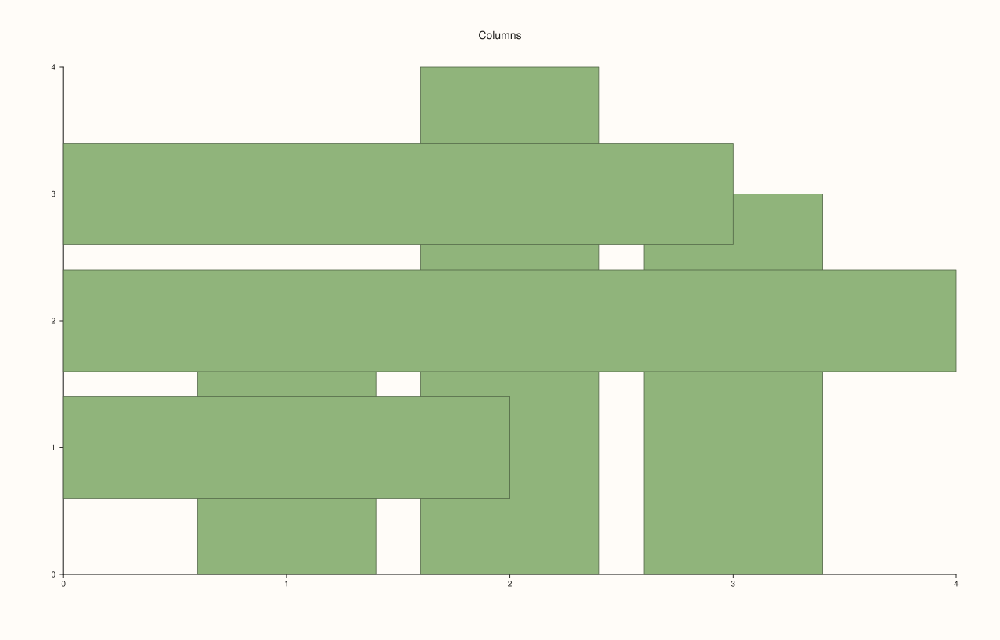
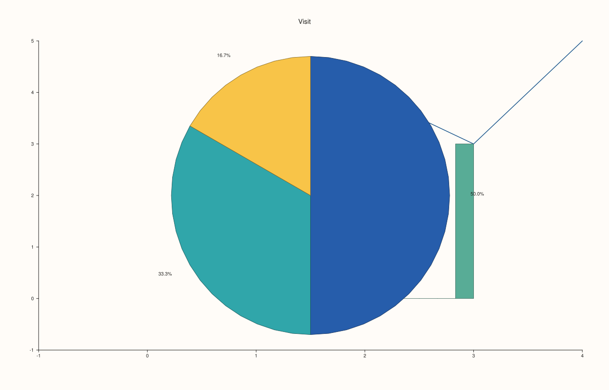
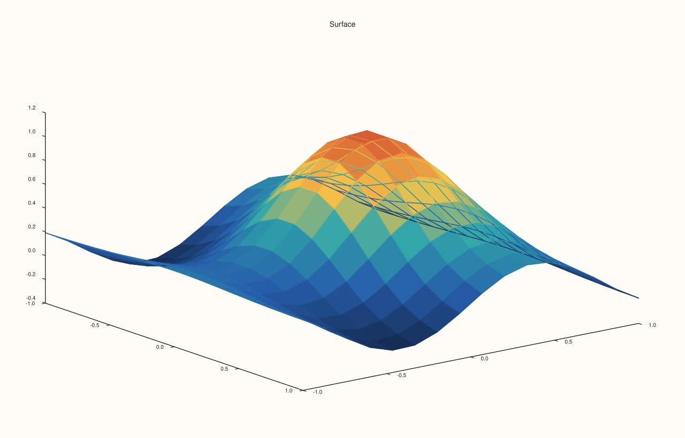
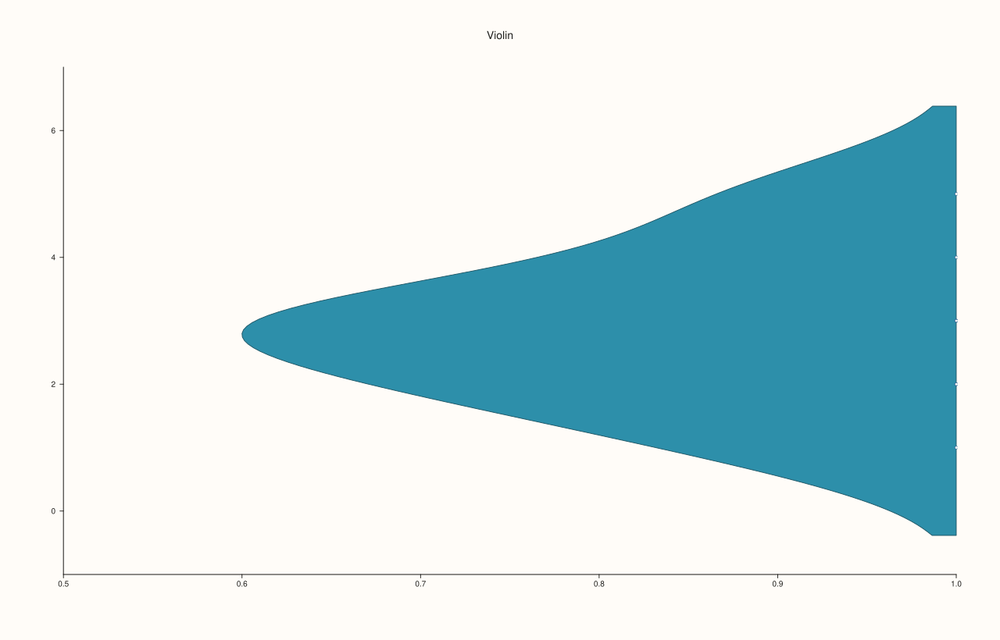
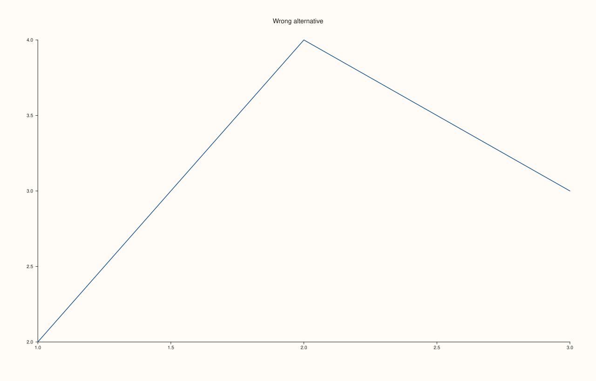

<!-- pluss-hand-authored -->

# Trace::payload

[Back to Trace API Reference](../../trace_api_reference)

## Signature

```cpp
const TracePayload& Trace::payload() const noexcept
```

## What It Does

Returns the data a trace holds, as a `std::variant` (`TracePayload`) with one alternative per data shape: `TrendData`, `CloudData`, `Cloud3Data`, `FieldmapData`, `RibbonData`, `SpikeData`, `WedgeData`, `WhiskData`, `ColumnsData`, `BucketData`, `QuartetData`, `ViolinData`, `RadialData`, `ContourData`, `IsoShellData`, `Path3Data`, `Spire3Data` and `SurfaceData`. Which alternative is active follows from [`kind()`](kind.md), and the payload is fixed when the trace is made; there is no setter.

Eighteen alternatives serve twenty-two kinds, because some kinds share a shape: `Contour` and `Isoband` and `Ridge3` hold `ContourData` or `SurfaceData` depending on how they were made, `Sheet` and `Lattice` both hold `SurfaceData`, and `Columns` for vertical and horizontal bars holds `ColumnsData`, told apart by its `horizontal` flag. Read the payload with `std::get<T>` when you know the kind, with `std::holds_alternative<T>` to test, and with `std::visit` to handle every case.

The series in a payload are the data as the trace converted them: a `std::vector<double>` handed to `trend` is held as a `Series`, so `numel()`, `sizes()` and the element access of a `Series` apply.

## Parameters

*(none)*

## Returns

`const TracePayload&`
    A reference to the variant. It stays valid until the trace is destroyed or moved (see the note on references).

## Examples

Example 1. Reading the data of a line. `std::get<TrendData>` gives the two series, and `numel()` counts the points.

```cpp
auto fig = studio("payload_trend");
auto& pane = fig.pane2("Payload");
Trace& t = pane.trend(std::vector<double>{1, 2, 3, 4}, std::vector<double>{2, 4, 3, 5});
const TrendData& data = std::get<TrendData>(t.payload());
std::cout << "points: " << data.x.numel() << " and " << data.y.numel() << "\n";
const auto ys = data.y.items<double>();
std::cout << "y values: " << ys[0] << " " << ys[1] << " " << ys[2] << " " << ys[3] << "\n";
fig.save_svg("figure.svg");
```

### Output

```text
points: 4 and 4
y values: 2 4 3 5
```



Example 2. One payload, two kinds. Vertical and horizontal bars both hold `ColumnsData`; its `horizontal` flag says which, and `base` and `width` are the values the trace was made with.

```cpp
auto fig = studio("payload_columns");
auto& pane = fig.pane2("Columns");
{
  Trace& v = pane.columns(std::vector<double>{1, 2, 3}, std::vector<double>{2, 4, 3});
  const ColumnsData& d = std::get<ColumnsData>(v.payload());
  std::cout << "columns:   horizontal " << d.horizontal << ", base " << d.base << ", width " << d.width << "\n";
}
{
  Trace& h = pane.columns_h(std::vector<double>{2, 4, 3}, std::vector<double>{1, 2, 3});
  const ColumnsData& d = std::get<ColumnsData>(h.payload());
  std::cout << "columns_h: horizontal " << d.horizontal << ", base " << d.base << ", width " << d.width << "\n";
}
fig.save_svg("figure.svg");
```

### Output

```text
columns:   horizontal 0, base 0, width 0.8
columns_h: horizontal 1, base 0, width 0.8
```



Example 3. Handling every case with `std::visit`. A helper reports the size of whatever a trace holds: it visits the variant and, for the alternatives it knows, counts the points. The three traces hold three different alternatives.

```cpp
auto count = [](const Trace& t) -> std::int64_t {
  return std::visit([](const auto& data) -> std::int64_t {
    using T = std::decay_t<decltype(data)>;
    if constexpr (std::is_same_v<T, TrendData> || std::is_same_v<T, CloudData> || std::is_same_v<T, SpikeData>) return data.x.numel();
    else if constexpr (std::is_same_v<T, BucketData>) return data.values.numel();
    else if constexpr (std::is_same_v<T, WedgeData>) return data.values.numel();
    else return -1;
  }, t.payload());
};
auto fig = studio("payload_visit");
auto& pane = fig.pane2("Visit");
std::cout << "trend:  " << count(pane.trend(std::vector<double>{1, 2, 3, 4}, std::vector<double>{2, 4, 3, 5})) << "\n";
std::cout << "bucket: " << count(pane.bucket(std::vector<double>{1, 2, 2, 3, 3, 3})) << "\n";
std::cout << "wedge:  " << count(pane.wedge(std::vector<double>{3, 2, 1})) << "\n";
fig.save_svg("figure.svg");
```

### Output

```text
trend:  4
bucket: 6
wedge:  3
```



Example 4. Surfaces hold `SurfaceData`, whether drawn as a solid or a wireframe: `Sheet` and `Lattice` have the same payload type and differ only in their kind. The grid is held as three series.

```cpp
constexpr std::int64_t n = 16;
auto coord = pluss::series::linspace(-1.0, 1.0, n, pluss::ScalarType::Float64);
std::vector<double> peak(static_cast<std::size_t>(n * n));
for (std::int64_t i = 0; i < n; ++i)
  for (std::int64_t j = 0; j < n; ++j) {
    const double x = -1.0 + 2.0 * i / (n - 1), y = -1.0 + 2.0 * j / (n - 1);
    peak[static_cast<std::size_t>(i * n + j)] = std::exp(-3.0 * (x * x + y * y)) + 0.25 * std::sin(4.0 * x);
  }
auto z = pluss::make_series(peak, {n, n});

auto fig = studio("payload_surface");
auto& pane = fig.pane3("Surface");
{
  Trace& s = pane.sheet(coord, coord, z);
  std::cout << "sheet:   SurfaceData " << std::holds_alternative<SurfaceData>(s.payload()) << ", kind " << static_cast<int>(s.kind()) << "\n";
}
{
  Trace& l = pane.lattice(coord, coord, z);
  const SurfaceData& d = std::get<SurfaceData>(l.payload());
  std::cout << "lattice: SurfaceData " << std::holds_alternative<SurfaceData>(l.payload()) << ", kind " << static_cast<int>(l.kind()) << ", z elements " << d.z.numel() << "\n";
}
fig.save_svg("figure.svg");
```

### Output

```text
sheet:   SurfaceData 1, kind 20
lattice: SurfaceData 1, kind 21, z elements 256
```



Example 5. Options travel in the payload. A violin holds its [`ViolinOptions`](../types/ViolinOptions.md): the options passed when it was made are read back from the payload, here the half-violin and the point marks asked for.

```cpp
auto fig = studio("payload_options");
auto& pane = fig.pane2("Violin");
ViolinOptions options;
options.side = ViolinSide::Left;
options.inner = ViolinInner::Point;
Trace& v = pane.violin(std::vector<double>{1, 2, 2, 3, 3, 3, 4, 5}, options);
const ViolinData& data = std::get<ViolinData>(v.payload());
std::cout << "side Left: " << (data.options.side == ViolinSide::Left) << ", inner Point: " << (data.options.inner == ViolinInner::Point) << ", has groups: " << data.group.has_value() << "\n";
fig.save_svg("figure.svg");
```

### Output

```text
side Left: 1, inner Point: 1, has groups: 0
```



Example 6. A wrong `std::get` throws. Asking a `Trend` for its `CloudData` fails with `std::bad_variant_access`; test with `holds_alternative`, or read `kind()` first, to avoid it.

```cpp
auto fig = studio("payload_wrong");
auto& pane = fig.pane2("Wrong alternative");
Trace& t = pane.trend(std::vector<double>{1, 2, 3}, std::vector<double>{2, 4, 3});
std::cout << "holds TrendData: " << std::holds_alternative<TrendData>(t.payload()) << ", holds CloudData: " << std::holds_alternative<CloudData>(t.payload()) << "\n";
try {
  (void)std::get<CloudData>(t.payload());
} catch (const std::bad_variant_access&) {
  std::cout << "std::get<CloudData> on a trend: std::bad_variant_access\n";
}
fig.save_svg("figure.svg");
```

### Output

```text
holds TrendData: 1, holds CloudData: 0
std::get<CloudData> on a trend: std::bad_variant_access
```



## Notes

- The payload is read-only through this accessor. To change the data, build a new trace.
- The reference a creation method returns stays valid for the life of the pane, and so does a reference taken from `payload()`, until that trace's kind or data is replaced.
- `payload()` is `noexcept`.

## See Also

- [`Trace::kind`](kind.md): which alternative is active.
- [`TraceKind`](../types/TraceKind.md): the kinds and the methods that make them.
- [`ViolinOptions`](../types/ViolinOptions.md): the options held by a violin payload.

<div class="pluss-inline-prev-next">
  <a class="prev-link" href="palette.html">
    <span class="label">Previous</span>
    <span class="title">palette</span>
  </a>
  <a class="next-link" href="shade.html">
    <span class="label">Next</span>
    <span class="title">shade</span>
  </a>
</div>
