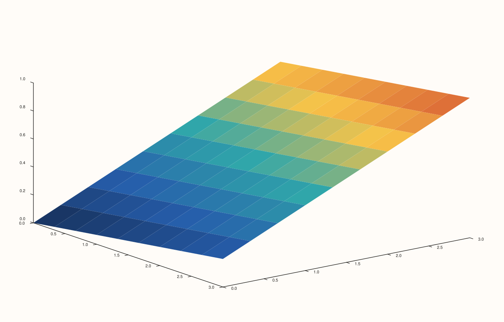

<!-- pluss-hand-authored -->

# Trace::shade / Trace::shade_mode

[Back to Trace API Reference](../../trace_api_reference)

## Signatures

```cpp
ShadeMode Trace::shade_mode() const noexcept

Trace& Trace::shade(ShadeMode mode) noexcept
```

## What It Does

Gets/sets how a 3D surface trace's facets are shaded. Default `ShadeMode::Faceted`. The
three values:

- **`ShadeMode::Faceted`** — the constructor default. Each facet is a single flat color;
  facet boundaries are visually distinct.
- **`ShadeMode::Flat`** — facets remain flat-shaded but boundary treatment differs from
  `Faceted` (see Notes for what was and wasn't independently verified here).
- **`ShadeMode::Smooth`** — colors are interpolated across facet boundaries for a
  continuous gradient appearance.

## Parameters

**mode** (`ShadeMode`)
    The shading mode.

## Returns

`ShadeMode` (getter)
    The current shade mode.

`Trace&` (setter)
    A reference to `*this`, for chaining.

## Examples

Example 1. The default `Faceted` shading on a `sheet()` surface.

```cpp
using namespace pluss::pl;

// `grid_n` is the single source of truth for the grid's row/col count -- the axis
// length, z's element count, and z's reshape dimensions all derive from it.
constexpr std::int64_t grid_n = 4;
auto coord = pluss::series::linspace(0.0, grid_n - 1.0, grid_n, pluss::ScalarType::Float64);
auto z = pluss::series::linspace(0.0, 1.0, grid_n * grid_n, pluss::ScalarType::Float64).reshape({grid_n, grid_n});

auto fig = studio("trace_shade_faceted");
auto& pane = fig.pane3();
pane.sheet(coord, coord, z);
fig.show();
```


Example 2. `ShadeMode::Smooth`. Verified via direct SVG diff to render genuinely
different from Example 1.

```cpp
using namespace pluss::pl;

// `grid_n` is the single source of truth for the grid's row/col count -- the axis
// length, z's element count, and z's reshape dimensions all derive from it.
constexpr std::int64_t grid_n = 4;
auto coord = pluss::series::linspace(0.0, grid_n - 1.0, grid_n, pluss::ScalarType::Float64);
auto z = pluss::series::linspace(0.0, 1.0, grid_n * grid_n, pluss::ScalarType::Float64).reshape({grid_n, grid_n});

auto fig = studio("trace_shade_smooth");
auto& pane = fig.pane3();
pane.sheet(coord, coord, z).shade(ShadeMode::Smooth);
fig.show();
```



## Notes

- Both getter and setter are `noexcept`.
- Only `Faceted` vs. `Smooth` was directly exercised as a genuinely-different-output pair
  in this documentation pass; `ShadeMode::Flat`'s distinction from `Faceted` was not
  independently isolated — treat it as a real, declared third option rather than assuming
  its specific visual difference from `Faceted` without checking further.
- Meaningfully affects only 3D surface-family trace kinds
  ([`sheet`](../pane/sheet.md), [`lattice`](../pane/lattice.md), and other
  `Volumetric`-only kinds built from `SurfaceData`/`Spire3Data`); expected to have no
  visible effect on 2D or non-surface trace kinds, though this wasn't exhaustively
  checked across every kind.

## See Also

- [`Trace::lighting`](lighting.md) / [`Trace::material`](material.md): the other two
  3D-surface-appearance controls on `Trace`.

<div class="pluss-inline-prev-next">
  <a class="prev-link" href="color_limits.html">
    <span class="label">Previous</span>
    <span class="title">color_limits</span>
  </a>
  <a class="next-link" href="lighting.html">
    <span class="label">Next</span>
    <span class="title">lighting</span>
  </a>
</div>
