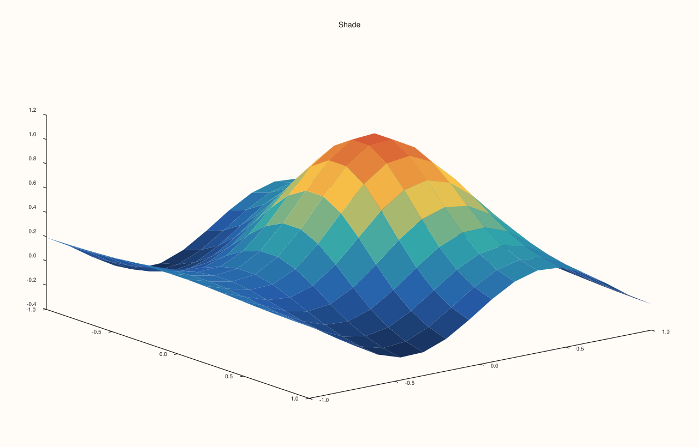
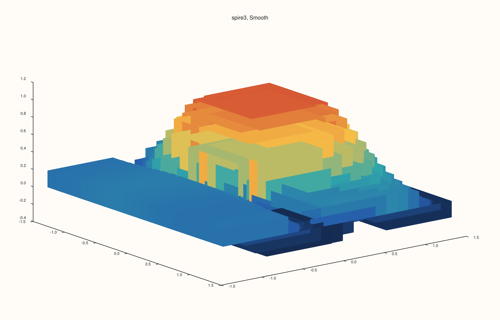
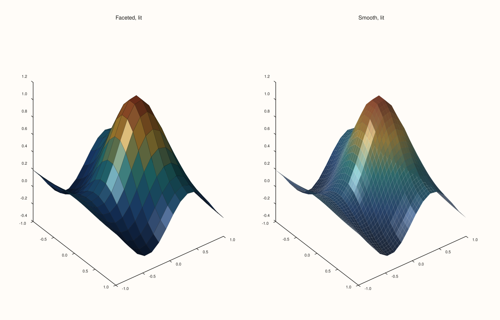

<!-- pluss-hand-authored -->

# Trace::shade

[Back to Trace API Reference](../../trace_api_reference)

## Signature

```cpp
ShadeMode Trace::shade_mode() const noexcept

Trace& Trace::shade(ShadeMode mode) noexcept
```

## What It Does

Chooses how a 3D surface is coloured across its cells, and `shade_mode()` reads the choice back. The three values, `Faceted`, `Flat` and `Smooth`, and what each looks like are described and compared on the [`ShadeMode`](../types/ShadeMode.md) page; this page covers the call. The default is `Faceted`.

Shading applies to the surface kinds: `sheet`, `spire3` and `isoshell`. On every other kind, including the wireframe `lattice`, the call is stored and read back but the figure does not change. It is about colour only: lighting is [`Trace::lighting`](lighting.md) and the material [`Trace::material`](material.md), and the three combine.

## Parameters

**mode** (`ShadeMode`)
    `Faceted`, `Flat` or `Smooth`.

## Returns

`ShadeMode` (getter)
    The current mode, `Faceted` by default.

`Trace&` (setter)
    The same trace, for chaining.

## Examples

Example 1. The three modes on one surface, coloured by height: `Faceted` shows the outlines of the cells, `Flat` softens them to faint seams, `Smooth` blends the colours across each cell.

```cpp
constexpr std::int64_t n = 16;
auto coord = pluss::series::linspace(-1.0, 1.0, n, pluss::ScalarType::Float64);
std::vector<double> peak(static_cast<std::size_t>(n * n));
for (std::int64_t i = 0; i < n; ++i)
  for (std::int64_t j = 0; j < n; ++j) {
    const double x = -1.0 + 2.0 * i / (n - 1), y = -1.0 + 2.0 * j / (n - 1);
    peak[static_cast<std::size_t>(i * n + j)] = std::exp(-3.0 * (x * x + y * y)) + 0.25 * std::sin(4.0 * x);
  }
auto z = pluss::make_series(peak, {n, n});

const ShadeMode modes[] = {ShadeMode::Faceted, ShadeMode::Flat, ShadeMode::Smooth};
const char* names[] = {"Faceted", "Flat", "Smooth"};
auto fig = studio("shade_gallery");
fig.mosaic(1, 3);
for (int i = 0; i < 3; ++i) fig.pane3(names[i]).sheet(coord, coord, z).shade(modes[i]);
fig.save_svg("figure.svg");
```


Example 2. Reading the mode back. The default is `Faceted`; each call stores its mode and returns the trace, so it chains with the other setters.

```cpp
constexpr std::int64_t n = 16;
auto coord = pluss::series::linspace(-1.0, 1.0, n, pluss::ScalarType::Float64);
std::vector<double> peak(static_cast<std::size_t>(n * n));
for (std::int64_t i = 0; i < n; ++i)
  for (std::int64_t j = 0; j < n; ++j) {
    const double x = -1.0 + 2.0 * i / (n - 1), y = -1.0 + 2.0 * j / (n - 1);
    peak[static_cast<std::size_t>(i * n + j)] = std::exp(-3.0 * (x * x + y * y)) + 0.25 * std::sin(4.0 * x);
  }
auto z = pluss::make_series(peak, {n, n});

auto fig = studio("shade_readback");
auto& pane = fig.pane3("Shade");
Trace& t = pane.sheet(coord, coord, z);
std::cout << "default: " << static_cast<int>(t.shade_mode()) << "  (Faceted = 0, Flat = 1, Smooth = 2)\n";
t.shade(ShadeMode::Smooth).label("surface");
std::cout << "after shade(Smooth): " << static_cast<int>(t.shade_mode()) << "\n";
t.shade(ShadeMode::Flat);
std::cout << "after shade(Flat):   " << static_cast<int>(t.shade_mode()) << "\n";
fig.save_svg("figure.svg");
```

### Output

```text
default: 0  (Faceted = 0, Flat = 1, Smooth = 2)
after shade(Smooth): 2
after shade(Flat):   1
```



Example 3. Which kinds answer to the mode. Each is drawn with `Faceted` and with `Smooth` and the SVG text compared: the surface, the pillars of `spire3` and the level surfaces of `isoshell` change; a line, a lattice and a field map do not.

```cpp
constexpr std::int64_t n = 16;
auto coord = pluss::series::linspace(-1.0, 1.0, n, pluss::ScalarType::Float64);
std::vector<double> peak(static_cast<std::size_t>(n * n));
for (std::int64_t i = 0; i < n; ++i)
  for (std::int64_t j = 0; j < n; ++j) {
    const double x = -1.0 + 2.0 * i / (n - 1), y = -1.0 + 2.0 * j / (n - 1);
    peak[static_cast<std::size_t>(i * n + j)] = std::exp(-3.0 * (x * x + y * y)) + 0.25 * std::sin(4.0 * x);
  }
auto z = pluss::make_series(peak, {n, n});

std::vector<double> volume(static_cast<std::size_t>(n * n * n));
for (std::size_t i = 0; i < volume.size(); ++i) volume[i] = std::sin(0.05 * static_cast<double>(i));
auto vol = pluss::make_series(volume, {n, n, n});
auto changes = [&](auto make, bool is3d) {
  std::string svg[2];
  for (int i = 0; i < 2; ++i) {
    auto fig = studio("shade_kinds");
    Pane& pane = is3d ? fig.pane3("p") : fig.pane2("p");
    Trace& t = make(pane);
    t.shade(i == 0 ? ShadeMode::Faceted : ShadeMode::Smooth);
    svg[i] = fig.to_svg();
  }
  return svg[0] != svg[1];
};
std::cout << "sheet:    " << changes([&](Pane& p) -> Trace& { return p.sheet(coord, coord, z); }, true) << "\n";
std::cout << "spire3:   " << changes([&](Pane& p) -> Trace& { return p.spire3(coord, coord, z); }, true) << "\n";
std::cout << "isoshell: " << changes([&](Pane& p) -> Trace& { return p.isoshell(coord, coord, coord, vol); }, true) << "\n";
std::cout << "lattice:  " << changes([&](Pane& p) -> Trace& { return p.lattice(coord, coord, z); }, true) << "\n";
std::cout << "fieldmap: " << changes([&](Pane& p) -> Trace& { return p.fieldmap(coord, coord, z); }, false) << "\n";
std::cout << "trend:    " << changes([&](Pane& p) -> Trace& { return p.trend(std::vector<double>{1, 2, 3}, std::vector<double>{2, 4, 3}); }, false) << "\n";
auto fig = studio("shade_kinds_out");
fig.pane3("spire3, Smooth").spire3(coord, coord, z).shade(ShadeMode::Smooth);
fig.save_svg("figure.svg");
```

### Output

```text
sheet:    1
spire3:   1
isoshell: 1
lattice:  0
fieldmap: 0
trend:    0
```



Example 4. Shading and lighting combine. With a sun-like light and Gouraud lighting, `Faceted` gives each cell its own tone and `Smooth` a continuous lit surface.

```cpp
constexpr std::int64_t n = 16;
auto coord = pluss::series::linspace(-1.0, 1.0, n, pluss::ScalarType::Float64);
std::vector<double> peak(static_cast<std::size_t>(n * n));
for (std::int64_t i = 0; i < n; ++i)
  for (std::int64_t j = 0; j < n; ++j) {
    const double x = -1.0 + 2.0 * i / (n - 1), y = -1.0 + 2.0 * j / (n - 1);
    peak[static_cast<std::size_t>(i * n + j)] = std::exp(-3.0 * (x * x + y * y)) + 0.25 * std::sin(4.0 * x);
  }
auto z = pluss::make_series(peak, {n, n});

const ShadeMode modes[] = {ShadeMode::Faceted, ShadeMode::Smooth};
const char* names[] = {"Faceted, lit", "Smooth, lit"};
auto fig = studio("shade_lit");
fig.mosaic(1, 2);
for (int i = 0; i < 2; ++i) {
  auto& pane = fig.pane3(names[i]);
  pane.lights().sun_key();
  pane.sheet(coord, coord, z).shade(modes[i]).lighting(LightingMode::Gouraud);
}
fig.save_svg("figure.svg");
```



## Notes

- `shade` is `noexcept` and accepts every value.
- On a very fine grid the cells are smaller than the eye can resolve and the three modes converge.

## See Also

- [`ShadeMode`](../types/ShadeMode.md): the three values, compared.
- [`Trace::lighting`](lighting.md), [`Trace::material`](material.md): light and surface response.
- [`Trace::palette`](palette.md): the colours being shaded.

<div class="pluss-inline-prev-next">
  <a class="prev-link" href="payload.html">
    <span class="label">Previous</span>
    <span class="title">payload</span>
  </a>
  <a class="next-link" href="stroke.html">
    <span class="label">Next</span>
    <span class="title">stroke</span>
  </a>
</div>
