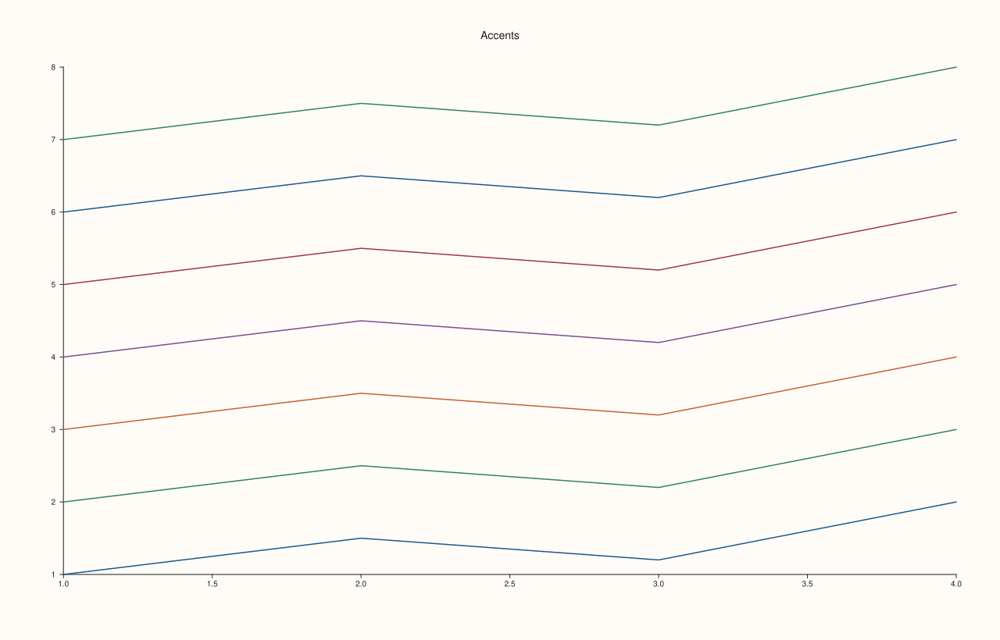
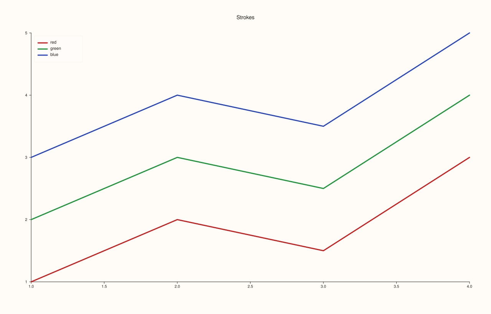
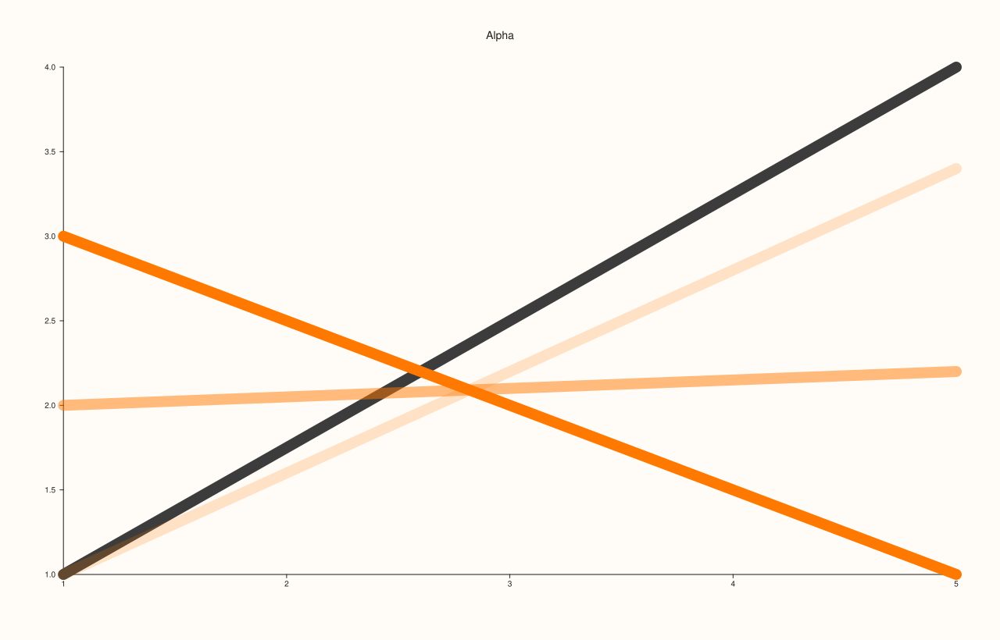
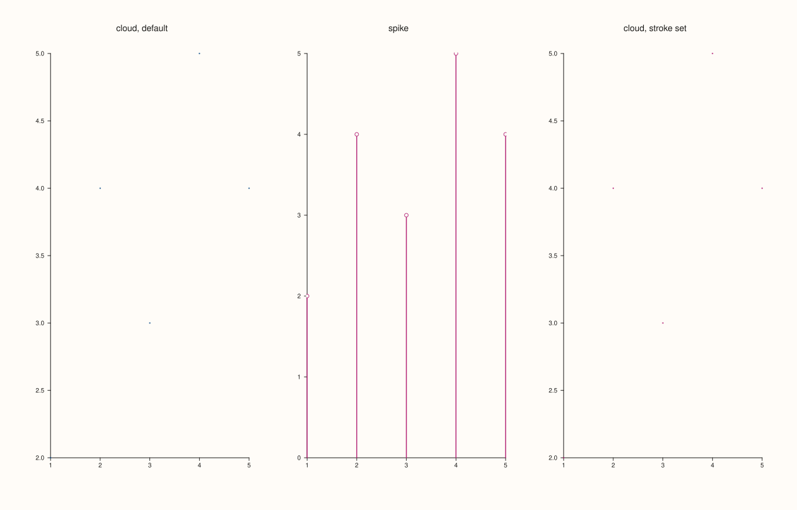
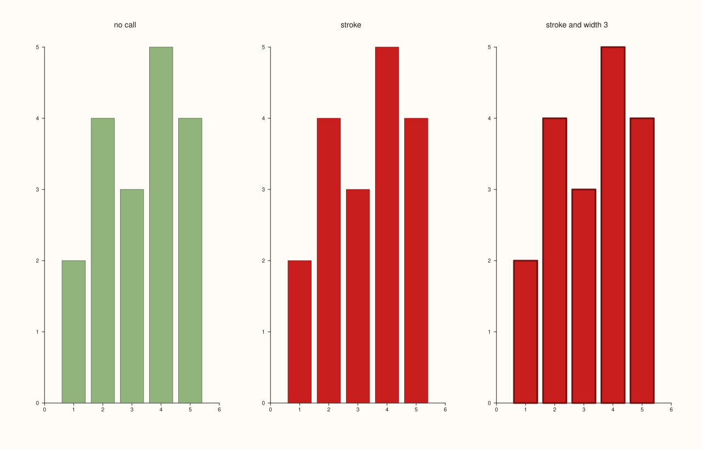
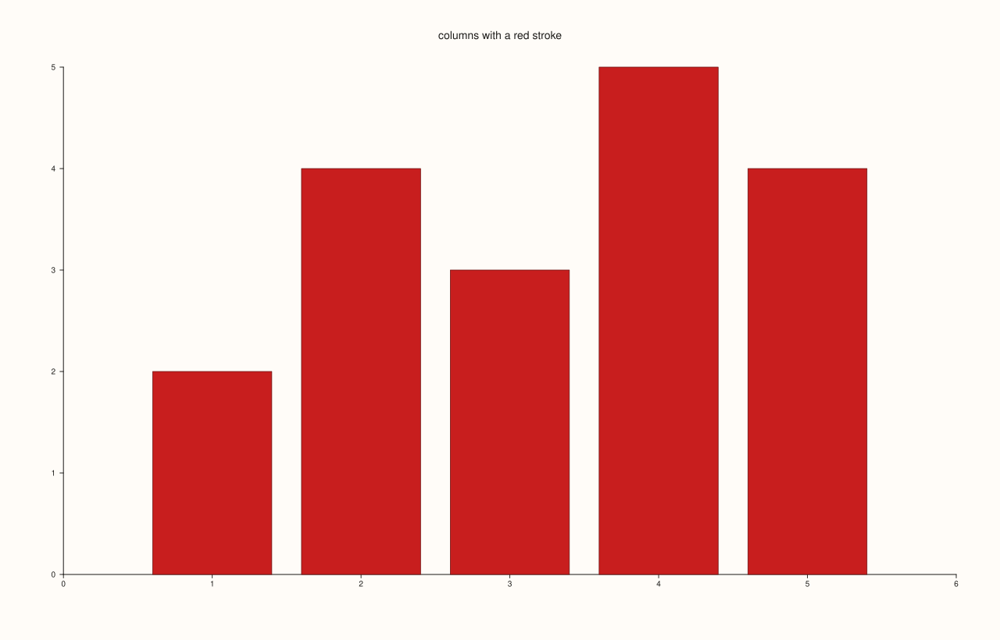

<!-- pluss-hand-authored -->

# Trace::stroke

[Back to Trace API Reference](../../trace_api_reference)

## Signature

```cpp
const Rgba& Trace::stroke_color() const noexcept

Trace& Trace::stroke(Rgba color) noexcept
```

## What It Does

Sets the colour of a trace's line or marker and `stroke_color()` reads it back. Every new trace starts with the next accent of the pane's [`Theme`](../types/Theme.md): the first trace gets the first accent, the second the second, and so on, wrapping after the last, so a pane with several traces is coloured distinctly without any call. `stroke` overrides that colour; the colour is an [`Rgba`](../types/Rgba.md), so it carries an opacity as well.

The stroke is the main colour of the trace. It colours the lines of a `trend`, `radial`, `whisk`, `quartet` and `violin` and the 3D `path3`, the stems and heads of a `spike` and the markers of a `cloud` and `cloud3`. It also fills the bars of `columns`, the bins of a `bucket` and a single-band `ribbon`, with a darker outline of the same colour, and it colours the outlines of a `wedge`'s slices (which keep their palette fills so that they stay distinct). For the filled kinds this holds only once the colour has been set: until `stroke` is called they are filled from the palette ([`Trace::palette`](palette.md)), as before.

Kinds that colour by value ignore the stroke: `fieldmap`, `contour`, `isoband`, `ridge3`, `lattice`, `sheet`, `spire3` and `isoshell` take their colours from the palette and the colour limits.

## Parameters

**color** (`Rgba`)
    The new colour. The channels are fractions between 0 and 1.

## Returns

`const Rgba&` (getter)
    The current colour, the next theme accent by default.

`Trace&` (setter)
    The same trace, for chaining.

## Examples

Example 1. The default colours. Seven traces in one pane take the five accents of the `paper` theme in turn and then start again: the sixth trace has the colour of the first, which the printed values show.

```cpp
auto fig = studio("stroke_cycle");
auto& pane = fig.pane2("Accents");
for (int i = 0; i < 7; ++i) {
  Trace& t = pane.trend(std::vector<double>{1, 2, 3, 4}, std::vector<double>{1.0 + i, 1.5 + i, 1.2 + i, 2.0 + i});
  const Rgba c = t.stroke_color();
  std::cout << "trace " << i << ": (" << static_cast<int>(c.red * 255 + 0.5) << ", " << static_cast<int>(c.green * 255 + 0.5) << ", " << static_cast<int>(c.blue * 255 + 0.5) << ")\n";
}
fig.save_svg("figure.svg");
```

### Output

```text
trace 0: (28, 87, 141)
trace 1: (49, 130, 92)
trace 2: (197, 97, 51)
trace 3: (125, 75, 140)
trace 4: (161, 52, 74)
trace 5: (28, 87, 141)
trace 6: (49, 130, 92)
```



Example 2. Explicit colours. Three lines coloured with `Rgba::from_u8`, the width raised so that the colour is clear, each named in the legend. The default accents are replaced.

```cpp
auto fig = studio("stroke_explicit");
auto& pane = fig.pane2("Strokes");
pane.trend(std::vector<double>{1, 2, 3, 4}, std::vector<double>{1, 2, 1.5, 3}).stroke(Rgba::from_u8(200, 30, 30)).width(3.0f).label("red");
pane.trend(std::vector<double>{1, 2, 3, 4}, std::vector<double>{2, 3, 2.5, 4}).stroke(Rgba::from_u8(30, 150, 60)).width(3.0f).label("green");
pane.trend(std::vector<double>{1, 2, 3, 4}, std::vector<double>{3, 4, 3.5, 5}).stroke(Rgba::from_u8(40, 70, 190)).width(3.0f).label("blue");
pane.legend(KeyPlace::NorthWest);
fig.save_svg("figure.svg");
```



Example 3. Opacity. The channel `alpha` makes a stroke translucent: the same thick line at alpha 1, 0.5 and 0.2 over a dark line, the lower the alpha the more of the dark line shows through.

```cpp
auto fig = studio("stroke_alpha");
auto& pane = fig.pane2("Alpha");
pane.trend(std::vector<double>{1, 5}, std::vector<double>{1.0, 4.0}).stroke(Rgba::from_u8(60, 60, 60)).width(14.0f);
const double alphas[] = {1.0, 0.5, 0.2};
for (int i = 0; i < 3; ++i) {
  Rgba colour = Rgba::from_u8(255, 120, 0);
  colour.alpha = alphas[i];
  pane.trend(std::vector<double>{1, 5}, std::vector<double>{3.0 - i, 1.0 + 1.2 * i}).stroke(colour).width(14.0f);
}
fig.save_svg("figure.svg");
```



Example 4. Markers and stems. The stroke colours the points of a `cloud` and the stems and heads of a `spike`; the three panes show a cloud, a spike and a cloud with its marker colour set.

```cpp
const std::vector<double> x{1, 2, 3, 4, 5}, y{2, 4, 3, 5, 4};
auto fig = studio("stroke_markers");
fig.mosaic(1, 3);
fig.pane2("cloud, default").cloud(x, y);
fig.pane2("spike").spike(x, y).stroke(Rgba::from_u8(180, 40, 120));
fig.pane2("cloud, stroke set").cloud(x, y).stroke(Rgba::from_u8(180, 40, 120));
fig.save_svg("figure.svg");
```



Example 5. Bars take their colour from the stroke once it is set. The first pane is a column trace with no call, filled from the palette as before; the second sets the stroke and the bars take that colour with a darker outline; the third also sets the width, which becomes the outline width.

```cpp
const std::vector<double> x{1, 2, 3, 4, 5}, y{2, 4, 3, 5, 4};
auto fig = studio("stroke_bars");
fig.mosaic(1, 3);
fig.pane2("no call").columns(x, y);
fig.pane2("stroke").columns(x, y).stroke(Rgba::from_u8(200, 30, 30));
fig.pane2("stroke and width 3").columns(x, y).stroke(Rgba::from_u8(200, 30, 30)).width(3.0f);
std::cout << "explicit before and after: " << fig.panes()[0].traces()[0].stroke_explicit() << " " << fig.panes()[1].traces()[0].stroke_explicit() << "\n";
fig.save_svg("figure.svg");
```

### Output

```text
explicit before and after: 0 1
```



Example 6. Which kinds answer to the stroke. Each is drawn with the default colour and with a red stroke and the SVG text compared: the lines, the markers, the bars, the bins and the pie's outlines change; a field map, which is coloured by value, does not.

```cpp
const std::vector<double> x{1, 2, 3, 4, 5}, y{2, 4, 3, 5, 4};
auto changes = [&](auto make) {
  std::string svg[2];
  for (int i = 0; i < 2; ++i) {
    auto fig = studio("stroke_applies");
    Trace& t = make(fig.pane2("p"));
    if (i == 1) t.stroke(Rgba::from_u8(200, 30, 30));
    svg[i] = fig.to_svg();
  }
  return svg[0] != svg[1];
};
std::cout << "trend:   " << changes([&](Pane& p) -> Trace& { return p.trend(x, y); }) << "\n";
std::cout << "cloud:   " << changes([&](Pane& p) -> Trace& { return p.cloud(x, y); }) << "\n";
std::cout << "spike:   " << changes([&](Pane& p) -> Trace& { return p.spike(x, y); }) << "\n";
std::cout << "columns: " << changes([&](Pane& p) -> Trace& { return p.columns(x, y); }) << "\n";
std::cout << "bucket:  " << changes([&](Pane& p) -> Trace& { return p.bucket(y); }) << "\n";
std::cout << "wedge:   " << changes([&](Pane& p) -> Trace& { return p.wedge(std::vector<double>{1, 2, 3}); }) << "\n";
constexpr std::int64_t n = 6;
auto coord = pluss::series::linspace(-1.0, 1.0, n, pluss::ScalarType::Float64);
std::vector<double> hills(static_cast<std::size_t>(n * n));
for (std::int64_t i = 0; i < n * n; ++i) hills[static_cast<std::size_t>(i)] = std::sin(0.4 * i);
auto z = pluss::make_series(hills, {n, n});
std::cout << "fieldmap: " << changes([&](Pane& p) -> Trace& { return p.fieldmap(coord, coord, z); }) << "\n";
auto fig = studio("stroke_applies_out");
fig.pane2("columns with a red stroke").columns(x, y).stroke(Rgba::from_u8(200, 30, 30));
fig.save_svg("figure.svg");
```

### Output

```text
trend:   1
cloud:   1
spike:   1
columns: 1
bucket:  1
wedge:   1
fieldmap: 0
```



## Notes

- A trace has both a stroke and a palette. The stroke is the single colour of the trace; the palette is how values are mapped to colours. A filled kind uses the palette until the stroke is set, a value-coloured kind always uses the palette.
- Reading `stroke_color()` straight after creating a trace is the way to see which accent it was given.
- A colour set once is kept; changing the pane's theme afterwards does not recolour traces that already exist.

## See Also

- [`Trace::width`](width.md): the thickness of the same lines.
- [`Trace::palette`](palette.md): the colouring of filled kinds and fields.
- [`Rgba`](../types/Rgba.md), [`Theme`](../types/Theme.md): the colour type and the accents a trace starts with.

<div class="pluss-inline-prev-next">
  <a class="prev-link" href="shade.html">
    <span class="label">Previous</span>
    <span class="title">shade</span>
  </a>
  <a class="next-link" href="transparent.html">
    <span class="label">Next</span>
    <span class="title">transparent</span>
  </a>
</div>
