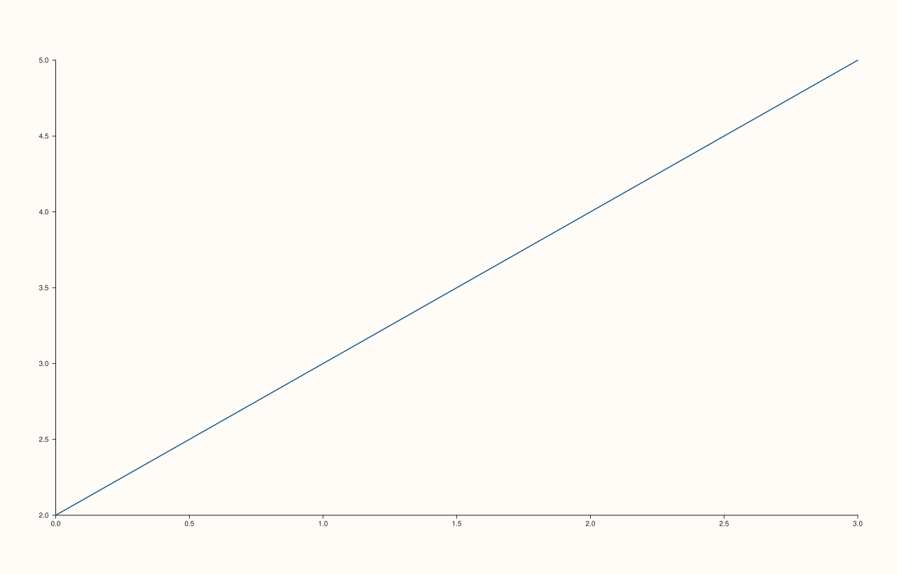
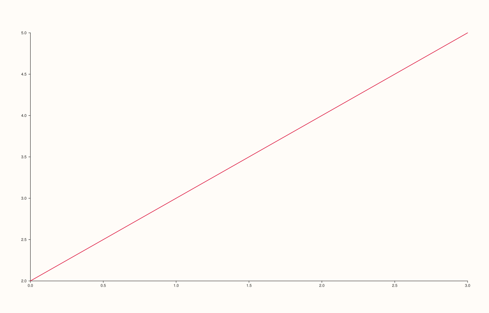

<!-- pluss-hand-authored -->

# Trace::stroke / Trace::stroke_color

[Back to Trace API Reference](../../trace_api_reference)

## Signatures

```cpp
const Rgba& Trace::stroke_color() const noexcept

Trace& Trace::stroke(Rgba color) noexcept
```

## What It Does

Gets/sets the trace's stroke/line color. Default `Rgba::from_u8(42, 95, 153)` (a mid blue).
Unlike [`width()`](width.md) and [`color_limits`](color_limits.md), `stroke()` performs no
validation at all — every `Rgba` value, including out-of-`[0,1]`-range or negative
components, is accepted and stored as-is.

## Parameters

**color** (`Rgba`, setter only)
    The new stroke color. `Rgba` has `red`, `green`, `blue`, `alpha` fields as `double` in
    (nominally) `[0.0, 1.0]`, plus the `Rgba::from_u8(r, g, b, a = 255)` convenience
    factory for 8-bit-per-channel values.

## Returns

`const Rgba&` (getter)
    The current stroke color.

`Trace&` (setter)
    A reference to `*this`, for chaining.

## Examples

Example 1. The default stroke color.

```cpp
using namespace pluss::pl;

// A formula-generated x/y pair -- `point_count` is the single source of truth for how
// many points the line has, rather than a hand-typed literal vector.
constexpr std::int64_t point_count = 4;
auto x = pluss::series::linspace(0.0, point_count - 1.0, point_count, pluss::ScalarType::Float64);
auto y = pluss::series::linspace(2.0, 5.0, point_count, pluss::ScalarType::Float64);

auto fig = studio("trace_stroke_default");
auto& pane = fig.pane2();
pane.trend(x, y);
fig.show();
```



Example 2. An explicit crimson stroke, built via `Rgba::from_u8`. Verified via direct SVG
diff to render genuinely different from Example 1.

```cpp
using namespace pluss::pl;

constexpr std::int64_t point_count = 4;
auto x = pluss::series::linspace(0.0, point_count - 1.0, point_count, pluss::ScalarType::Float64);
auto y = pluss::series::linspace(2.0, 5.0, point_count, pluss::ScalarType::Float64);

auto fig = studio("trace_stroke_red");
auto& pane = fig.pane2();
pane.trend(x, y).stroke(Rgba::from_u8(220, 20, 60));
fig.show();
```



## Notes

- Both getter and setter are `noexcept`.
- No validation of any kind — component values outside `[0.0, 1.0]` are stored and passed
  through to rendering unchanged, unlike [`width()`](width.md)'s silent-reject-on-invalid
  behavior.
- Applies uniformly to all 22 `TraceKind` values, though its visual prominence again
  depends on the trace kind — most visible on line/outline-drawing kinds, and on fill-color
  for kinds that don't separately use [`palette()`](palette.md) for a gradient.

## See Also

- [`Trace::width`](width.md): the paired thickness control for the same stroke.
- [`Trace::palette`](palette.md): a *gradient* of colors (for scalar-field-valued trace
  kinds), as opposed to this single flat stroke color.

<div class="pluss-inline-prev-next">
  <a class="prev-link" href="width.html">
    <span class="label">Previous</span>
    <span class="title">width</span>
  </a>
  <a class="next-link" href="palette.html">
    <span class="label">Next</span>
    <span class="title">palette</span>
  </a>
</div>
