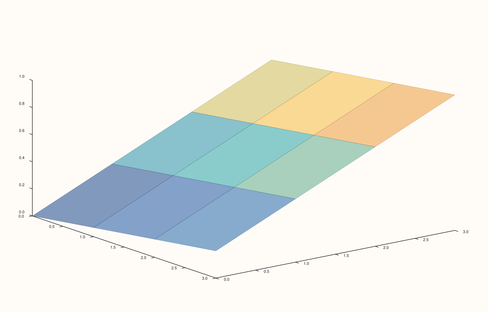

<!-- pluss-hand-authored -->

# Trace::transparent

[Back to Trace API Reference](../../trace_api_reference)

## Signatures

```cpp
bool Trace::transparent() const noexcept

Trace& Trace::transparent(bool enable) noexcept
```

## What It Does

Gets/sets whether this trace renders with a translucent fill (most relevant to
filled-area and surface trace kinds). Default `false`.

```{important} Fixed: enable is now required, not defaulted
Earlier revisions of this method declared the setter as transparent(bool enable =
true), sharing its name with the separate const getter overload. On a
non-const Trace&, that made the bare zero-argument call t.transparent()
silently resolve to the SETTER rather than the getter -- a real
overload-resolution hazard, directly confirmed by compiled reproduction during
this documentation effort. It has since been fixed at the source: enable no
longer has a default, so t.transparent() (zero arguments) now only matches the
const getter and always safely reads the current value, on both const and
non-const Trace objects. To set the value, pass the argument explicitly:
t.transparent(true) or t.transparent(false). See Trace::annotate_levels for the
identical fix applied to that method, and Pane::visible for the same fix applied
to the three affected Pane methods.
```

## Parameters

**enable** (`bool`, required, setter only)
    Whether the trace's fill should render translucent.

## Returns

`bool` (getter)
    The current transparent state, `false` by default.

`Trace&` (setter)
    A reference to `*this`, for chaining.

## Examples

Example 1. The default (opaque) fill on a `sheet()` surface.

```cpp
using namespace pluss::pl;

// `grid_n` is the single source of truth for the grid's row/col count -- the axis
// length, z's element count, and z's reshape dimensions all derive from it.
constexpr std::int64_t grid_n = 4;
auto coord = pluss::series::linspace(0.0, grid_n - 1.0, grid_n, pluss::ScalarType::Float64);
auto z = pluss::series::linspace(0.0, 1.0, grid_n * grid_n, pluss::ScalarType::Float64).reshape({grid_n, grid_n});

auto fig = studio("trace_transparent_default");
auto& pane = fig.pane3();
pane.sheet(coord, coord, z);
fig.show();
```


Example 2. `transparent(true)`. Verified via direct SVG diff to render genuinely
different from Example 1.

```cpp
using namespace pluss::pl;

// `grid_n` is the single source of truth for the grid's row/col count -- the axis
// length, z's element count, and z's reshape dimensions all derive from it.
constexpr std::int64_t grid_n = 4;
auto coord = pluss::series::linspace(0.0, grid_n - 1.0, grid_n, pluss::ScalarType::Float64);
auto z = pluss::series::linspace(0.0, 1.0, grid_n * grid_n, pluss::ScalarType::Float64).reshape({grid_n, grid_n});

auto fig = studio("trace_transparent_enabled");
auto& pane = fig.pane3();
pane.sheet(coord, coord, z).transparent(true);
fig.show();
```



Example 3 (edge case). Since `enable` is now required, a bare `t.transparent()` call
compiles as a *read* — it can no longer accidentally mutate state.

```cpp
using namespace pluss::pl;

constexpr std::int64_t point_count = 4;
auto x = pluss::series::linspace(0.0, point_count - 1.0, point_count, pluss::ScalarType::Float64);
auto y = pluss::series::linspace(1.0, 3.0, point_count, pluss::ScalarType::Float64);

auto fig = studio("trace_transparent_safe_bare_call");
auto& pane = fig.pane2();
Trace& t = pane.trend(x, y);
std::cout << "default transparent(): " << t.transparent() << "\n";
t.transparent(true);
std::cout << "after t.transparent(true): " << t.transparent() << "\n";
```

Output:

```text
default transparent(): 0
after t.transparent(true): 1
```

## Notes

- Both getter and setter are `noexcept`.
- `enable`'s default argument was removed specifically to eliminate the getter/setter
  overload-resolution hazard — see the important callout above. `t.transparent()` (no
  arguments) is now unconditionally the getter, on both `const` and non-`const` objects;
  `std::as_const(t).transparent()` still works but is no longer necessary to reach the
  getter safely.
- Most meaningfully affects filled-area and surface trace kinds; expected to have little
  or no visible effect on pure line/point trace kinds with no fill.

## See Also

- [`Trace::annotate_levels`](annotate_levels.md): the other `Trace` method that received
  the identical fix.
- [`Pane::visible`](../pane/visible.md): the three `Pane` methods that received the same
  fix.

<div class="pluss-inline-prev-next">
  <a class="prev-link" href="material.html">
    <span class="label">Previous</span>
    <span class="title">material</span>
  </a>
  <a class="next-link" href="annotate_levels.html">
    <span class="label">Next</span>
    <span class="title">annotate_levels</span>
  </a>
</div>
