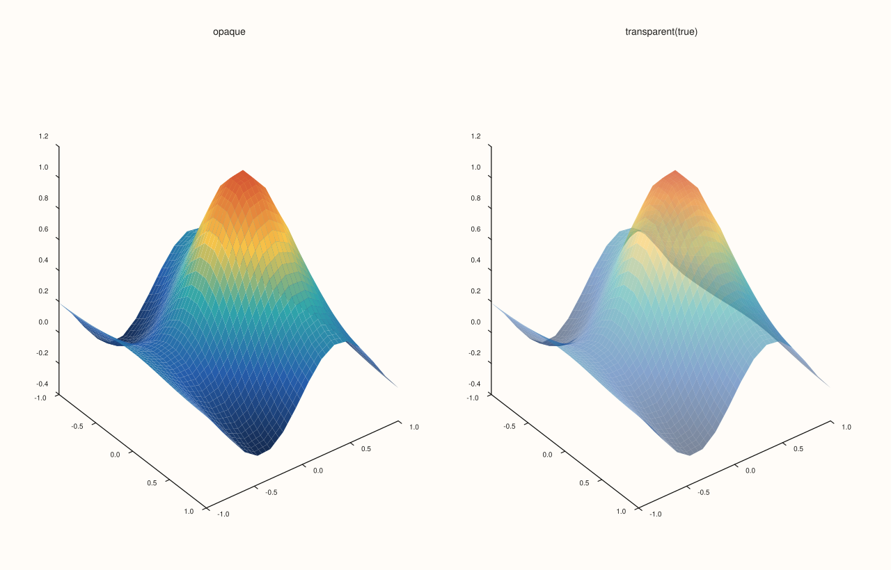
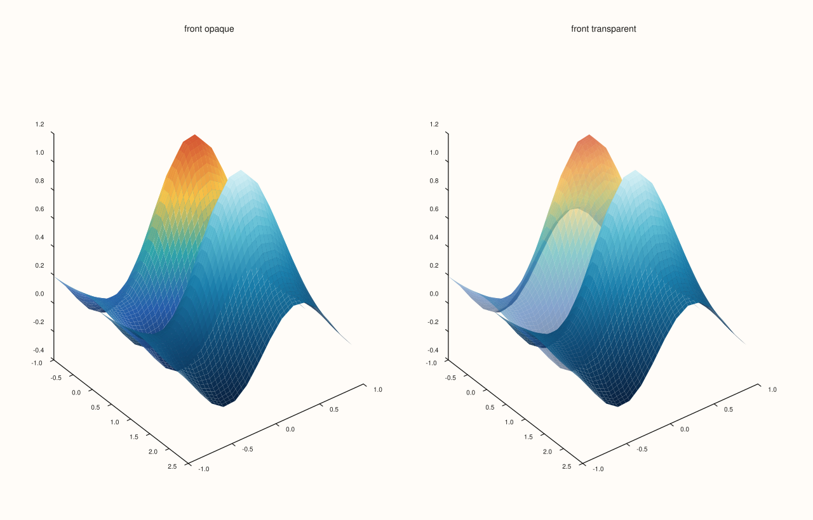
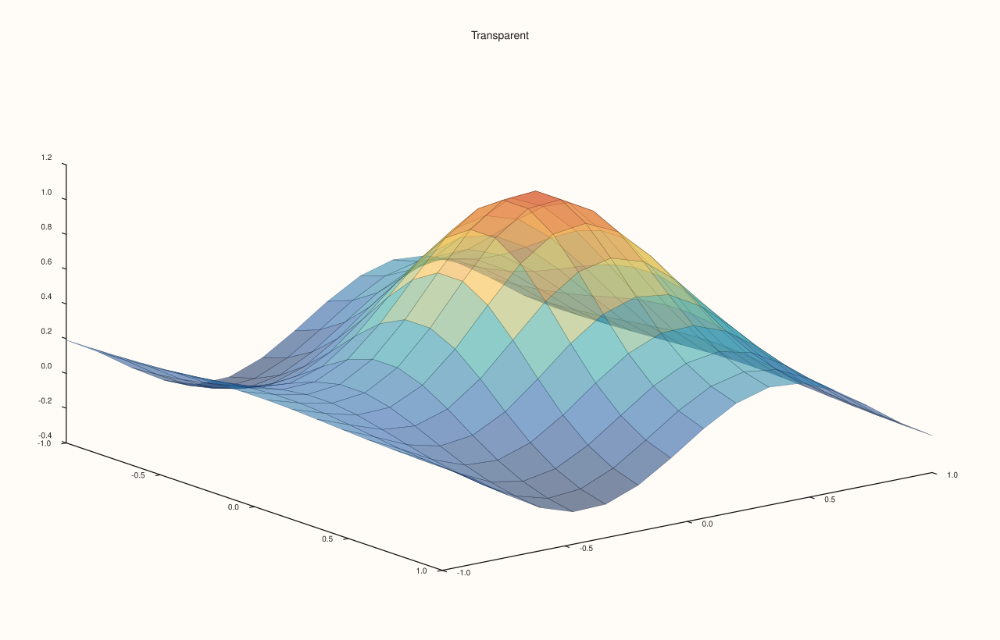
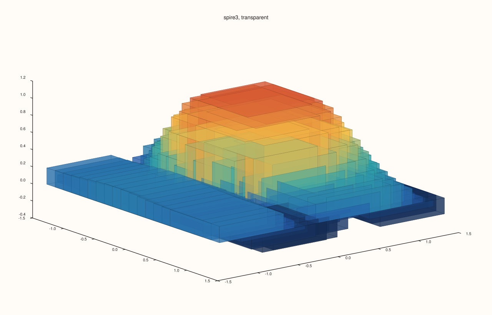

<!-- pluss-hand-authored -->

# Trace::transparent

[Back to Trace API Reference](../../trace_api_reference)

## Signature

```cpp
bool Trace::transparent() const noexcept

Trace& Trace::transparent(bool enable) noexcept
```

## What It Does

Makes a 3D surface see-through, and the getter reports the setting. It is off by default. With `transparent(true)` the faces of the surface are drawn at a reduced opacity (a little over half), so whatever lies behind them, another surface, a cue or the far axes, shows through. Without it a surface is opaque and hides what is behind it.

It applies to the surface kinds `sheet`, `spire3` and `isoshell`. On every other kind the call is stored and has no effect. The setter takes its argument without a default, so `transparent()` with no argument is always the getter.

## Parameters

**enable** (`bool`, setter only)
    True for see-through faces, false for opaque ones.

## Returns

`bool` (getter)
    Whether the surface is transparent, false by default.

`Trace&` (setter)
    The same trace, for chaining.

## Examples

Example 1. An opaque and a see-through surface. The same surface in two panes, the second with `transparent(true)`: the grid behind the far part of the surface shows through.

```cpp
constexpr std::int64_t n = 16;
auto coord = pluss::series::linspace(-1.0, 1.0, n, pluss::ScalarType::Float64);
std::vector<double> peak(static_cast<std::size_t>(n * n));
for (std::int64_t i = 0; i < n; ++i)
  for (std::int64_t j = 0; j < n; ++j) {
    const double x = -1.0 + 2.0 * i / (n - 1), y = -1.0 + 2.0 * j / (n - 1);
    peak[static_cast<std::size_t>(i * n + j)] = std::exp(-3.0 * (x * x + y * y)) + 0.25 * std::sin(4.0 * x);
  }
auto z = pluss::make_series(peak, {n, n});

auto fig = studio("transparent_surface");
fig.mosaic(1, 2);
fig.pane3("opaque").sheet(coord, coord, z).shade(ShadeMode::Smooth);
fig.pane3("transparent(true)").sheet(coord, coord, z).shade(ShadeMode::Smooth).transparent(true);
fig.save_svg("figure.svg");
```



Example 2. Seeing through to a second surface. A tall bump is drawn first and a smaller one behind it; with the first transparent the second can be seen through it, and with the first opaque it is hidden.

```cpp
constexpr std::int64_t n = 16;
auto coord = pluss::series::linspace(-1.0, 1.0, n, pluss::ScalarType::Float64);
std::vector<double> peak(static_cast<std::size_t>(n * n));
for (std::int64_t i = 0; i < n; ++i)
  for (std::int64_t j = 0; j < n; ++j) {
    const double x = -1.0 + 2.0 * i / (n - 1), y = -1.0 + 2.0 * j / (n - 1);
    peak[static_cast<std::size_t>(i * n + j)] = std::exp(-3.0 * (x * x + y * y)) + 0.25 * std::sin(4.0 * x);
  }
auto z = pluss::make_series(peak, {n, n});

auto shifted = pluss::series::linspace(0.2, 2.2, n, pluss::ScalarType::Float64);
auto fig = studio("transparent_two");
fig.mosaic(1, 2);
for (int i = 0; i < 2; ++i) {
  auto& pane = fig.pane3(i == 0 ? "front opaque" : "front transparent");
  pane.sheet(shifted, coord, z).shade(ShadeMode::Smooth).palette(PaletteRamp::ocean());
  Trace& front = pane.sheet(coord, coord, z).shade(ShadeMode::Smooth);
  if (i == 1) front.transparent(true);
}
fig.save_svg("figure.svg");
```



Example 3. Reading the setting back. It is false by default; the setter turns it on and returns the trace; the bare getter never changes the setting.

```cpp
constexpr std::int64_t n = 16;
auto coord = pluss::series::linspace(-1.0, 1.0, n, pluss::ScalarType::Float64);
std::vector<double> peak(static_cast<std::size_t>(n * n));
for (std::int64_t i = 0; i < n; ++i)
  for (std::int64_t j = 0; j < n; ++j) {
    const double x = -1.0 + 2.0 * i / (n - 1), y = -1.0 + 2.0 * j / (n - 1);
    peak[static_cast<std::size_t>(i * n + j)] = std::exp(-3.0 * (x * x + y * y)) + 0.25 * std::sin(4.0 * x);
  }
auto z = pluss::make_series(peak, {n, n});

auto fig = studio("transparent_readback");
auto& pane = fig.pane3("Transparent");
Trace& t = pane.sheet(coord, coord, z);
std::cout << "default: " << t.transparent() << "\n";
t.transparent(true);
std::cout << "after transparent(true): " << t.transparent() << "\n";
t.transparent(false);
std::cout << "after transparent(false): " << t.transparent() << "\n";
t.transparent(true);
fig.save_svg("figure.svg");
```

### Output

```text
default: 0
after transparent(true): 1
after transparent(false): 0
```



Example 4. Which kinds become see-through. Each is drawn with and without `transparent(true)` and the SVG text compared: the surface, the pillars and the level surfaces change; a wireframe, a contour and a line do not.

```cpp
constexpr std::int64_t n = 16;
auto coord = pluss::series::linspace(-1.0, 1.0, n, pluss::ScalarType::Float64);
std::vector<double> peak(static_cast<std::size_t>(n * n));
for (std::int64_t i = 0; i < n; ++i)
  for (std::int64_t j = 0; j < n; ++j) {
    const double x = -1.0 + 2.0 * i / (n - 1), y = -1.0 + 2.0 * j / (n - 1);
    peak[static_cast<std::size_t>(i * n + j)] = std::exp(-3.0 * (x * x + y * y)) + 0.25 * std::sin(4.0 * x);
  }
auto z = pluss::make_series(peak, {n, n});

std::vector<double> volume(static_cast<std::size_t>(n * n * n));
for (std::size_t i = 0; i < volume.size(); ++i) volume[i] = std::sin(0.05 * static_cast<double>(i));
auto vol = pluss::make_series(volume, {n, n, n});
auto changes = [&](auto make, bool is3d) {
  std::string svg[2];
  for (int i = 0; i < 2; ++i) {
    auto fig = studio("transparent_kinds");
    Pane& pane = is3d ? fig.pane3("p") : fig.pane2("p");
    Trace& t = make(pane);
    if (i == 1) t.transparent(true);
    svg[i] = fig.to_svg();
  }
  return svg[0] != svg[1];
};
std::cout << "sheet:    " << changes([&](Pane& p) -> Trace& { return p.sheet(coord, coord, z); }, true) << "\n";
std::cout << "spire3:   " << changes([&](Pane& p) -> Trace& { return p.spire3(coord, coord, z); }, true) << "\n";
std::cout << "isoshell: " << changes([&](Pane& p) -> Trace& { return p.isoshell(coord, coord, coord, vol); }, true) << "\n";
std::cout << "lattice:  " << changes([&](Pane& p) -> Trace& { return p.lattice(coord, coord, z); }, true) << "\n";
std::cout << "contour:  " << changes([&](Pane& p) -> Trace& { return p.contour(coord, coord, z); }, false) << "\n";
auto fig = studio("transparent_kinds_out");
fig.pane3("spire3, transparent").spire3(coord, coord, z).transparent(true);
fig.save_svg("figure.svg");
```

### Output

```text
sheet:    1
spire3:   1
isoshell: 1
lattice:  0
contour:  0
```



## Notes

- Transparency is a property of the trace's faces only; the pane's axes, grid and legend are never made transparent.
- Opacity of a 2D stroke is set through the alpha channel of the colour ([`Trace::stroke`](stroke.md)), not through this call.
- `transparent` is `noexcept`.

## See Also

- [`Trace::shade`](shade.md), [`Trace::lighting`](lighting.md), [`Trace::material`](material.md): the other surface options.
- [`Trace::stroke`](stroke.md): colour with an alpha channel.
- [`Pane::sheet`](../pane/sheet.md), [`Pane::spire3`](../pane/spire3.md), [`Pane::isoshell`](../pane/isoshell.md): the kinds it applies to.

<div class="pluss-inline-prev-next">
  <a class="prev-link" href="stroke.html">
    <span class="label">Previous</span>
    <span class="title">stroke</span>
  </a>
  <a class="next-link" href="visible.html">
    <span class="label">Next</span>
    <span class="title">visible</span>
  </a>
</div>
