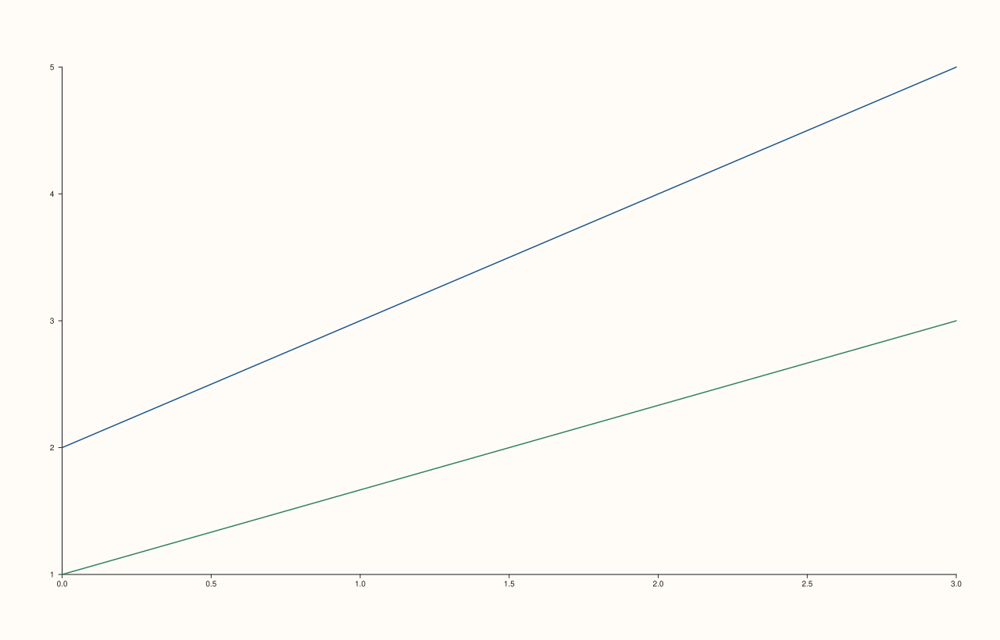

<!-- pluss-hand-authored -->

# Trace::visible / Trace::hide / Trace::show

[Back to Trace API Reference](../../trace_api_reference)

## Signatures

```cpp
bool Trace::visible() const noexcept

Trace& Trace::hide() noexcept
Trace& Trace::show() noexcept
```

## What It Does

Gets whether this individual trace is drawn, and toggles it via two distinctly-named
setters. Default `true`.

```{important} Was never exposed to the visible()-style hazard fixed elsewhere in this reference
Pane::visible, Trace::transparent, and Trace::annotate_levels each used to
declare a setter with a default argument sharing its name with a separate
const getter -- a real overload-resolution hazard where a bare
pane.visible() on a non-const Pane& silently invoked the SETTER, since fixed
by making the setter's argument required (see Pane::visible for the full
history). Trace::visible() never had this problem in the first place: it has
no setter of the same name at all. Mutating a trace's visibility requires
calling the distinctly-named hide() or show() instead, which makes
trace.visible() unambiguously and always a read, regardless of const-ness --
by design, not by later fix. Trace::visible() was the model the other four
methods were retrofitted to match.
```

## Parameters

*(none — `hide()`/`show()` take no arguments)*

## Returns

`bool` (getter)
    The current visibility, `true` by default.

`Trace&` (`hide()`/`show()`)
    A reference to `*this`, for chaining.

## Examples

Example 1. Two visible traces, the default.

```cpp
using namespace pluss::pl;

// A formula-generated x axis shared by both traces, plus two y curves over different
// `[start, stop]` bounds -- `point_count` is the single source of truth for how many
// points each line has.
constexpr std::int64_t point_count = 4;
auto x = pluss::series::linspace(0.0, point_count - 1.0, point_count, pluss::ScalarType::Float64);
auto y1 = pluss::series::linspace(2.0, 5.0, point_count, pluss::ScalarType::Float64);
auto y2 = pluss::series::linspace(1.0, 3.0, point_count, pluss::ScalarType::Float64);

auto fig = studio("trace_visible_default");
auto& pane = fig.pane2();
pane.trend(x, y1);
pane.trend(x, y2);
fig.show();
```



Example 2. The second trace hidden via `hide()`. Verified via direct SVG diff to render
genuinely different from Example 1 (one fewer line drawn).

```cpp
using namespace pluss::pl;

constexpr std::int64_t point_count = 4;
auto x = pluss::series::linspace(0.0, point_count - 1.0, point_count, pluss::ScalarType::Float64);
auto y1 = pluss::series::linspace(2.0, 5.0, point_count, pluss::ScalarType::Float64);
auto y2 = pluss::series::linspace(1.0, 3.0, point_count, pluss::ScalarType::Float64);

auto fig = studio("trace_visible_hidden");
auto& pane = fig.pane2();
pane.trend(x, y1);
pane.trend(x, y2).hide();
fig.show();
```


## Notes

- All three are `noexcept`.
- `show()` reverses `hide()` — calling `show()` on an already-visible trace, or `hide()`
  on an already-hidden one, is a harmless no-op that still returns `*this`.
- This is the trace-level counterpart to [`Pane::visible`](../pane/visible.md); the two
  operate on different scopes entirely (one trace vs. the whole pane, including its axes)
  and, notably, `Pane::visible()` carries the same-name hazard that `Trace::visible()`
  was designed without.

## See Also

- [`Pane::visible`](../pane/visible.md): the pane-level counterpart — and the method that
  originally exposed this whole family of getter/setter-naming hazards in this
  documentation effort.
- [`Trace::transparent`](transparent.md) / [`Trace::annotate_levels`](annotate_levels.md):
  the two `Trace` methods that *do* carry the hazard `visible()` avoids.

<div class="pluss-inline-prev-next">
  <a class="prev-link" href="annotate_levels.html">
    <span class="label">Previous</span>
    <span class="title">annotate_levels</span>
  </a>
</div>
