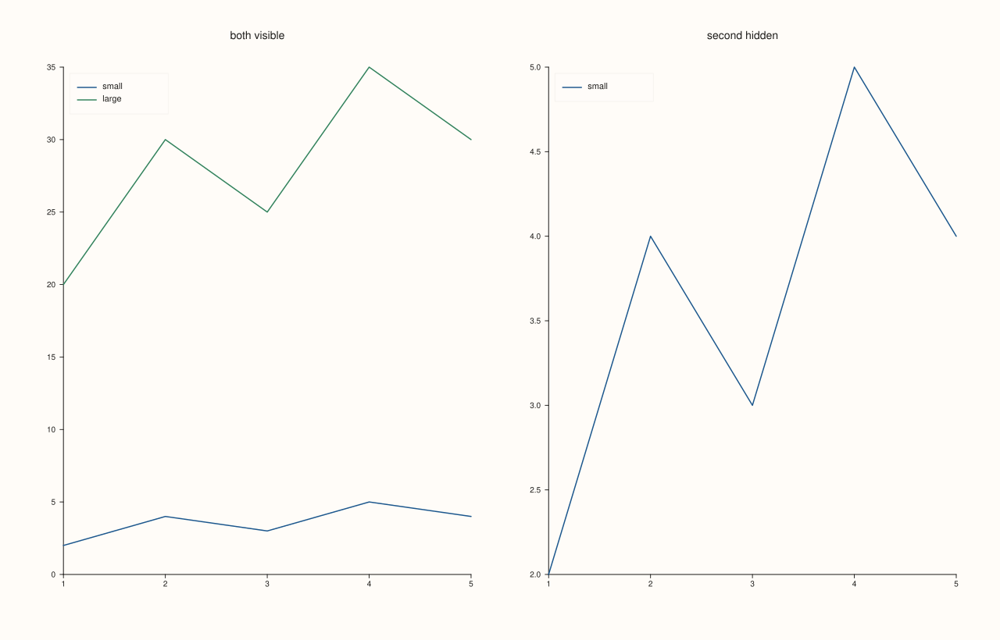
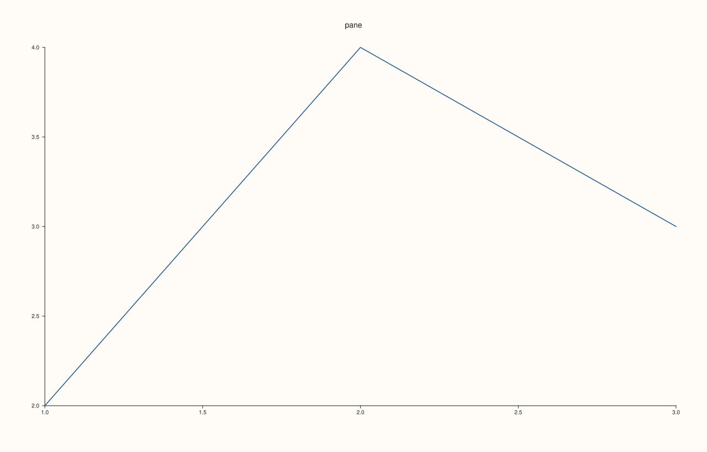
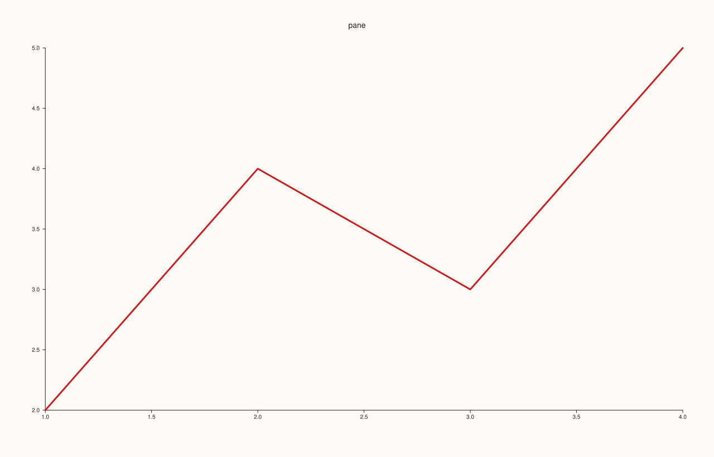
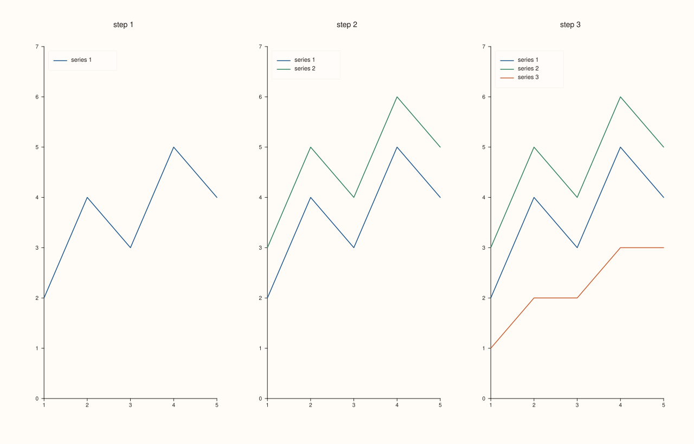

<!-- pluss-hand-authored -->

# Trace::visible

[Back to Trace API Reference](../../trace_api_reference)

## Signature

```cpp
bool Trace::visible() const noexcept

Trace& Trace::hide() noexcept
Trace& Trace::show() noexcept
```

## What It Does

Switches a single trace on and off without removing it. `hide()` stops the trace from being drawn, `show()` draws it again and `visible()` reports the state; the default is visible. The setters are `hide` and `show` and the getter is `visible`, three different names, so there is no overload that a bare call could mistake for a setter.

A hidden trace is treated as if it had not been added: it is not drawn, it does not appear in any legend (neither a pane's nor the docked one), and it does not take part in the automatic axis limits, so hiding a trace with large values lets the axes close in on the rest. It still counts as a trace of the pane (`Pane::trace_count()`) and keeps its data, style and label, so showing it again restores it exactly. This is what makes it the right tool for toggling series in an interactive view or for building a figure in layers.

## Parameters

*(none)*

## Returns

`bool` (`visible`)
    True when the trace is drawn.

`Trace&` (`hide`, `show`)
    The same trace, for chaining.

## Examples

Example 1. Hiding and showing. Two traces, the second with much larger values; with both visible the axis has to reach 35, and with the second hidden the axis fits the first alone. The printed states follow the calls.

```cpp
auto fig = studio("visible_toggle");
fig.mosaic(1, 2);
{
  auto& pane = fig.pane2("both visible");
  pane.trend(std::vector<double>{1, 2, 3, 4, 5}, std::vector<double>{2, 4, 3, 5, 4}).label("small");
  pane.trend(std::vector<double>{1, 2, 3, 4, 5}, std::vector<double>{20, 30, 25, 35, 30}).label("large");
  pane.legend(KeyPlace::NorthWest);
}
{
  auto& pane = fig.pane2("second hidden");
  pane.trend(std::vector<double>{1, 2, 3, 4, 5}, std::vector<double>{2, 4, 3, 5, 4}).label("small");
  Trace& large = pane.trend(std::vector<double>{1, 2, 3, 4, 5}, std::vector<double>{20, 30, 25, 35, 30}).label("large");
  std::cout << "visible by default: " << large.visible() << "\n";
  large.hide();
  std::cout << "after hide(): " << large.visible() << "\n";
  pane.legend(KeyPlace::NorthWest);
  std::cout << "still counted as a trace: " << pane.trace_count() << "\n";
}
fig.save_svg("figure.svg");
```

### Output

```text
visible by default: 1
after hide(): 0
still counted as a trace: 2
```



Example 2. A hidden trace is as if it were not there. The figure of a pane whose second trace is hidden is identical to the figure of a pane that never had it: the SVG text is equal, legend and axis fit included.

```cpp
std::string svg[2];
for (int i = 0; i < 2; ++i) {
  auto fig = studio("visible_absent");
  auto& pane = fig.pane2("pane");
  pane.trend(std::vector<double>{1, 2, 3, 4, 5}, std::vector<double>{2, 4, 3, 5, 4}).label("kept");
  if (i == 1) pane.trend(std::vector<double>{1, 2, 3, 4, 5}, std::vector<double>{20, 30, 25, 35, 30}).label("hidden").hide();
  pane.legend(KeyPlace::NorthWest);
  svg[i] = fig.to_svg();
}
std::cout << "hidden trace == never added: " << (svg[0] == svg[1]) << "\n";
auto fig = studio("visible_absent_out");
fig.pane2("pane").trend(std::vector<double>{1, 2, 3}, std::vector<double>{2, 4, 3}).label("kept");
fig.save_svg("figure.svg");
```

### Output

```text
hidden trace == never added: 1
```



Example 3. Showing again restores the trace exactly. The figure after `hide()` and `show()` equals the figure of a trace that was never hidden, and the style set before hiding, the colour and the width, is kept.

```cpp
std::string svg[2];
for (int i = 0; i < 2; ++i) {
  auto fig = studio("visible_restore");
  auto& pane = fig.pane2("pane");
  Trace& t = pane.trend(std::vector<double>{1, 2, 3, 4}, std::vector<double>{2, 4, 3, 5}).stroke(Rgba::from_u8(200, 30, 30)).width(3.0f).label("styled");
  if (i == 1) t.hide().show();
  std::cout << "i = " << i << ": visible " << t.visible() << ", width " << t.stroke_width() << ", label '" << t.label_text() << "'\n";
  pane.legend(KeyPlace::NorthWest);
  svg[i] = fig.to_svg();
}
std::cout << "hide().show() == untouched: " << (svg[0] == svg[1]) << "\n";
auto fig = studio("visible_restore_out");
fig.pane2("pane").trend(std::vector<double>{1, 2, 3, 4}, std::vector<double>{2, 4, 3, 5}).stroke(Rgba::from_u8(200, 30, 30)).width(3.0f);
fig.save_svg("figure.svg");
```

### Output

```text
i = 0: visible 1, width 3, label 'styled'
i = 1: visible 1, width 3, label 'styled'
hide().show() == untouched: 1
```



Example 4. Building a figure in layers: three panes show the same four series, with one, two and then three of them visible. Each pane is made by creating all the series and hiding the ones not yet wanted, which is how a figure for a talk reveals a result step by step.

```cpp
const std::vector<double> x{1, 2, 3, 4, 5};
const std::vector<double> ys[3] = {{2, 4, 3, 5, 4}, {3, 5, 4, 6, 5}, {1, 2, 2, 3, 3}};
auto fig = studio("visible_layers");
fig.mosaic(1, 3);
for (int step = 1; step <= 3; ++step) {
  auto& pane = fig.pane2("step " + std::to_string(step));
  for (int s = 0; s < 3; ++s) {
    Trace& t = pane.trend(x, ys[s]).label("series " + std::to_string(s + 1));
    if (s >= step) t.hide();
  }
  pane.y_limits(Range1d{0.0, 7.0});
  pane.legend(KeyPlace::NorthWest);
}
fig.save_svg("figure.svg");
```



## Notes

- `visible()` is a getter only: there is no `visible(bool)`. This is deliberate, because a getter and a setter with one name let a bare `trace.visible()` call a setter.
- To hide or show a whole pane, use [`Pane::visible`](../pane/visible.md) and `Pane::hide`/`show`; hiding every trace of a pane leaves its axes and title.
- The references returned by the creation methods stay valid for the life of the pane, so a trace can be hidden or shown again at any time.

## See Also

- [`Pane::visible`](../pane/visible.md): the same switch for a whole pane.
- [`Trace::label`](label.md): a hidden trace is not listed in the legend.
- [`Pane::y_limits`](../pane/y_limits.md): fixing the axis keeps it from moving when traces are hidden.

<div class="pluss-inline-prev-next">
  <a class="prev-link" href="transparent.html">
    <span class="label">Previous</span>
    <span class="title">transparent</span>
  </a>
  <a class="next-link" href="width.html">
    <span class="label">Next</span>
    <span class="title">width</span>
  </a>
</div>
