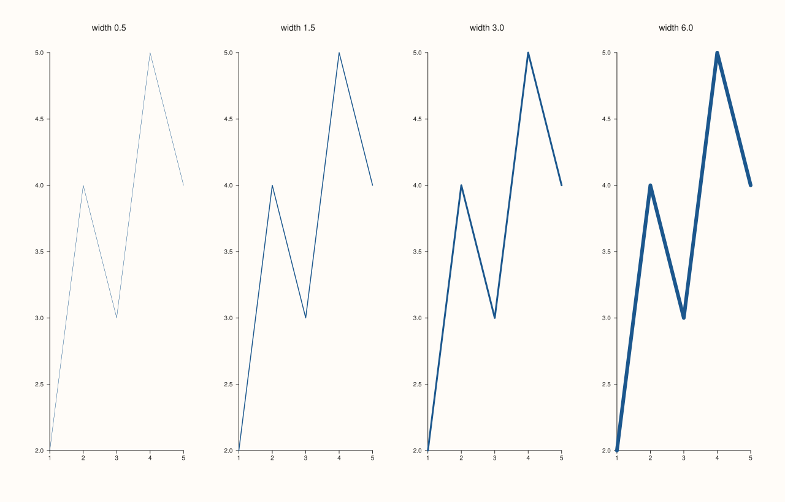
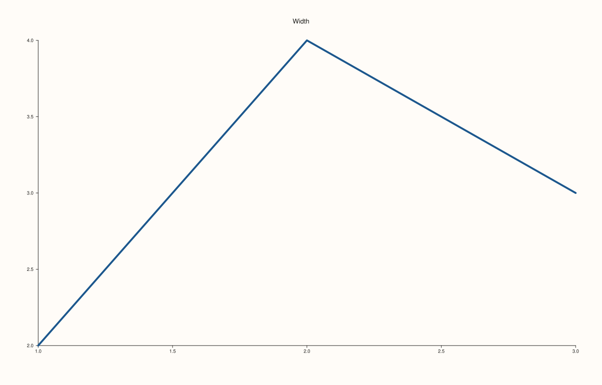
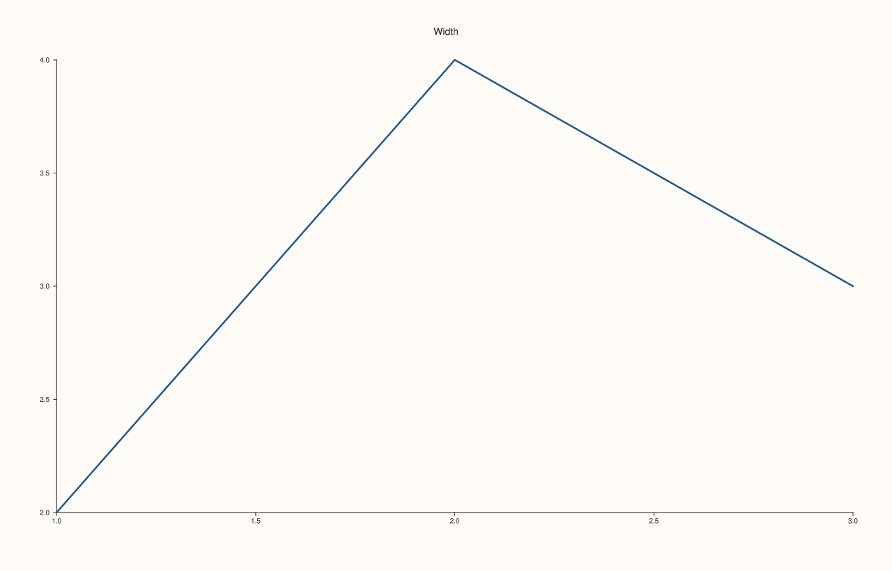
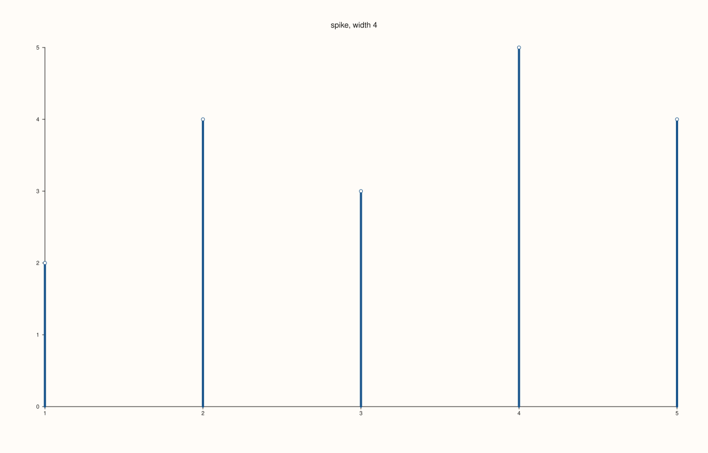
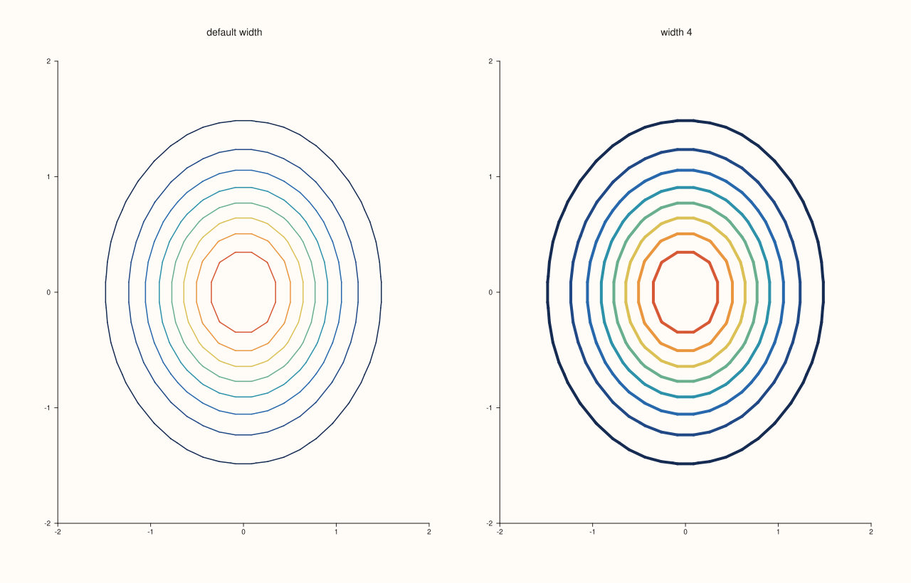

<!-- pluss-hand-authored -->

# Trace::width

[Back to Trace API Reference](../../trace_api_reference)

## Signature

```cpp
float Trace::stroke_width() const noexcept

Trace& Trace::width(float width)
```

## What It Does

Sets the thickness of the lines a trace draws, in drawing units, and `stroke_width()` reads it back. The default is 1.5. The width must be finite and positive: zero, a negative number, infinity or NaN is refused with `pluss::Error` and the trace keeps the width it had.

Not every kind has lines the width can act on. It sets the width of: a `trend`, a `radial` curve, the stems of a `spike`, the error bars of a `whisk` and the outlines of a `quartet` and a `violin`; the lines of `contour`, `isoband` and `ridge3`; and the wires of a `lattice` and a `path3`. It also sets the width of the outline of the filled kinds `columns`, `bucket`, `ribbon` and `wedge`; until `width` is called those keep their own thinner outline (0.8, and 0.9 for a ribbon and a pie). It has no effect on kinds that are sets of points or solid surfaces: `cloud`, `cloud3`, `fieldmap`, `sheet`, `spire3` and `isoshell`, whose appearance comes from the palette ([`Trace::palette`](palette.md)) and, for a cloud, from the size series given when it is made.

## Parameters

**width** (`float`)
    The stroke width. Must be finite and greater than zero.

## Returns

`float` (getter)
    The current width, 1.5 by default.

`Trace&` (setter)
    The same trace, for chaining.

## Examples

Example 1. Four widths on the same line: 0.5, 1.5 (the default), 3 and 6. Only the thickness changes.

```cpp
const float widths[] = {0.5f, 1.5f, 3.0f, 6.0f};
auto fig = studio("width_gallery");
fig.mosaic(1, 4);
for (int i = 0; i < 4; ++i) {
  auto& pane = fig.pane2("width " + std::to_string(widths[i]).substr(0, 3));
  pane.trend(std::vector<double>{1, 2, 3, 4, 5}, std::vector<double>{2, 4, 3, 5, 4}).width(widths[i]);
}
fig.save_svg("figure.svg");
```



Example 2. Reading the width back. The default is 1.5; a new value is stored and returned; `width` chains with the other setters.

```cpp
auto fig = studio("width_readback");
auto& pane = fig.pane2("Width");
Trace& trace = pane.trend(std::vector<double>{1, 2, 3}, std::vector<double>{2, 4, 3});
std::cout << "default: " << trace.stroke_width() << "\n";
trace.width(0.25f);
std::cout << "after width(0.25): " << trace.stroke_width() << "\n";
trace.width(4.0f).label("thick");
std::cout << "after width(4).label(...): " << trace.stroke_width() << "\n";
fig.save_svg("figure.svg");
```

### Output

```text
default: 1.5
after width(0.25): 0.25
after width(4).label(...): 4
```



Example 3. Invalid widths are refused, and the trace keeps its width. Zero, a negative number, infinity and NaN each throw `pluss::Error`; the width read back afterwards is still the one set before.

```cpp
auto fig = studio("width_invalid");
auto& pane = fig.pane2("Width");
Trace& trace = pane.trend(std::vector<double>{1, 2, 3}, std::vector<double>{2, 4, 3});
trace.width(2.5f);
for (float bad : {0.0f, -1.0f, std::numeric_limits<float>::infinity(), std::numeric_limits<float>::quiet_NaN()}) {
  try {
    trace.width(bad);
  } catch (const pluss::Error& e) {
    std::cout << "width(" << bad << "): " << e.message() << "\n";
  }
}
std::cout << "width is still " << trace.stroke_width() << "\n";
fig.save_svg("figure.svg");
```

### Output

```text
width(0): Trace::width: width must be finite and positive
width(-1): Trace::width: width must be finite and positive
width(inf): Trace::width: width must be finite and positive
width(nan): Trace::width: width must be finite and positive
width is still 2.5
```



Example 4. Which kinds answer to the width. Each kind is drawn once with the default width and once with 6, and the SVG text compared: a line, a spike, a wire and the outline of a column change, while a cloud does not.

```cpp
constexpr std::int64_t n = 8;
auto coord = pluss::series::linspace(-1.0, 1.0, n, pluss::ScalarType::Float64);
std::vector<double> hills(static_cast<std::size_t>(n * n));
for (std::int64_t i = 0; i < n * n; ++i) hills[static_cast<std::size_t>(i)] = std::sin(0.4 * i);
auto z = pluss::make_series(hills, {n, n});
const std::vector<double> x{1, 2, 3, 4, 5}, y{2, 4, 3, 5, 4};
auto changes = [&](auto make, bool volume) {
  std::string svg[2];
  for (int i = 0; i < 2; ++i) {
    auto fig = studio("width_kinds");
    Pane& pane = volume ? fig.pane3("p") : fig.pane2("p");
    Trace& t = make(pane);
    if (i == 1) t.width(6.0f);
    svg[i] = fig.to_svg();
  }
  return svg[0] != svg[1];
};
std::cout << "trend:   " << changes([&](Pane& p) -> Trace& { return p.trend(x, y); }, false) << "\n";
std::cout << "spike:   " << changes([&](Pane& p) -> Trace& { return p.spike(x, y); }, false) << "\n";
std::cout << "lattice: " << changes([&](Pane& p) -> Trace& { return p.lattice(coord, coord, z); }, true) << "\n";
std::cout << "cloud:   " << changes([&](Pane& p) -> Trace& { return p.cloud(x, y); }, false) << "\n";
std::cout << "columns: " << changes([&](Pane& p) -> Trace& { return p.columns(x, y); }, false) << "\n";
auto fig = studio("width_kinds_out");
fig.pane2("spike, width 4").spike(x, y).width(4.0f);
fig.save_svg("figure.svg");
```

### Output

```text
trend:   1
spike:   1
lattice: 1
cloud:   1
columns: 1
```



Example 5. Width on a contour. The contour lines of a gridded field are drawn at 1.5 by default and at 4 here; an `isoband` changes with the width in the same way.

```cpp
constexpr std::int64_t n = 24;
auto coord = pluss::series::linspace(-2.0, 2.0, n, pluss::ScalarType::Float64);
std::vector<double> field(static_cast<std::size_t>(n * n));
for (std::int64_t i = 0; i < n; ++i)
  for (std::int64_t j = 0; j < n; ++j) {
    const double x = -2.0 + 4.0 * i / (n - 1), y = -2.0 + 4.0 * j / (n - 1);
    field[static_cast<std::size_t>(i * n + j)] = std::exp(-(x * x + y * y));
  }
auto z = pluss::make_series(field, {n, n});
auto fig = studio("width_contour");
fig.mosaic(1, 2);
fig.pane2("default width").contour(coord, coord, z);
fig.pane2("width 4").contour(coord, coord, z).width(4.0f);
fig.save_svg("figure.svg");
```



## Notes

- `width` throws, so unlike the other trace setters it is not `noexcept`. Code that builds the width from user input should catch `pluss::Error` or check the value first.
- The width of axes, grid lines and legend frames is not set by any trace: it comes from the pane's theme.

## See Also

- [`Trace::stroke`](stroke.md): the colour of the same lines.
- [`Trace::palette`](palette.md): how filled kinds and fields are coloured instead.
- [`Trace::kind`](kind.md): the kind decides which calls apply.

<div class="pluss-inline-prev-next">
  <a class="prev-link" href="visible.html">
    <span class="label">Previous</span>
    <span class="title">visible</span>
  </a>
</div>
