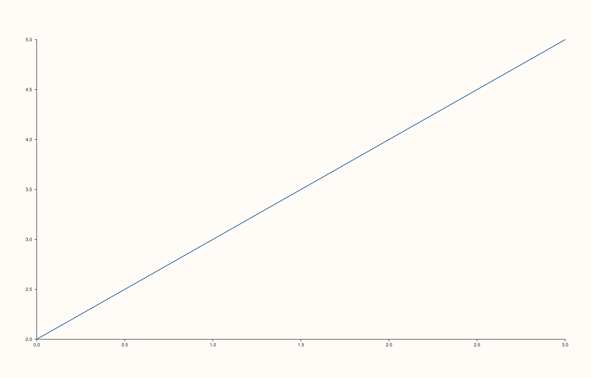
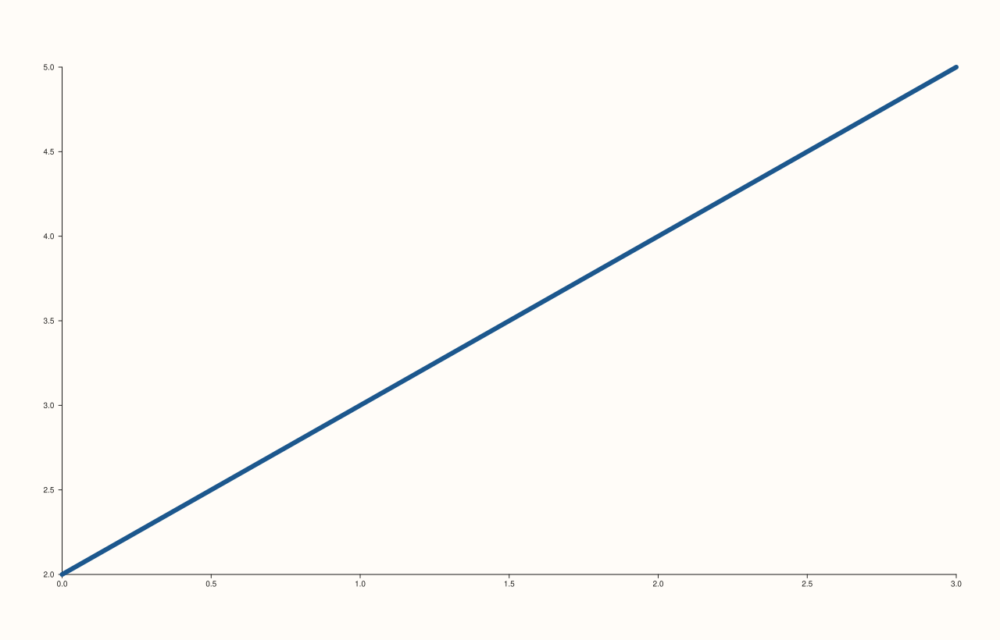

<!-- pluss-hand-authored -->

# Trace::width / Trace::stroke_width

[Back to Trace API Reference](../../trace_api_reference)

## Signatures

```cpp
float Trace::stroke_width() const noexcept

Trace& Trace::width(float width) noexcept
```

## What It Does

Gets/sets the trace's stroke/line width, in points. Default `1.5F`.

```{important} Invalid input is silently ignored, not rejected with an exception
Unlike most Pane setters documented elsewhere in this reference (which throw
std::invalid_argument on bad input), width() validates by simply declining to
apply an invalid value and returning *this unchanged: passing a non-finite or
non-positive width leaves stroke_width() exactly as it was before the call, with
no exception and no other observable side effect. Directly verified: calling
width(-5.0F) on a trace with the default 1.5F width left stroke_width() at
1.5F afterward.
```

## Parameters

**width** (`float`, setter only)
    The new stroke width in points. Must be finite and strictly positive
    (`std::isfinite(width) && width > 0.0F`) to take effect; otherwise the call is a
    silent no-op.

## Returns

`float` (getter)
    The current stroke width, `1.5F` by default.

`Trace&` (setter)
    A reference to `*this`, for chaining — returned even when the call was a silent no-op.

## Examples

Example 1. The default stroke width.

```cpp
using namespace pluss::pl;

// A formula-generated x/y pair -- `point_count` is the single source of truth for how
// many points the line has, rather than a hand-typed literal vector.
constexpr std::int64_t point_count = 4;
auto x = pluss::series::linspace(0.0, point_count - 1.0, point_count, pluss::ScalarType::Float64);
auto y = pluss::series::linspace(2.0, 5.0, point_count, pluss::ScalarType::Float64);

auto fig = studio("trace_width_default");
auto& pane = fig.pane2();
pane.trend(x, y);
fig.show();
```



Example 2. A thicker stroke. Verified via direct SVG diff to render genuinely different
from Example 1.

```cpp
using namespace pluss::pl;

constexpr std::int64_t point_count = 4;
auto x = pluss::series::linspace(0.0, point_count - 1.0, point_count, pluss::ScalarType::Float64);
auto y = pluss::series::linspace(2.0, 5.0, point_count, pluss::ScalarType::Float64);

auto fig = studio("trace_width_thick");
auto& pane = fig.pane2();
pane.trend(x, y).width(6.0F);
fig.show();
```



Example 3 (edge case). Passing an invalid width — negative, zero, and non-finite values are
all silently ignored, leaving the trace's width unchanged. The default is captured into a
variable and compared against directly, rather than re-typed as a literal, so this check
stays correct even if the library's actual default value ever changes.

```cpp
using namespace pluss::pl;

constexpr std::int64_t point_count = 4;
auto x = pluss::series::linspace(0.0, point_count - 1.0, point_count, pluss::ScalarType::Float64);
auto y = pluss::series::linspace(2.0, 5.0, point_count, pluss::ScalarType::Float64);

auto fig = studio("trace_width_invalid");
auto& pane = fig.pane2();
Trace& t = pane.trend(x, y);
const float default_width = t.stroke_width();  // captured live, not hardcoded
std::cout << "default: " << default_width << "\n";
t.width(-5.0F);
std::cout << "after width(-5.0F): " << t.stroke_width() << "\n";
t.width(0.0F);
std::cout << "after width(0.0F): " << t.stroke_width() << "\n";
t.width(3.5F);
std::cout << "after width(3.5F) [valid]: " << t.stroke_width() << "\n";
```

Output:

```text
default: 1.5
after width(-5.0F): 1.5
after width(0.0F): 1.5
after width(3.5F) [valid]: 3.5
```

## Notes

- Both getter and setter are `noexcept` — even the "rejected" invalid-input path never
  throws, it just skips the assignment.
- `0.0F` is explicitly rejected (the check is `width > 0.0F`, strict inequality) — a
  zero-width line is not achievable through this setter.
- Applies to every trace kind uniformly; it is the one styling knob shared across all 22
  `TraceKind` values, though its visual effect is most obvious on line-drawing kinds
  ([`trend`](../pane/trend.md), [`path3`](../pane/path3.md)) and outline-drawing kinds
  (bar/violin/box borders) rather than filled-area kinds.

## See Also

- [`Trace::stroke`](stroke.md): the paired color control for the same stroke.
- [`Trace::color_limits`](color_limits.md): another `Trace` setter with the identical
  silent-no-op-on-invalid-input validation style.

<div class="pluss-inline-prev-next">
  <a class="prev-link" href="label.html">
    <span class="label">Previous</span>
    <span class="title">label</span>
  </a>
  <a class="next-link" href="stroke.html">
    <span class="label">Next</span>
    <span class="title">stroke</span>
  </a>
</div>
