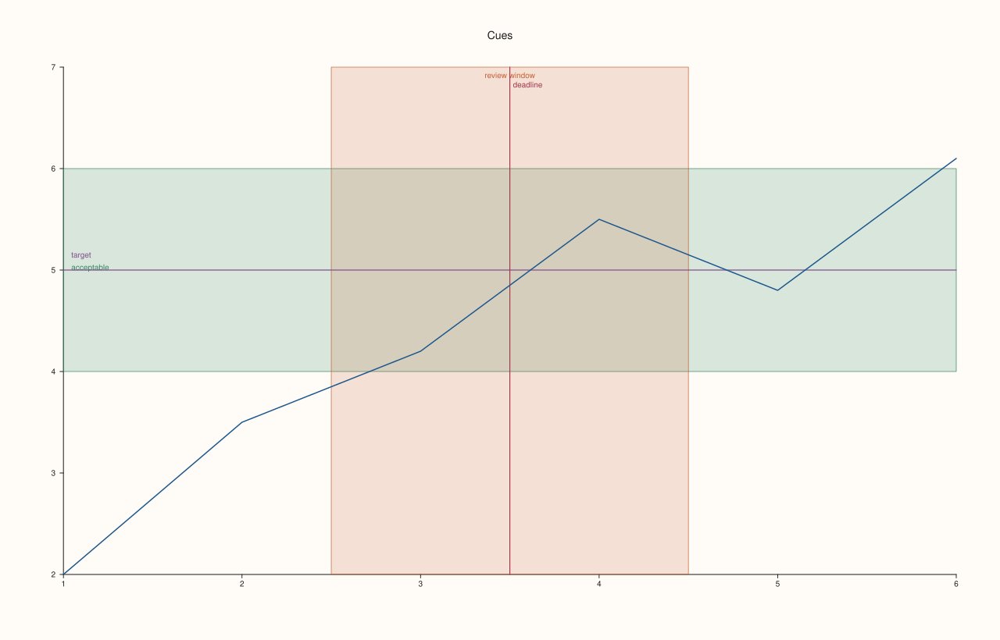
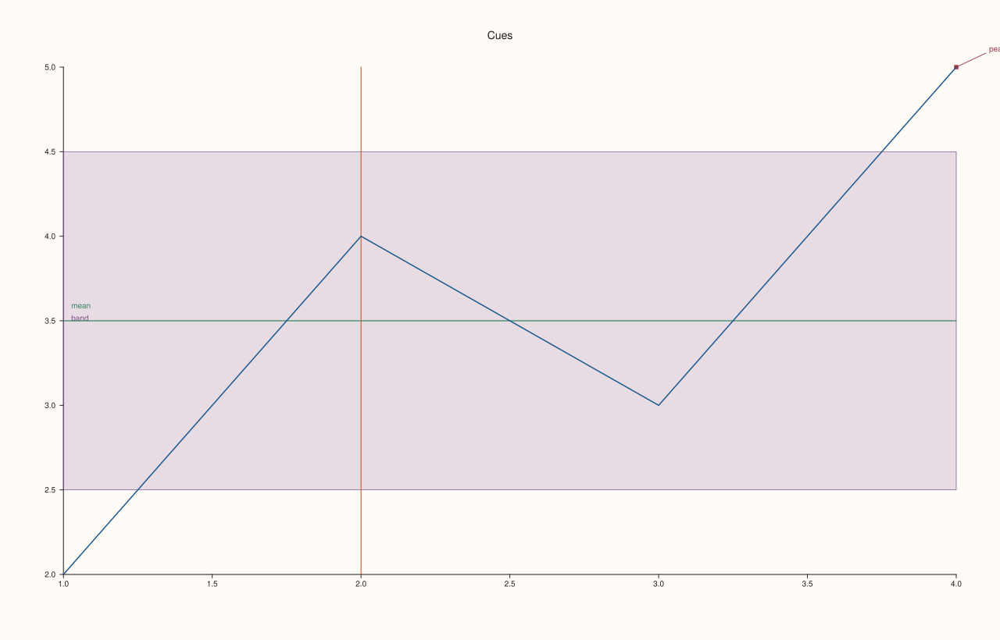
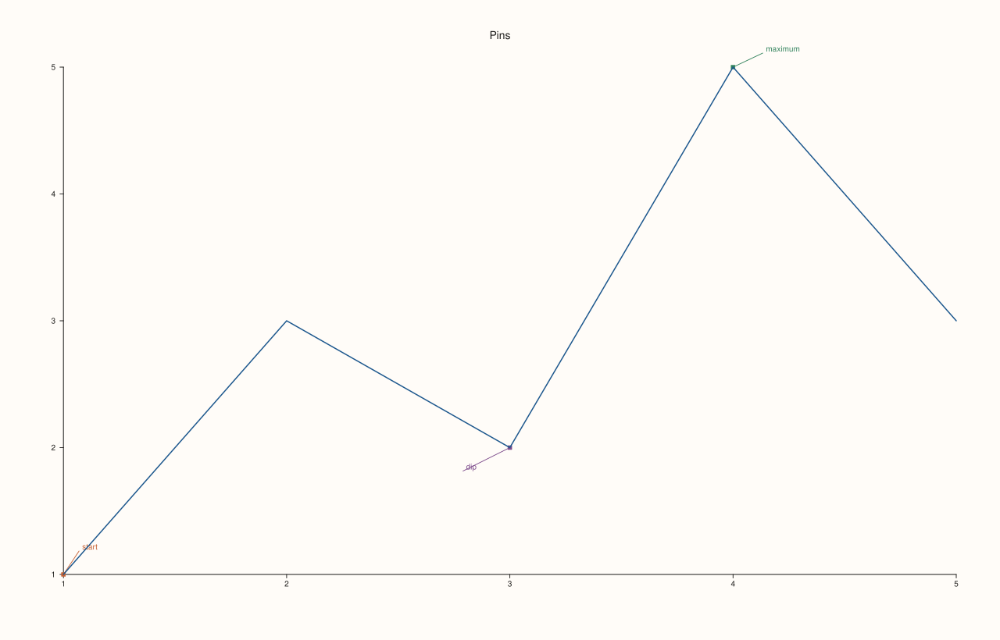
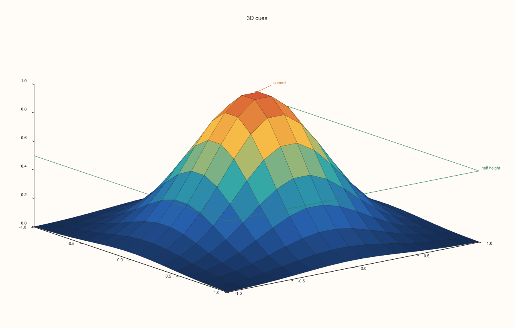
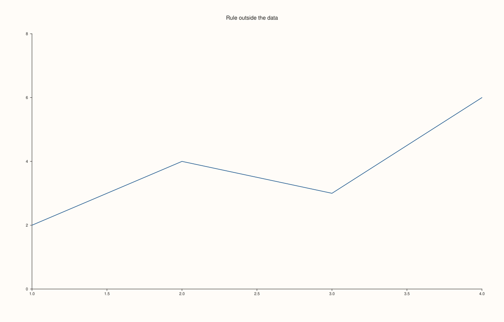
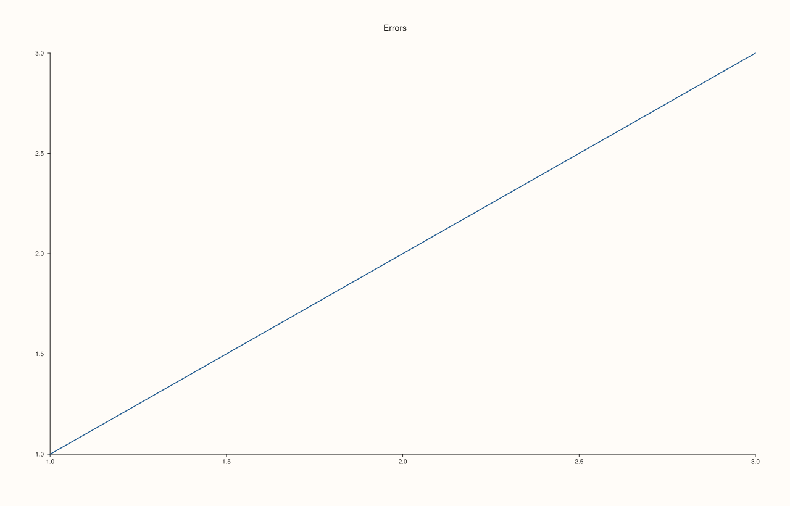

<!-- generated by PlussPl/docs/sphinx/tools/plotdocs.py from tools/specs/Cues.py; edit the spec -->

# RuleCue, BandCue, PinCue

[Back to Types and Options Reference](../../types_api_reference)

## What It Does

Cues are annotations that mark a pane without being data: a **rule** is a reference line at a value on one axis (a target, a threshold, a mean), a **band** is a shaded stripe between two values on one axis (a tolerance, a regime, a period of interest), and a **pin** is a note attached to a point with a short leader line. They are added with the pane methods
[`rule_x`](../pane/rule_x.md), `rule_y`, `rule_z`, [`band_x`](../pane/band_x.md), `band_y`, `band_z` and [`pin`](../pane/pin.md), and read back through `Pane::rules()`, `Pane::bands()` and `Pane::pins()`, which return the cue structs documented here.

A cue belongs to the pane and is drawn over its plot area in the pane's coordinates, so it moves with the axes. Cues take part in the automatic limits: a rule or a band outside the plotted data widens the axis to include it, which can squeeze the data into a corner. To keep the axis on the data, set the limits yourself ([`LimitMethod`](LimitMethod.md), Example 5).

The three structs describe the cue *as it is drawn*. The pane methods fill them from their arguments, and choose the colour themselves: a cue takes the next accent of the pane's [`Theme`](Theme.md) after the traces and the cues already on the pane, so a rule added to a pane with two lines gets the third accent. The colour and width fields are there to read back; there is no call to set them.

## Fields

| Struct | Field | Meaning | Default |
|---|---|---|---|
| `RuleCue` | `axis` | `CueAxis::X`, `Y` or `Z`: the axis the value is on. | `X` |
| | `value` | The position of the line on that axis, in data units. | 0 |
| | `label` | Text drawn by the line; empty for none. | empty |
| | `color`, `width` | The line's colour and width. | The next theme accent; width 1.15 (1.0 on the z axis) |
| `BandCue` | `axis` | The axis the span is on. | `Y` |
| | `span` | A [`Range1d`](Geometry.md): the low and high edges of the band. | 0 to 1 |
| | `label` | Text drawn by the band. | empty |
| | `stroke`, `fill` | The colour of the band's edges and of its fill. | The next theme accent; the fill is the same colour at alpha 0.18 |
| `PinCue` | `anchor` | The point the pin is attached to, a [`Vec3d`](Geometry.md) (z is used on a 3D pane). | origin |
| | `text` | The note. | empty |
| | `offset_x`, `offset_y` | Where the text sits relative to the anchor, in points. | 38 and -18 (up and to the right) |
| | `color` | The colour of the note and its leader line. | The next theme accent |

## Examples

Example 1. Two rules and two bands on a line plot: a horizontal rule at the target value 5, a vertical rule at the deadline x = 3.5, a shaded band for an acceptable range of y, and a band across x for a period of interest. Each carries a label.

```cpp
auto fig = studio("cues_rules");
auto& pane = fig.pane2("Cues");
pane.trend(std::vector<double>{1, 2, 3, 4, 5, 6}, std::vector<double>{2, 3.5, 4.2, 5.5, 4.8, 6.1}).label("signal");
pane.band_y(Range1d{4.0, 6.0}, "acceptable");
pane.band_x(Range1d{2.5, 4.5}, "review window");
pane.rule_y(5.0, "target");
pane.rule_x(3.5, "deadline");
fig.save_svg("figure.svg");
```



Example 2. Reading the cues back. Each method adds one cue; the vectors hold them in the order they were added, with the axis, value and label that were given and the default colour and width.

```cpp
auto fig = studio("cues_readback");
auto& pane = fig.pane2("Cues");
pane.trend(std::vector<double>{1, 2, 3, 4}, std::vector<double>{2, 4, 3, 5});
pane.rule_y(3.5, "mean");
pane.rule_x(2.0);
pane.band_y(Range1d{2.5, 4.5}, "band");
pane.pin("peak", 4.0, 5.0);
for (const RuleCue& r : pane.rules())
  std::cout << "rule: axis " << static_cast<int>(r.axis) << ", value " << r.value << ", label '" << r.label << "', width " << r.width << "\n";
for (const BandCue& b : pane.bands())
  std::cout << "band: axis " << static_cast<int>(b.axis) << ", span [" << b.span.low << ", " << b.span.high << "], label '" << b.label << "'\n";
for (const PinCue& p : pane.pins())
  std::cout << "pin:  anchor (" << p.anchor.x << ", " << p.anchor.y << ", " << p.anchor.z << "), text '" << p.text << "', offset (" << p.offset_x << ", " << p.offset_y << ")\n";
std::cout << "CueAxis: X = " << static_cast<int>(CueAxis::X) << ", Y = " << static_cast<int>(CueAxis::Y) << ", Z = " << static_cast<int>(CueAxis::Z) << "\n";
fig.save_svg("figure.svg");
```

### Output

```text
rule: axis 1, value 3.5, label 'mean', width 1.15
rule: axis 0, value 2, label '', width 1.15
band: axis 1, span [2.5, 4.5], label 'band'
pin:  anchor (4, 5, 0), text 'peak', offset (38, -18)
CueAxis: X = 0, Y = 1, Z = 2
```



Example 3. Pins. A pin names a point on the data; its text sits at an offset from the anchor, 38 points to the right and 18 points up by default. A second pin gives its own offset to the left so that the two notes do not collide.

```cpp
auto fig = studio("cues_pins");
auto& pane = fig.pane2("Pins");
pane.trend(std::vector<double>{1, 2, 3, 4, 5}, std::vector<double>{1, 3, 2, 5, 3});
pane.pin("maximum", 4.0, 5.0);
pane.pin("start", 1.0, 1.0, 20.0, -30.0);
pane.pin("dip", 3.0, 2.0, -60.0, 30.0);
std::cout << "pins: " << pane.pins().size() << ", default offsets (" << pane.pins()[0].offset_x << ", " << pane.pins()[0].offset_y << "), the third (" << pane.pins()[2].offset_x << ", " << pane.pins()[2].offset_y << ")\n";
fig.save_svg("figure.svg");
```

### Output

```text
pins: 3, default offsets (38, -18), the third (-60, 30)
```



Example 4. Cues in 3D. On a 3D pane a rule can be on the z axis and a pin takes a `Vec3d` anchor. The rule marks a height of 0.5 on a surface; the pin names the summit. (A rule on the z axis is stored, and drawn, only on a 3D pane.)

```cpp
constexpr std::int64_t n = 16;
auto coord = pluss::series::linspace(-1.0, 1.0, n, pluss::ScalarType::Float64);
std::vector<double> peak(static_cast<std::size_t>(n * n));
for (std::int64_t i = 0; i < n; ++i)
  for (std::int64_t j = 0; j < n; ++j) {
    const double x = -1.0 + 2.0 * i / (n - 1), y = -1.0 + 2.0 * j / (n - 1);
    peak[static_cast<std::size_t>(i * n + j)] = std::exp(-3.0 * (x * x + y * y));
  }
auto fig = studio("cues_3d");
auto& pane = fig.pane3("3D cues");
pane.sheet(coord, coord, pluss::make_series(peak, {n, n}));
pane.rule_z(0.5, "half height");
pane.pin("summit", Vec3d{0.0, 0.0, 1.0});
std::cout << "z rule axis: " << static_cast<int>(pane.rules()[0].axis) << ", pin anchor z: " << pane.pins()[0].anchor.z << "\n";
fig.save_svg("figure.svg");
```

### Output

```text
z rule axis: 2, pin anchor z: 1
```



Example 5. Cues widen automatic axes. A rule at y = 20 on data whose largest value is 6 pulls the axis up to 20 and squeezes the data into the bottom of the pane (the first figure's state, shown by the printed range). With the limits set to 0 to 8 the axis stays on the data, and the rule, which is outside that range, is not drawn in the plot; this is the saved figure.

```cpp
std::string svg[2];
for (int i = 0; i < 2; ++i) {
  auto fig = studio("cues_outside");
  auto& pane = fig.pane2("Rule outside the data");
  pane.trend(std::vector<double>{1, 2, 3, 4}, std::vector<double>{2, 4, 3, 6});
  pane.rule_y(20.0, "far above");
  if (i == 1) pane.y_limits(Range1d{0.0, 8.0});
  svg[i] = fig.to_svg();
  if (i == 1) fig.save_svg("figure.svg");
}
std::cout << "automatic and explicit limits draw different figures: " << (svg[0] != svg[1]) << "\n";
```

### Output

```text
automatic and explicit limits draw different figures: 1
```



Example 6. Invalid cues are refused when they are added: a rule at a value that is not finite, a pin at an anchor that is not finite, and a band whose edges are reversed.

```cpp
auto fig = studio("cues_errors");
auto& pane = fig.pane2("Errors");
pane.trend(std::vector<double>{1, 2, 3}, std::vector<double>{1, 2, 3});
try { pane.rule_y(std::numeric_limits<double>::quiet_NaN()); } catch (const pluss::Error& e) { std::cout << e.message() << "\n"; }
try { pane.pin("bad", std::numeric_limits<double>::infinity(), 1.0); } catch (const pluss::Error& e) { std::cout << e.message() << "\n"; }
try { pane.band_y(Range1d{5.0, 1.0}, "reversed"); } catch (const pluss::Error& e) { std::cout << e.message() << "\n"; }
std::cout << "cues added: " << pane.rules().size() + pane.bands().size() + pane.pins().size() << "\n";
fig.save_svg("figure.svg");
```

### Output

```text
rule_y: value must be finite
pin: anchor and offsets must be finite
band_y: range must be finite and strictly increasing
cues added: 0
```



## Notes

- Labels of cues on the same edge of the pane never overlap: a label that would land on another is moved down (along the top edge) or up (along the left edge) by a line.
- A rule needs a finite value and a band a span with `low` not above `high`; the calls throw `pluss::Error` otherwise (Example 6).
- `Pane::rules()`, `bands()` and `pins()` are `const` views; to remove a cue, rebuild the pane.

## See Also

- [`Pane::rule_x`](../pane/rule_x.md), [`Pane::rule_y`](../pane/rule_y.md), [`Pane::rule_z`](../pane/rule_z.md): add a rule.
- [`Pane::band_x`](../pane/band_x.md), [`Pane::band_y`](../pane/band_y.md), [`Pane::band_z`](../pane/band_z.md): add a band.
- [`Pane::pin`](../pane/pin.md): add a pin.
- [`Rgba`](Rgba.md), [`Geometry`](Geometry.md): the colour and point types of the fields.

<div class="pluss-inline-prev-next">
  <a class="next-link" href="Geometry.html">
    <span class="label">Next</span>
    <span class="title">Range1d, Vec3d, Extent2d</span>
  </a>
</div>
