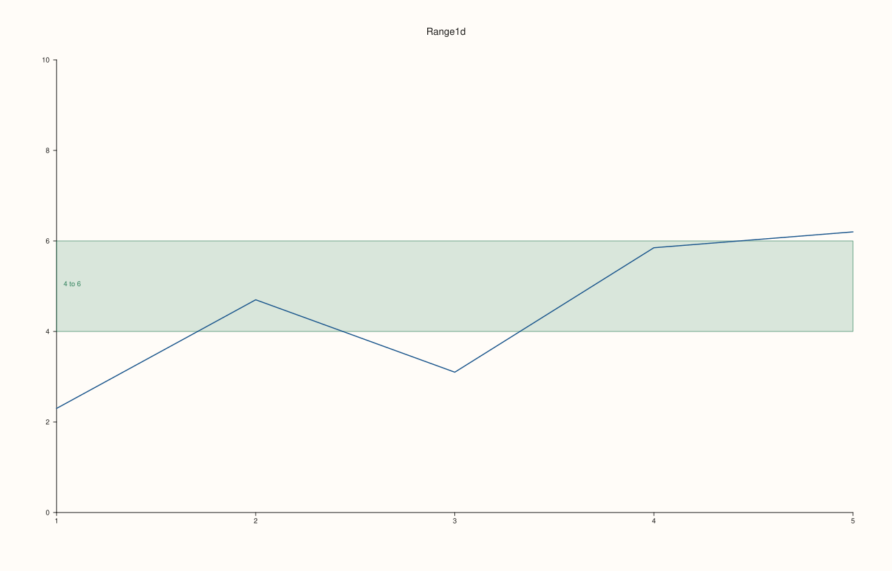
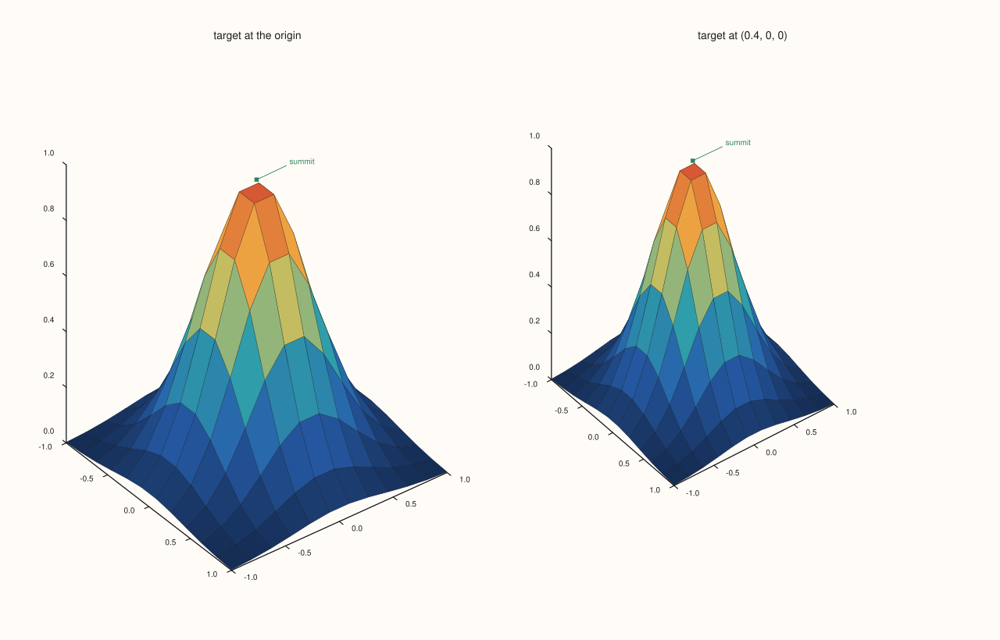
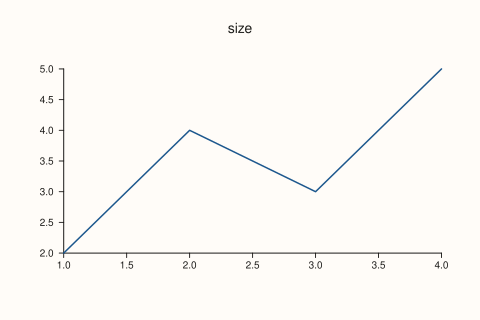

<!-- generated by PlussPl/docs/sphinx/tools/plotdocs.py from tools/specs/Geometry.py; edit the spec -->

# Range1d, Vec3d, Extent2d

[Back to Types and Options Reference](../../types_api_reference)

## What It Does

Three plain structs carry the numbers that the plotting calls take and return.

A **`Range1d`** is an interval with a `low` and a `high` end. It is the argument of the manual limits ([`Pane::x_limits`](../pane/x_limits.md), `y_limits`, `z_limits`, `color_limits`), of a trace's [`color_limits`](../trace/color_limits.md), of the span of a band ([`BandCue`](Cues.md)) and of a `bucket` range. Its default is the unit interval 0 to 1.

A **`Vec3d`** is a point or a direction in three dimensions: the anchor of a [`pin`](../pane/pin.md) on a 3D pane, and the target and up direction of a [`Lens`](Lens.md).

An **`Extent2d`** is the width and height of a figure, in the units of the SVG it is written to (pixels at 96 per inch). A `Studio` has one, readable with `Studio::extent()` and set with [`Studio::size`](../studio/size.md); its default is 1280 by 820.

None of them validates its values on construction. A `Range1d` with `low` above `high`, or a `Vec3d` with a NaN, is accepted as it is, and is rejected, or simply drawn wrongly, by the call that receives it.

## Fields

| Struct | Field | Meaning | Default |
|---|---|---|---|
| `Range1d` | `low`, `high` | The two ends of the interval, in data units. | 0 and 1 |
| `Vec3d` | `x`, `y`, `z` | The coordinates. | 0, 0, 0 |
| `Extent2d` | `width`, `height` | The size of the figure. | 1280 and 820 |

## Examples

Example 1. `Range1d` as manual limits and as a band. The y limits are the range 0 to 10, which leaves the data in the lower half, and a band spans the range 4 to 6 on the same axis.

```cpp
auto fig = studio("geometry_range");
auto& pane = fig.pane2("Range1d");
pane.trend(std::vector<double>{1, 2, 3, 4, 5}, std::vector<double>{2.3, 4.7, 3.1, 5.85, 6.2});
const Range1d limits{0.0, 10.0};
const Range1d window{4.0, 6.0};
pane.y_limits(limits);
pane.band_y(window, "4 to 6");
std::cout << "limits " << pane.y_axis().limits->low << " to " << pane.y_axis().limits->high << "\n";
std::cout << "default Range1d: " << Range1d{}.low << " to " << Range1d{}.high << "\n";
fig.save_svg("figure.svg");
```

### Output

```text
limits 0 to 10
default Range1d: 0 to 1
```



Example 2. `Vec3d` as the anchor of a pin and as the target of the lens. The pin is attached to the point (0, 0, 1) of a 3D pane; the lens is aimed at a point off the centre of the scene, which shifts the picture.

```cpp
constexpr std::int64_t n = 12;
auto coord = pluss::series::linspace(-1.0, 1.0, n, pluss::ScalarType::Float64);
std::vector<double> peak(static_cast<std::size_t>(n * n));
for (std::int64_t i = 0; i < n; ++i)
  for (std::int64_t j = 0; j < n; ++j) {
    const double x = -1.0 + 2.0 * i / (n - 1), y = -1.0 + 2.0 * j / (n - 1);
    peak[static_cast<std::size_t>(i * n + j)] = std::exp(-3.0 * (x * x + y * y));
  }
auto z = pluss::make_series(peak, {n, n});
auto fig = studio("geometry_vec3");
fig.mosaic(1, 2);
for (int i = 0; i < 2; ++i) {
  auto& pane = fig.pane3(i == 0 ? "target at the origin" : "target at (0.4, 0, 0)");
  pane.sheet(coord, coord, z);
  pane.pin("summit", Vec3d{0.0, 0.0, 1.0});
  if (i == 1) pane.lens().target_at(Vec3d{0.4, 0.0, 0.0});
  std::cout << "target (" << pane.lens().target().x << ", " << pane.lens().target().y << ", " << pane.lens().target().z << ")\n";
}
fig.save_svg("figure.svg");
```

### Output

```text
target (0, 0, 0)
target (0.4, 0, 0)
```



Example 3. `Extent2d` as the figure size. `size(width, height)` sets it and `extent()` reads it back; the SVG's own width and height follow. A figure the size of a phone screen and the default one are drawn from the same data.

```cpp
const double sizes[2][2] = {{1280.0, 820.0}, {480.0, 320.0}};
for (int i = 0; i < 2; ++i) {
  auto fig = studio("geometry_extent");
  if (i == 1) fig.size(sizes[1][0], sizes[1][1]);
  fig.pane2("size").trend(std::vector<double>{1, 2, 3, 4}, std::vector<double>{2, 4, 3, 5});
  const Extent2d& e = fig.extent();
  const std::string svg = fig.to_svg();
  const auto at = svg.find("width=\"");
  std::cout << "extent " << e.width << " x " << e.height << ", the SVG begins: " << svg.substr(svg.find("<svg"), 60) << "...\n";
  if (i == 1) fig.save_svg("figure.svg");
}
std::cout << "default Extent2d: " << Extent2d{}.width << " x " << Extent2d{}.height << "\n";
```

### Output

```text
extent 1280 x 820, the SVG begins: <svg xmlns="http://www.w3.org/2000/svg" width="1280.0000" he...
extent 480 x 320, the SVG begins: <svg xmlns="http://www.w3.org/2000/svg" width="480.0000" hei...
default Extent2d: 1280 x 820
```



## Notes

- These structs are aggregates: initialise them with braces (`Range1d{0.0, 10.0}`) or by assigning the fields.
- `Range1d` is not ordered or checked: `Range1d{10.0, 0.0}` is a legal value, and is rejected by the limit calls that require `low < high`.
- Vectors and ranges here are data units; the figure size is in drawing units. Point sizes of fonts, tick lengths and gutters do not scale with the size of the figure.

## See Also

- [`Pane::x_limits`](../pane/x_limits.md), [`Trace::color_limits`](../trace/color_limits.md): the places a `Range1d` is accepted.
- [`Studio::size`](../studio/size.md), [`Studio::extent`](../studio/extent.md): set and read the `Extent2d`.
- [`Cues`](Cues.md), [`Lens`](Lens.md): the `Vec3d` users.

<div class="pluss-inline-prev-next">
  <a class="prev-link" href="Cues.html">
    <span class="label">Previous</span>
    <span class="title">RuleCue, BandCue, PinCue</span>
  </a>
  <a class="next-link" href="GridStyle.html">
    <span class="label">Next</span>
    <span class="title">GridStyle</span>
  </a>
</div>
