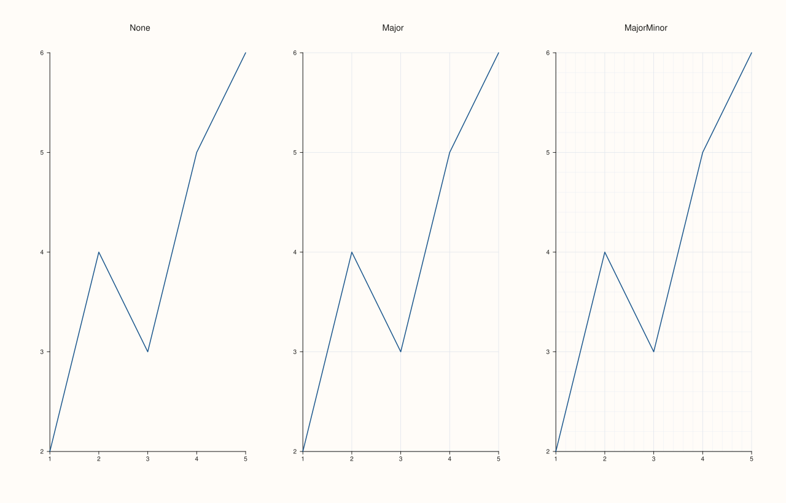
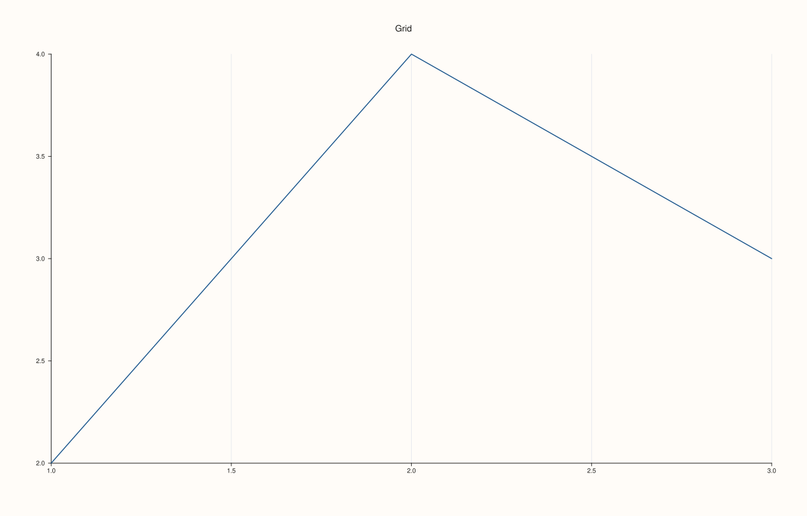
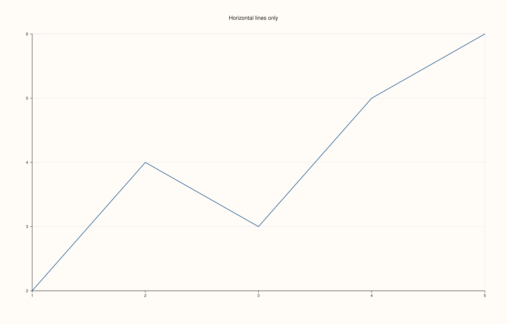
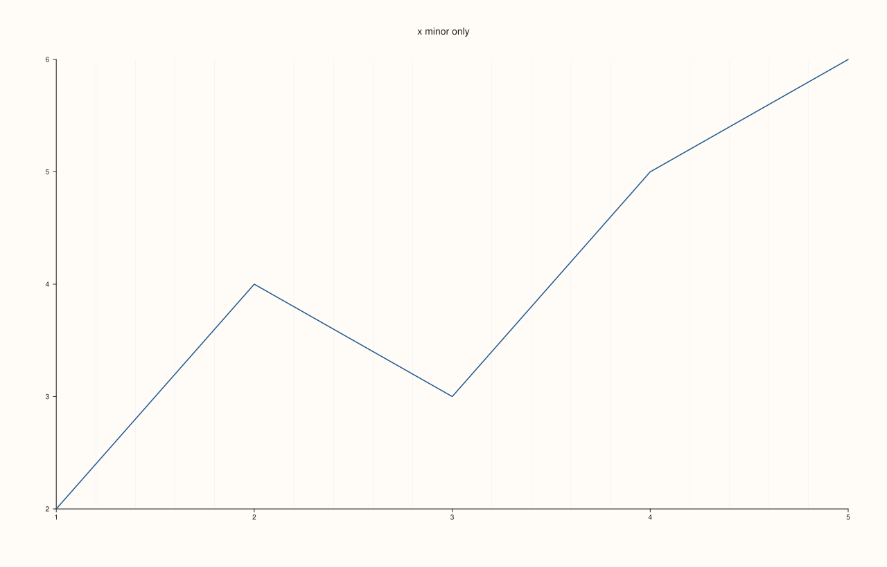
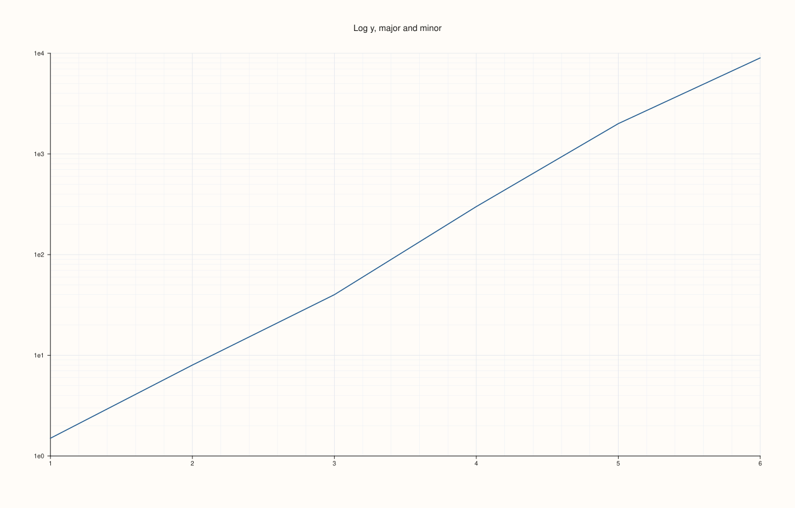

<!-- generated by PlussPl/docs/sphinx/tools/plotdocs.py from tools/specs/GridStyle.py; edit the spec -->

# GridStyle

[Back to Types and Options Reference](../../types_api_reference)

## What It Does

`GridStyle` chooses which grid lines a pane draws behind its data. [`Pane::grid`](../pane/grid.md) takes it for the whole pane at
once, and `Pane::grid_style` reads the pane's current combination back. The same lines can be switched
per axis with the `x_major_grid`, `y_major_grid`, `x_minor_grid` and `y_minor_grid` toggles (and the `z_` pair on a 3D pane), which
is how a pane gets, for example, vertical lines only.

Major lines sit at the labelled ticks and minor lines at the subdivisions between them. Grid lines are drawn behind the data
and never change the limits or the tick labels.

## Values

| Value | Lines drawn | Take it when |
|---|---|---|
| `None` | No grid lines. This is the default of a new pane. | A clean plot, or the data are labelled directly. |
| `Major` | Lines at every labelled tick of the axes. | Values must be read off the axes. |
| `MajorMinor` | Major lines, plus fainter lines between them. | Fine reading, or a log axis where the minor lines carry the decades. |

## Examples

Example 1. The three values on the same data. `None` draws only the axes; `Major` adds a line at each labelled tick; `MajorMinor` adds the fainter subdivisions.

```cpp
const GridStyle styles[] = {GridStyle::None, GridStyle::Major, GridStyle::MajorMinor};
const char* names[] = {"None", "Major", "MajorMinor"};

auto fig = studio("grid_style_gallery");
fig.mosaic(1, 3);
for (int i = 0; i < 3; ++i) {
  auto& pane = fig.pane2(names[i]);
  pane.trend(std::vector<double>{1, 2, 3, 4, 5}, std::vector<double>{2, 4, 3, 5, 6});
  pane.grid(styles[i]);
}
fig.save_svg("figure.svg");
```



Example 2. `grid` sets the whole combination and `grid_style` reads back which of the three it amounts to. Switching an individual axis toggle changes the reported style: after `x_major_grid(true)` alone the pane reports `Major`.

```cpp
auto fig = studio("grid_style_readback");
auto& pane = fig.pane2("Grid");
pane.trend(std::vector<double>{1, 2, 3}, std::vector<double>{2, 4, 3});
std::cout << "default: " << static_cast<int>(pane.grid_style()) << "\n";
pane.grid(GridStyle::MajorMinor);
std::cout << "after grid(MajorMinor): " << static_cast<int>(pane.grid_style()) << "\n";
pane.grid(GridStyle::None);
pane.x_major_grid(true);
std::cout << "after grid(None), x_major_grid(true): " << static_cast<int>(pane.grid_style()) << "\n";
fig.save_svg("figure.svg");
```

### Output

```text
default: 0
after grid(MajorMinor): 2
after grid(None), x_major_grid(true): 1
```



Example 3. The per-axis toggles. Only the y-axis has major lines here, so the plot has horizontal lines to read values across, and none vertically.

```cpp
auto fig = studio("grid_style_per_axis");
auto& pane = fig.pane2("Horizontal lines only");
pane.trend(std::vector<double>{1, 2, 3, 4, 5}, std::vector<double>{2, 4, 3, 5, 6});
pane.y_major_grid(true);
fig.save_svg("figure.svg");
```



Example 4. Minor lines can be turned on without major lines. Here only the x-axis has minor lines, drawn between the labelled ticks.

```cpp
auto fig = studio("grid_style_minor_only");
auto& pane = fig.pane2("x minor only");
pane.trend(std::vector<double>{1, 2, 3, 4, 5}, std::vector<double>{2, 4, 3, 5, 6});
pane.x_minor_grid(true);
fig.save_svg("figure.svg");
```



Example 5. On a logarithmic axis `MajorMinor` earns its place: the major lines are the labelled decades, and the minor lines subdivide each decade, crowding together towards its top as a logarithmic axis does.

```cpp
auto fig = studio("grid_style_log");
auto& pane = fig.pane2("Log y, major and minor");
pane.trend(std::vector<double>{1, 2, 3, 4, 5, 6}, std::vector<double>{1.5, 8, 40, 300, 2000, 9000});
pane.scale_y(ScalePolicy::log10());
pane.grid(GridStyle::MajorMinor);
fig.save_svg("figure.svg");
```



## Notes

- A new pane starts with no grid; a figure-wide default can be set once with [`Studio::pane_style_defaults`](../studio/pane_style_defaults.md) so that every pane created afterwards starts with it.
- The grid is part of the pane, not of a trace: it is drawn whether or not the pane has traces, and it is unaffected by a trace's visibility.

## See Also

- [`Pane::grid`](../pane/grid.md), `Pane::grid_style`: set and read the style.
- [`Pane::x_major_grid`](../pane/x_major_grid.md) and the other axis toggles.
- [`ScalePolicy`](ScalePolicy.md): the log axis whose minor grid lines carry the decades.

<div class="pluss-inline-prev-next">
  <a class="prev-link" href="Geometry.html">
    <span class="label">Previous</span>
    <span class="title">Range1d, Vec3d, Extent2d</span>
  </a>
  <a class="next-link" href="KeyDock.html">
    <span class="label">Next</span>
    <span class="title">KeyDock</span>
  </a>
</div>
