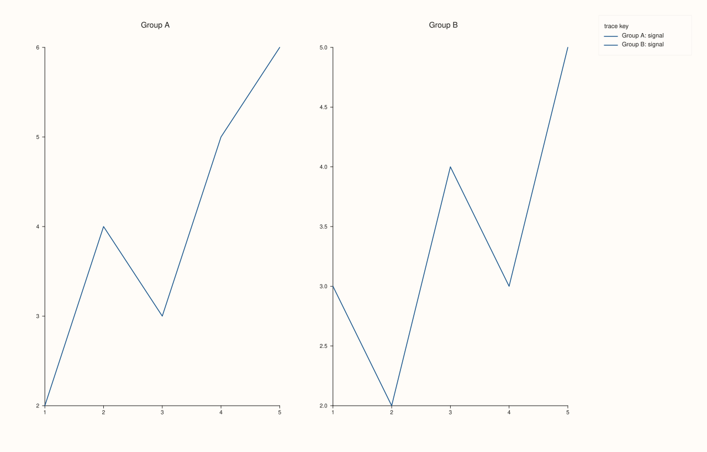
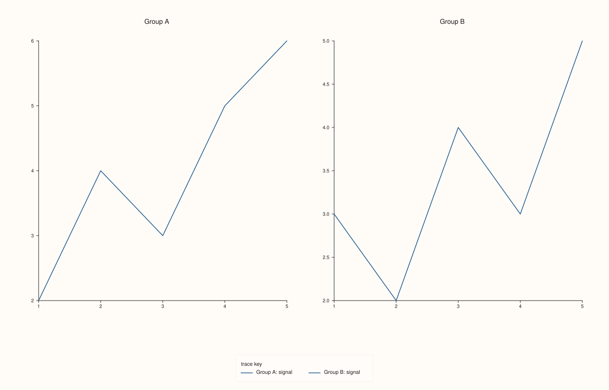
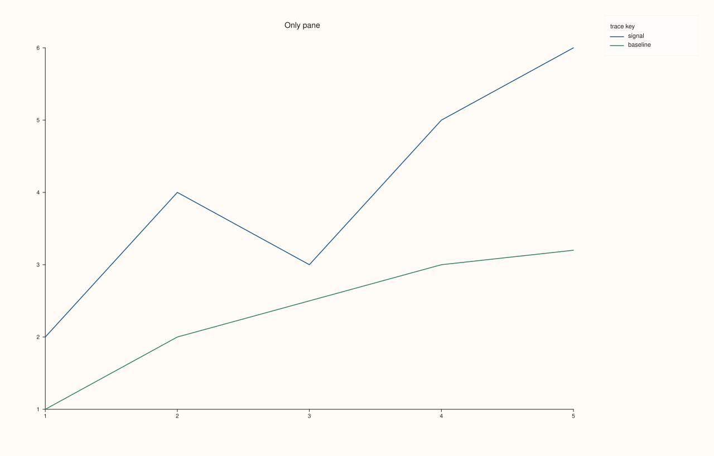
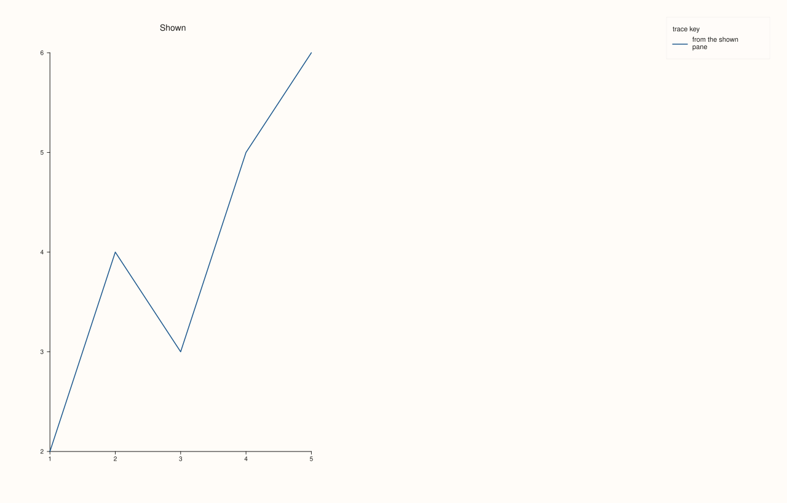

<!-- generated by PlussPl/docs/sphinx/tools/plotdocs.py from tools/specs/KeyDock.py; edit the spec -->

# KeyDock

[Back to Types and Options Reference](../../types_api_reference)

## What It Does

`KeyDock` chooses where the figure-wide legend is docked. [`Studio::legend`](../studio/legend.md) takes it. A docked legend pools
the labelled traces of **every visible pane** into one key at an edge of the whole figure, so a figure of several panes
that share series names needs one key instead of one per pane. When more than one pane is visible each entry is prefixed
with the title of its pane, so entries from different panes stay distinguishable; with a single visible pane no prefix is added.

The docked legend is independent of each pane's own inset legend ([`KeyPlace`](KeyPlace.md)): a figure can have either, both or
neither. A trace with no [`label`](../trace/label.md) is never listed.

## Values

| Value | Where the legend goes | Take it when |
|---|---|---|
| `None` | No docked legend. This is the default of a new `Studio`. | Each pane carries its own key, or none is needed. |
| `East` | A column at the right edge of the figure. | Several panes, many entries, or a tall figure. |
| `South` | A band along the bottom edge of the figure. | Few entries and a wide figure. |

There is no `West` or `North`.

## Examples

Example 1. The three values on the same two-pane figure. `None` draws no key; `East` and `South` draw one pooled key, with each entry prefixed by the title of its pane.

```cpp
const KeyDock docks[] = {KeyDock::None, KeyDock::East, KeyDock::South};
const char* names[] = {"None", "East", "South"};
for (int i = 0; i < 3; ++i) {
  auto fig = studio(std::string("key_dock_") + names[i]);
  fig.mosaic(1, 2);
  auto& a = fig.pane2("Group A");
  a.trend(std::vector<double>{1, 2, 3, 4, 5}, std::vector<double>{2, 4, 3, 5, 6}).label("signal");
  auto& b = fig.pane2("Group B");
  b.trend(std::vector<double>{1, 2, 3, 4, 5}, std::vector<double>{3, 2, 4, 3, 5}).label("signal");
  fig.legend(docks[i]);
  std::cout << names[i] << ": legend_dock() = " << static_cast<int>(fig.legend_dock()) << "\n";
  if (i == 1) fig.save_svg("figure.svg");
}
```

### Output

```text
None: legend_dock() = 0
East: legend_dock() = 1
South: legend_dock() = 2
```



Example 2. `South` on the same figure, so that the band along the bottom edge can be compared with the column on the east edge of Example 1.

```cpp
auto fig = studio("key_dock_south");
fig.mosaic(1, 2);
auto& a = fig.pane2("Group A");
a.trend(std::vector<double>{1, 2, 3, 4, 5}, std::vector<double>{2, 4, 3, 5, 6}).label("signal");
auto& b = fig.pane2("Group B");
b.trend(std::vector<double>{1, 2, 3, 4, 5}, std::vector<double>{3, 2, 4, 3, 5}).label("signal");
fig.legend(KeyDock::South);
fig.save_svg("figure.svg");
```



Example 3. With a single visible pane the entries are not prefixed with a pane title, because the prefix would carry no information.

```cpp
auto fig = studio("key_dock_single");
auto& pane = fig.pane2("Only pane");
pane.trend(std::vector<double>{1, 2, 3, 4, 5}, std::vector<double>{2, 4, 3, 5, 6}).label("signal");
pane.trend(std::vector<double>{1, 2, 3, 4, 5}, std::vector<double>{1, 2, 2.5, 3, 3.2}).label("baseline");
fig.legend(KeyDock::East);
fig.save_svg("figure.svg");
```



Example 4. Only visible panes contribute. The second pane is hidden, so only the first pane's label is pooled, and since one visible pane remains no prefix is added.

```cpp
auto fig = studio("key_dock_hidden");
fig.mosaic(1, 2);
auto& a = fig.pane2("Shown");
a.trend(std::vector<double>{1, 2, 3, 4, 5}, std::vector<double>{2, 4, 3, 5, 6}).label("from the shown pane");
auto& b = fig.pane2("Hidden");
b.trend(std::vector<double>{1, 2, 3, 4, 5}, std::vector<double>{3, 2, 4, 3, 5}).label("from the hidden pane");
b.hide();
fig.legend(KeyDock::East);
fig.save_svg("figure.svg");
```



## Notes

- The docked legend and a pane's inset legend are drawn independently. If you want only the pooled key, leave every pane's [`KeyPlace`](KeyPlace.md) at `None`, which is its default.
- The look of the docked legend is set with `Studio::legend_frame` ([`KeyFrame`](KeyFrame.md)) and `Studio::legend_shape` ([`KeyShape`](KeyShape.md)).

## See Also

- [`Studio::legend`](../studio/legend.md): sets the dock.
- [`Studio::legend_dock`](../studio/legend_dock.md): reads it back.
- [`KeyPlace`](KeyPlace.md): the per-pane inset legend.

<div class="pluss-inline-prev-next">
  <a class="prev-link" href="GridStyle.html">
    <span class="label">Previous</span>
    <span class="title">GridStyle</span>
  </a>
  <a class="next-link" href="KeyFrame.html">
    <span class="label">Next</span>
    <span class="title">KeyFrame</span>
  </a>
</div>
