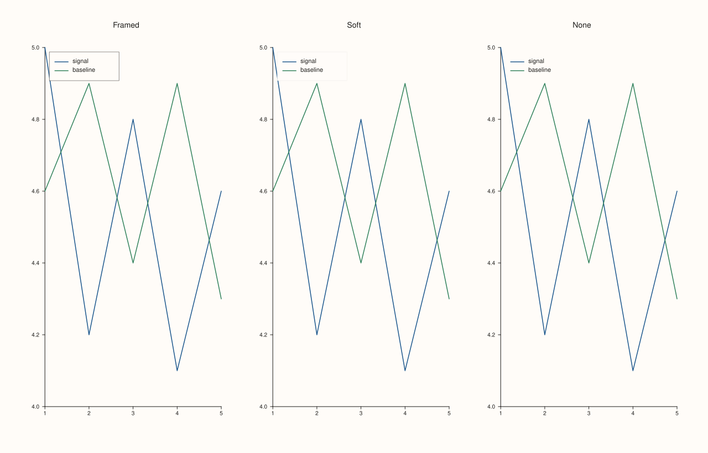
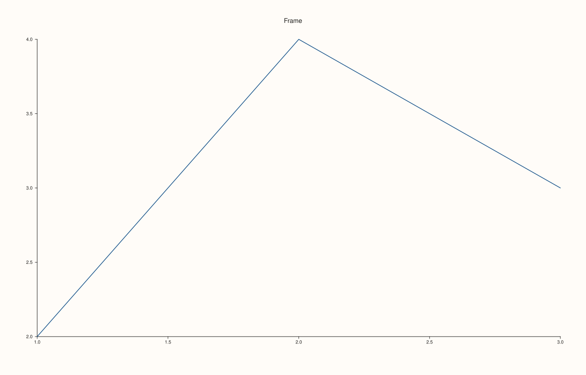
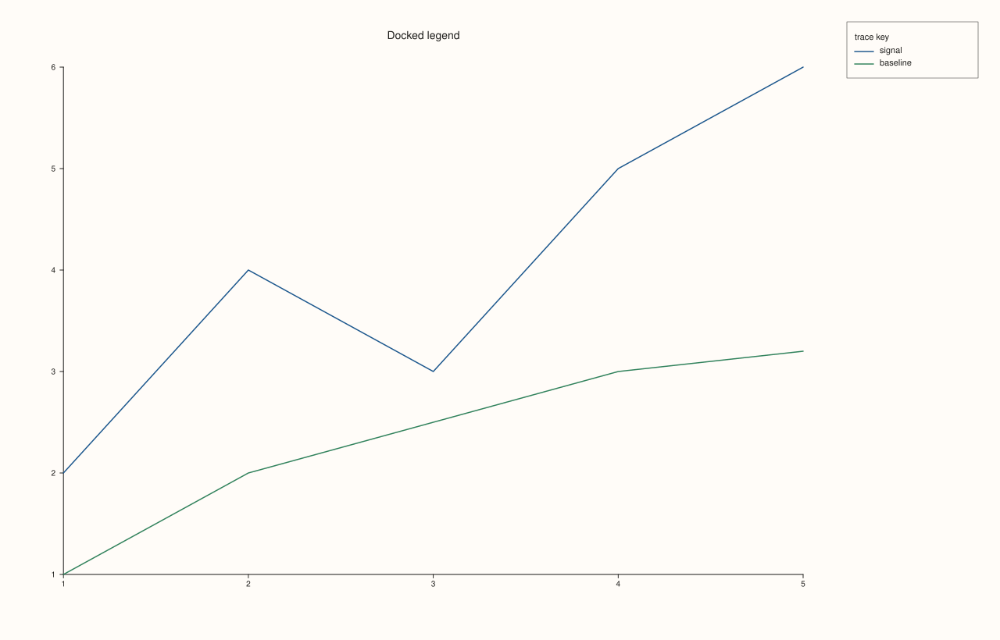

<!-- generated by PlussPl/docs/sphinx/tools/plotdocs.py from tools/specs/KeyFrame.py; edit the spec -->

# KeyFrame

[Back to Types and Options Reference](../../types_api_reference)

## What It Does

`KeyFrame` chooses how a legend is boxed. It applies to a pane's inset legend ([`Pane::legend_frame`](../pane/legend_frame.md))
and to the figure-wide docked legend ([`Studio::legend_frame`](../studio/legend_frame.md)). It changes only the box
around the entries; what the legend lists, and where it sits, are set by [`KeyPlace`](KeyPlace.md), [`KeyDock`](KeyDock.md)
and [`KeyShape`](KeyShape.md).

A frame helps a legend that sits over a busy plot area, because the box keeps the entries readable against the lines behind
them. A legend outside the plot area, or over empty space, usually looks cleaner without one.

## Values

| Value | Appearance | Take it when |
|---|---|---|
| `Framed` | A box with a visible outline. | The legend overlaps the data and must stand apart from it. |
| `Soft` | A box with a faint fill and a faint outline. | A light separation from the data is enough. |
| `None` | No box: the entries are drawn directly. | The legend is outside the plot area or over empty space. |

## Pane and figure

A pane has its own frame setting for its inset legend and the `Studio` has one for the docked legend. They do not affect
each other. The default of a new pane is `Soft`: Example 2 prints it before any call. A pane or a `Studio` that never calls
`legend_frame` keeps that default.

## Examples

Example 1. The three frames on the same pane. The legend is placed over the data in the top-left corner so that the difference in separation between the box and the lines is visible.

```cpp
const KeyFrame frames[] = {KeyFrame::Framed, KeyFrame::Soft, KeyFrame::None};
const char* names[] = {"Framed", "Soft", "None"};

auto fig = studio("key_frame_gallery");
fig.mosaic(1, 3);
for (int i = 0; i < 3; ++i) {
  auto& pane = fig.pane2(names[i]);
  pane.trend(std::vector<double>{1, 2, 3, 4, 5}, std::vector<double>{5, 4.2, 4.8, 4.1, 4.6}).label("signal");
  pane.trend(std::vector<double>{1, 2, 3, 4, 5}, std::vector<double>{4.6, 4.9, 4.4, 4.9, 4.3}).label("baseline");
  pane.legend(KeyPlace::NorthWest);
  pane.legend_frame(frames[i]);
}
fig.save_svg("figure.svg");
```



Example 2. `legend_frame` returns the pane and the getter reads the value back. The library default of a new pane is printed first.

```cpp
auto fig = studio("key_frame_readback");
auto& pane = fig.pane2("Frame");
pane.trend(std::vector<double>{1, 2, 3}, std::vector<double>{2, 4, 3}).label("signal");
std::cout << "default: " << static_cast<int>(pane.legend_frame()) << "\n";
for (KeyFrame f : {KeyFrame::Framed, KeyFrame::Soft, KeyFrame::None}) {
  pane.legend_frame(f);
  std::cout << static_cast<int>(f) << " -> " << static_cast<int>(pane.legend_frame()) << "\n";
}
fig.save_svg("figure.svg");
```

### Output

```text
default: 1
0 -> 0
1 -> 1
2 -> 2
```



Example 3. The same three frames on a docked, figure-wide legend. `Studio::legend_frame` frames the one legend that `Studio::legend` docks to the east edge of the figure, whatever the panes' own settings are.

```cpp
const KeyFrame frames[] = {KeyFrame::Framed, KeyFrame::Soft, KeyFrame::None};
for (int i = 0; i < 3; ++i) {
  auto fig = studio("key_frame_docked");
  auto& pane = fig.pane2("Docked legend");
  pane.trend(std::vector<double>{1, 2, 3, 4, 5}, std::vector<double>{2, 4, 3, 5, 6}).label("signal");
  pane.trend(std::vector<double>{1, 2, 3, 4, 5}, std::vector<double>{1, 2, 2.5, 3, 3.2}).label("baseline");
  fig.legend(KeyDock::East);
  fig.legend_frame(frames[i]);
  std::cout << "Studio frame " << static_cast<int>(fig.legend_frame()) << "\n";
  if (i == 0) fig.save_svg("figure.svg");
}
```

### Output

```text
Studio frame 0
Studio frame 1
Studio frame 2
```



## Notes

- The default frame of a new pane is `Soft`.
- `Soft` and `Framed` differ only in how strongly the box is drawn: both keep the entries in a box, and neither changes the layout of the entries.

## See Also

- [`Pane::legend_frame`](../pane/legend_frame.md), [`Studio::legend_frame`](../studio/legend_frame.md): set the frame.
- [`KeyPlace`](KeyPlace.md), [`KeyDock`](KeyDock.md), [`KeyShape`](KeyShape.md): the other legend options.

<div class="pluss-inline-prev-next">
  <a class="prev-link" href="KeyDock.html">
    <span class="label">Previous</span>
    <span class="title">KeyDock</span>
  </a>
  <a class="next-link" href="KeyPlace.html">
    <span class="label">Next</span>
    <span class="title">KeyPlace</span>
  </a>
</div>
