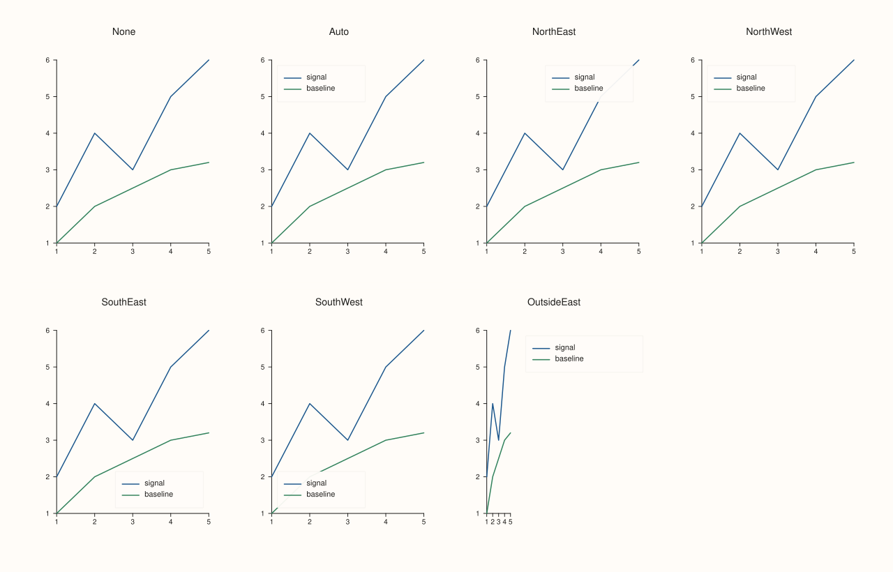
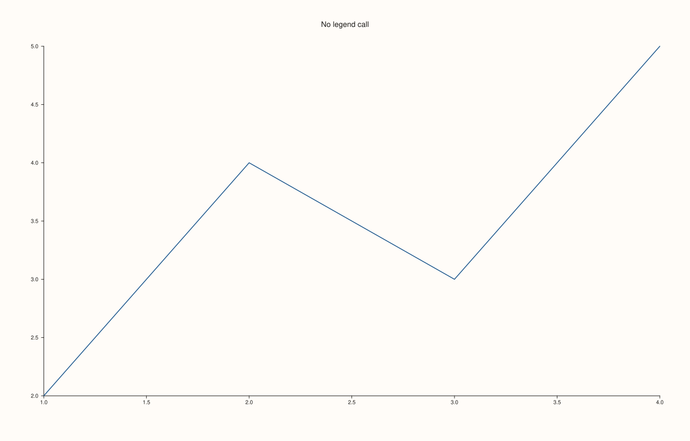
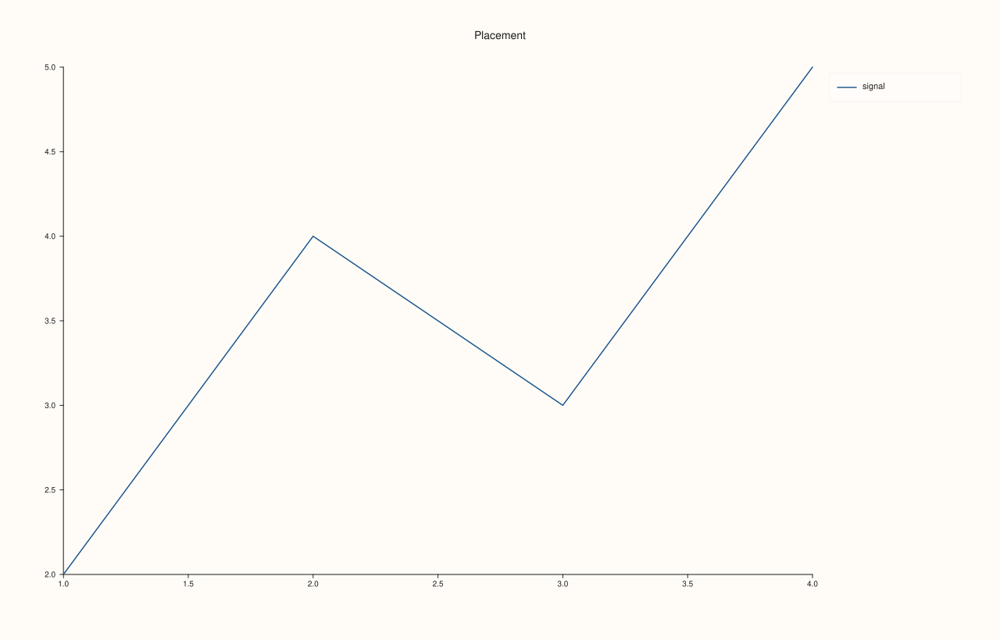
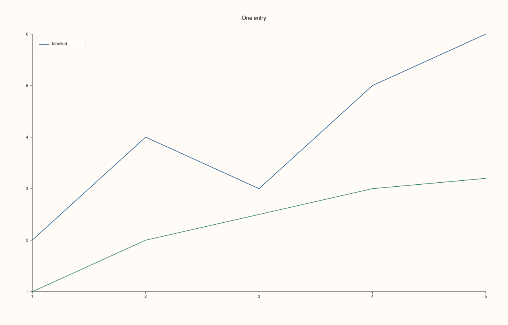
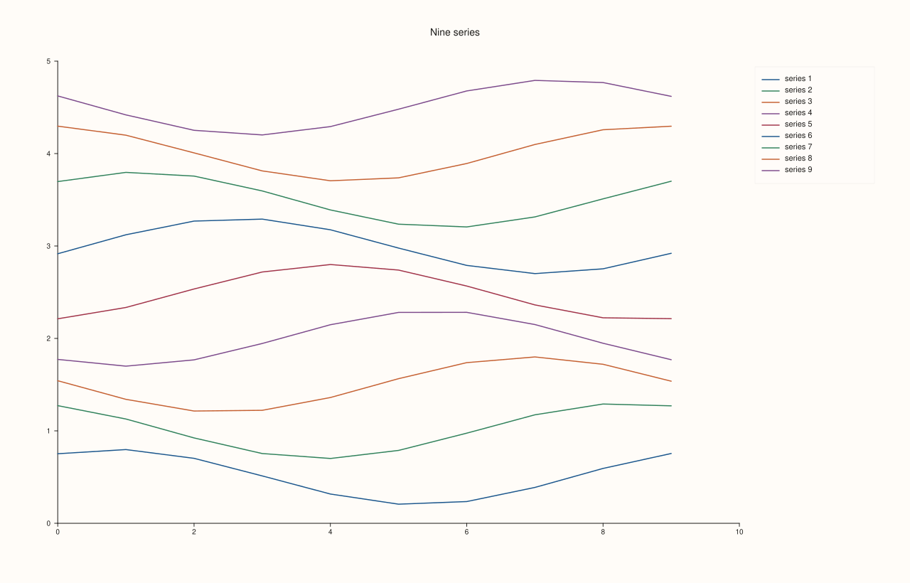

<!-- generated by PlussPl/docs/sphinx/tools/plotdocs.py from tools/specs/KeyPlace.py; edit the spec -->

# KeyPlace

[Back to Types and Options Reference](../../types_api_reference)

## What It Does

`KeyPlace` says where a pane draws its **inset legend**: the key that lists the labelled traces of that one pane. It is the
argument of [`Pane::legend`](../pane/legend.md) and the value that [`Pane::legend_place`](../pane/legend_place.md) reads
back. A legend only ever lists traces that have a [`label`](../trace/label.md); a trace with no label is never drawn in it,
whatever the placement.

A pane's own legend is independent of the figure-wide legend that [`Studio::legend`](../studio/legend.md) docks to an edge of
the whole figure with a [`KeyDock`](KeyDock.md). The two can be used together, one without the other, or not at all.
Choose a corner when the data leave one clear, `Auto` when you do not want to look at the data, and `OutsideEast` when the
plot area must stay completely free of the key.

## Values

| Value | Where the legend goes | Take it when |
|---|---|---|
| `None` | No inset legend. This is the default of every new pane. | The labels are explained elsewhere, or the figure has a docked legend. |
| `Auto` | A corner chosen by the renderer. | You want a legend and do not want to choose a corner. |
| `NorthEast` | Inside the plot area, top right. | Data that rise to the right leave the top left empty, so prefer `NorthWest`; data that fall leave this corner empty. |
| `NorthWest` | Inside the plot area, top left. | Rising data. |
| `SouthEast` | Inside the plot area, bottom right. | Rising data that start high. |
| `SouthWest` | Inside the plot area, bottom left. | Falling data. |
| `OutsideEast` | Outside the plot area, to the right of it. | The plot area must not be covered at all, or there are many entries. |

## Reading and changing the placement

`Pane::legend(place)` sets it and returns the pane, so it chains. `Pane::legend_place()` returns the current value, and a pane that
never called `legend` reports `KeyPlace::None`. The shape and the frame of the legend are separate options,
[`KeyShape`](KeyShape.md) and [`KeyFrame`](KeyFrame.md), set with `Pane::legend_shape` and `Pane::legend_frame`.

## Examples

Example 1. Every value on the same two series, one pane per value. `None` draws no key at all; the four corners and `OutsideEast` draw the same key in five different places; `Auto` is the renderer's choice.

```cpp
const KeyPlace places[] = {KeyPlace::None, KeyPlace::Auto, KeyPlace::NorthEast,
                           KeyPlace::NorthWest, KeyPlace::SouthEast, KeyPlace::SouthWest,
                           KeyPlace::OutsideEast};
const char* names[] = {"None", "Auto", "NorthEast", "NorthWest", "SouthEast", "SouthWest", "OutsideEast"};

auto fig = studio("key_place_gallery");
fig.mosaic(2, 4);
for (int i = 0; i < 7; ++i) {
  auto& pane = fig.pane2(names[i]);
  pane.trend(std::vector<double>{1, 2, 3, 4, 5}, std::vector<double>{2, 4, 3, 5, 6}).label("signal");
  pane.trend(std::vector<double>{1, 2, 3, 4, 5}, std::vector<double>{1, 2, 2.5, 3, 3.2}).label("baseline");
  pane.legend(places[i]);
}
fig.save_svg("figure.svg");
```



Example 2. The default. A pane that never calls `legend` reports `None`, and its labelled traces are not listed anywhere.

```cpp
auto fig = studio("key_place_default");
auto& pane = fig.pane2("No legend call");
pane.trend(std::vector<double>{1, 2, 3, 4}, std::vector<double>{2, 4, 3, 5}).label("signal");
std::cout << "legend_place() is None: " << (pane.legend_place() == KeyPlace::None) << "\n";
fig.save_svg("figure.svg");
```

### Output

```text
legend_place() is None: 1
```



Example 3. `legend` returns the pane, and `legend_place` reads the value back. The underlying integers are the declaration order of the enumerators, which is what a stored or serialised value would contain.

```cpp
auto fig = studio("key_place_readback");
auto& pane = fig.pane2("Placement");
pane.trend(std::vector<double>{1, 2, 3, 4}, std::vector<double>{2, 4, 3, 5}).label("signal");
for (KeyPlace place : {KeyPlace::None, KeyPlace::Auto, KeyPlace::NorthEast, KeyPlace::NorthWest,
                       KeyPlace::SouthEast, KeyPlace::SouthWest, KeyPlace::OutsideEast}) {
  pane.legend(place);
  std::cout << static_cast<int>(pane.legend_place()) << " ";
}
std::cout << "\n";
fig.save_svg("figure.svg");
```

### Output

```text
0 1 2 3 4 5 6
```



Example 4. Only labelled traces are listed. The second trace has no `label`, so a legend with two lines in the plot has one entry.

```cpp
auto fig = studio("key_place_unlabelled");
auto& pane = fig.pane2("One entry");
pane.trend(std::vector<double>{1, 2, 3, 4, 5}, std::vector<double>{2, 4, 3, 5, 6}).label("labelled");
pane.trend(std::vector<double>{1, 2, 3, 4, 5}, std::vector<double>{1, 2, 2.5, 3, 3.2});
pane.legend(KeyPlace::NorthWest);
fig.save_svg("figure.svg");
```



Example 5. `OutsideEast` leaves the whole plot area free of the key. With nine labelled series a key inside the plot area would cover data in every corner; outside, it takes width from the figure instead.

```cpp
auto fig = studio("key_place_outside");
auto& pane = fig.pane2("Nine series");
for (int k = 1; k <= 9; ++k) {
  std::vector<double> x, y;
  for (int i = 0; i < 10; ++i) { x.push_back(i); y.push_back(k * 0.5 + 0.3 * std::sin(0.7 * i + k)); }
  pane.trend(x, y).label("series " + std::to_string(k));
}
pane.legend(KeyPlace::OutsideEast);
fig.save_svg("figure.svg");
```



## Notes

- `Auto` chooses for the data it is given. Do not rely on a particular corner: an explicit value is the only way to make the placement part of the figure's specification.
- A pane's legend lists that pane's labelled traces only. To pool the traces of every pane into one key, use [`Studio::legend`](../studio/legend.md) with a [`KeyDock`](KeyDock.md).
- The placement is read when the figure is rendered, so calling `legend` at any point before `save_svg`, `save_png` or `show` has the same effect.

## See Also

- [`Pane::legend`](../pane/legend.md): sets the placement.
- [`Pane::legend_place`](../pane/legend_place.md): reads it back.
- [`KeyShape`](KeyShape.md), [`KeyFrame`](KeyFrame.md): the layout and the frame of the key.
- [`KeyDock`](KeyDock.md): the figure-wide legend.

<div class="pluss-inline-prev-next">
  <a class="prev-link" href="KeyFrame.html">
    <span class="label">Previous</span>
    <span class="title">KeyFrame</span>
  </a>
  <a class="next-link" href="KeyShape.html">
    <span class="label">Next</span>
    <span class="title">KeyShape</span>
  </a>
</div>
