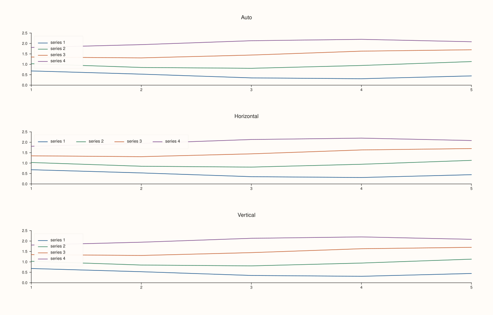
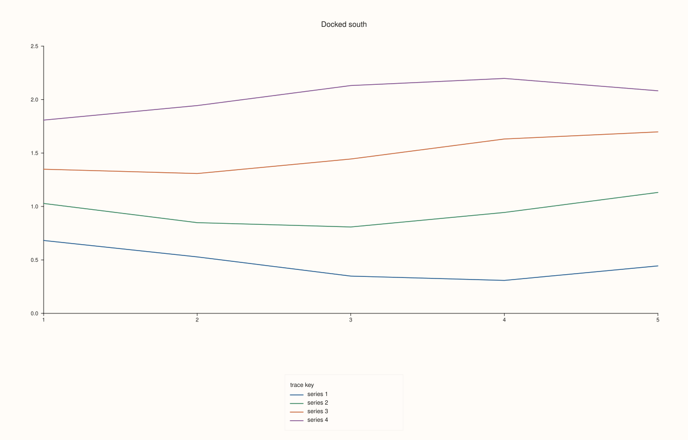
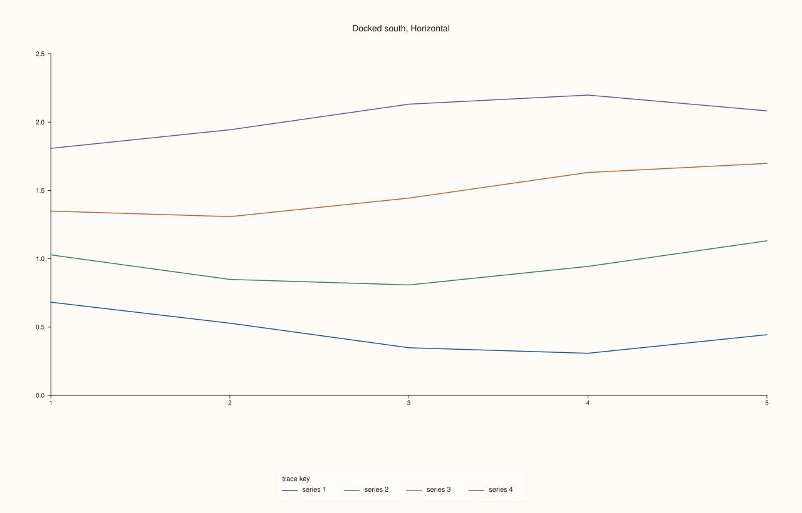
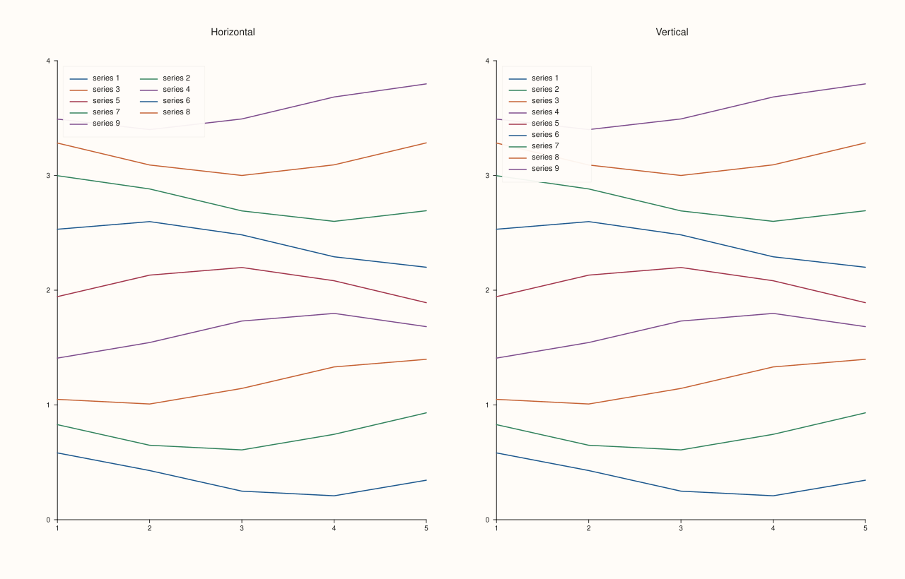
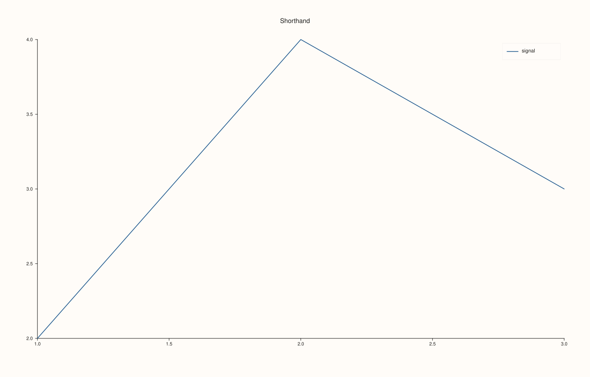

<!-- generated by PlussPl/docs/sphinx/tools/plotdocs.py from tools/specs/KeyShape.py; edit the spec -->

# KeyShape

[Back to Types and Options Reference](../../types_api_reference)

## What It Does

`KeyShape` chooses how a legend arranges its entries: stacked in a **column**, one entry per line, or side by side in a **row**. It applies to a
pane's inset legend ([`Pane::legend_shape`](../pane/legend_shape.md)) and to the docked, figure-wide legend ([`Studio::legend_shape`](../studio/legend_shape.md)).

`Vertical` always stacks the entries in one column. `Horizontal` puts them in a row, and when the row would be wider than the room the legend has, it fills the width with as many columns as
fit and continues on the next line, so a long list still ends up as a compact grid rather than as one very wide strip. `Auto`, the default, chooses by where the legend is: a row for a legend docked to the
bottom edge of the figure (`KeyDock::South`), where a row sits naturally beneath a wide plot, and a column everywhere else, including every inset legend and the east dock.

In a column, a long label wraps onto further lines inside the box. In a row each column has the width of the widest label.

The `ks` namespace holds the same three values as shorter spellings, so a call can read `pane.legend_shape(ks::Horizontal)`. They are the same constants, not a different type.

## Values

| Value | Arrangement | Take it when |
|---|---|---|
| `Auto` | A row for a legend docked `South`; a column for every other legend. This is the default. | You have no preference. |
| `Horizontal` | Entries side by side, as many columns as fit in the width, then further rows. | The legend sits above or below a wide plot, or an inset legend should be short rather than tall. |
| `Vertical` | One entry per line. | The legend sits beside the plot, or the labels are long. |

## Room

A legend has limited room: an inset legend can be at most about half the width of the plot, an `OutsideEast` legend between 168 and 280 points wide, an east-docked legend a quarter of the figure's width, and a legend is also limited in
height. A `Horizontal` legend whose labels are too long for two columns to fit in that width falls back to a single column, and entries that still do not fit the height are cut and replaced by a `... +N more` line.

## Examples

Example 1. The three shapes on an inset legend with four short labels, in three panes one above the other so that each has room for a row. `Auto` and `Vertical` stack the entries; `Horizontal` puts the four in one row, which is shorter and wider. (In a narrow pane there is no room for a row, and `Horizontal` fits as many columns as the width allows, as Example 5 shows.)

```cpp
const KeyShape shapes[] = {KeyShape::Auto, KeyShape::Horizontal, KeyShape::Vertical};
const char* names[] = {"Auto", "Horizontal", "Vertical"};

auto fig = studio("key_shape_gallery");
fig.mosaic(3, 1);
for (int i = 0; i < 3; ++i) {
  auto& pane = fig.pane2(names[i]);
  for (int k = 1; k <= 4; ++k) {
    std::vector<double> x{1, 2, 3, 4, 5}, y;
    for (double v : x) y.push_back(0.5 * k + 0.2 * std::sin(v + k));
    pane.trend(x, y).label("series " + std::to_string(k));
  }
  pane.legend(KeyPlace::NorthWest);
  pane.legend_shape(shapes[i]);
}
fig.save_svg("figure.svg");
```



Example 2. The docked legend. At the bottom edge `Auto` is already a row, so it equals `Horizontal` (the first comparison is true) and differs from `Vertical`, the stacked version (the second is false). The saved figure is `Vertical`, to compare with the row of Example 3.

```cpp
const KeyShape shapes[] = {KeyShape::Auto, KeyShape::Horizontal, KeyShape::Vertical};
std::string svg[3];
for (int i = 0; i < 3; ++i) {
  auto fig = studio("key_shape_docked_south");
  auto& pane = fig.pane2("Docked south");
  for (int k = 1; k <= 4; ++k) {
    std::vector<double> x{1, 2, 3, 4, 5}, y;
    for (double v : x) y.push_back(0.5 * k + 0.2 * std::sin(v + k));
    pane.trend(x, y).label("series " + std::to_string(k));
  }
  fig.legend(KeyDock::South);
  fig.legend_shape(shapes[i]);
  svg[i] = fig.to_svg();
  if (i == 2) fig.save_svg("figure.svg");
}
std::cout << "Auto == Horizontal at the south edge: " << (svg[0] == svg[1]) << "\n";
std::cout << "Auto == Vertical at the south edge:   " << (svg[0] == svg[2]) << "\n";
```

### Output

```text
Auto == Horizontal at the south edge: 1
Auto == Vertical at the south edge:   0
```



Example 3. The same docked legend as a row. Four entries run side by side beneath the plot, under the legend's title; the figure is `Horizontal`.

```cpp
auto fig = studio("key_shape_south_row");
auto& pane = fig.pane2("Docked south, Horizontal");
for (int k = 1; k <= 4; ++k) {
  std::vector<double> x{1, 2, 3, 4, 5}, y;
  for (double v : x) y.push_back(0.5 * k + 0.2 * std::sin(v + k));
  pane.trend(x, y).label("series " + std::to_string(k));
}
fig.legend(KeyDock::South);
fig.legend_shape(KeyShape::Horizontal);
fig.save_svg("figure.svg");
```



Example 4. On the east dock `Auto` is a column, so `Auto` and `Vertical` are the same figure (first comparison true), while `Horizontal` differs (second false). With long labels a row cannot fit in the width of the east dock, so `Horizontal` there is a column too, as the third comparison shows.

```cpp
const KeyShape shapes[] = {KeyShape::Auto, KeyShape::Horizontal, KeyShape::Vertical};
std::string svg[3];
for (int i = 0; i < 3; ++i) {
  auto fig = studio("key_shape_east");
  auto& pane = fig.pane2("Docked east");
  for (int k = 1; k <= 4; ++k) {
    std::vector<double> x{1, 2, 3, 4, 5}, y;
    for (double v : x) y.push_back(0.5 * k + 0.2 * std::sin(v + k));
    pane.trend(x, y).label("series " + std::to_string(k));
  }
  fig.legend(KeyDock::East);
  fig.legend_shape(shapes[i]);
  svg[i] = fig.to_svg();
}
std::cout << "Auto == Vertical at the east edge:   " << (svg[0] == svg[2]) << "\n";
std::cout << "Auto == Horizontal at the east edge: " << (svg[0] == svg[1]) << "\n";

std::string longer[2];
for (int i = 0; i < 2; ++i) {
  auto fig = studio("key_shape_east_long");
  auto& pane = fig.pane2("Docked east, long labels");
  for (int k = 1; k <= 4; ++k) {
    std::vector<double> x{1, 2, 3, 4, 5}, y;
    for (double v : x) y.push_back(0.5 * k + 0.2 * std::sin(v + k));
    pane.trend(x, y).label("a long descriptive name for series number " + std::to_string(k));
  }
  fig.legend(KeyDock::East);
  fig.legend_shape(i == 0 ? KeyShape::Horizontal : KeyShape::Vertical);
  longer[i] = fig.to_svg();
}
std::cout << "long labels, Horizontal == Vertical: " << (longer[0] == longer[1]) << "\n";
```

### Output

```text
Auto == Vertical at the east edge:   1
Auto == Horizontal at the east edge: 0
long labels, Horizontal == Vertical: 0
```

Example 5. A long list as a row. Nine entries in a `Horizontal` inset legend are laid out as a grid with as many columns as fit the width, instead of one very wide strip; `Vertical` gives the tall column.

```cpp
const KeyShape shapes[] = {KeyShape::Horizontal, KeyShape::Vertical};
const char* names[] = {"Horizontal", "Vertical"};
auto fig = studio("key_shape_many");
fig.mosaic(1, 2);
for (int i = 0; i < 2; ++i) {
  auto& pane = fig.pane2(names[i]);
  for (int k = 1; k <= 9; ++k) {
    std::vector<double> x{1, 2, 3, 4, 5}, y;
    for (double v : x) y.push_back(0.4 * k + 0.2 * std::sin(v + k));
    pane.trend(x, y).label("series " + std::to_string(k));
  }
  pane.legend(KeyPlace::NorthWest);
  pane.legend_shape(shapes[i]);
}
fig.save_svg("figure.svg");
```



Example 6. The `ks` spellings are the same constants: the comparisons are true, so either spelling can be used wherever a `KeyShape` is expected.

```cpp
auto fig = studio("key_shape_shorthand");
auto& pane = fig.pane2("Shorthand");
pane.trend(std::vector<double>{1, 2, 3}, std::vector<double>{2, 4, 3}).label("signal");
pane.legend(KeyPlace::NorthEast).legend_shape(ks::Horizontal);
std::cout << "ks::Horizontal == KeyShape::Horizontal: " << (ks::Horizontal == KeyShape::Horizontal) << "\n";
std::cout << "legend_shape() == ks::Horizontal: " << (pane.legend_shape() == ks::Horizontal) << "\n";
fig.save_svg("figure.svg");
```

### Output

```text
ks::Horizontal == KeyShape::Horizontal: 1
legend_shape() == ks::Horizontal: 1
```



## Notes

- A single entry has nothing to put in a row, so `Horizontal` and `Vertical` agree for a legend with one entry.
- The shape and the placement are independent: any `KeyShape` can be combined with any [`KeyPlace`](KeyPlace.md) or [`KeyDock`](KeyDock.md).
- A pane's legend and the docked legend each have their own shape.

## See Also

- [`Pane::legend_shape`](../pane/legend_shape.md), [`Studio::legend_shape`](../studio/legend_shape.md): set the shape.
- [`KeyPlace`](KeyPlace.md), [`KeyDock`](KeyDock.md), [`KeyFrame`](KeyFrame.md): the other legend options.

<div class="pluss-inline-prev-next">
  <a class="prev-link" href="KeyPlace.html">
    <span class="label">Previous</span>
    <span class="title">KeyPlace</span>
  </a>
  <a class="next-link" href="Lens.html">
    <span class="label">Next</span>
    <span class="title">Lens</span>
  </a>
</div>
