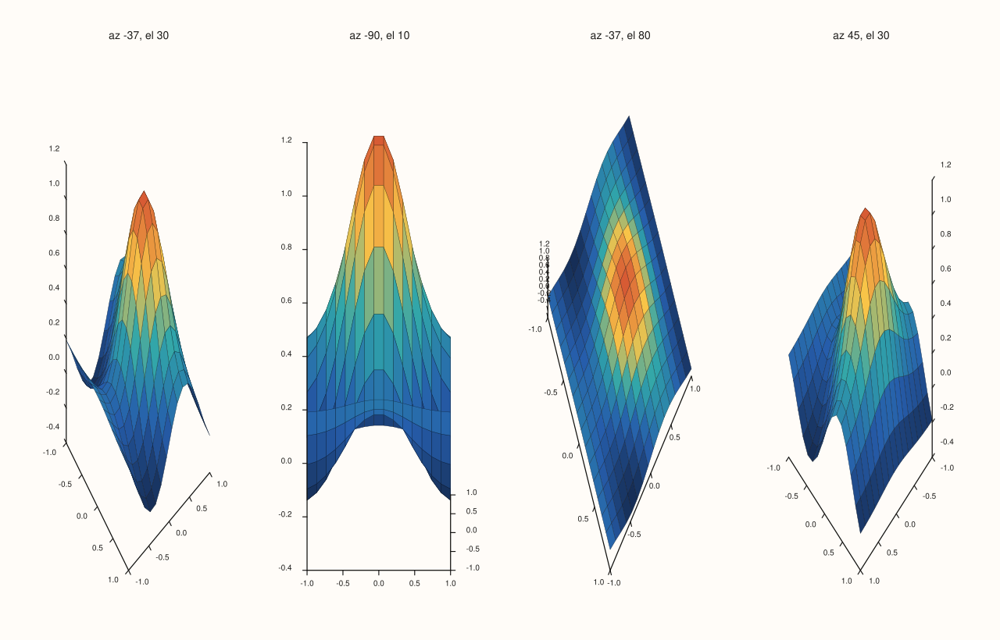
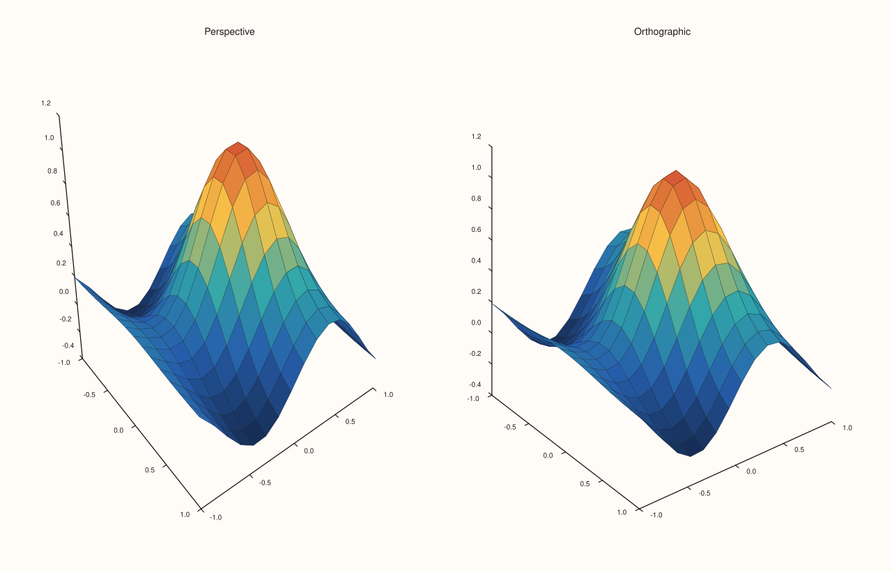
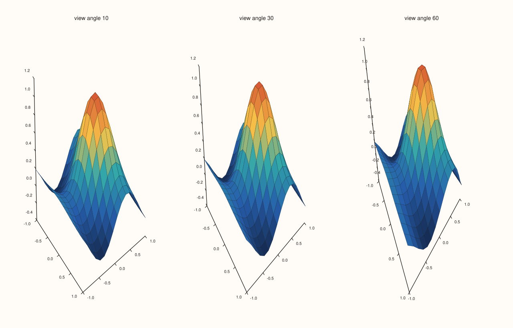
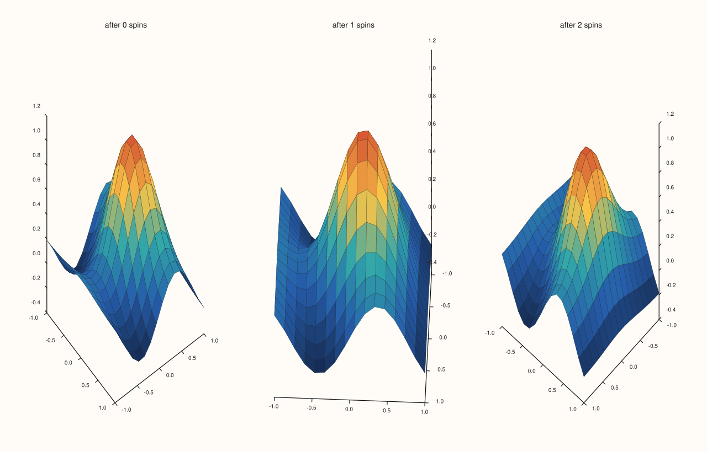
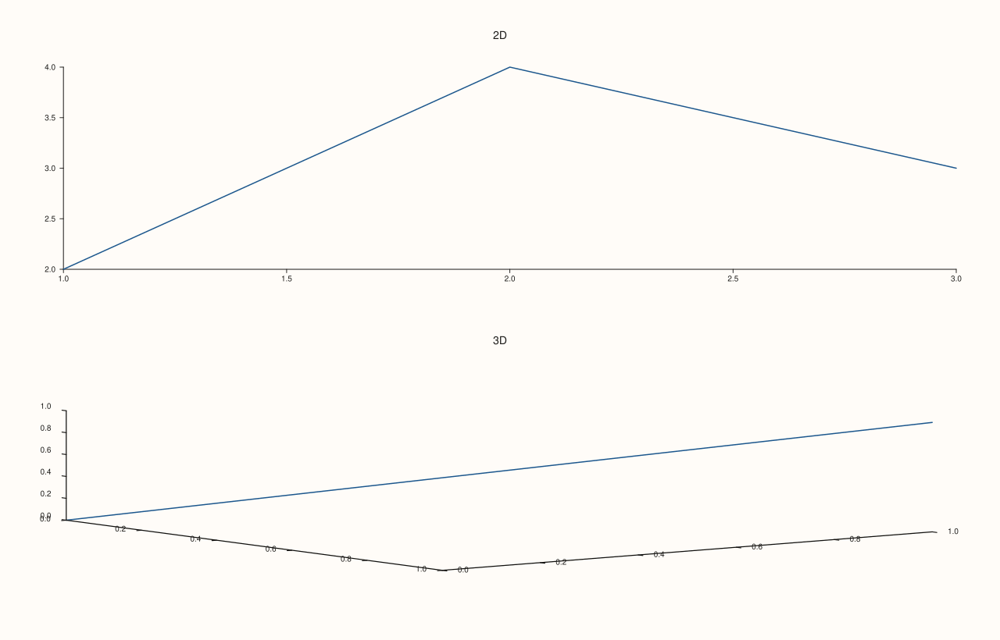

<!-- generated by PlussPl/docs/sphinx/tools/plotdocs.py from tools/specs/Lens.py; edit the spec -->

# Lens

[Back to Types and Options Reference](../../types_api_reference)

## What It Does

A `Lens` is the camera of a pane: where it looks from, what it looks at, which way is up, and how it projects the scene onto the page.
Every pane has one. It is read and changed through the pane, `pane.lens()`, which returns a mutable reference: there is no
`Pane::lens(Lens)` setter, and each change is a chainable call on the lens itself, `pane.lens().look(60, 25).project(ProjectionKind::Orthographic)`. A whole `Lens` value can also be assigned to it.

The viewing direction is set by the **azimuth** (the angle around the vertical axis) and the **elevation** (the angle above the horizontal plane), in degrees.
`project` chooses between an **orthographic** view, which is what every pane starts with, and a **perspective** view, in which distant parts of the scene look smaller, while in the orthographic view they do not and parallel lines stay parallel; and `view_angle` is the
field of view of the perspective projection. Only 3D panes use the lens to draw: a 2D pane has the planar lens, which looks straight down the z axis.

## Members

| Member | Meaning | Default |
|---|---|---|
| `look(azimuth, elevation)` | Set the viewing angles, in degrees. | -37.5 and 30 (a 3D pane) |
| `spin(d_azimuth, d_elevation)` | Rotate the view by the given amounts from where it is. | |
| `project(kind)` | `Perspective` or `Orthographic`. | `Orthographic` for a pane's lens; `Perspective` for a default-constructed `Lens` |
| `view_angle(degrees)` | The field of view of the perspective projection, strictly between 0 and 180 degrees; any other value throws. | 30 |
| `target_at(point)` | The point the picture is centred on, in box units: 0 is the centre of the data box and 0.5 its faces. A target off the centre puts that point in the middle of the picture and keeps the whole box in view. | the origin |
| `up(vector)` | Which direction is up on the page. | (0, 0, 1) |
| `Lens::spatial()`, `Lens::planar()` | The lens a 3D pane starts with (azimuth -37.5, elevation 30, orthographic), and the lens of a 2D pane (azimuth 0, elevation 90, looking straight down, +y up). | |
| `azimuth_deg()`, `elevation_deg()`, `view_angle_deg()`, `projection()`, `target()`, `up_vector()` | Read the state back. | |

## Examples

Example 1. `look` on the same surface. Four views by azimuth and elevation: the default, a view along one axis at low elevation, a high view from above, and one from the other side. The surface is the same each time; only the camera moves.

```cpp
constexpr std::int64_t n = 16;
auto coord = pluss::series::linspace(-1.0, 1.0, n, pluss::ScalarType::Float64);
std::vector<double> peak(static_cast<std::size_t>(n * n));
for (std::int64_t i = 0; i < n; ++i)
  for (std::int64_t j = 0; j < n; ++j) {
    const double x = -1.0 + 2.0 * i / (n - 1), y = -1.0 + 2.0 * j / (n - 1);
    peak[static_cast<std::size_t>(i * n + j)] = std::exp(-3.0 * (x * x + y * y)) + 0.25 * std::sin(4.0 * x);
  }
auto z = pluss::make_series(peak, {n, n});

const double views[4][2] = {{-37.5, 30.0}, {-90.0, 10.0}, {-37.5, 80.0}, {45.0, 30.0}};
auto fig = studio("lens_angles");
fig.mosaic(1, 4);
for (int i = 0; i < 4; ++i) {
  auto& pane = fig.pane3("az " + std::to_string(static_cast<int>(views[i][0])) + ", el " + std::to_string(static_cast<int>(views[i][1])));
  pane.sheet(coord, coord, z);
  pane.lens().look(views[i][0], views[i][1]);
}
fig.save_svg("figure.svg");
```



Example 2. `project`. The same view in perspective and in orthographic projection. A pane starts out orthographic, so `Orthographic` here is the default; in the perspective view the near parts of the surface look larger than the far parts and parallel edges converge.

```cpp
constexpr std::int64_t n = 16;
auto coord = pluss::series::linspace(-1.0, 1.0, n, pluss::ScalarType::Float64);
std::vector<double> peak(static_cast<std::size_t>(n * n));
for (std::int64_t i = 0; i < n; ++i)
  for (std::int64_t j = 0; j < n; ++j) {
    const double x = -1.0 + 2.0 * i / (n - 1), y = -1.0 + 2.0 * j / (n - 1);
    peak[static_cast<std::size_t>(i * n + j)] = std::exp(-3.0 * (x * x + y * y)) + 0.25 * std::sin(4.0 * x);
  }
auto z = pluss::make_series(peak, {n, n});

const ProjectionKind kinds[] = {ProjectionKind::Perspective, ProjectionKind::Orthographic};
const char* names[] = {"Perspective", "Orthographic"};
auto fig = studio("lens_projection");
fig.mosaic(1, 2);
for (int i = 0; i < 2; ++i) {
  auto& pane = fig.pane3(names[i]);
  pane.sheet(coord, coord, z);
  pane.lens().project(kinds[i]);
}
fig.save_svg("figure.svg");
```



Example 3. `view_angle`, which only the perspective projection uses, so each pane here switches to perspective first. A wider field of view, 60 degrees, exaggerates the perspective, and a narrow one, 10 degrees, flattens it towards the orthographic view. With the default orthographic projection the angle would change nothing.

```cpp
constexpr std::int64_t n = 16;
auto coord = pluss::series::linspace(-1.0, 1.0, n, pluss::ScalarType::Float64);
std::vector<double> peak(static_cast<std::size_t>(n * n));
for (std::int64_t i = 0; i < n; ++i)
  for (std::int64_t j = 0; j < n; ++j) {
    const double x = -1.0 + 2.0 * i / (n - 1), y = -1.0 + 2.0 * j / (n - 1);
    peak[static_cast<std::size_t>(i * n + j)] = std::exp(-3.0 * (x * x + y * y)) + 0.25 * std::sin(4.0 * x);
  }
auto z = pluss::make_series(peak, {n, n});

const double angles[] = {10.0, 30.0, 60.0};
auto fig = studio("lens_view_angle");
fig.mosaic(1, 3);
for (int i = 0; i < 3; ++i) {
  auto& pane = fig.pane3("view angle " + std::to_string(static_cast<int>(angles[i])));
  pane.sheet(coord, coord, z);
  pane.lens().project(ProjectionKind::Perspective).view_angle(angles[i]);
}
fig.save_svg("figure.svg");
```



Example 4. `spin` turns the view relative to where it is, which is what an animation loop does. Starting from the default, two spins of 40 degrees of azimuth move the camera round the surface in steps; `look` would set each angle absolutely.

```cpp
constexpr std::int64_t n = 16;
auto coord = pluss::series::linspace(-1.0, 1.0, n, pluss::ScalarType::Float64);
std::vector<double> peak(static_cast<std::size_t>(n * n));
for (std::int64_t i = 0; i < n; ++i)
  for (std::int64_t j = 0; j < n; ++j) {
    const double x = -1.0 + 2.0 * i / (n - 1), y = -1.0 + 2.0 * j / (n - 1);
    peak[static_cast<std::size_t>(i * n + j)] = std::exp(-3.0 * (x * x + y * y)) + 0.25 * std::sin(4.0 * x);
  }
auto z = pluss::make_series(peak, {n, n});

auto fig = studio("lens_spin");
fig.mosaic(1, 3);
for (int i = 0; i < 3; ++i) {
  auto& pane = fig.pane3("after " + std::to_string(i) + " spins");
  pane.sheet(coord, coord, z);
  for (int s = 0; s < i; ++s) pane.lens().spin(40.0, 0.0);
  std::cout << "spins " << i << ": azimuth " << pane.lens().azimuth_deg() << ", elevation " << pane.lens().elevation_deg() << "\n";
}
fig.save_svg("figure.svg");
```

### Output

```text
spins 0: azimuth -37.5, elevation 30
spins 1: azimuth 2.5, elevation 30
spins 2: azimuth 42.5, elevation 30
```



Example 5. The state of the lens, read back. A 3D pane starts at azimuth -37.5, elevation 30, a 30 degree field of view and an orthographic projection, looking at the origin with +z up. The lens of a 2D pane is the planar one: it looks straight down, at elevation 90, with +y up. A lens built directly with `Lens()` is a perspective one, unlike the lens a pane starts with. Each pane is read straight after it is created, because creating the next pane can move the earlier ones in memory.

```cpp
auto print = [](const char* name, const Pane& pane) {
  const Lens& lens = pane.lens();
  std::cout << name << ": azimuth " << lens.azimuth_deg() << ", elevation " << lens.elevation_deg()
            << ", view angle " << lens.view_angle_deg() << ", orthographic " << (lens.projection() == ProjectionKind::Orthographic)
            << ", target (" << lens.target().x << ", " << lens.target().y << ", " << lens.target().z << ")"
            << ", up (" << lens.up_vector().x << ", " << lens.up_vector().y << ", " << lens.up_vector().z << ")\n";
};
auto fig = studio("lens_readback");
{
  auto& planar = fig.pane2("2D");
  planar.trend(std::vector<double>{1, 2, 3}, std::vector<double>{2, 4, 3});
  print("planar    ", planar);
}
{
  auto& volumetric = fig.pane3("3D");
  volumetric.path3(std::vector<double>{0, 1}, std::vector<double>{0, 1}, std::vector<double>{0, 1});
  print("volumetric", volumetric);
}
const Lens bare;
std::cout << "Lens():           orthographic " << (bare.projection() == ProjectionKind::Orthographic) << ", azimuth " << bare.azimuth_deg() << ", elevation " << bare.elevation_deg() << "\n";
std::cout << "Lens::spatial():  orthographic " << (Lens::spatial().projection() == ProjectionKind::Orthographic) << "\n";
std::cout << "Lens::planar():   elevation " << Lens::planar().elevation_deg() << "\n";
fig.save_svg("figure.svg");
```

### Output

```text
planar    : azimuth 0, elevation 90, view angle 30, orthographic 1, target (0, 0, 0), up (0, 1, 0)
volumetric: azimuth -37.5, elevation 30, view angle 30, orthographic 1, target (0, 0, 0), up (0, 0, 1)
Lens():           orthographic 0, azimuth -37.5, elevation 30
Lens::spatial():  orthographic 1
Lens::planar():   elevation 90
```



## Notes

- Set the lens on the pane that owns the 3D traces; each pane has its own, so panes in one figure can be viewed from different directions.
- [`LightRig`](LightRig.md) lights can be fixed to the camera or to the data (`LightSpace`), so moving the lens either carries the lights with it or leaves them where the data are.
- Orthographic, the default, is the usual choice for figures that are read quantitatively, because equal lengths look equal; perspective is more natural for a picture.

## See Also

- [`Pane::lens`](../pane/lens.md): reaches the lens of a pane.
- [`LightRig`](LightRig.md): the lights, which can be fixed to the camera or to the data.
- [`ShadeMode`](ShadeMode.md), [`LightingMode`](LightingMode.md): how the surface is drawn.

<div class="pluss-inline-prev-next">
  <a class="prev-link" href="KeyShape.html">
    <span class="label">Previous</span>
    <span class="title">KeyShape</span>
  </a>
  <a class="next-link" href="LightRig.html">
    <span class="label">Next</span>
    <span class="title">LightRig</span>
  </a>
</div>
