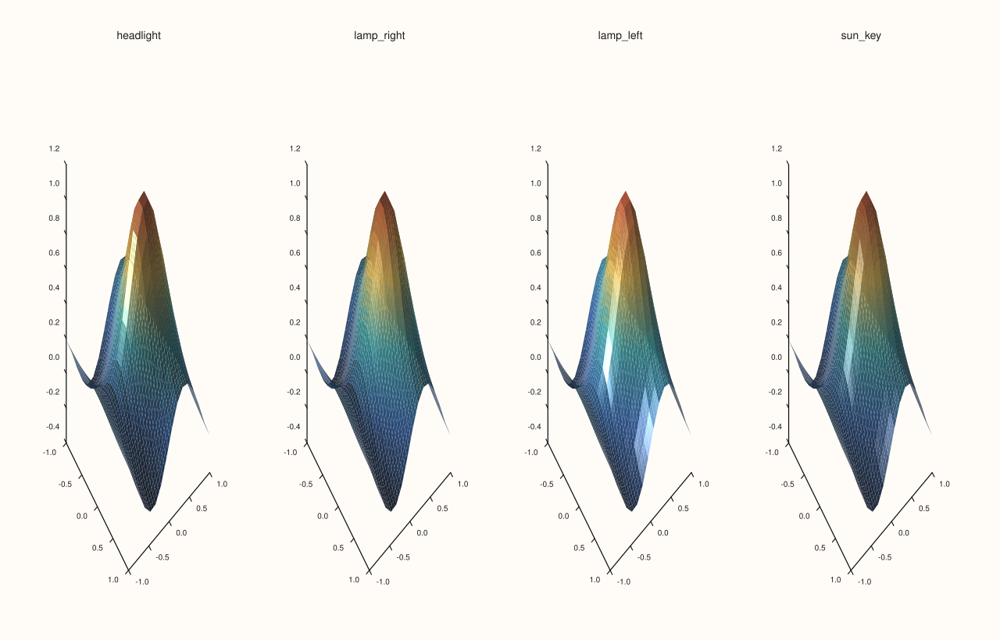
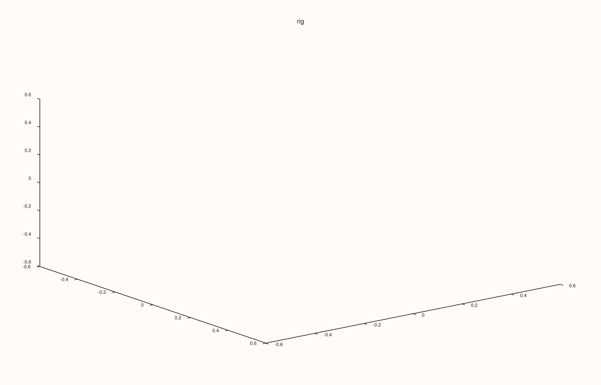
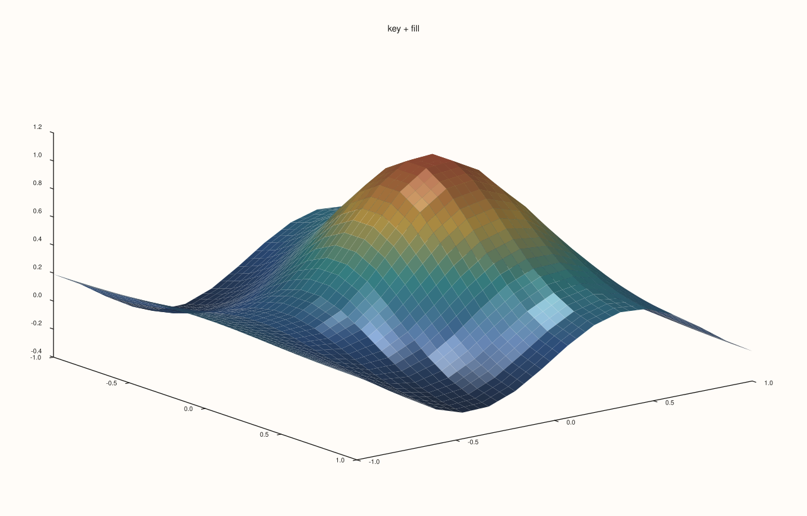
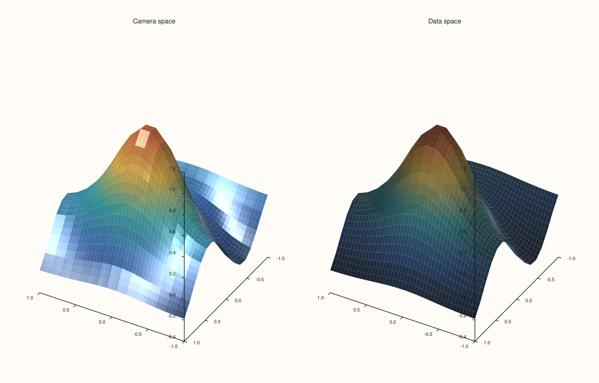
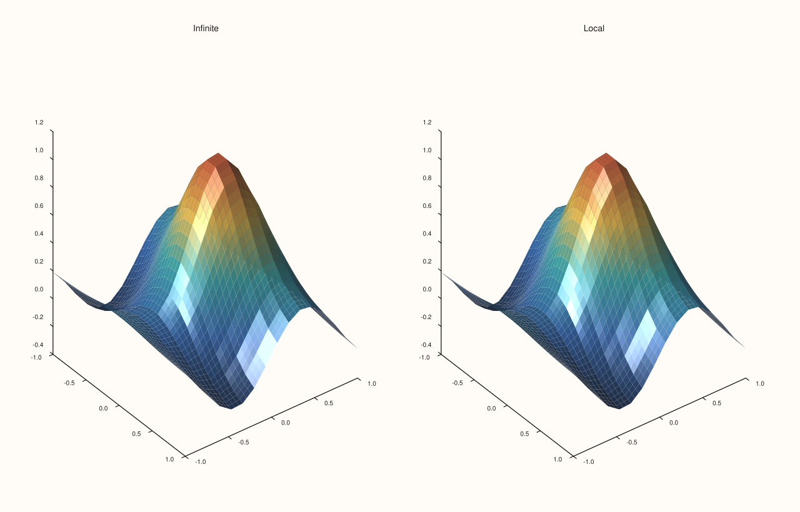

<!-- generated by PlussPl/docs/sphinx/tools/plotdocs.py from tools/specs/LightRig.py; edit the spec -->

# LightRig

[Back to Types and Options Reference](../../types_api_reference)

## What It Does

A `LightRig` is the set of lights of a 3D pane, reached through `pane.lights()`, which returns a mutable reference, as `pane.lens()` does for the camera.
A new pane has **no lights**, and a surface only shows the effect of light when its trace asks for it with a
[`LightingMode`](LightingMode.md) other than `None` and the rig has at least one light. Without lights, lighting and
[`MaterialProfile`](MaterialProfile.md) have no visible effect.

Each light is a `LightSpec`: a direction given by an azimuth and an elevation in degrees, the space that direction is measured in, and a style.
`LightSpace::Camera` fixes the direction to the camera, so the lighting stays the same when the view is rotated with the [`Lens`](Lens.md); `LightSpace::Data` fixes it to the data,
so rotating the view moves the light across the surface as it would move a light in a room. `LightStyle` says what kind of source the light is: `Infinite` is parallel light, like the sun, that shines along the same direction on every part of the surface, and `Local` is a point source placed a little way out from the middle of the scene in that direction, so the direction of the light changes from one part of the surface to the next (Example 6).

Four presets add a ready-made light or lights, and `add` appends your own. The presets add to the rig, so call `clear` first for a rig of exactly one preset.

## Members

| Member | Effect |
|---|---|
| `headlight()` | Adds a light at the camera, shining along the line of sight. Flat and even, with little shading. |
| `lamp_right()`, `lamp_left()` | Adds a lamp off to the right or the left of the camera. |
| `sun_key()` | Adds a strong key light, with a second light to fill the shadows. |
| `add(spec)` | Appends your own `LightSpec`. |
| `clear()` | Removes every light. |
| `lights()`, `empty()` | Read the rig. |

| `LightSpec` field | Meaning | Default |
|---|---|---|
| `azimuth_deg` | The light's direction around the vertical axis, degrees. | 30 |
| `elevation_deg` | The light's direction above the horizontal, degrees. | 30 |
| `space` | `Camera` (fixed to the view) or `Data` (fixed to the scene). | `Camera` |
| `style` | `Local` (a point source) or `Infinite` (parallel light). | `Local` |

## Examples

Example 1. The four presets on the same surface with Gouraud lighting. Each pane has one preset on its own. The headlight lights the surface evenly from the viewer, the two lamps rake it from one side, and the sun key adds a strong key light with fill.

```cpp
constexpr std::int64_t n = 16;
auto coord = pluss::series::linspace(-1.0, 1.0, n, pluss::ScalarType::Float64);
std::vector<double> peak(static_cast<std::size_t>(n * n));
for (std::int64_t i = 0; i < n; ++i)
  for (std::int64_t j = 0; j < n; ++j) {
    const double x = -1.0 + 2.0 * i / (n - 1), y = -1.0 + 2.0 * j / (n - 1);
    peak[static_cast<std::size_t>(i * n + j)] = std::exp(-3.0 * (x * x + y * y)) + 0.25 * std::sin(4.0 * x);
  }
auto z = pluss::make_series(peak, {n, n});

auto fig = studio("light_rig_presets");
fig.mosaic(1, 4);
const char* names[] = {"headlight", "lamp_right", "lamp_left", "sun_key"};
for (int i = 0; i < 4; ++i) {
  auto& pane = fig.pane3(names[i]);
  if (i == 0) pane.lights().headlight();
  if (i == 1) pane.lights().lamp_right();
  if (i == 2) pane.lights().lamp_left();
  if (i == 3) pane.lights().sun_key();
  pane.sheet(coord, coord, z).shade(ShadeMode::Smooth).lighting(LightingMode::Gouraud);
}
fig.save_svg("figure.svg");
```



Example 2. What each preset puts in the rig. Each is printed from a fresh rig, so the lights are exactly the preset's: direction, space and style.

```cpp
const char* names[] = {"headlight", "lamp_right", "lamp_left", "sun_key"};
for (int i = 0; i < 4; ++i) {
  LightRig rig;
  if (i == 0) rig.headlight();
  if (i == 1) rig.lamp_right();
  if (i == 2) rig.lamp_left();
  if (i == 3) rig.sun_key();
  std::cout << names[i] << ": " << rig.lights().size() << " light(s)\n";
  for (const LightSpec& light : rig.lights())
    std::cout << "  azimuth " << light.azimuth_deg << ", elevation " << light.elevation_deg
              << ", " << (light.space == LightSpace::Camera ? "Camera" : "Data")
              << ", " << (light.style == LightStyle::Local ? "Local" : "Infinite") << "\n";
}
auto fig = studio("light_rig_contents");
fig.pane3("rig").lights().headlight();
std::cout << "a new pane has no lights: " << studio("x").pane3("y").lights().empty() << "\n";
fig.save_svg("figure.svg");
```

### Output

```text
headlight: 1 light(s)
  azimuth 0, elevation 0, Camera, Local
lamp_right: 1 light(s)
  azimuth 30, elevation 30, Camera, Local
lamp_left: 1 light(s)
  azimuth -30, elevation 30, Camera, Local
sun_key: 2 light(s)
  azimuth -20, elevation 35, Camera, Infinite
  azimuth 120, elevation 15, Camera, Infinite
a new pane has no lights: 1
```



Example 3. A rig built by hand. `add` appends a `LightSpec`; here a key light from the upper left and a weaker fill from the right. A light is a direction: 30 degrees of azimuth and 30 of elevation is the default of `LightSpec`.

```cpp
constexpr std::int64_t n = 16;
auto coord = pluss::series::linspace(-1.0, 1.0, n, pluss::ScalarType::Float64);
std::vector<double> peak(static_cast<std::size_t>(n * n));
for (std::int64_t i = 0; i < n; ++i)
  for (std::int64_t j = 0; j < n; ++j) {
    const double x = -1.0 + 2.0 * i / (n - 1), y = -1.0 + 2.0 * j / (n - 1);
    peak[static_cast<std::size_t>(i * n + j)] = std::exp(-3.0 * (x * x + y * y)) + 0.25 * std::sin(4.0 * x);
  }
auto z = pluss::make_series(peak, {n, n});

auto fig = studio("light_rig_custom");
auto& pane = fig.pane3("key + fill");
pane.lights().clear()
    .add(LightSpec{-60.0, 50.0, LightSpace::Camera, LightStyle::Local})
    .add(LightSpec{70.0, 15.0, LightSpace::Camera, LightStyle::Local});
std::cout << "lights: " << pane.lights().lights().size() << "\n";
pane.sheet(coord, coord, z).shade(ShadeMode::Smooth).lighting(LightingMode::Gouraud);
fig.save_svg("figure.svg");
```

### Output

```text
lights: 2
```



Example 4. `LightSpace`. Both panes have the same light and the same rotated view. With `Camera` the light stays with the viewer, so the lighting looks the same as it did from the default view; with `Data` the light stays with the scene, so rotating the view changes which side of the surface is lit.

```cpp
constexpr std::int64_t n = 16;
auto coord = pluss::series::linspace(-1.0, 1.0, n, pluss::ScalarType::Float64);
std::vector<double> peak(static_cast<std::size_t>(n * n));
for (std::int64_t i = 0; i < n; ++i)
  for (std::int64_t j = 0; j < n; ++j) {
    const double x = -1.0 + 2.0 * i / (n - 1), y = -1.0 + 2.0 * j / (n - 1);
    peak[static_cast<std::size_t>(i * n + j)] = std::exp(-3.0 * (x * x + y * y)) + 0.25 * std::sin(4.0 * x);
  }
auto z = pluss::make_series(peak, {n, n});

const LightSpace spaces[] = {LightSpace::Camera, LightSpace::Data};
const char* names[] = {"Camera space", "Data space"};
auto fig = studio("light_rig_space");
fig.mosaic(1, 2);
for (int i = 0; i < 2; ++i) {
  auto& pane = fig.pane3(names[i]);
  pane.lights().clear().add(LightSpec{-60.0, 40.0, spaces[i], LightStyle::Local});
  pane.sheet(coord, coord, z).shade(ShadeMode::Smooth).lighting(LightingMode::Gouraud);
  pane.lens().look(120.0, 30.0);
}
fig.save_svg("figure.svg");
```



Example 5. `clear` empties the rig, and the presets add to what is there. Calling `sun_key()` twice gives four lights, and `clear().sun_key()` gives the two of one preset.

```cpp
auto fig = studio("light_rig_clear");
auto& pane = fig.pane3("Rig");
pane.lights().sun_key();
std::cout << "after sun_key():             " << pane.lights().lights().size() << " lights\n";
pane.lights().sun_key();
std::cout << "after a second sun_key():    " << pane.lights().lights().size() << " lights\n";
pane.lights().clear();
std::cout << "after clear():               " << pane.lights().lights().size() << " lights, empty " << pane.lights().empty() << "\n";
pane.lights().clear().sun_key();
std::cout << "after clear().sun_key():     " << pane.lights().lights().size() << " lights\n";
fig.save_svg("figure.svg");
```

### Output

```text
after sun_key():             2 lights
after a second sun_key():    4 lights
after clear():               0 lights, empty 1
after clear().sun_key():     2 lights
```


Example 6. `LightStyle`. The same light direction as `Infinite` (parallel light, the same direction everywhere) and as `Local` (a point source near the scene, so the direction changes across the surface). The two figures differ (the comparison prints false): the parallel light gives highlights of the same shape across the surface, while the point source's changing direction makes the highlights larger and brighter in the lower right, where the surface faces it more directly.

```cpp
constexpr std::int64_t n = 16;
auto coord = pluss::series::linspace(-1.0, 1.0, n, pluss::ScalarType::Float64);
std::vector<double> peak(static_cast<std::size_t>(n * n));
for (std::int64_t i = 0; i < n; ++i)
  for (std::int64_t j = 0; j < n; ++j) {
    const double x = -1.0 + 2.0 * i / (n - 1), y = -1.0 + 2.0 * j / (n - 1);
    peak[static_cast<std::size_t>(i * n + j)] = std::exp(-3.0 * (x * x + y * y)) + 0.25 * std::sin(4.0 * x);
  }
auto z = pluss::make_series(peak, {n, n});

std::string svg[2];
const LightStyle styles[] = {LightStyle::Infinite, LightStyle::Local};
const char* names[] = {"Infinite", "Local"};
auto fig = studio("light_rig_style");
fig.mosaic(1, 2);
for (int i = 0; i < 2; ++i) {
  auto& pane = fig.pane3(names[i]);
  pane.lights().clear().add(LightSpec{-30.0, 40.0, LightSpace::Camera, styles[i]});
  pane.sheet(coord, coord, z).shade(ShadeMode::Smooth).lighting(LightingMode::Gouraud);
  auto alone = studio("light_rig_style_alone");
  auto& p2 = alone.pane3("style");
  p2.lights().clear().add(LightSpec{-30.0, 40.0, LightSpace::Camera, styles[i]});
  p2.sheet(coord, coord, z).shade(ShadeMode::Smooth).lighting(LightingMode::Gouraud);
  svg[i] = alone.to_svg();
}
std::cout << "Infinite == Local: " << (svg[0] == svg[1]) << "\n";
fig.save_svg("figure.svg");
```

### Output

```text
Infinite == Local: 0
```



## Notes

- Several lights add: the brightness of each cell is the average over the lights, scaled by the material, so more lights do not make the surface brighter, only differently lit.
- A pane without lights draws lit traces as if lighting were off. If a lit surface looks unlit, check that the rig is not empty.
- Use `LightSpace::Camera` for a figure that is viewed from several angles and should keep a consistent look; use `Data` when the position of the light relative to the object is part of what the figure shows.

## See Also

- [`Pane::lights`](../pane/lights.md): reaches the rig of a pane.
- [`LightingMode`](LightingMode.md), [`MaterialProfile`](MaterialProfile.md), [`ShadeMode`](ShadeMode.md): the appearance options that use it.
- [`Lens`](Lens.md): the camera.

<div class="pluss-inline-prev-next">
  <a class="prev-link" href="Lens.html">
    <span class="label">Previous</span>
    <span class="title">Lens</span>
  </a>
  <a class="next-link" href="LightingMode.html">
    <span class="label">Next</span>
    <span class="title">LightingMode</span>
  </a>
</div>
