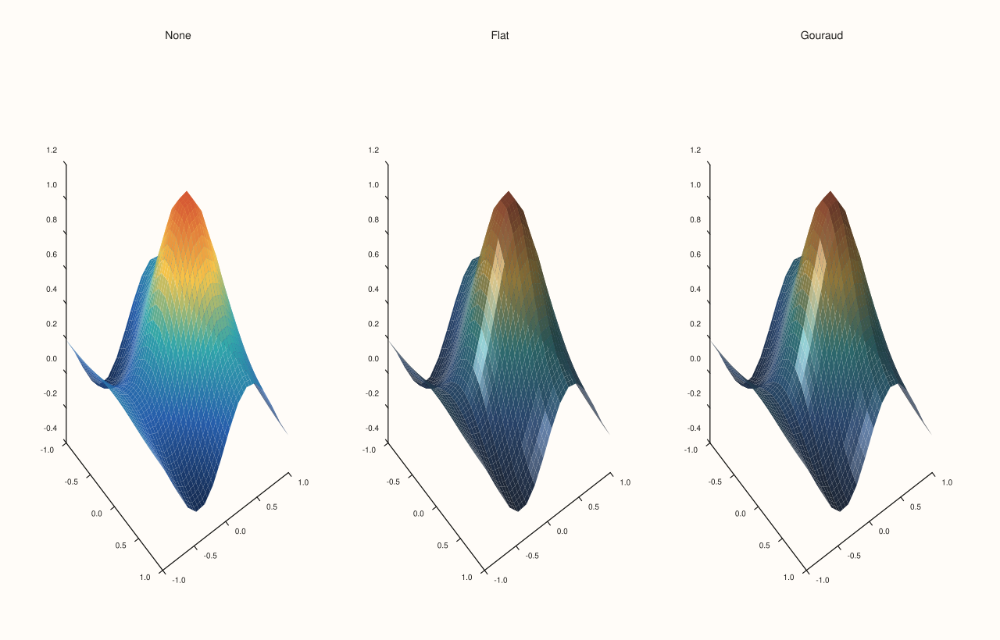
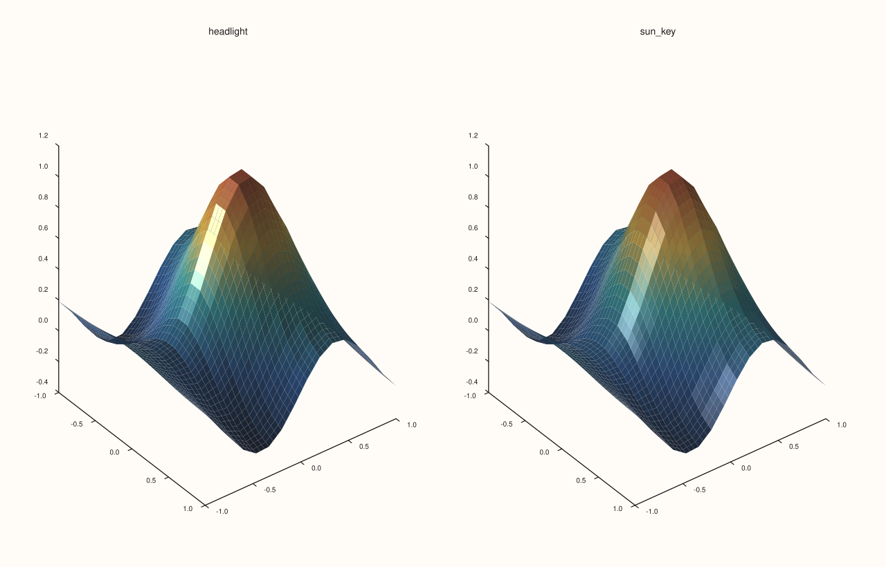
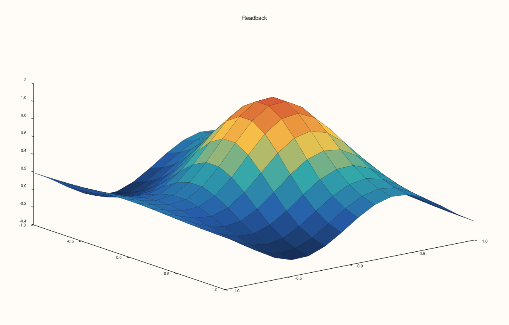

<!-- generated by PlussPl/docs/sphinx/tools/plotdocs.py from tools/specs/LightingMode.py; edit the spec -->

# LightingMode

[Back to Types and Options Reference](../../types_api_reference)

## What It Does

`LightingMode` decides whether, and how, a 3D surface trace is lit. It is the argument of [`Trace::lighting`](../trace/lighting.md) and
the value `Trace::lighting_mode` reads back. The lights themselves belong to the pane ([`LightRig`](LightRig.md)): a lighting mode
with no lights in the rig has nothing to compute, so it needs both. The surface's response to the light is the separate
[`MaterialProfile`](MaterialProfile.md).

The two lit modes differ in where the light is evaluated. `Flat` evaluates it once per cell and gives the whole cell one brightness, so
the surface keeps a visibly faceted look even when the colouring is smooth. `Gouraud` evaluates it at the corners of each cell and
interpolates, so the brightness varies continuously across the surface.

## Values

| Value | Lighting | Look |
|---|---|---|
| `None` | No lighting: the surface shows its data colour only. This is the default. | Flat colour; shape is read from the colour and the outlines. |
| `Flat` | One brightness per cell. | Lit, with each cell a separate tone. |
| `Gouraud` | Brightness interpolated across each cell. | Lit and smooth. |

## Examples

Example 1. The three modes on the same surface with the same sun-like rig. `None` ignores the rig; `Flat` shades each cell by its own angle to the light; `Gouraud` blends the shading across the surface.

```cpp
constexpr std::int64_t n = 16;
auto coord = pluss::series::linspace(-1.0, 1.0, n, pluss::ScalarType::Float64);
std::vector<double> peak(static_cast<std::size_t>(n * n));
for (std::int64_t i = 0; i < n; ++i)
  for (std::int64_t j = 0; j < n; ++j) {
    const double x = -1.0 + 2.0 * i / (n - 1), y = -1.0 + 2.0 * j / (n - 1);
    peak[static_cast<std::size_t>(i * n + j)] = std::exp(-3.0 * (x * x + y * y)) + 0.25 * std::sin(4.0 * x);
  }
auto z = pluss::make_series(peak, {n, n});

const LightingMode modes[] = {LightingMode::None, LightingMode::Flat, LightingMode::Gouraud};
const char* names[] = {"None", "Flat", "Gouraud"};
auto fig = studio("lighting_mode_gallery");
fig.mosaic(1, 3);
for (int i = 0; i < 3; ++i) {
  auto& pane = fig.pane3(names[i]);
  pane.lights().sun_key();
  pane.sheet(coord, coord, z).shade(ShadeMode::Smooth).lighting(modes[i]);
}
fig.save_svg("figure.svg");
```



Example 2. A lighting mode needs lights. With an empty rig `Gouraud` has nothing to compute, and the figure is the same as with `None`: the SVG text of the two is equal.

```cpp
constexpr std::int64_t n = 16;
auto coord = pluss::series::linspace(-1.0, 1.0, n, pluss::ScalarType::Float64);
std::vector<double> peak(static_cast<std::size_t>(n * n));
for (std::int64_t i = 0; i < n; ++i)
  for (std::int64_t j = 0; j < n; ++j) {
    const double x = -1.0 + 2.0 * i / (n - 1), y = -1.0 + 2.0 * j / (n - 1);
    peak[static_cast<std::size_t>(i * n + j)] = std::exp(-3.0 * (x * x + y * y)) + 0.25 * std::sin(4.0 * x);
  }
auto z = pluss::make_series(peak, {n, n});

std::string svg[2];
const LightingMode modes[] = {LightingMode::None, LightingMode::Gouraud};
for (int i = 0; i < 2; ++i) {
  auto fig = studio("lighting_mode_no_lights");
  auto& pane = fig.pane3("No lights");
  std::cout << "lights in the rig: " << pane.lights().lights().size() << "\n";
  pane.sheet(coord, coord, z).lighting(modes[i]);
  svg[i] = fig.to_svg();
}
std::cout << "None == Gouraud with an empty rig: " << (svg[0] == svg[1]) << "\n";
```

### Output

```text
lights in the rig: 0
lights in the rig: 0
None == Gouraud with an empty rig: 1
```

Example 3. The same mode with different rigs. `Gouraud` under a single `headlight` (a light at the camera) and under `sun_key` (a stronger, angled key light) give different pictures, because the mode reads whatever the rig contains.

```cpp
constexpr std::int64_t n = 16;
auto coord = pluss::series::linspace(-1.0, 1.0, n, pluss::ScalarType::Float64);
std::vector<double> peak(static_cast<std::size_t>(n * n));
for (std::int64_t i = 0; i < n; ++i)
  for (std::int64_t j = 0; j < n; ++j) {
    const double x = -1.0 + 2.0 * i / (n - 1), y = -1.0 + 2.0 * j / (n - 1);
    peak[static_cast<std::size_t>(i * n + j)] = std::exp(-3.0 * (x * x + y * y)) + 0.25 * std::sin(4.0 * x);
  }
auto z = pluss::make_series(peak, {n, n});

auto fig = studio("lighting_mode_rig");
fig.mosaic(1, 2);
auto& head = fig.pane3("headlight");
head.lights().headlight();
head.sheet(coord, coord, z).shade(ShadeMode::Smooth).lighting(LightingMode::Gouraud);
auto& sun = fig.pane3("sun_key");
sun.lights().sun_key();
sun.sheet(coord, coord, z).shade(ShadeMode::Smooth).lighting(LightingMode::Gouraud);
fig.save_svg("figure.svg");
```



Example 4. `lighting` returns the trace; `lighting_mode` reads it back. A new trace's default is `None`.

```cpp
constexpr std::int64_t n = 16;
auto coord = pluss::series::linspace(-1.0, 1.0, n, pluss::ScalarType::Float64);
std::vector<double> peak(static_cast<std::size_t>(n * n));
for (std::int64_t i = 0; i < n; ++i)
  for (std::int64_t j = 0; j < n; ++j) {
    const double x = -1.0 + 2.0 * i / (n - 1), y = -1.0 + 2.0 * j / (n - 1);
    peak[static_cast<std::size_t>(i * n + j)] = std::exp(-3.0 * (x * x + y * y)) + 0.25 * std::sin(4.0 * x);
  }
auto z = pluss::make_series(peak, {n, n});

auto fig = studio("lighting_mode_readback");
auto& pane = fig.pane3("Readback");
Trace& trace = pane.sheet(coord, coord, z);
std::cout << "default: " << static_cast<int>(trace.lighting_mode()) << "\n";
for (LightingMode m : {LightingMode::None, LightingMode::Flat, LightingMode::Gouraud}) {
  trace.lighting(m);
  std::cout << static_cast<int>(m) << " -> " << static_cast<int>(trace.lighting_mode()) << "\n";
}
fig.save_svg("figure.svg");
```

### Output

```text
default: 0
0 -> 0
1 -> 1
2 -> 2
```



## Notes

- Lighting is per trace and the rig is per pane: two traces in one pane share the lights but can have different modes and materials.
- `Gouraud` costs more to evaluate than `Flat` on very large grids, but is the usual choice for a smooth surface.

## See Also

- [`Trace::lighting`](../trace/lighting.md): sets the mode.
- [`LightRig`](LightRig.md): the lights a mode uses.
- [`MaterialProfile`](MaterialProfile.md), [`ShadeMode`](ShadeMode.md): the other two appearance options of a surface.

<div class="pluss-inline-prev-next">
  <a class="prev-link" href="LightRig.html">
    <span class="label">Previous</span>
    <span class="title">LightRig</span>
  </a>
  <a class="next-link" href="LimitMethod.html">
    <span class="label">Next</span>
    <span class="title">LimitMethod</span>
  </a>
</div>
