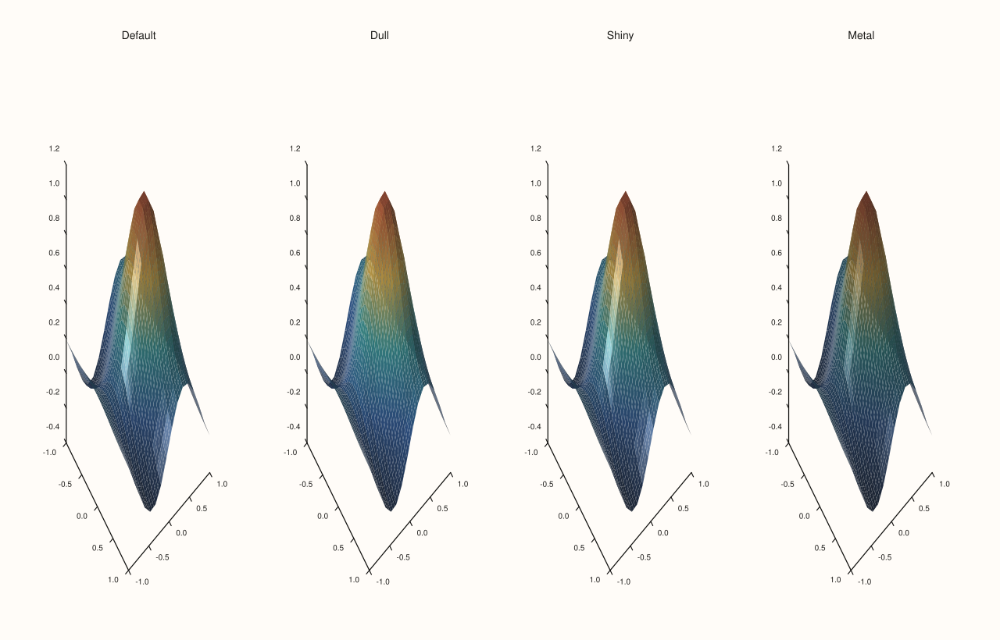
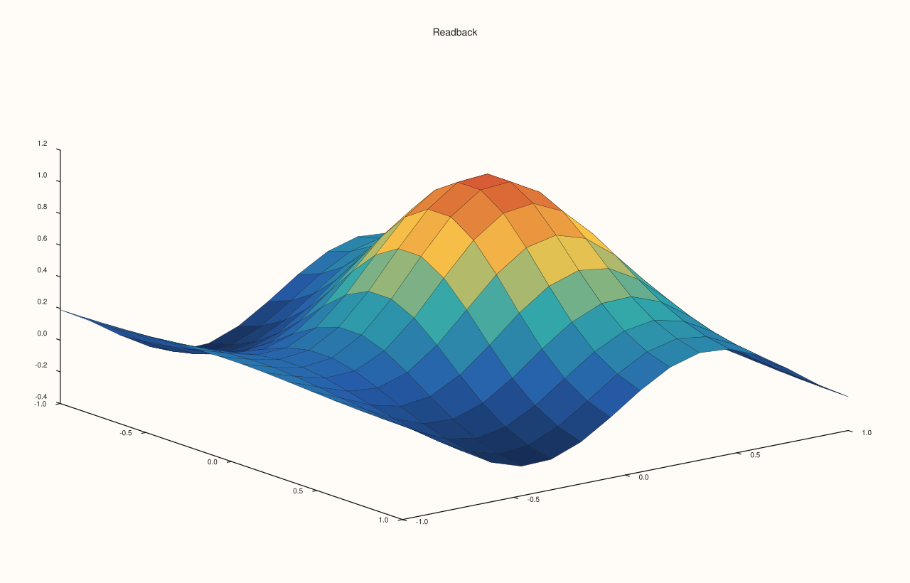

<!-- generated by PlussPl/docs/sphinx/tools/plotdocs.py from tools/specs/MaterialProfile.py; edit the spec -->

# MaterialProfile

[Back to Types and Options Reference](../../types_api_reference)

## What It Does

`MaterialProfile` decides how a lit 3D surface responds to light: how strongly it shows highlights, and how it reflects the
light's colour. It is the argument of [`Trace::material`](../trace/material.md) and the value `Trace::material_profile` reads back. It is
only visible on a lit surface: with [`LightingMode::None`](LightingMode.md), or a pane with no [`lights`](LightRig.md), every profile
renders the same surface.

## Values

| Value | Response | Look |
|---|---|---|
| `Default` | Exactly the response of `Shiny`. This is the default. | A glossy highlight on moderate diffuse shading. |
| `Dull` | Diffuse shading only: no highlight at all. | Matt, like paper or clay. |
| `Shiny` | Moderate diffuse shading with a strong, fairly broad highlight. | Glossy, like plastic or glazed ceramic. |
| `Metal` | The strongest and tightest highlight, with weak diffuse shading that darkens the surface away from it. | Metallic. |

`Default` and `Shiny` are the same material: the library's default is a shiny one, so a surface that never calls `material` already has
a highlight. Choose `Dull` to remove it.

## Examples

Example 1. The four profiles on the same lit surface with the same sun-like rig and Gouraud lighting. `Default` and `Shiny` are identical, `Dull` has no highlight and `Metal` has the tightest highlight on a darker surface.

```cpp
constexpr std::int64_t n = 16;
auto coord = pluss::series::linspace(-1.0, 1.0, n, pluss::ScalarType::Float64);
std::vector<double> peak(static_cast<std::size_t>(n * n));
for (std::int64_t i = 0; i < n; ++i)
  for (std::int64_t j = 0; j < n; ++j) {
    const double x = -1.0 + 2.0 * i / (n - 1), y = -1.0 + 2.0 * j / (n - 1);
    peak[static_cast<std::size_t>(i * n + j)] = std::exp(-3.0 * (x * x + y * y)) + 0.25 * std::sin(4.0 * x);
  }
auto z = pluss::make_series(peak, {n, n});

const MaterialProfile profiles[] = {MaterialProfile::Default, MaterialProfile::Dull, MaterialProfile::Shiny, MaterialProfile::Metal};
const char* names[] = {"Default", "Dull", "Shiny", "Metal"};
auto fig = studio("material_profile_gallery");
fig.mosaic(1, 4);
for (int i = 0; i < 4; ++i) {
  auto& pane = fig.pane3(names[i]);
  pane.lights().sun_key();
  pane.sheet(coord, coord, z).shade(ShadeMode::Smooth).lighting(LightingMode::Gouraud).material(profiles[i]);
}
fig.save_svg("figure.svg");
```



Example 2. Without light a material has nothing to respond to. With lighting off the four profiles render the same figure: all three comparisons print true.

```cpp
constexpr std::int64_t n = 16;
auto coord = pluss::series::linspace(-1.0, 1.0, n, pluss::ScalarType::Float64);
std::vector<double> peak(static_cast<std::size_t>(n * n));
for (std::int64_t i = 0; i < n; ++i)
  for (std::int64_t j = 0; j < n; ++j) {
    const double x = -1.0 + 2.0 * i / (n - 1), y = -1.0 + 2.0 * j / (n - 1);
    peak[static_cast<std::size_t>(i * n + j)] = std::exp(-3.0 * (x * x + y * y)) + 0.25 * std::sin(4.0 * x);
  }
auto z = pluss::make_series(peak, {n, n});

std::string svg[4];
const MaterialProfile profiles[] = {MaterialProfile::Default, MaterialProfile::Dull, MaterialProfile::Shiny, MaterialProfile::Metal};
for (int i = 0; i < 4; ++i) {
  auto fig = studio("material_profile_unlit");
  fig.pane3("Unlit").sheet(coord, coord, z).material(profiles[i]);
  svg[i] = fig.to_svg();
}
std::cout << "Default == Dull:  " << (svg[0] == svg[1]) << "\n";
std::cout << "Default == Shiny: " << (svg[0] == svg[2]) << "\n";
std::cout << "Default == Metal: " << (svg[0] == svg[3]) << "\n";
```

### Output

```text
Default == Dull:  1
Default == Shiny: 1
Default == Metal: 1
```

Example 3. With light the profiles differ, with one exception: `Dull` and `Metal` differ from `Default`, and `Shiny` equals it, because `Default` is `Shiny`.

```cpp
constexpr std::int64_t n = 16;
auto coord = pluss::series::linspace(-1.0, 1.0, n, pluss::ScalarType::Float64);
std::vector<double> peak(static_cast<std::size_t>(n * n));
for (std::int64_t i = 0; i < n; ++i)
  for (std::int64_t j = 0; j < n; ++j) {
    const double x = -1.0 + 2.0 * i / (n - 1), y = -1.0 + 2.0 * j / (n - 1);
    peak[static_cast<std::size_t>(i * n + j)] = std::exp(-3.0 * (x * x + y * y)) + 0.25 * std::sin(4.0 * x);
  }
auto z = pluss::make_series(peak, {n, n});

std::string svg[4];
const MaterialProfile profiles[] = {MaterialProfile::Default, MaterialProfile::Dull, MaterialProfile::Shiny, MaterialProfile::Metal};
for (int i = 0; i < 4; ++i) {
  auto fig = studio("material_profile_lit");
  auto& pane = fig.pane3("Lit");
  pane.lights().sun_key();
  pane.sheet(coord, coord, z).shade(ShadeMode::Smooth).lighting(LightingMode::Gouraud).material(profiles[i]);
  svg[i] = fig.to_svg();
}
std::cout << "Default == Dull:  " << (svg[0] == svg[1]) << "\n";
std::cout << "Default == Shiny: " << (svg[0] == svg[2]) << "\n";
std::cout << "Default == Metal: " << (svg[0] == svg[3]) << "\n";
```

### Output

```text
Default == Dull:  0
Default == Shiny: 1
Default == Metal: 0
```

Example 4. `material` returns the trace; `material_profile` reads the value back. The default of a new trace is `Default`.

```cpp
constexpr std::int64_t n = 16;
auto coord = pluss::series::linspace(-1.0, 1.0, n, pluss::ScalarType::Float64);
std::vector<double> peak(static_cast<std::size_t>(n * n));
for (std::int64_t i = 0; i < n; ++i)
  for (std::int64_t j = 0; j < n; ++j) {
    const double x = -1.0 + 2.0 * i / (n - 1), y = -1.0 + 2.0 * j / (n - 1);
    peak[static_cast<std::size_t>(i * n + j)] = std::exp(-3.0 * (x * x + y * y)) + 0.25 * std::sin(4.0 * x);
  }
auto z = pluss::make_series(peak, {n, n});

auto fig = studio("material_profile_readback");
auto& pane = fig.pane3("Readback");
Trace& trace = pane.sheet(coord, coord, z);
std::cout << "default: " << static_cast<int>(trace.material_profile()) << "\n";
for (MaterialProfile m : {MaterialProfile::Dull, MaterialProfile::Shiny, MaterialProfile::Metal}) {
  trace.material(m);
  std::cout << static_cast<int>(m) << " -> " << static_cast<int>(trace.material_profile()) << "\n";
}
fig.save_svg("figure.svg");
```

### Output

```text
default: 0
1 -> 1
2 -> 2
3 -> 3
```



## Notes

- A surface you have not styled is already `Shiny`, so a bare `lighting(LightingMode::Gouraud)` gives a glossy surface; add `material(MaterialProfile::Dull)` for a matt one.
- Choose the material last: the lights and the lighting mode decide whether it can show at all.
- A rig that lights the surface from the viewing direction (a headlight) shows little highlight on any material; a light off to the side ([`LightRig`](LightRig.md)) shows the difference between profiles best.

## See Also

- [`Trace::material`](../trace/material.md): sets the profile.
- [`LightingMode`](LightingMode.md), [`LightRig`](LightRig.md): the light the profile responds to.
- [`ShadeMode`](ShadeMode.md): the colouring across cells.

<div class="pluss-inline-prev-next">
  <a class="prev-link" href="LimitMethod.html">
    <span class="label">Previous</span>
    <span class="title">LimitMethod</span>
  </a>
  <a class="next-link" href="MosaicLayout.html">
    <span class="label">Next</span>
    <span class="title">MosaicLayout, PanePlacement</span>
  </a>
</div>
