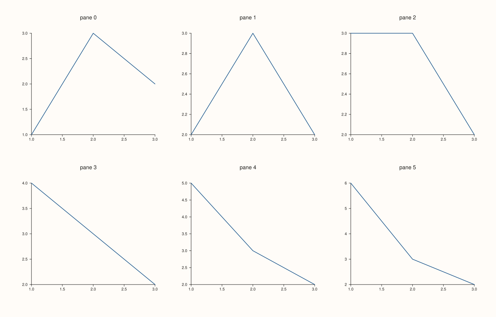
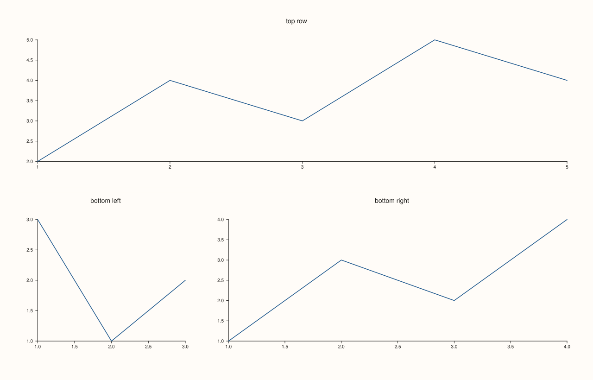
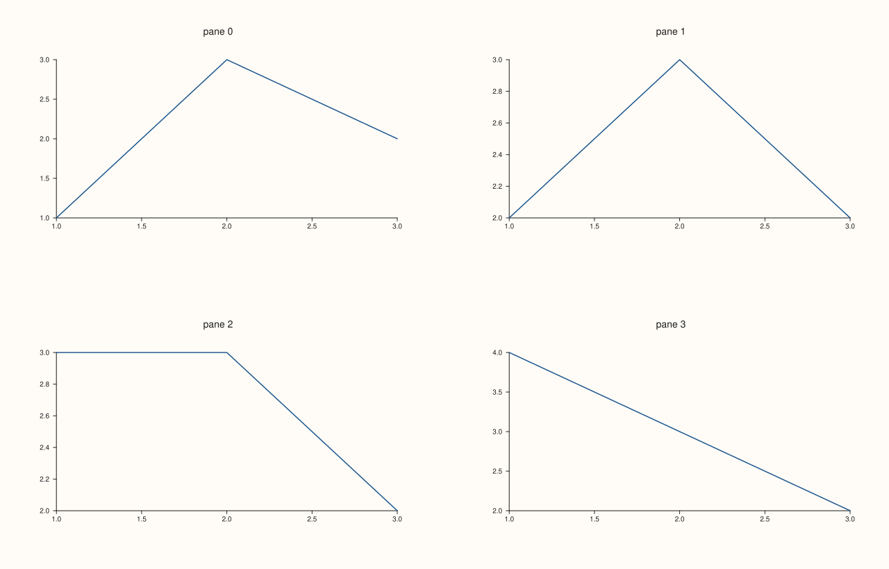
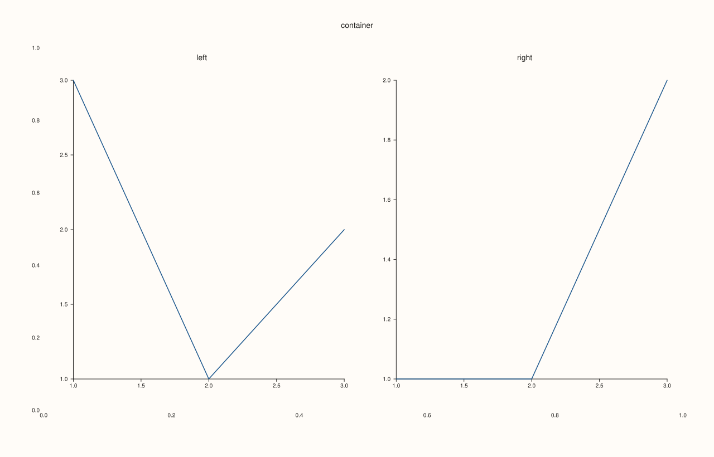
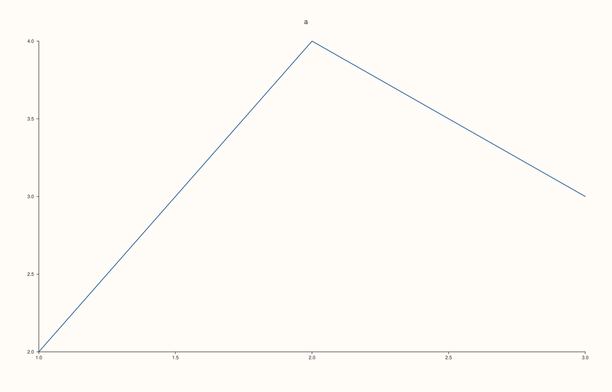

<!-- generated by PlussPl/docs/sphinx/tools/plotdocs.py from tools/specs/MosaicLayout.py; edit the spec -->

# MosaicLayout, PanePlacement

[Back to Types and Options Reference](../../types_api_reference)

## What It Does

A figure with more than one pane needs an arrangement. `Studio::mosaic(rows, cols, gutter_x, gutter_y)` divides the figure into a grid of `rows` by `cols` equal cells with gutters between them, and that grid is read back as a **`MosaicLayout`** (`Studio::mosaic_layout()`). Each pane then takes a cell. By default panes fill the cells in order, row by row; `Pane::place(row, col)` puts a pane in a particular cell and `Pane::place(row, col, row_span, col_span)` lets it span several cells. What a pane has been given is read back as its **`PanePlacement`** (`Pane::placement()`).

Without `mosaic`, the layout is not active and the panes are arranged automatically. A pane can also hold a smaller grid of its own: [`Studio::subpane2`](../studio/subpane2.md) and `subpane3` create panes inside a parent cell, and the `parent`, `local_rows`, `local_cols` and `local_gutter` fields of the placement describe that inner grid.

## Fields

| Struct | Field | Meaning | Default |
|---|---|---|---|
| `MosaicLayout` | `rows`, `cols` | The grid size. | 0 (no mosaic) |
| | `gutter_x`, `gutter_y` | The space between cells, horizontally and vertically: a distance in drawing units, or `auto_gutter` (-1), a share of the cell. | `auto_gutter` |
| | `active` | Whether `mosaic` has been called. | false |
| `PanePlacement` | `row`, `col` | The cell of the pane's top-left corner. | 0, 0 |
| | `row_span`, `col_span` | How many cells the pane covers. | 1, 1 |
| | `explicit_slot` | Whether `place` was called (otherwise the pane took the next free cell). | false |
| | `parent` | For a sub-pane, the index of the pane that contains it; -1 for a top-level pane. | -1 |
| | `local_rows`, `local_cols` | For a pane that holds sub-panes, the size of its inner grid. | 0 |
| | `local_gutter_x`, `local_gutter_y` | The gutters of that inner grid. | 12 |

## Examples

Example 1. A 2 by 3 mosaic filled in order. Six panes take the six cells row by row when the figure is drawn; until then a pane that never called `place` reports the placement (0, 0) with `explicit_slot` false, because its cell is assigned at drawing time, as the printed values show. The saved figure shows the six cells filled in order.

```cpp
auto fig = studio("mosaic_grid");
fig.mosaic(2, 3);
std::cout << "rows " << fig.mosaic_layout().rows << ", cols " << fig.mosaic_layout().cols << ", gutters auto: " << (fig.mosaic_layout().gutter_x == auto_gutter && fig.mosaic_layout().gutter_y == auto_gutter) << ", active " << fig.mosaic_layout().active << "\n";
for (int i = 0; i < 6; ++i) {
  auto& pane = fig.pane2("pane " + std::to_string(i));
  pane.trend(std::vector<double>{1, 2, 3}, std::vector<double>{1.0 + i, 3, 2});
  std::cout << "pane " << i << ": row " << pane.placement().row << ", col " << pane.placement().col << ", explicit " << pane.placement().explicit_slot << "\n";
}
fig.save_svg("figure.svg");
```

### Output

```text
rows 2, cols 3, gutters auto: 1, active 1
pane 0: row 0, col 0, explicit 0
pane 1: row 0, col 0, explicit 0
pane 2: row 0, col 0, explicit 0
pane 3: row 0, col 0, explicit 0
pane 4: row 0, col 0, explicit 0
pane 5: row 0, col 0, explicit 0
```



Example 2. `place` puts a pane in a chosen cell, and with spans it covers several. In a 2 by 3 mosaic the first pane spans the whole top row, the second takes the bottom left, and the third spans the two bottom right cells.

```cpp
auto fig = studio("mosaic_place");
fig.mosaic(2, 3);
{
  auto& top = fig.pane2("top row");
  top.trend(std::vector<double>{1, 2, 3, 4, 5}, std::vector<double>{2, 4, 3, 5, 4});
  top.place(0, 0, 1, 3);
  std::cout << "top: row " << top.placement().row << ", col " << top.placement().col << ", spans " << top.placement().row_span << " x " << top.placement().col_span << ", explicit " << top.placement().explicit_slot << "\n";
}
{
  auto& left = fig.pane2("bottom left");
  left.trend(std::vector<double>{1, 2, 3}, std::vector<double>{3, 1, 2});
  left.place(1, 0);
  std::cout << "left: row " << left.placement().row << ", col " << left.placement().col << "\n";
}
{
  auto& wide = fig.pane2("bottom right");
  wide.trend(std::vector<double>{1, 2, 3, 4}, std::vector<double>{1, 3, 2, 4});
  wide.place(1, 1, 1, 2);
  std::cout << "wide: row " << wide.placement().row << ", col " << wide.placement().col << ", spans " << wide.placement().row_span << " x " << wide.placement().col_span << "\n";
}
fig.save_svg("figure.svg");
```

### Output

```text
top: row 0, col 0, spans 1 x 3, explicit 1
left: row 1, col 0
wide: row 1, col 1, spans 1 x 2
```



Example 3. The gutters. The same 2 by 2 mosaic with gutters of 0 and of 80: the cells keep their shape but the space between them changes, so the panes are drawn smaller with the larger gutter.

```cpp
const double gutters[2] = {0.0, 80.0};
for (int g = 0; g < 2; ++g) {
  auto fig = studio("mosaic_gutters");
  fig.mosaic(2, 2, gutters[g], gutters[g]);
  for (int i = 0; i < 4; ++i)
    fig.pane2("pane " + std::to_string(i)).trend(std::vector<double>{1, 2, 3}, std::vector<double>{1.0 + i, 3, 2});
  std::cout << "gutter " << fig.mosaic_layout().gutter_x << "\n";
  if (g == 1) fig.save_svg("figure.svg");
}
```

### Output

```text
gutter 0
gutter 80
```



Example 4. Sub-panes. A container pane is created first and its area divided into a local 1 by 2 grid with `subpane2(parent_index, rows, cols, row, col, ...)`; each sub-pane records its parent and the local grid in its placement. The container is a pane of its own, here with its axes hidden so that only the two sub-panes show.

```cpp
auto fig = studio("mosaic_subpane");
fig.mosaic(1, 1);
{
  auto& container = fig.pane2("container");
  container.axes_visible(false);
  std::cout << "container: parent " << container.placement().parent << "\n";
}
for (int c = 0; c < 2; ++c) {
  auto& sub = fig.subpane2(0, 1, 2, 0, c, 1, 1, c == 0 ? "left" : "right");
  sub.trend(std::vector<double>{1, 2, 3}, std::vector<double>{c == 0 ? 3.0 : 1.0, 1, 2});
  const PanePlacement& p = sub.placement();
  std::cout << "sub-pane " << c << ": parent " << p.parent << ", cell (" << p.row << ", " << p.col << "), local grid " << p.local_rows << " x " << p.local_cols << "\n";
}
fig.save_svg("figure.svg");
```

### Output

```text
container: parent -1
sub-pane 0: parent 0, cell (0, 0), local grid 1 x 2
sub-pane 1: parent 0, cell (0, 1), local grid 1 x 2
```



Example 5. With no `mosaic` call the layout is inactive and the panes are arranged automatically. The default layout reports zero rows and columns, and the placement of a pane that never called `place` is not explicit.

```cpp
auto fig = studio("mosaic_default");
std::cout << "layout active " << fig.mosaic_layout().active << ", rows " << fig.mosaic_layout().rows << ", cols " << fig.mosaic_layout().cols << "\n";
auto& a = fig.pane2("a");
a.trend(std::vector<double>{1, 2, 3}, std::vector<double>{2, 4, 3});
std::cout << "explicit " << a.placement().explicit_slot << ", spans " << a.placement().row_span << " x " << a.placement().col_span << "\n";
fig.save_svg("figure.svg");
```

### Output

```text
layout active 0, rows 0, cols 0
explicit 0, spans 1 x 1
```



## Notes

- Cells are numbered from 0, row first. A pane that spans more cells than remain in the grid is refused.
- `mosaic` sets the layout once for the figure; panes created before or after take cells in order, so call `mosaic` first.
- Creating a new pane can move the earlier ones in memory, so read or configure a pane right after creating it, as the examples do.

## See Also

- [`Studio::mosaic`](../studio/mosaic.md), [`Studio::mosaic_layout`](../studio/mosaic_layout.md): set and read the layout.
- [`Pane::place`](../pane/place.md): puts a pane in a cell; `Pane::placement()` reads the result back.
- [`Studio::subpane2`](../studio/subpane2.md), [`Studio::subpane3`](../studio/subpane3.md): panes inside a cell.

<div class="pluss-inline-prev-next">
  <a class="prev-link" href="MaterialProfile.html">
    <span class="label">Previous</span>
    <span class="title">MaterialProfile</span>
  </a>
  <a class="next-link" href="PaletteRamp.html">
    <span class="label">Next</span>
    <span class="title">PaletteRamp</span>
  </a>
</div>
