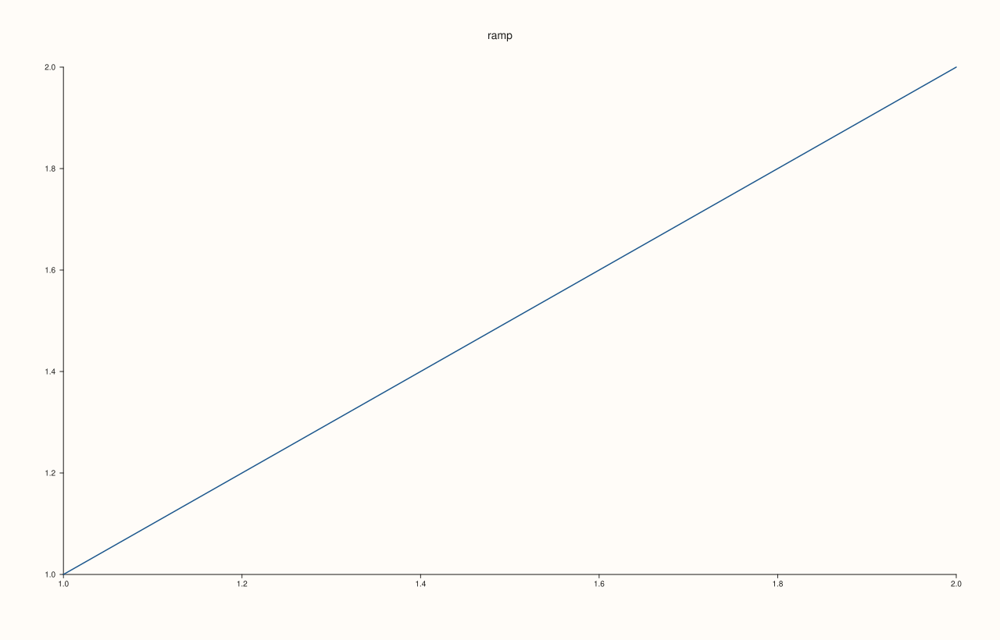
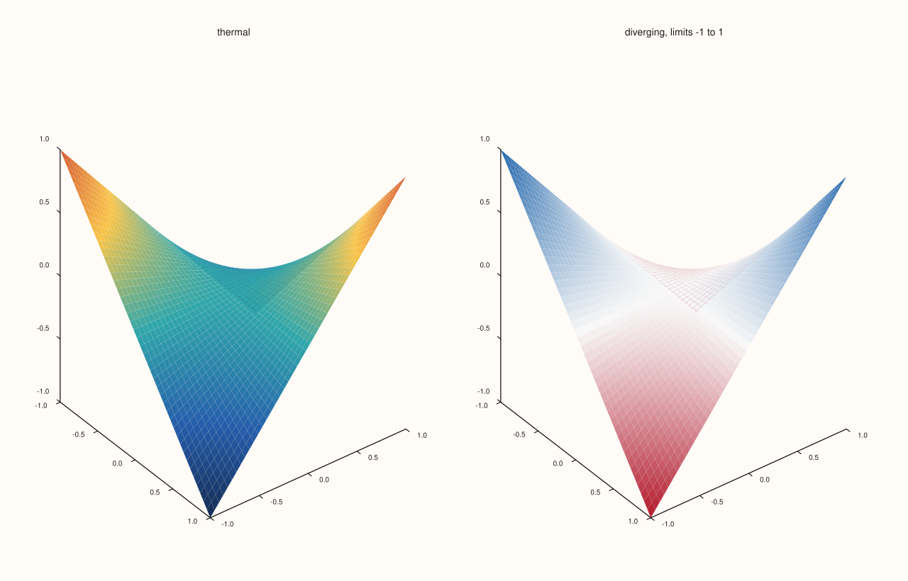
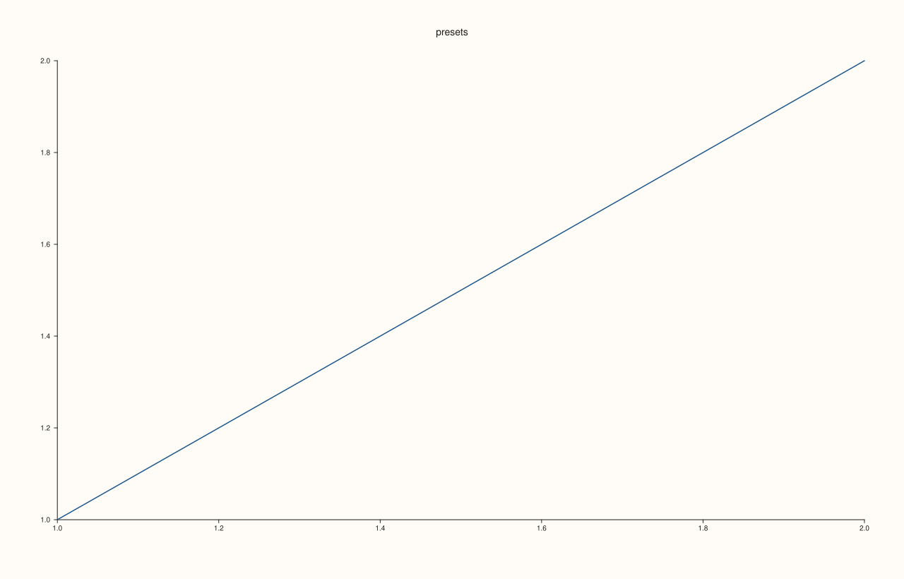

<!-- generated by PlussPl/docs/sphinx/tools/plotdocs.py from tools/specs/PaletteRamp.py; edit the spec -->

# PaletteRamp

[Back to Types and Options Reference](../../types_api_reference)

## What It Does

A `PaletteRamp` is a named, ordered list of colours that data values are mapped through: the value at the bottom of the colour range gets the first colour, the value at the top gets
the last, and values in between get a blend of the neighbouring stops. It is the argument of [`Trace::palette`](../trace/palette.md), which colours a surface, a field map or a coloured cloud, and it is the
`surface_palette` of a [`Theme`](Theme.md), the palette that traces start with.

`sample(position)` is the mapping itself: it takes a position from 0 (the first stop) to 1 (the last) and returns the interpolated [`Rgba`](Rgba.md). A position outside `[0, 1]` is clamped to the ends. The five
presets cover the common cases; build your own from a name and a list of stops when the data have a meaning that a preset does not suit, such as a diverging scale around zero.

Which part of the data range maps to the ramp is set by the colour limits ([`Trace::color_limits`](../trace/color_limits.md), [`LimitMethod`](LimitMethod.md)); the ramp only decides the colours.

## Values

| Preset | Stops | Runs from | Runs to | Take it for |
|---|---|---|---|---|
| `thermal()` | 5 | dark navy (21, 43, 81) | orange-red (214, 88, 52) | General continuous data with a clear low and high. The default of a `Theme`. |
| `neutral()` | 4 | near-black grey (27, 30, 38) | light grey (229, 232, 238) | Figures to be printed in black and white, or data that should not suggest a colour. |
| `lagoon()` | 6 | dark indigo (44, 52, 125) | yellow (248, 230, 84) | Quantities where every step of the scale should be distinguishable; it passes through blue and green. |
| `ocean()` | 5 | deep navy (9, 33, 64) | pale cyan (211, 239, 244) | Smooth scalar fields with a calm look. |
| `meadow()` | 5 | dark green (28, 52, 36) | cream (240, 226, 171) | Growth, vegetation, positive quantities. |

The colours are printed by Example 4, so they can be checked against the version of the library you use.

## Examples

Example 1. The five presets on the same surface, coloured by height. Each pane draws the surface with one preset passed to `Trace::palette`.

```cpp
constexpr std::int64_t n = 16;
auto coord = pluss::series::linspace(-1.0, 1.0, n, pluss::ScalarType::Float64);
std::vector<double> peak(static_cast<std::size_t>(n * n));
for (std::int64_t i = 0; i < n; ++i)
  for (std::int64_t j = 0; j < n; ++j) {
    const double x = -1.0 + 2.0 * i / (n - 1), y = -1.0 + 2.0 * j / (n - 1);
    peak[static_cast<std::size_t>(i * n + j)] = std::exp(-3.0 * (x * x + y * y)) + 0.25 * std::sin(4.0 * x);
  }
auto z = pluss::make_series(peak, {n, n});

const char* names[] = {"thermal", "neutral", "lagoon", "ocean", "meadow"};
auto fig = studio("palette_ramp_gallery");
fig.mosaic(1, 5);
for (int i = 0; i < 5; ++i) {
  PaletteRamp ramp = i == 0 ? PaletteRamp::thermal() : i == 1 ? PaletteRamp::neutral() : i == 2 ? PaletteRamp::lagoon() : i == 3 ? PaletteRamp::ocean() : PaletteRamp::meadow();
  auto& pane = fig.pane3(names[i]);
  pane.sheet(coord, coord, z).shade(ShadeMode::Smooth).palette(ramp);
}
fig.save_svg("figure.svg");
```


Example 2. `sample`. A custom ramp of three stops, red, white and blue, and the colour it gives at five positions. The ends are the first and last stops, the middle is the middle stop, and a position between two stops is a blend of them. Out-of-range positions are clamped.

```cpp
const PaletteRamp ramp("diverging", {Rgba::from_u8(178, 24, 43), Rgba::from_u8(247, 247, 247), Rgba::from_u8(33, 102, 172)});
std::cout << ramp.name() << ", " << ramp.stops().size() << " stops, empty " << ramp.empty() << "\n";
for (double position : {-0.5, 0.0, 0.25, 0.5, 0.75, 1.0, 1.5}) {
  const Rgba c = ramp.sample(position);
  std::cout << "sample(" << position << ") = (" << static_cast<int>(c.red * 255 + 0.5) << ", " << static_cast<int>(c.green * 255 + 0.5)
            << ", " << static_cast<int>(c.blue * 255 + 0.5) << ")\n";
}
auto fig = studio("palette_ramp_sample");
fig.pane2("ramp").trend(std::vector<double>{1, 2}, std::vector<double>{1, 2});
fig.save_svg("figure.svg");
```

### Output

```text
diverging, 3 stops, empty 0
sample(-0.5) = (178, 24, 43)
sample(0) = (178, 24, 43)
sample(0.25) = (212, 136, 145)
sample(0.5) = (247, 247, 247)
sample(0.75) = (140, 175, 210)
sample(1) = (33, 102, 172)
sample(1.5) = (33, 102, 172)
```



Example 3. A custom diverging ramp on data that is positive and negative. With the colour limits set symmetrically about zero, the middle stop, white, is exactly zero; a preset like `thermal` would colour zero as an arbitrary middle value.

```cpp
constexpr std::int64_t n = 16;
auto coord = pluss::series::linspace(-1.0, 1.0, n, pluss::ScalarType::Float64);
std::vector<double> values(static_cast<std::size_t>(n * n));
for (std::int64_t i = 0; i < n; ++i)
  for (std::int64_t j = 0; j < n; ++j) {
    const double x = -1.0 + 2.0 * i / (n - 1), y = -1.0 + 2.0 * j / (n - 1);
    values[static_cast<std::size_t>(i * n + j)] = x * y;
  }
auto z = pluss::make_series(values, {n, n});
const PaletteRamp diverging("diverging", {Rgba::from_u8(178, 24, 43), Rgba::from_u8(247, 247, 247), Rgba::from_u8(33, 102, 172)});

auto fig = studio("palette_ramp_diverging");
fig.mosaic(1, 2);
auto& preset = fig.pane3("thermal");
preset.sheet(coord, coord, z).shade(ShadeMode::Smooth);
auto& custom = fig.pane3("diverging, limits -1 to 1");
custom.sheet(coord, coord, z).shade(ShadeMode::Smooth).palette(diverging).color_limits(Range1d{-1.0, 1.0});
fig.save_svg("figure.svg");
```



Example 4. The presets are ordinary ramps with a name and stops that can be read: this prints each preset's name and its first and last colours. A default-constructed ramp is empty.

```cpp
const PaletteRamp presets[] = {PaletteRamp::thermal(), PaletteRamp::neutral(), PaletteRamp::lagoon(), PaletteRamp::ocean(), PaletteRamp::meadow()};
for (const PaletteRamp& p : presets) {
  const Rgba a = p.sample(0.0), b = p.sample(1.0);
  std::cout << p.name() << ": " << p.stops().size() << " stops, first (" << static_cast<int>(a.red * 255 + 0.5) << ", " << static_cast<int>(a.green * 255 + 0.5) << ", " << static_cast<int>(a.blue * 255 + 0.5)
            << "), last (" << static_cast<int>(b.red * 255 + 0.5) << ", " << static_cast<int>(b.green * 255 + 0.5) << ", " << static_cast<int>(b.blue * 255 + 0.5) << ")\n";
}
std::cout << "PaletteRamp(): empty " << PaletteRamp().empty() << "\n";
auto fig = studio("palette_ramp_presets");
fig.pane2("presets").trend(std::vector<double>{1, 2}, std::vector<double>{1, 2});
fig.save_svg("figure.svg");
```

### Output

```text
thermal: 5 stops, first (21, 43, 81), last (214, 88, 52)
neutral: 4 stops, first (27, 30, 38), last (229, 232, 238)
lagoon: 6 stops, first (44, 52, 125), last (248, 230, 84)
ocean: 5 stops, first (9, 33, 64), last (211, 239, 244)
meadow: 5 stops, first (28, 52, 36), last (240, 226, 171)
PaletteRamp(): empty 1
```



## Notes

- The ramp is applied to the trace's colour limits, so the same ramp on two traces with different limits colours different values alike; set the limits explicitly when panes must be compared.
- A ramp with a single stop is a constant colour; an empty ramp has nothing to sample, so give a custom ramp at least two stops.
- Ramps are values: copy one, and the copies are independent.

## See Also

- [`Trace::palette`](../trace/palette.md): applies a ramp to a trace.
- [`Theme`](Theme.md): the theme's `surface_palette` is the palette traces start with.
- [`Rgba`](Rgba.md): the colour type of the stops.
- [`Trace::color_limits`](../trace/color_limits.md): which values map to the ends of the ramp.

<div class="pluss-inline-prev-next">
  <a class="prev-link" href="MosaicLayout.html">
    <span class="label">Previous</span>
    <span class="title">MosaicLayout, PanePlacement</span>
  </a>
  <a class="next-link" href="PdfEngine.html">
    <span class="label">Next</span>
    <span class="title">PdfEngine</span>
  </a>
</div>
