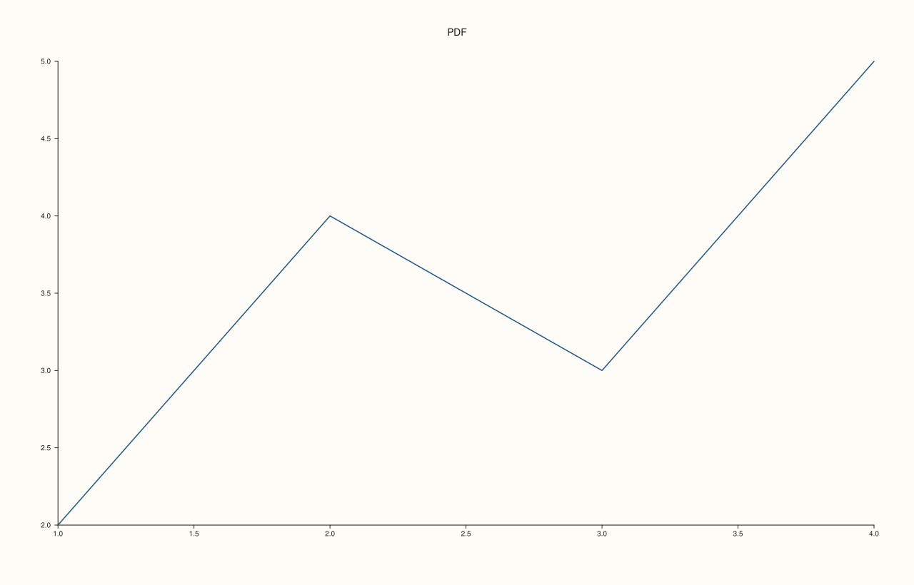
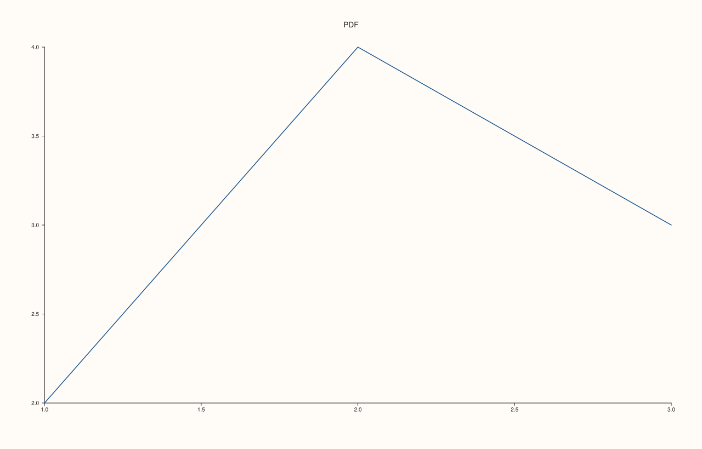

<!-- generated by PlussPl/docs/sphinx/tools/plotdocs.py from tools/specs/PdfEngine.py; edit the spec -->

# PdfEngine

[Back to Types and Options Reference](../../types_api_reference)

## What It Does

`PdfEngine` chooses how [`Studio::save_pdf`](../studio/save_pdf.md) produces a PDF. There are two writers. The **internal** writer draws the figure straight into a PDF with the library's own code, so it needs nothing installed; its output is a compact PDF 1.4 file in which text is real text. The **converter** route first writes the figure as SVG and then asks an external tool to turn it into a PDF; it needs one of `rsvg-convert`, `inkscape` or ImageMagick (`magick` or `convert`) on the machine, and its output is whatever that tool writes.

`Auto`, the default, uses the internal writer, so a plain `save_pdf(path)` always works. Ask for `SvgConvert` only when you want the converter's rendering, for example to get exactly the picture the SVG shows. If no converter is available it throws `std::runtime_error` and writes nothing, so the choice is also a way to test whether the machine has one.

## Values

| Value | Writer | Needs | Output |
|---|---|---|---|
| `Auto` | The internal writer. This is the default. | Nothing. | PDF 1.4, the same bytes as `Internal`. |
| `Internal` | The internal writer. | Nothing. | PDF 1.4. |
| `SvgConvert` | Writes an SVG, then runs `rsvg-convert`, `inkscape` or `magick`/`convert`. | One of those tools. | Whatever the tool writes. |

## Examples

Example 1. `Auto` and `Internal` write the same file. The two PDFs are read back and compared byte for byte, and both start with the PDF 1.4 header of the internal writer.

```cpp
auto fig = studio("pdf_engine");
fig.pane2("PDF").trend(std::vector<double>{1, 2, 3, 4}, std::vector<double>{2, 4, 3, 5});
const std::string dir = std::filesystem::temp_directory_path().string() + "/pdf_engine_";
auto read = [](const std::string& path) { std::ifstream in(path, std::ios::binary); return std::string(std::istreambuf_iterator<char>(in), {}); };
fig.save_pdf(dir + "auto.pdf", PdfEngine::Auto);
fig.save_pdf(dir + "internal.pdf", PdfEngine::Internal);
fig.save_pdf(dir + "default.pdf");
const std::string a = read(dir + "auto.pdf"), b = read(dir + "internal.pdf"), c = read(dir + "default.pdf");
std::cout << "starts with " << a.substr(0, 8) << "\n";
std::cout << "Auto == Internal: " << (a == b) << ", default argument == Auto: " << (a == c) << "\n";
fig.save_svg("figure.svg");
```

### Output

```text
starts with %PDF-1.4
Auto == Internal: 1, default argument == Auto: 1
```


Example 2. `Studio::to_pdf()` returns the internal writer's PDF as a string instead of writing a file, so it is the same bytes as `save_pdf` with `Auto` or `Internal`, with no file involved.

```cpp
auto fig = studio("pdf_engine_string");
fig.pane2("PDF").trend(std::vector<double>{1, 2, 3, 4}, std::vector<double>{2, 4, 3, 5});
const std::string pdf = fig.to_pdf();
const std::string path = std::filesystem::temp_directory_path().string() + "/pdf_engine_string.pdf";
fig.save_pdf(path, PdfEngine::Internal);
std::ifstream in(path, std::ios::binary);
const std::string file(std::istreambuf_iterator<char>(in), {});
std::cout << "to_pdf() starts with " << pdf.substr(0, 8) << ", equals the saved file: " << (pdf == file) << "\n";
fig.save_svg("figure.svg");
```

### Output

```text
to_pdf() starts with %PDF-1.4, equals the saved file: 1
```


Example 3. `SvgConvert` depends on the machine. The call either writes a PDF (printed here as the header of the file it wrote, which differs from the internal writer's) or, on a machine with none of the converters installed, throws and says which tools it looked for. Either outcome is reported, so the example is correct on both kinds of machine.

```cpp
auto fig = studio("pdf_engine_convert");
fig.pane2("PDF").trend(std::vector<double>{1, 2, 3, 4}, std::vector<double>{2, 4, 3, 5});
const std::string path = std::filesystem::temp_directory_path().string() + "/pdf_engine_convert.pdf";
try {
  fig.save_pdf(path, PdfEngine::SvgConvert);
  std::ifstream in(path, std::ios::binary);
  std::string head(8, ' ');
  in.read(head.data(), 8);
  std::cout << "a converter was found; the file starts with " << head.substr(0, 5) << ", and it is not the internal writer's: " << (head != "%PDF-1.4") << "\n";
} catch (const pluss::Error& e) {
  std::cout << "no converter: " << e.message() << "\n";
}
fig.save_svg("figure.svg");
```

### Output

```text
a converter was found; the file starts with %PDF-, and it is not the internal writer's: 1
```



Example 4. The path must end in `.pdf`; a path with another extension is refused before anything is written, whichever engine is asked for.

```cpp
auto fig = studio("pdf_engine_extension");
fig.pane2("PDF").trend(std::vector<double>{1, 2, 3}, std::vector<double>{2, 4, 3});
for (PdfEngine engine : {PdfEngine::Internal, PdfEngine::SvgConvert}) {
  try {
    fig.save_pdf(std::filesystem::temp_directory_path().string() + "/figure.svg", engine);
  } catch (const pluss::Error& e) {
    const std::string message = e.message();
    std::cout << message.substr(0, message.find('\n')) << "\n";
  }
}
fig.save_svg("figure.svg");
```

### Output

```text
save_pdf(): filename extension '.svg' does not match expected '.pdf'
save_pdf(): filename extension '.svg' does not match expected '.pdf'
```



## Notes

- `to_pdf()` and `save_pdf(path)` need no external tool; `save_png` always rasterises through a converter and throws if there is none (it is not governed by `PdfEngine`).
- The converter route writes a temporary SVG next to the system's temporary files and removes it again.

## See Also

- [`Studio::save_pdf`](../studio/save_pdf.md), [`Studio::to_pdf`](../studio/to_pdf.md): the calls that take the engine.
- [`Studio::save_svg`](../studio/save_svg.md), [`Studio::save_png`](../studio/save_png.md): the other file formats.

<div class="pluss-inline-prev-next">
  <a class="prev-link" href="PaletteRamp.html">
    <span class="label">Previous</span>
    <span class="title">PaletteRamp</span>
  </a>
  <a class="next-link" href="Rgba.html">
    <span class="label">Next</span>
    <span class="title">Rgba</span>
  </a>
</div>
