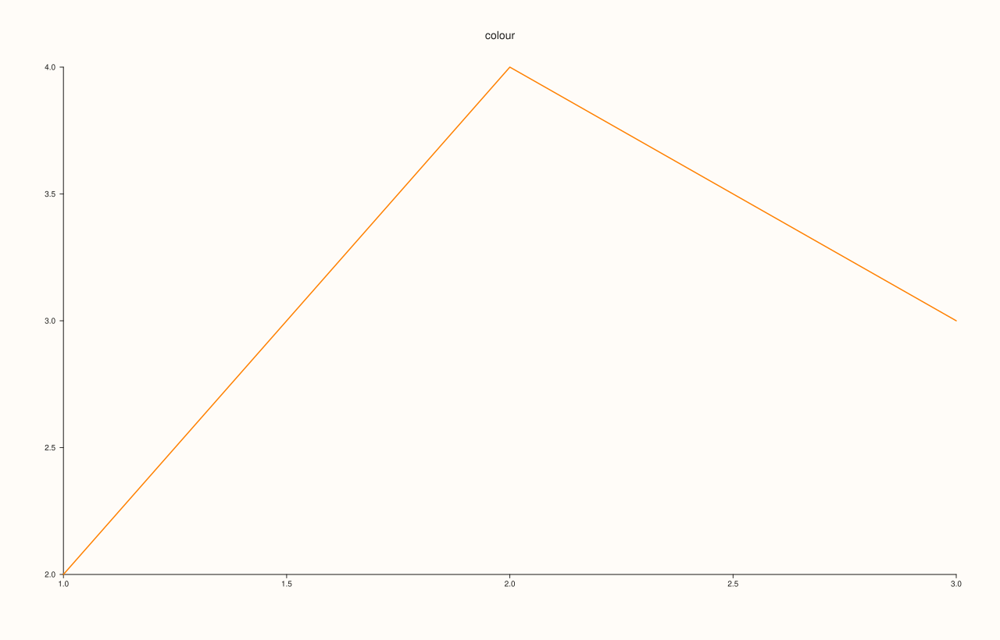
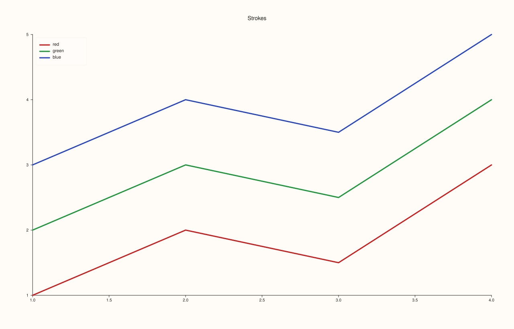
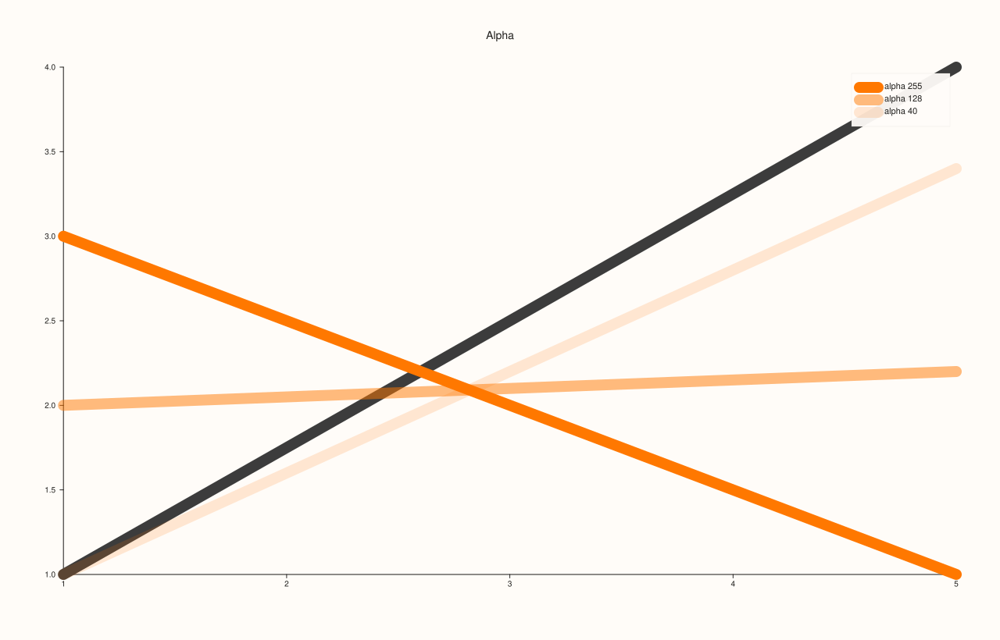

<!-- generated by PlussPl/docs/sphinx/tools/plotdocs.py from tools/specs/Rgba.py; edit the spec -->

# Rgba

[Back to Types and Options Reference](../../types_api_reference)

## What It Does

`Rgba` is the colour type of PlussPl: the stroke of a trace ([`Trace::stroke`](../trace/stroke.md)), the stops of a [`PaletteRamp`](PaletteRamp.md), the accents, background and foreground of a [`Theme`](Theme.md), and the colours of the
cues that mark a pane. Its four fields are fractions between 0 and 1: red, green, blue and **alpha**, the opacity, where 1 is fully opaque and 0 is invisible.

`Rgba::from_u8` builds one from the 0 to 255 integers that colour pickers, style guides and CSS give, dividing each by 255. The alpha argument defaults to 255, opaque. The constructor is `constexpr`, so a colour can be a compile-time constant.

## Fields

| Field | Meaning | Range | Default |
|---|---|---|---|
| `red`, `green`, `blue` | The colour channels. | 0 to 1 | 0 |
| `alpha` | The opacity. | 0 (invisible) to 1 (opaque) | 1 |

| Function | Meaning |
|---|---|
| `Rgba::from_u8(r, g, b, a = 255)` | The colour with each argument divided by 255. |

## Examples

Example 1. `from_u8` against the fields. A mid orange given as 255, 128, 0 has channels of 1, 0.50196 and 0; the alpha of 255 is 1. A half-transparent colour passes 128 as the alpha.

```cpp
const Rgba orange = Rgba::from_u8(255, 128, 0);
const Rgba half = Rgba::from_u8(255, 128, 0, 128);
const Rgba fields{1.0, 0.5, 0.0, 0.5};
std::cout << "from_u8(255,128,0):      " << orange.red << ", " << orange.green << ", " << orange.blue << ", alpha " << orange.alpha << "\n";
std::cout << "from_u8(255,128,0,128):  " << half.red << ", " << half.green << ", " << half.blue << ", alpha " << half.alpha << "\n";
std::cout << "brace-initialised:       " << fields.red << ", " << fields.green << ", " << fields.blue << ", alpha " << fields.alpha << "\n";
std::cout << "default:                 " << Rgba{}.red << ", " << Rgba{}.green << ", " << Rgba{}.blue << ", alpha " << Rgba{}.alpha << "\n";
auto fig = studio("rgba_from_u8");
fig.pane2("colour").trend(std::vector<double>{1, 2, 3}, std::vector<double>{2, 4, 3}).stroke(orange);
fig.save_svg("figure.svg");
```

### Output

```text
from_u8(255,128,0):      1, 0.501961, 0, alpha 1
from_u8(255,128,0,128):  1, 0.501961, 0, alpha 0.501961
brace-initialised:       1, 0.5, 0, alpha 0.5
default:                 0, 0, 0, alpha 1
```



Example 2. A colour as a trace's stroke. Three lines coloured with `from_u8` (a strong red, green and blue), the width raised so the colour shows.

```cpp
auto fig = studio("rgba_stroke");
auto& pane = fig.pane2("Strokes");
pane.trend(std::vector<double>{1, 2, 3, 4}, std::vector<double>{1, 2, 1.5, 3}).stroke(Rgba::from_u8(200, 30, 30)).width(3.0f).label("red");
pane.trend(std::vector<double>{1, 2, 3, 4}, std::vector<double>{2, 3, 2.5, 4}).stroke(Rgba::from_u8(30, 150, 60)).width(3.0f).label("green");
pane.trend(std::vector<double>{1, 2, 3, 4}, std::vector<double>{3, 4, 3.5, 5}).stroke(Rgba::from_u8(40, 70, 190)).width(3.0f).label("blue");
pane.legend(KeyPlace::NorthWest);
fig.save_svg("figure.svg");
```



Example 3. Alpha. The same orange line at alpha 255, 128 and 40, drawn over a dark grey line it crosses. As alpha falls the line shows more of what is behind it and less of its own colour.

```cpp
auto fig = studio("rgba_alpha");
auto& pane = fig.pane2("Alpha");
pane.trend(std::vector<double>{1, 5}, std::vector<double>{1.0, 4.0}).stroke(Rgba::from_u8(60, 60, 60)).width(14.0f);
const unsigned alphas[] = {255, 128, 40};
for (int i = 0; i < 3; ++i)
  pane.trend(std::vector<double>{1, 5}, std::vector<double>{3.0 - i, 1.0 + i * 1.2}).stroke(Rgba::from_u8(255, 120, 0, alphas[i])).width(14.0f).label("alpha " + std::to_string(alphas[i]));
pane.legend(KeyPlace::NorthEast);
fig.save_svg("figure.svg");
```



## Notes

- The fields are doubles, so a channel can be a computed fraction; values outside 0 to 1 are not meaningful colours.
- `from_u8` does not validate its arguments: pass 0 to 255.
- Colours are values; there is no named-colour table. Define constants for the colours your figures share, or build a [`Theme`](Theme.md) so they are chosen once.

## See Also

- [`Trace::stroke`](../trace/stroke.md): colours a trace.
- [`PaletteRamp`](PaletteRamp.md), [`Theme`](Theme.md): lists of colours.
- `RuleCue`, `BandCue`, `PinCue`: coloured annotations (`Pane::rule_x`, `band_y`, `pin`).

<div class="pluss-inline-prev-next">
  <a class="prev-link" href="PdfEngine.html">
    <span class="label">Previous</span>
    <span class="title">PdfEngine</span>
  </a>
  <a class="next-link" href="ScalePolicy.html">
    <span class="label">Next</span>
    <span class="title">ScalePolicy</span>
  </a>
</div>
