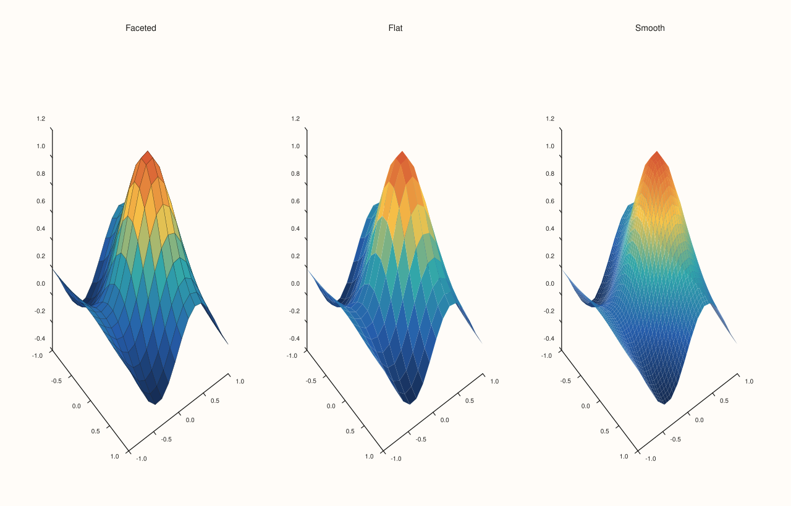
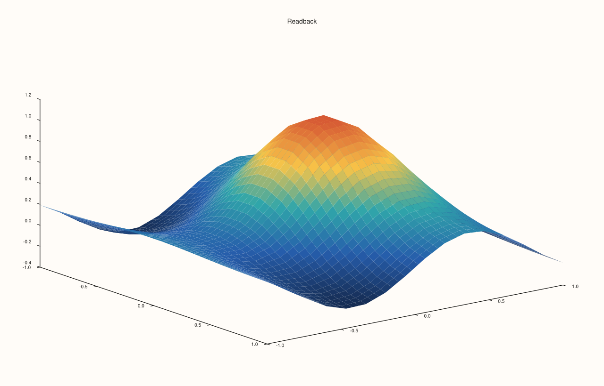
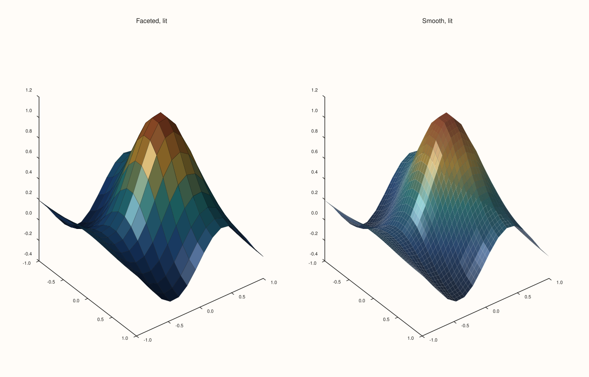

<!-- generated by PlussPl/docs/sphinx/tools/plotdocs.py from tools/specs/ShadeMode.py; edit the spec -->

# ShadeMode

[Back to Types and Options Reference](../../types_api_reference)

## What It Does

`ShadeMode` chooses how a 3D surface trace is coloured across its cells. It is the argument of
[`Trace::shade`](../trace/shade.md) and the value [`Trace::shade_mode`](../trace/shade.md) reads back. It applies to surface-family
traces, such as [`sheet`](../pane/sheet.md) and [`lattice`](../pane/lattice.md). It is about colour only: it does not change the surface's
geometry, and it is separate from [`LightingMode`](LightingMode.md), which decides whether light is applied, and from
[`MaterialProfile`](MaterialProfile.md), which decides how the surface responds to it.

## Values

| Value | Colouring | Look |
|---|---|---|
| `Faceted` | Each cell is one colour, taken from the cell, with the cell outlines visible. This is the default. | A mosaic of tiles; the grid of the data can be counted. |
| `Flat` | Each cell is one colour, with the dark outlines replaced by faint seams. | The same tiles with the grid lines softened. |
| `Smooth` | The colour varies continuously across each cell, blending towards the colours at its corners. | A continuous surface; the grid disappears. |

## Examples

Example 1. The three modes on the same 16 by 16 surface, coloured by height. `Faceted` shows the cell outlines, `Flat` softens them to faint seams and keeps the tiles, and `Smooth` blends the tiles into a continuous surface.

```cpp
constexpr std::int64_t n = 16;
auto coord = pluss::series::linspace(-1.0, 1.0, n, pluss::ScalarType::Float64);
std::vector<double> peak(static_cast<std::size_t>(n * n));
for (std::int64_t i = 0; i < n; ++i)
  for (std::int64_t j = 0; j < n; ++j) {
    const double x = -1.0 + 2.0 * i / (n - 1), y = -1.0 + 2.0 * j / (n - 1);
    peak[static_cast<std::size_t>(i * n + j)] = std::exp(-3.0 * (x * x + y * y)) + 0.25 * std::sin(4.0 * x);
  }
auto z = pluss::make_series(peak, {n, n});

const ShadeMode modes[] = {ShadeMode::Faceted, ShadeMode::Flat, ShadeMode::Smooth};
const char* names[] = {"Faceted", "Flat", "Smooth"};
auto fig = studio("shade_mode_gallery");
fig.mosaic(1, 3);
for (int i = 0; i < 3; ++i) {
  auto& pane = fig.pane3(names[i]);
  pane.sheet(coord, coord, z).shade(modes[i]);
}
fig.save_svg("figure.svg");
```



Example 2. `shade` returns the trace, so it chains with the other trace setters, and `shade_mode` reads the value back. The default of a new surface trace is printed first.

```cpp
constexpr std::int64_t n = 16;
auto coord = pluss::series::linspace(-1.0, 1.0, n, pluss::ScalarType::Float64);
std::vector<double> peak(static_cast<std::size_t>(n * n));
for (std::int64_t i = 0; i < n; ++i)
  for (std::int64_t j = 0; j < n; ++j) {
    const double x = -1.0 + 2.0 * i / (n - 1), y = -1.0 + 2.0 * j / (n - 1);
    peak[static_cast<std::size_t>(i * n + j)] = std::exp(-3.0 * (x * x + y * y)) + 0.25 * std::sin(4.0 * x);
  }
auto z = pluss::make_series(peak, {n, n});

auto fig = studio("shade_mode_readback");
auto& pane = fig.pane3("Readback");
Trace& trace = pane.sheet(coord, coord, z);
std::cout << "default: " << static_cast<int>(trace.shade_mode()) << "\n";
for (ShadeMode m : {ShadeMode::Faceted, ShadeMode::Flat, ShadeMode::Smooth}) {
  trace.shade(m);
  std::cout << static_cast<int>(m) << " -> " << static_cast<int>(trace.shade_mode()) << "\n";
}
fig.save_svg("figure.svg");
```

### Output

```text
default: 0
0 -> 0
1 -> 1
2 -> 2
```



Example 3. The three modes render three different figures: comparing the SVG text of the three, no two are equal. (Faceted and Flat in particular are alike in colour, and differ in the outlines.)

```cpp
constexpr std::int64_t n = 16;
auto coord = pluss::series::linspace(-1.0, 1.0, n, pluss::ScalarType::Float64);
std::vector<double> peak(static_cast<std::size_t>(n * n));
for (std::int64_t i = 0; i < n; ++i)
  for (std::int64_t j = 0; j < n; ++j) {
    const double x = -1.0 + 2.0 * i / (n - 1), y = -1.0 + 2.0 * j / (n - 1);
    peak[static_cast<std::size_t>(i * n + j)] = std::exp(-3.0 * (x * x + y * y)) + 0.25 * std::sin(4.0 * x);
  }
auto z = pluss::make_series(peak, {n, n});

std::string svg[3];
const ShadeMode modes[] = {ShadeMode::Faceted, ShadeMode::Flat, ShadeMode::Smooth};
for (int i = 0; i < 3; ++i) {
  auto fig = studio("shade_mode_distinct");
  fig.pane3("Surface").sheet(coord, coord, z).shade(modes[i]);
  svg[i] = fig.to_svg();
}
std::cout << "Faceted == Flat:   " << (svg[0] == svg[1]) << "\n";
std::cout << "Faceted == Smooth: " << (svg[0] == svg[2]) << "\n";
std::cout << "Flat == Smooth:    " << (svg[1] == svg[2]) << "\n";
auto fig = studio("shade_mode_distinct_out");
fig.pane3("Smooth").sheet(coord, coord, z).shade(ShadeMode::Smooth);
fig.save_svg("figure.svg");
```

### Output

```text
Faceted == Flat:   0
Faceted == Smooth: 0
Flat == Smooth:    0
```


Example 4. Shading and lighting combine. `Smooth` colouring with Gouraud lighting and a sun-like rig gives the familiar smooth, lit surface, while `Faceted` with the same light shades each cell as one tile of its own brightness.

```cpp
constexpr std::int64_t n = 16;
auto coord = pluss::series::linspace(-1.0, 1.0, n, pluss::ScalarType::Float64);
std::vector<double> peak(static_cast<std::size_t>(n * n));
for (std::int64_t i = 0; i < n; ++i)
  for (std::int64_t j = 0; j < n; ++j) {
    const double x = -1.0 + 2.0 * i / (n - 1), y = -1.0 + 2.0 * j / (n - 1);
    peak[static_cast<std::size_t>(i * n + j)] = std::exp(-3.0 * (x * x + y * y)) + 0.25 * std::sin(4.0 * x);
  }
auto z = pluss::make_series(peak, {n, n});

const ShadeMode modes[] = {ShadeMode::Faceted, ShadeMode::Smooth};
const char* names[] = {"Faceted, lit", "Smooth, lit"};
auto fig = studio("shade_mode_lit");
fig.mosaic(1, 2);
for (int i = 0; i < 2; ++i) {
  auto& pane = fig.pane3(names[i]);
  pane.lights().sun_key();
  pane.sheet(coord, coord, z).shade(modes[i]).lighting(LightingMode::Gouraud);
}
fig.save_svg("figure.svg");
```



## Notes

- `ShadeMode` only affects surface-family 3D traces. On a 2D trace it has no visible effect.
- Smooth colouring needs a value at each corner, so it is most striking on coarse grids; on a very fine grid the cells are smaller than the eye can see and `Faceted`, `Flat` and `Smooth` converge.

## See Also

- [`Trace::shade`](../trace/shade.md): sets the mode.
- [`LightingMode`](LightingMode.md), [`MaterialProfile`](MaterialProfile.md): light and surface response.
- [`LightRig`](LightRig.md): the lights a lit surface needs.

<div class="pluss-inline-prev-next">
  <a class="prev-link" href="ScalePolicy.html">
    <span class="label">Previous</span>
    <span class="title">ScalePolicy</span>
  </a>
  <a class="next-link" href="Theme.html">
    <span class="label">Next</span>
    <span class="title">Theme</span>
  </a>
</div>
