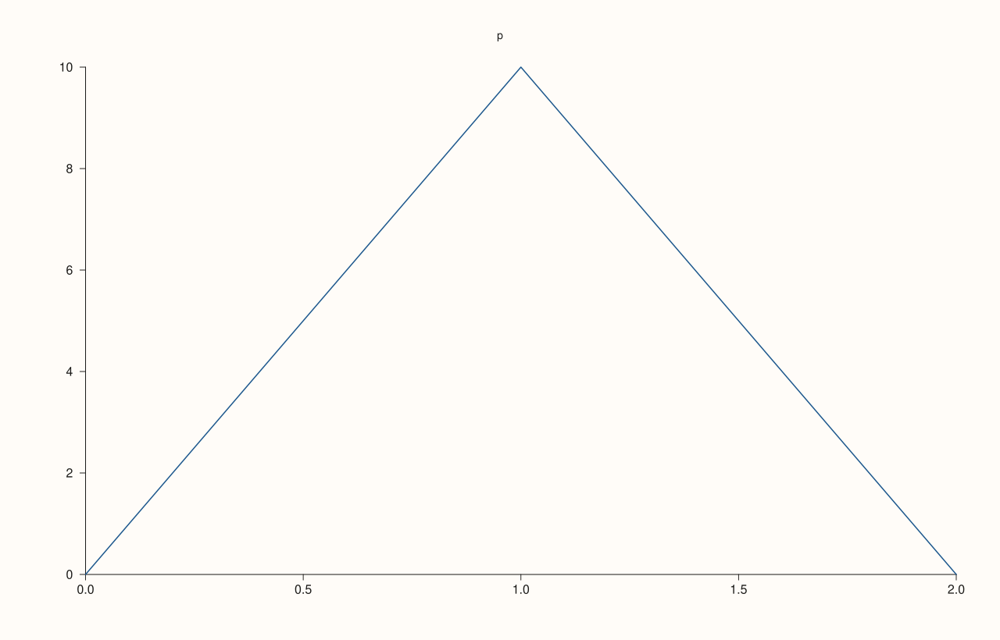
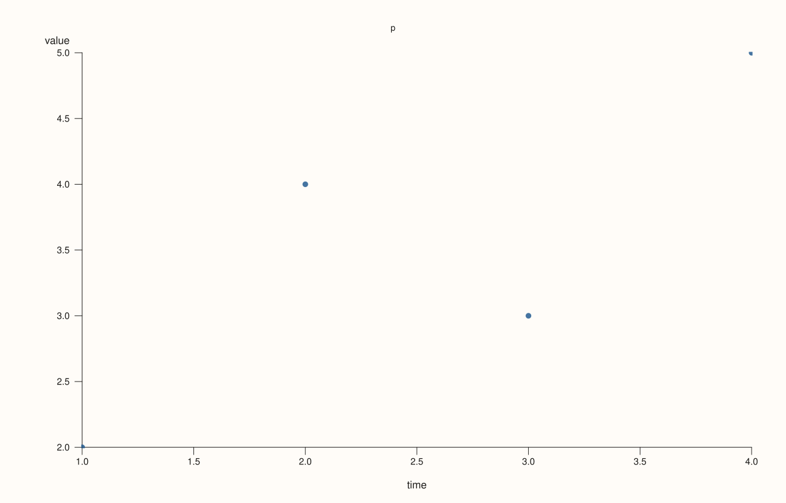
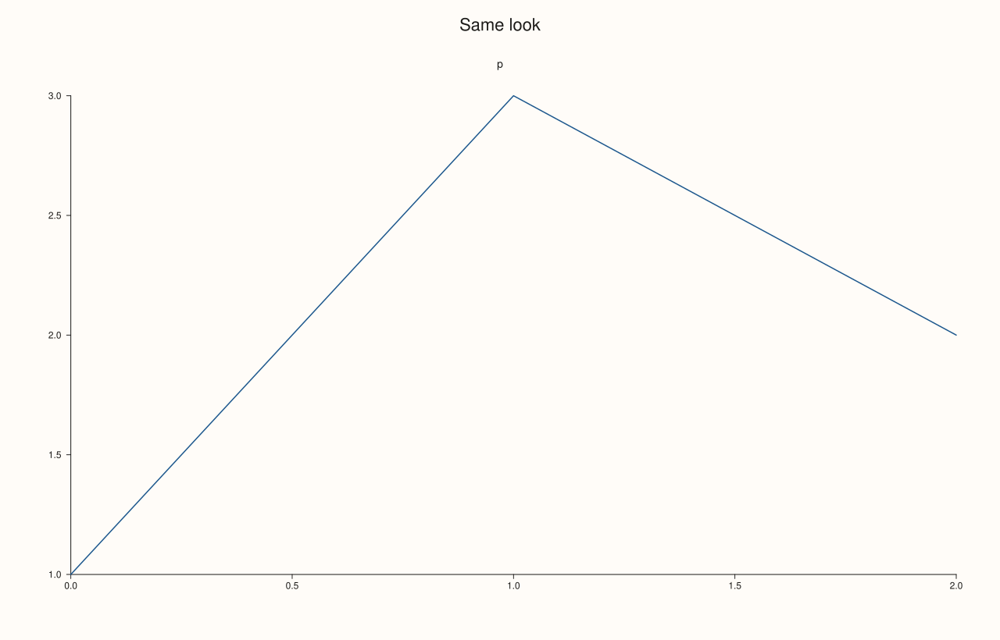
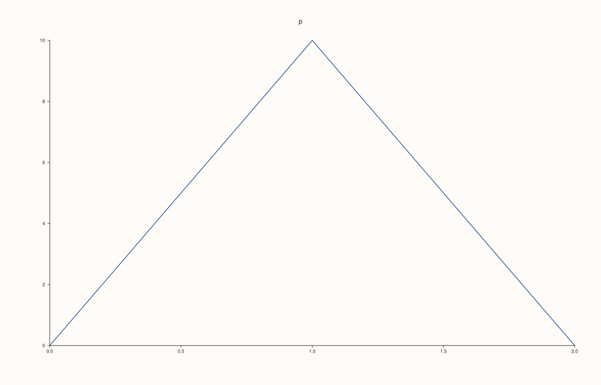
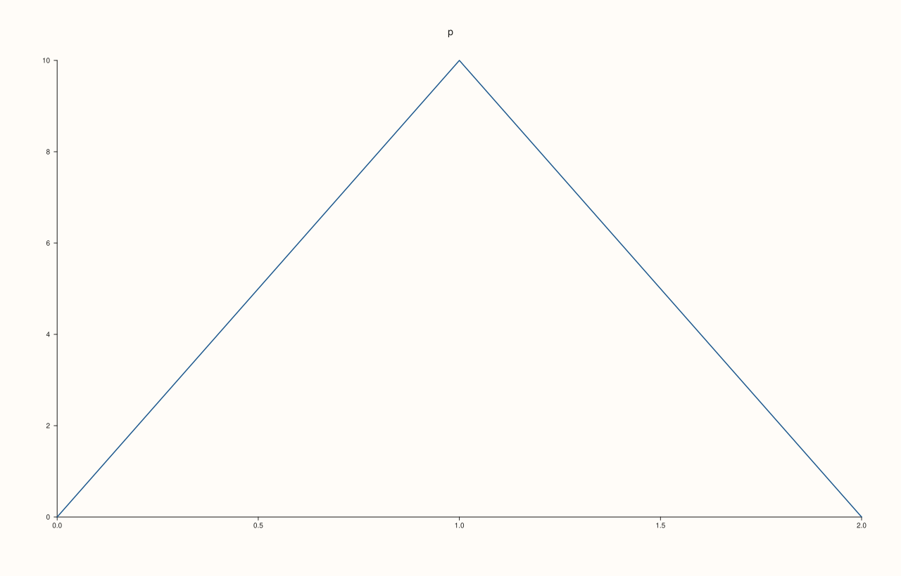

<!-- generated by PlussPl/docs/sphinx/tools/plotdocs.py from tools/specs/StyleOptions.py; edit the spec -->

# StyleOptions

[Back to Types and Options Reference](../../types_api_reference)

## What It Does

`StyleOptions` is the set of numbers that give a figure its look: the sizes of the fonts, the length of ticks, the room around a plot, the width of a legend box, the size of a marker, the shading of a surface, the colours of the grid. A figure draws with the defaults below unless it is given another set, so the look of every figure of a program can be changed by one call, and nothing needs to be edited in the library.

To restyle a figure, take a copy of its current values with [`Studio::style_options`](../studio/style_options.md), change the ones you want, and give the set back with [`Studio::style`](../studio/style.md). The set is copied into the figure: later changes to your copy do not reach it, and one set can be given to any number of figures. Values are plain numbers, in these units:

| Suffix | Unit |
|---|---|
| `_pt` | points, the unit of the drawing. |
| `_em` | a multiple of the font size the quantity sits beside, so it follows the font and its scale ([`tick_font_scale`](../pane/tick_font_scale.md), [`context_scales`](../studio/context_scales.md)). |
| `_share` | a fraction of the figure, of a cell or of a plot. |
| `_factor`, `_alpha`, `_shade` | dimensionless multipliers and opacities. |

A value is only a number: a quantity that depends on the content (the gap between the longest tick label and the axis label, the width a legend needs) is not here. It is worked out when the figure is drawn, from these values and from the content. Values marked guard keep the drawing sane (a marker never shrinks below a visible dot) and are not ways to make a distance look right. Every value must be a finite number; a set with another is refused by `Studio::style`, naming the value.

There are 331 values, in the groups below. A pair such as `pane_left_inset` holds two numbers, one for the relaxed layout and one for the compact layout ([`tight_layout`](../studio/tight_layout.md)); a material holds the five coefficients of its shading; a colour holds red, green, blue and alpha between 0 and 1.

## Values

### Fonts (pt). The font scales of a pane or a studio multiply these

| Name | Meaning | Default |
|---|---|---|
| `tick_font_pt` | size of the tick labels | 10 |
| `axis_label_font_pt` | size of the axis labels | 11 |
| `headline_font_pt` | size of the figure's headline | 18 |
| `caption_font_pt` | size of the shared captions of aligned panes | 12 |
| `cue_label_font_pt` | size of the labels of rules, bands and pins | 10 |

### Planar axes (em of the tick font, or of the axis-label font where stated)

| Name | Meaning | Default |
|---|---|---|
| `tick_length_em` | tick mark length | 0.45 |
| `tick_text_gap_em` | from the end of a tick to its text | 0.74 |
| `rotated_tick_text_gap_base_em` | the gap of a rotated tick label, before the rotation gain | 0.28 |
| `rotated_tick_text_gap_gain_em` | added in proportion to the rotation (0 at 0 deg, full at 90) | 0.16 |
| `bordered_virtual_tick_factor` | clearance kept for a tick on a pane with axes | 1 |
| `borderless_virtual_tick_factor` | and on a pane without them | 0.35 |
| `y_axis_optical_comp_em` | y tick labels are end-anchored and look farther away | 0.18 |
| `y_axis_optical_comp_rotation_attenuation` | how much of the optical shift of y tick labels is kept when they are rotated | 0.6 |
| `axis_label_gap_x_em` | of the axis-label font: axis label from the tick text | 0.85 |
| `axis_label_gap_y_em` | gap between the y axis label and the tick text, in em of the axis-label font | 0.75 |
| `axis_label_gap_x_no_axes_em` | gap between the x axis label and the tick text on a pane without axes | 0.55 |
| `axis_label_gap_y_no_axes_em` | gap between the y axis label and the tick text on a pane without axes | 0.45 |

### 3D axes (em of the tick font, or of the axis-label font where stated)

| Name | Meaning | Default |
|---|---|---|
| `spatial_tick_length_em` | length of a tick mark on the x and y axes of a 3D pane | 0.6 |
| `spatial_z_tick_length_em` | length of a tick mark on the z axis of a 3D pane | 0.55 |
| `spatial_tick_text_gap_em` | gap from a tick to its text on a 3D pane | 1.4 |
| `spatial_axis_label_base_gap_em` | of the axis-label font | 2.1 |
| `text_ascent_em` | a line of text above its baseline | 0.8 |
| `text_descent_em` | and below it | 0.2 |
| `estimated_glyph_width_em` | average advance of a glyph, to size a label before it is drawn | 0.56 |
| `tick_text_clearance_em` | clearance kept below the tick labels of a planar axis | 0.35 |
| `axis_label_baseline_em` | from the top of an axis label to its baseline | 0.85 |

### Headline (em of the headline font)

| Name | Meaning | Default |
|---|---|---|
| `headline_line_height_em` | distance between the lines of a wrapped headline | 1.22 |
| `headline_side_margin_em` | room kept free at each side of the headline when it wraps | 1.5 |
| `headline_first_baseline_em` | first baseline from the top of the figure | 1.78 |
| `headline_min_wrap_width_em` | never wrap into a column narrower than this | 6 |

### Shared captions and cues (em of their own font)

| Name | Meaning | Default |
|---|---|---|
| `caption_below_plot_em` | x caption below the plot area | 3 |
| `caption_left_of_ticks_em` | y caption (turned) left of the tick labels | 1.1 |
| `caption_above_left_x_em` | z caption offsets from the plot corner | 0.67 |
| `caption_above_left_y_em` | height of a shared z caption above its plot | 0.83 |
| `cue_label_from_edge_em` | a cue label from the edge of the plot | 1.4 |
| `cue_label_beside_line_em` | and beside its line | 0.4 |
| `cue_label_inset_em` | distance of a rule or band label from the edge of the plot | 1 |
| `pin_mark_em` | half the side of the square at a pin anchor | 0.25 |
| `pin_text_offset_x_em` | horizontal gap between a pin's leader and its text | 0.4 |
| `pin_text_offset_y_em` | vertical gap between a pin's leader and its text | 0.2 |
| `cue_band_stroke_pt` | width of the outline of a band | 0.7 |
| `pin_leader_stroke_pt` | width of a pin's leader line | 0.9 |
| `pin_mark_stroke_pt` | width of the outline of a pin's mark | 0.5 |

### Marks

| Name | Meaning | Default |
|---|---|---|
| `marker_radius_per_sqrt_size` | radius of a cloud marker = this * sqrt(size), uncapped | 0.31 |
| `marker3d_radius_per_sqrt_size` | radius of a 3D marker per square root of its size | 0.33 |

### Guards (documented; each is a validity, safety or resource limit, not a layout choice)

| Name | Meaning | Default |
|---|---|---|
| `min_font_pt` | a font stays positive-sized | 1 |
| `min_marker_radius_pt` | a marker never shrinks below a visible dot | 0.95 |
| `min_marker3d_radius_pt` | smallest radius of a 3D marker (guard) | 2 |

### Layout spacing (pt). A pair is {relaxed, compact}: the compact value is used when tight_layout is on

| Name | Meaning | Default |
|---|---|---|
| `pane_top_inset` | room above the plot area of a pane | relaxed 58, compact 44 |
| `pane_left_inset` | room left of the plot area, before the tick labels are added | relaxed 38, compact 28 |
| `pane_right_inset` | room right of the plot area | relaxed 28, compact 20 |
| `pane_bottom_inset` | room below the plot area, before the tick labels are added | relaxed 56, compact 42 |
| `pane_outside_legend_right_inset` | room right of the plot for a legend placed outside it | relaxed 212, compact 176 |
| `bare_left_inset` | a pane with no axis text at all | relaxed 16, compact 12 |
| `bare_bottom_inset` | room below a pane that has no axis text | relaxed 22, compact 18 |
| `bare_right_inset` | room right of a pane that has no axis text | relaxed 16, compact 12 |
| `empty_axis_label_pad` | reserved beside an axis that has no label | 6 |
| `reference_figure_width_pt` | width of the figure the edge margins were designed for; margins are shares of the real width | 1280 |
| `reference_figure_height_pt` | height of the figure the edge margins were designed for | 820 |
| `figure_edge_share_x` | of the width: left and right | relaxed 0.021875, compact 0.0140625 |
| `figure_edge_share_y` | of the height: top and bottom | relaxed 0.0341463, compact 0.0219512 |
| `figure_caption_column_em` | a y caption's column on the left | relaxed 2.16667, compact 1.33333 |
| `figure_caption_row_em` | an x caption's row at the bottom | relaxed 2.33333, compact 1.83333 |
| `figure_headline_clearance_em` | the headline above the panes | relaxed 1.66667, compact 1.22222 |
| `mosaic_gutter_share` | automatic gutter between cells of a mosaic, as a share of a cell | 0.03 |
| `min_tight_gutter_pt` | guard: a tight gutter never closes up | 6 |
| `tight_gutter_factor` | a tight gutter is this share of the requested one | 0.62 |
| `volume_near_pad` | room kept around a 3D plot on the side nearer the viewer | relaxed 12, compact 8 |
| `volume_far_pad` | room kept around a 3D plot on the far side | relaxed 14, compact 10 |
| `volume_left_label_share` | share of the left margin of a 3D pane given to its labels | 0.6 |
| `volume_right_label_share` | share of the right margin of a 3D pane given to its labels | 0.65 |
| `volume_bottom_tick_share` | share of the bottom margin of a 3D pane given to tick labels | 0.55 |
| `volume_bottom_label_share` | share of the bottom margin of a 3D pane given to axis labels | 0.8 |
| `volume_top_tick_share` | share of the top margin of a 3D pane given to tick labels | 0.45 |
| `volume_title_em` | of the axis-label font | 1.1 |

### Legend / key box (pt, at the key font)

| Name | Meaning | Default |
|---|---|---|
| `key_font_pt` | size of the text of a legend | 11 |
| `key_pad_top_pt` | padding above the first entry of a legend box | 10 |
| `key_pad_bottom_pt` | padding below the last entry | 10 |
| `key_pad_left_pt` | padding left of the entries | 10 |
| `key_pad_right_pt` | padding right of the entries | 10 |
| `key_icon_span_pt` | the line or swatch that introduces an entry | 24 |
| `key_label_gap_pt` | from the icon to the label text | 8 |
| `key_title_height_pt` | height of a legend's title line | 18 |
| `key_title_gap_pt` | gap between a legend's title and its entries | 2 |
| `key_line_height_pt` | distance between the lines of a wrapped legend label | 12 |
| `key_row_pad_pt` | space between two entries | 4 |
| `key_row_min_height_pt` | least height of an entry row | 16 |
| `key_column_gap_pt` | gap between the columns of a legend | 18 |
| `key_min_label_width_pt` | guard: a label column never collapses | 24 |
| `key_title_baseline_pt` | title baseline below the top padding | 13 |
| `key_first_baseline_pt` | first text line baseline below its row top | 10 |
| `key_swatch_half_height_pt` | half the height of the sample of a trace in a legend | 5 |
| `key_swatch_stroke_pt` | width of the outline of a legend sample | 0.6 |
| `key_framed_stroke_pt` | width of the border of a framed legend | 0.7 |
| `key_soft_stroke_pt` | width of the border of a soft legend | 0.6 |
| `key_framed_stroke_alpha` | opacity of the border of a framed legend | 0.72 |
| `key_soft_fill_alpha` | opacity of the background of a soft legend | 0.94 |
| `key_soft_stroke_alpha` | opacity of the border of a soft legend | 0.28 |
| `key_soft_fill_white_mix` | share of white mixed into the background of a soft legend | 0.08 |
| `key_soft_stroke_background_mix` | share of the page colour mixed into the border of a soft legend | 0.78 |
| `key_inset_pt` | an inset legend from the edges of the plot area | 8 |
| `key_outside_gap_pt` | an outside legend from the plot area | 22 |
| `key_min_width_pt` | narrowest legend box | 126 |
| `key_min_width_outside_pt` | narrowest legend box placed outside the plot | 168 |
| `key_max_width_outside_pt` | widest legend box placed outside the plot | 280 |
| `key_max_width_plot_share` | of the plot width | 0.52 |
| `key_max_width_floor_pt` | guard: never narrower than this | 160 |
| `key_max_height_floor_pt` | guard | 48 |
| `legend_overlap_sample_step_pt` | spacing of the samples along a line when Auto looks for the emptiest corner | 4 |
| `key_max_height_margin_pt` | left free inside the plot height | 16 |
| `key_target_ratio_horizontal` | width to height a horizontal legend aims at | 1.7 |
| `key_target_ratio_vertical` | width to height a vertical legend aims at | 0.72 |
| `key_target_ratio_auto` | width to height an automatic legend aims at | 1 |
| `key_width_samples` | number of widths tried when fitting a legend box | 10 |
| `key_max_label_lines` | readability policy: a legend label is cut (visibly, with "...") after this many lines | 4 |
| `key_truncation_score` | a width that cuts a label is scored worse than any width that does not | 10 |
| `key_overflow_base_score` | penalty for a legend label that does not fit, when choosing a width | 5 |
| `key_overflow_gain_score` | extra penalty for each further line a label needs | 8 |
| `key_area_weight` | weight of the box area when choosing a legend width | 0.03 |
| `dock_min_width_east_pt` | narrowest legend docked to the east edge | 168 |
| `dock_min_width_south_pt` | narrowest legend docked to the south edge | 220 |
| `dock_east_width_share` | of the figure width | 0.24 |
| `dock_east_width_min_pt` | guard: the east dock is never narrower than this; above it, it is a share of the figure | 220 |
| `dock_east_height_floor_pt` | least height of an east dock (guard) | 64 |
| `dock_east_height_margin_pt` | room left above and below an east dock | 62 |
| `dock_east_height_margin_with_headline_pt` | the same when the figure has a headline | 92 |
| `dock_east_right_inset_pt` | distance of an east dock from the right edge | 28 |
| `dock_east_plot_gap_pt` | gap between the plots and an east dock | 28 |
| `dock_south_plot_gap_pt` | kept between the panes and a south dock        // kept between the panes and an east dock | 30 |
| `dock_east_top_pt` | distance of an east dock from the top edge | 28 |
| `dock_east_top_with_headline_pt` | the same when the figure has a headline | 58 |
| `dock_bottom_inset_pt` | distance of the plots from the bottom edge when a dock is at the south | 22 |
| `dock_south_side_margin_pt` | room kept at each side of a south dock | 108 |
| `dock_south_height_share` | share of the figure height a south dock may take | 0.26 |
| `dock_south_height_floor_pt` | least height of a south dock (guard) | 52 |
| `dock_south_bottom_pt` | distance of a south dock from the bottom edge | 18 |
| `dock_south_side_inset_pt` | distance of a south dock from the side edges | 22 |

### Planar axes, grids and polar rings: strokes (pt) and colours

| Name | Meaning | Default |
|---|---|---|
| `grid_minor_stroke_pt` | width of a minor grid line | 0.5 |
| `grid_major_stroke_pt` | width of a major grid line | 0.8 |
| `axis_line_stroke_pt` | width of the axis lines | 1 |
| `axis_close_stroke_pt` | the closing lines of a boxed axis | 0.8 |
| `tick_stroke_pt` | width of the tick marks | 0.9 |
| `tick_color_foreground_share` | tick marks are the foreground at this brightness | 0.7 |
| `axis_color_foreground_share` | share of the foreground colour used for the axes | 0.9 |
| `dark_background_luma` | a background darker than this uses the dark grid colours | 0.5 |
| `luma_red` | weight of red in the brightness of a colour | 0.2126 |
| `luma_green` | weight of green in the brightness of a colour | 0.7152 |
| `luma_blue` | weight of blue in the brightness of a colour | 0.0722 |
| `polar_ring_count` | number of rings of a polar pane | 4 |
| `polar_ring_segments` | segments used to draw a ring | 96 |
| `polar_spoke_count` | number of spokes of a polar pane | 12 |
| `polar_outer_ring_stroke_pt` | width of the outer ring | 1 |
| `polar_ring_stroke_pt` | width of the inner rings | 0.6 |
| `polar_spoke_stroke_pt` | width of the spokes | 0.6 |
| `polar_ring_color` | colour of the rings | rgba(195,203,214) |
| `polar_spoke_color` | colour of the spokes | rgba(215,221,230) |
| `plot_face_dark_grid` | plot background of the dark-grid style | rgba(239,242,246) |
| `plot_face_sand` | plot background of the sand style | rgba(250,244,225) |
| `plot_face_styled` | plot background of the other styled themes | rgba(231,236,242) |
| `minor_grid_dark_grid` | minor grid colour of the dark-grid style | rgba(184,192,204,186) |
| `minor_grid_sand` | minor grid colour of the sand style | rgba(222,212,182) |
| `minor_grid_dark_background` | minor grid colour on a dark page | rgba(73,86,104,170) |
| `minor_grid_light` | minor grid colour on a light page | rgba(234,238,244) |
| `major_grid_dark_grid` | major grid colour of the dark-grid style | rgba(151,163,181,210) |
| `major_grid_sand` | major grid colour of the sand style | rgba(194,178,139) |
| `major_grid_dark_background` | major grid colour on a dark page | rgba(96,111,131,190) |
| `major_grid_light` | major grid colour on a light page | rgba(224,229,236) |

### Planar traces (pt unless stated)

| Name | Meaning | Default |
|---|---|---|
| `trace_line_stroke_pt` | thin lines of a mark: whiskers, caps, leaders, outlines | 0.9 |
| `trace_thin_line_stroke_pt` | width of thin lines such as stems and outlines | 0.8 |
| `trace_fine_line_stroke_pt` | width of the finest lines of a trace | 0.75 |
| `trace_marker_outline_stroke_pt` | outline of a marker drawn over a mark | 0.8 |
| `trace_box_min_median_stroke_pt` | the median of a box is never thinner than this | 1.2 |
| `trace_quartet_min_median_stroke_pt` | least width of the median line of a box | 1.25 |
| `error_cap_half_width_pt` | half the width of the cap of an error bar | 4 |
| `marker_fill_alpha` | translucency of a cloud marker fill | 0.82 |
| `marker_min_fill_alpha` | guard: a marker never turns invisible | 0.18 |
| `marker_steps_per_radius` | polygon steps of a marker per point of radius | 1.8 |
| `marker_min_steps` | guard: a marker is at least a hexagon | 6 |
| `outline_shade` | outline of a filled mark: the fill at this brightness | 0.55 |

### Scale guide (the colour bar beside a pane), pt

| Name | Meaning | Default |
|---|---|---|
| `scale_guide_bar_gap_axes_pt` | from the plot area when the pane has axes | 22 |
| `scale_guide_bar_gap_bare_pt` | and when it has none | 7 |
| `scale_guide_bar_width_pt` | width of the colour bar | 14 |
| `scale_guide_tick_length_pt` | length of the ticks of the colour bar | 5 |
| `scale_guide_tick_label_pad_axes_pt` | gap between the bar and its tick labels on a pane with axes | 8 |
| `scale_guide_tick_label_pad_bare_pt` | the same on a pane without axes | 6 |
| `scale_guide_label_allowance_axes` | room for the tick labels, {relaxed, compact} | relaxed 40, compact 34 |
| `scale_guide_label_allowance_bare` | room kept right of the bar for its labels on a pane without axes | relaxed 28, compact 22 |
| `scale_guide_slices` | slices of the gradient bar | 64 |
| `scale_guide_tick_count` | number of ticks on the colour bar | 5 |
| `scale_guide_stroke_pt` | width of the outline of the colour bar | 0.8 |
| `scale_guide_font_pt` | size of the labels of the colour bar | 9.5 |
| `scale_guide_label_x_pt` | distance of the bar's labels from the bar | 8 |
| `scale_guide_label_baseline_pt` | vertical offset of the bar's labels from their ticks | 4 |

### Pane caption block and row titles

| Name | Meaning | Default |
|---|---|---|
| `pane_caption_font_pt` | size of a pane's own caption | 10 |
| `pane_caption_color_share` | share of the foreground colour used for a pane caption | 0.85 |
| `pane_caption_inset_x_pt` | single line: from the pane's left edge | 10 |
| `pane_caption_from_bottom_pt` | single line: above the pane's bottom edge | 14 |
| `pane_caption_line_gap_pt` | space between the lines of a pane caption | 2 |
| `pane_caption_block_inset_x_pt` | several lines: inside the plot area | 8 |
| `pane_caption_block_top_pt` | gap between the plot and a pane caption | 16 |
| `pane_caption_block_bottom_margin_pt` | room kept below a pane caption | 8 |
| `row_title_font_pt` | size of a row title | 12.5 |
| `row_title_below_edge_pt` | min_y without a headline: from the top, beyond the font | 7 |
| `row_title_below_headline_pt` | min_y with a headline | 54 |
| `row_title_below_headline_font_share` | clearance of a row title below the headline, as a share of the headline font | 0.45 |
| `row_title_above_row_em` | the title baseline above the row, in em of the font | 0.7 |
| `row_title_above_row_pt` | gap between a row title and its row | 4 |

### Pane title, 3D grids and 3D cues

| Name | Meaning | Default |
|---|---|---|
| `pane_title_font_pt` | size of a pane's title | 14 |
| `pane_title_baseline_em` | 22pt at the 14pt title font: from the top of the pane | 1.57143 |
| `volume_grid_major_color` | colour of the major grid lines on the faces of a 3D plot | rgba(190,198,208,148) |
| `volume_grid_minor_color` | colour of the minor grid lines on the faces of a 3D plot | rgba(205,212,221,122) |
| `volume_grid_minor_stroke_pt` | minor grid lines on the back walls | 0.38 |
| `volume_grid_minor_floor_stroke_pt` | width of the minor grid on the floor of a 3D plot | 0.32 |
| `volume_grid_major_stroke_pt` | width of the major grid on the walls of a 3D plot | 0.65 |
| `volume_grid_major_floor_stroke_pt` | width of the major grid on the floor of a 3D plot | 0.55 |
| `volume_band_stroke_pt` | width of the outline of a band in a 3D plot | 0.6 |
| `volume_cue_label_offset_x_em` | of the cue font | 0.6 |
| `volume_cue_label_offset_y_em` | height of a cue label above its line in a 3D plot | 0.4 |

### Per-kind marks (pt unless stated; shares are of the quantity named)

| Name | Meaning | Default |
|---|---|---|
| `field_label_font_pt` | size of the value written in a cell of a labelled heat map | 10 |
| `field_label_luma_threshold` | a lighter cell gets the dark label, a darker one the light label | 0.55 |
| `field_label_on_light` | colour of a cell label on a light cell | rgba(24,23,21) |
| `field_label_on_dark` | colour of a cell label on a dark cell | rgba(248,247,244) |
| `degenerate_range_half_width` | a range with no spread is widened by this much on each side | 0.5 |
| `spike_head_radius_pt` | radius of the dot at the end of a stem | 3 |
| `spike_head_segments` | segments used to draw the dot of a stem | 12 |
| `pie_radius_share` | of the smaller side of the plot area | 0.45 |
| `pie_explode_share` | of the radius, at an explode of 1 | 0.18 |
| `pie_min_steps` | polygon steps of a slice: at least this many | 8 |
| `pie_steps_per_full_turn` | and this many for a slice of the whole circle | 48 |
| `pie_label_radius_factor` | slice labels sit this far out, in radii | 1.15 |
| `pie_label_font_pt` | size of the labels of a pie | 10 |
| `ribbon_palette_sample` | a single-band ribbon | 0.58 |
| `columns_palette_sample` | position in the palette of the colour of bars | 0.62 |
| `bucket_palette_sample` | position in the palette of the colour of histogram bars | 0.55 |
| `columns_outline_stroke_pt` | width of the outline of bars | 0.8 |
| `bucket_outline_stroke_pt` | width of the outline of histogram bars | 0.8 |
| `filled_outline_stroke_pt` | ribbon and wedge outlines | 0.9 |
| `whisk_centre_radius_pt` | radius of the dot at the centre of an error bar | 2.7 |
| `whisk_centre_segments` | segments used to draw it | 12 |
| `quartet_palette_sample` | position in the palette of the colour of a box | 0.42 |
| `violin_palette_sample` | position in the palette of the colour of a violin | 0.42 |
| `quartet_whisker_cap_share` | of half the box width | 0.45 |
| `quartet_mean_radius_pt` | radius of the mean marker of a box | 2.5 |
| `quartet_mean_segments` | segments used to draw it | 10 |
| `quartet_outline_shade` | how much darker than its fill the outline of a box is | 0.58 |
| `quartet_emphasis_shade` | the median line of a box, darker than the rest | 0.82 |
| `violin_point_radius_pt` | radius of the sample points of a violin | 1.9 |
| `violin_point_segments` | segments used to draw them | 10 |
| `violin_point_stroke_pt` | width of the outline of the sample points | 0.65 |
| `violin_stick_budget` | readability policy: sticks are thinned to about this many | 280 |
| `contour_label_min_length_pt` | a level is labelled only if its longest segment is this long | 24 |
| `contour_label_font_pt` | size of the level labels of contour lines | 10 |
| `isoband_outline_stroke_pt` | width of the outline of a filled band | 0.18 |
| `isoband_outline_shade` | how much darker than its fill the outline of a band is | 0.65 |

### 3D surfaces: materials and lighting

| Name | Meaning | Default |
|---|---|---|
| `material_dull` | coefficients of the dull material | ambient 0.3, diffuse 0.8, specular 0.0, exponent 10.0, highlight 1.0 |
| `material_shiny` | coefficients of the shiny material | ambient 0.3, diffuse 0.6, specular 0.9, exponent 20.0, highlight 1.0 |
| `material_metal` | coefficients of the metal material | ambient 0.3, diffuse 0.3, specular 1.0, exponent 25.0, highlight 0.5 |
| `material_default` | the material a trace has when none is chosen | material_shiny |
| `local_light_distance` | a Local light: its distance from the scene centre, in scene units | 2.2 |
| `surface_min_intensity` | guard: a lit surface never goes fully black | 0.15 |
| `surface_max_intensity` | guard: nor blows out | 1.5 |
| `smooth_surface_white_mix` | smooth shading lifts the colour toward white by this share | 0.08 |
| `transparent_surface_alpha` | opacity of a transparent surface | 0.56 |
| `facet_outline_shade` | faceted surfaces: outline brightness | 0.45 |
| `facet_outline_stroke_pt` | width of the outline of the facets of a surface | 0.45 |
| `volume_contour_label_min_length_pt` | shortest contour line that gets a label in a 3D plot | 28 |
| `volume_contour_label_font_pt` | size of the level labels in a 3D plot | 10 |
| `spire_outline_stroke_pt` | width of the outline of 3D bars | 0.8 |

### Axis ranges and tick steps

| Name | Meaning | Default |
|---|---|---|
| `limit_pad_share` | the Padded limit method widens a range by this share of its span on each side | 0.06 |
| `empty_linear_range_half_width` | a linear axis with no finite data spans minus to plus this | 1 |
| `empty_log_range_low` | a log axis with no positive data spans from this | 0.1 |
| `empty_log_range_high` | to this | 10 |
| `log_floor_share` | data that reaches zero or below on a log axis is cut at this share of the largest value | 0.001 |
| `log_floor_min` | guard: and never below this | 1e-06 |
| `nice_step_one_below` | a tick step is 1, 2, 5 or 10 times a power of ten: up to this mantissa it is 1 | 1.5 |
| `nice_step_two_below` | up to this it is 2 | 3.5 |
| `nice_step_five_below` | up to this it is 5, above it 10 | 7.5 |
| `minor_tick_limit` | guard: most minor ticks drawn in one decade of a log axis | 96 |
| `minor_tick_limit_total` | guard: most minor ticks drawn on one axis | 128 |
| `tick_text_centering_em` | a tick label is centred on its tick by moving its baseline down this much of its font | 0.35 |

### 3D camera

| Name | Meaning | Default |
|---|---|---|
| `camera_reference_distance` | distance of the eye from the scene at the reference field of view, in scene units | 3.2 |
| `camera_reference_half_view_deg` | half the field of view that distance belongs to; wider angles bring the eye closer | 15 |
| `camera_min_distance` | guard: the eye never gets closer than this | 1.1 |
| `camera_up_flip_threshold` | looking this close to straight up or down, the view turns about y instead of z | 0.95 |

### Density estimate of a violin (Silverman's rule, as in the usual statistical packages)

| Name | Meaning | Default |
|---|---|---|
| `violin_resolution` | points the outline of a violin is drawn with | 120 |
| `violin_bandwidth_factor` | bandwidth = this * sigma * n^(-1/5) | 0.9 |
| `violin_iqr_to_sigma` | the spread of a normal distribution in interquartile ranges | 1.34 |
| `violin_fallback_bandwidth_span_divisor` | a sample with no spread gets a bandwidth of its range over this | 22 |
| `violin_min_bandwidth_span_divisor` | guard: a bandwidth is never narrower than the range over this | 64 |

### Text and mathematics (sizes in em of the font the text sits in)

| Name | Meaning | Default |
|---|---|---|
| `math_script_scale` | size of a superscript or subscript relative to the line | 0.72 |
| `math_superscript_rise_em` | a superscript is raised by this | 0.33 |
| `math_subscript_drop_em` | a subscript is lowered by this | 0.2 |
| `math_delimiter_shift_share` | a stretched delimiter is lowered by this share of how much it grew | 0.36 |
| `math_delimiter_scale_plain` | a stretched delimiter is this much larger than the text | 1.24 |
| `math_delimiter_scale_script` | when scripts are near | 1.4 |
| `math_delimiter_scale_fraction` | when a fraction is near | 1.56 |
| `math_numerator_rise_em` | a stacked numerator is raised by this | 0.6 |
| `math_denominator_rise_em` | a stacked denominator is lowered by this | -0.54 |
| `math_fraction_side_padding_em` | room kept at each side of a fraction bar | 0.08 |
| `math_fraction_min_width_em` | narrowest fraction bar | 0.74 |
| `math_fraction_bar_offset_em` | height of the bar above the baseline | 0.03 |
| `math_fraction_bar_width_em` | thickness of the bar | 0.055 |
| `math_fraction_trailing_gap_em` | gap after a fraction | 0.1 |
| `fallback_glyph_width_units` | width, in thousandths of an em, of a glyph the font tables do not list | 600 |

### 3D axes and tick formatting

| Name | Meaning | Default |
|---|---|---|
| `volume_axis_color_share` | axis lines: the foreground at this brightness | 0.58 |
| `volume_tick_color_share` | share of the foreground colour used for the ticks of a 3D plot | 0.72 |
| `volume_axis_stroke_pt` | width of the axis lines of a 3D plot | 1.25 |
| `volume_tick_stroke_pt` | width of the tick marks of a 3D plot | 1.16 |
| `volume_unparallel_label_below_pt` | axis labels kept upright (not parallel to their axis): below the axis midpoint | 58 |
| `volume_unparallel_y_label_left_pt` | distance of an upright y label left of a 3D plot | 24 |
| `tick_align_middle_threshold` | a tick pointing mostly up or down is centred, otherwise left- or right-aligned | 0.35 |
| `tick_snap_to_zero` | a tick closer to zero than this, relative to the span, is written as 0 | 1e-12 |
| `tick_plain_decimals` | decimals written for plain tick format | 6 |
| `tick_scientific_decimals` | decimals written for scientific tick format | 2 |
| `auto_scientific_above` | automatic ticks above this magnitude are written in scientific notation | 1e+06 |
| `auto_scientific_below` | automatic ticks below this magnitude are written in scientific notation | 0.001 |
| `auto_tick_decimals_min` | automatic ticks show at least this many decimals when the step is fractional (readability policy) | 1 |
| `auto_tick_decimals_max` | and at most this many: finer steps are written in scientific notation instead | 3 |

### The y-axis label of a planar pane

| Name | Meaning | Default |
|---|---|---|
| `uncentered_y_label_clearance_pt` | an upright y label above the plot: at least this far | 8 |
| `uncentered_y_label_clearance_em` | or this many ems of the tick font | 0.95 |
| `centered_y_label_baseline_em` | of the axis-label font: a turned label's offset beyond the tick labels | 0.75 |
| `near_vertical_tolerance_deg` | a label within this of upright-vertical counts as vertical | 20 |
| `y_label_fit_margin_pt` | kept free along the axis when a vertical label is fitted | 10 |
| `y_label_fit_floor_pt` | guard: the room a vertical label is fitted to is at least this | 12 |
| `y_label_fit_min_font_pt` | readability policy: a long label shrinks no further than this, then ends in "..." | 7 |
| `key_min_wrap_chars` | guard: a key label wraps to at least this many characters per line | 4 |
| `y_label_min_chars` | guard | 4 |
| `y_label_max_chars` | guard | 2048 |

### Stacked panes and sub-pane grids

| Name | Meaning | Default |
|---|---|---|
| `stacked_pane_gap` | between panes stacked without a mosaic | relaxed 18, compact 12 |
| `subpane_gutter_pt` | between the sub-panes of one parent (PanePlacement's default) | 12 |
| `min_tight_subpane_gutter_pt` | guard | 4 |

## Examples

Example 1. The defaults, read from a figure that has not been styled. A copy is taken, one value is changed in the copy, and the figure is unchanged until the copy is given back.

```cpp
auto fig = studio("style_read");
fig.pane2("p").trend(std::vector<double>{0, 1, 2}, std::vector<double>{0, 10, 0});
StyleOptions options = fig.style_options();
std::cout << "tick font " << options.tick_font_pt << " pt, axis label font " << options.axis_label_font_pt << " pt\n";
options.tick_font_pt = 16.0;
std::cout << "figure still uses " << fig.style_options().tick_font_pt << "\n";
fig.style(options);
std::cout << "figure now uses " << fig.style_options().tick_font_pt << "\n";
fig.save_svg("figure.svg");
```

### Output

```text
tick font 10 pt, axis label font 11 pt
figure still uses 10
figure now uses 16
```



Example 2. Restyling a figure for a talk: larger fonts, longer ticks and larger markers, set in one place. The two figures hold the same data.

```cpp
auto build = [&](bool talk) {
  auto fig = studio(talk ? "style_talk" : "style_default");
  auto& pane = fig.pane2("p");
  pane.cloud(std::vector<double>{1, 2, 3, 4}, std::vector<double>{2, 4, 3, 5}, std::vector<double>{60, 60, 60, 60});
  pane.x_label("time").y_label("value");
  if (talk) {
    StyleOptions options = fig.style_options();
    options.tick_font_pt = 15.0;
    options.axis_label_font_pt = 17.0;
    options.tick_length_em = 0.8;
    options.marker_radius_per_sqrt_size = 0.6;
    fig.style(options);
  }
  return fig;
};
auto plain = build(false), talk = build(true);
std::cout << "figures differ: " << (plain.to_svg() != talk.to_svg()) << "\n";
talk.save_svg("figure.svg");
```

### Output

```text
figures differ: 1
```



Example 3. A style belongs to the figure it is given to. Two figures built one after the other, the first styled and the second not: the second is drawn with the defaults.

```cpp
auto build = [&](bool styled) {
  auto fig = studio("style_per_figure");
  fig.pane2("p").trend(std::vector<double>{0, 1, 2}, std::vector<double>{0, 10, 0});
  if (styled) {
    StyleOptions options = fig.style_options();
    options.tick_font_pt = 18.0;
    fig.style(options);
  }
  return fig.to_svg();
};
const std::string styled_first = build(true);
const std::string plain_after = build(false);
const std::string plain_alone = build(false);
std::cout << "unstyled figure after a styled one is unchanged: " << (plain_after == plain_alone) << "\n";
std::cout << "styled differs from unstyled: " << (styled_first != plain_after) << "\n";
auto fig = studio("style_per_figure_out");
fig.pane2("p").trend(std::vector<double>{0, 1, 2}, std::vector<double>{0, 10, 0});
fig.save_svg("figure.svg");
```

### Output

```text
unstyled figure after a styled one is unchanged: 1
styled differs from unstyled: 1
```


Example 4. One set for many figures. A program that makes several figures builds the set once and gives it to each, so they share a look.

```cpp
StyleOptions house;
house.tick_font_pt = 12.0;
house.axis_label_font_pt = 13.0;
house.headline_font_pt = 22.0;
auto fig_a = studio("style_shared_a");
auto fig_b = studio("style_shared_b");
for (auto* fig : {&fig_a, &fig_b}) {
  fig->style(house);
  fig->headline("Same look");
  fig->pane2("p").trend(std::vector<double>{0, 1, 2}, std::vector<double>{1, 3, 2});
}
std::cout << "same tick font: " << (fig_a.style_options().tick_font_pt == fig_b.style_options().tick_font_pt) << "\n";
fig_a.save_svg("figure.svg");
```

### Output

```text
same tick font: 1
```



Example 5. A pair of values for the two layouts. The room left of the plot in the relaxed layout is changed, and the figure moves; the compact layout keeps its own value.

```cpp
auto build = [&](double left) {
  auto fig = studio("style_spacing");
  fig.pane2("p").trend(std::vector<double>{0, 1, 2}, std::vector<double>{0, 10, 0});
  StyleOptions options = fig.style_options();
  options.pane_left_inset.relaxed = left;
  fig.style(options);
  return fig.to_svg();
};
const double defaults = StyleOptions{}.pane_left_inset.relaxed;
std::cout << "default relaxed inset: " << defaults << " pt, compact: " << StyleOptions{}.pane_left_inset.compact << " pt\n";
std::cout << "a larger inset changes the figure: " << (build(defaults + 40.0) != build(defaults)) << "\n";
auto fig = studio("style_spacing_out");
fig.pane2("p").trend(std::vector<double>{0, 1, 2}, std::vector<double>{0, 10, 0});
StyleOptions options = fig.style_options();
options.pane_left_inset.relaxed = defaults + 40.0;
fig.style(options);
fig.save_svg("figure.svg");
```

### Output

```text
default relaxed inset: 38 pt, compact: 28 pt
a larger inset changes the figure: 1
```



Example 6. A value that is not a finite number is refused, naming it, and the figure keeps the style it had.

```cpp
auto fig = studio("style_errors");
fig.pane2("p").trend(std::vector<double>{0, 1, 2}, std::vector<double>{0, 10, 0});
StyleOptions options = fig.style_options();
options.tick_font_pt = std::numeric_limits<double>::quiet_NaN();
try {
  fig.style(options);
} catch (const pluss::Error& e) {
  std::cout << e.message() << "\n";
}
options.tick_font_pt = std::numeric_limits<double>::infinity();
try {
  fig.style(options);
} catch (const pluss::Error& e) {
  std::cout << e.message() << "\n";
}
std::cout << "figure keeps " << fig.style_options().tick_font_pt << "\n";
fig.save_svg("figure.svg");
```

### Output

```text
style: tick_font_pt must be a finite number
style: tick_font_pt must be a finite number
figure keeps 10
```



## Notes

- A set is copied into the figure when it is given, and a figure that was never given one uses the defaults listed above.
- Fonts that a figure scales ([`context_scales`](../studio/context_scales.md), [`Pane::tick_font_scale`](../pane/tick_font_scale.md)) multiply the point sizes here.
- The values here are the whole of the figure's taste. Changing them does not change what is drawn, only how it looks.

## See Also

- [`Studio::style`](../studio/style.md): give a figure a set of values.
- [`Studio::style_options`](../studio/style_options.md): read the values a figure draws with.
- [`Studio::tight_layout`](../studio/tight_layout.md): the compact layout, which the pairs of values serve.
- [`Studio::context_scales`](../studio/context_scales.md): scale the text of a whole figure.

<div class="pluss-inline-prev-next">
  <a class="prev-link" href="ShadeMode.html">
    <span class="label">Previous</span>
    <span class="title">ShadeMode</span>
  </a>
  <a class="next-link" href="Theme.html">
    <span class="label">Next</span>
    <span class="title">Theme</span>
  </a>
</div>
