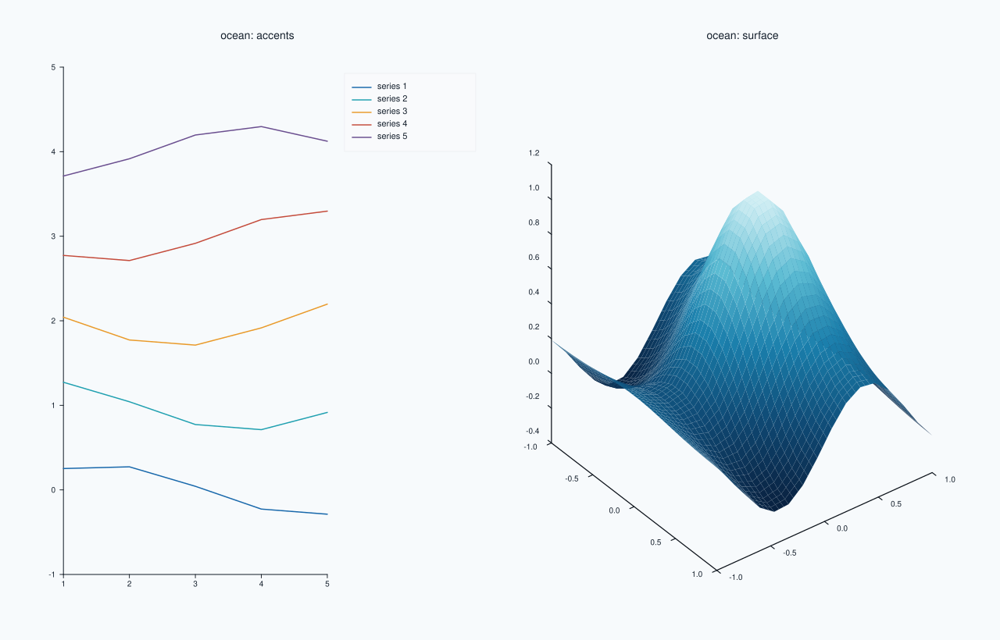
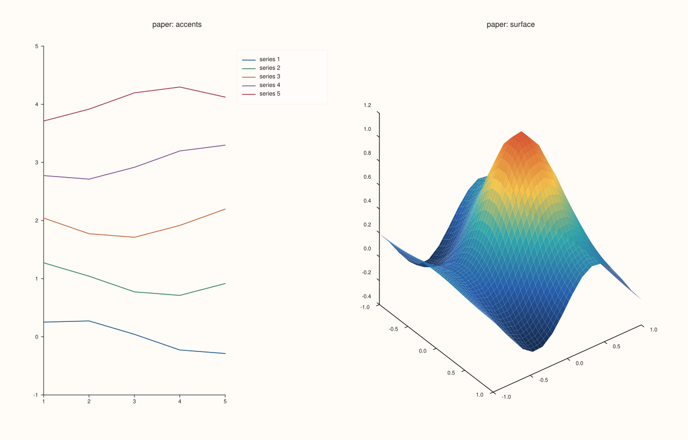
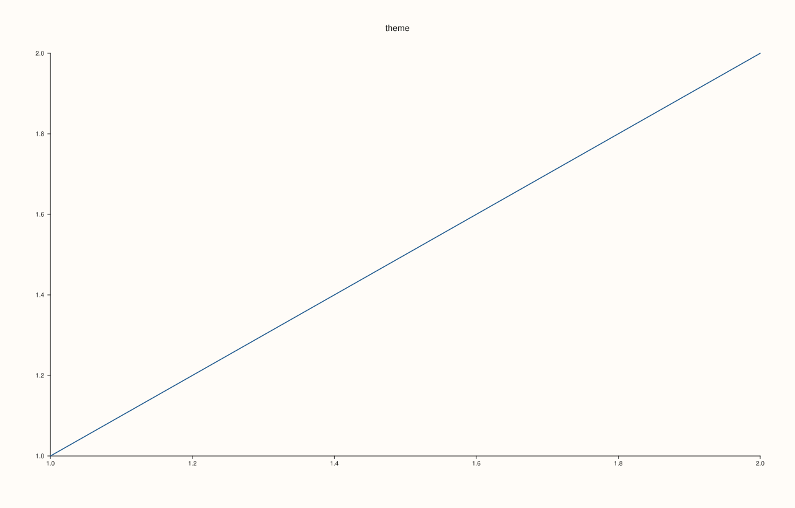
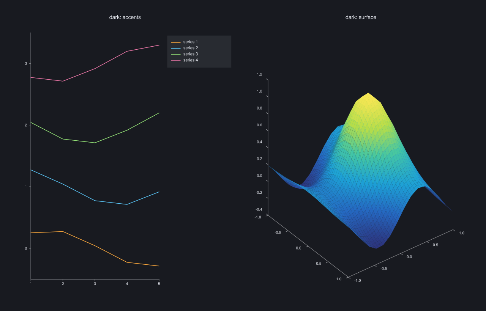
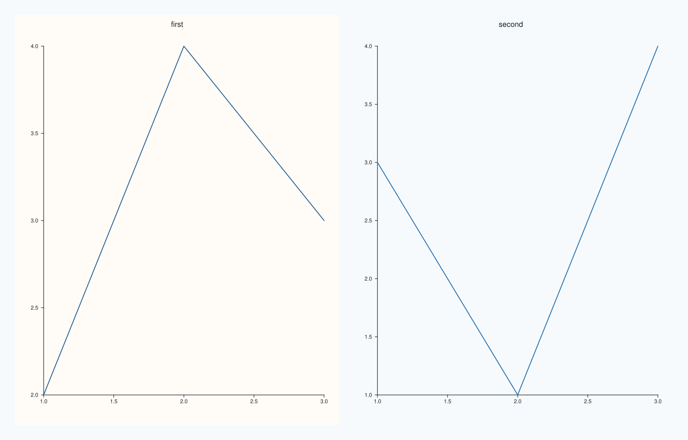

<!-- generated by PlussPl/docs/sphinx/tools/plotdocs.py from tools/specs/Theme.py; edit the spec -->

# Theme

[Back to Types and Options Reference](../../types_api_reference)

## What It Does

A `Theme` is the set of colours that a figure is drawn in. It bundles a name, a list of **accent** colours that successive traces take in turn, a **background**, a **foreground** that
axes, labels and text are drawn in, and a **surface palette**, a [`PaletteRamp`](PaletteRamp.md) that surfaces and fields start with. Every colour a figure draws that you have not set yourself comes from its theme.

A theme is given to a `Studio` when it is made (`Studio fig("name", Theme::ocean())`) or later with [`Studio::theme`](../studio/theme.md). It is copied into each pane when the pane is created, so a change of the studio's theme
affects only the panes created afterwards, and each pane's copy is reachable and editable through `theme_tokens()` on the pane and on the studio. Two presets ship with the library, `Theme::paper()` (the default) and `Theme::ocean()`; the
free functions `themes::paper()` and `themes::ocean()` return the same values.

`accent(index)` returns the accent for the index-th series. It wraps: an index beyond the end of the accents starts again at the first, so any number of series can be coloured. A trace's own [`stroke`](../trace/stroke.md) overrides its accent.

## Values

| Member | Meaning |
|---|---|
| `name()` | The theme's name. `paper` and `ocean` for the presets. |
| `accents()`, `accent(i)` | The accent colours, and the colour for series `i` (wrapping). |
| `background()` | The colour of the figure's background. |
| `foreground()` | The colour of axes, tick labels, titles and other text. |
| `surface_palette()` | The [`PaletteRamp`](PaletteRamp.md) that surface traces start with. |
| `Theme::paper()`, `Theme::ocean()` | The two presets. |

## Examples

Example 1. The two presets on the same figure, each drawn as its own studio: five lines (so the accents show in order) and a surface (so the surface palette shows). Only the theme differs.

```cpp
constexpr std::int64_t n = 16;
auto coord = pluss::series::linspace(-1.0, 1.0, n, pluss::ScalarType::Float64);
std::vector<double> peak(static_cast<std::size_t>(n * n));
for (std::int64_t i = 0; i < n; ++i)
  for (std::int64_t j = 0; j < n; ++j) {
    const double x = -1.0 + 2.0 * i / (n - 1), y = -1.0 + 2.0 * j / (n - 1);
    peak[static_cast<std::size_t>(i * n + j)] = std::exp(-3.0 * (x * x + y * y)) + 0.25 * std::sin(4.0 * x);
  }
auto z = pluss::make_series(peak, {n, n});

const Theme themes_to_show[] = {Theme::paper(), Theme::ocean()};
for (int i = 0; i < 2; ++i) {
  Studio fig(themes_to_show[i].name(), themes_to_show[i]);
  fig.mosaic(1, 2);
  auto& lines = fig.pane2(themes_to_show[i].name() + ": accents");
  for (int k = 0; k < 5; ++k) {
    std::vector<double> x{1, 2, 3, 4, 5}, y;
    for (double v : x) y.push_back(k + 0.3 * std::sin(v + k));
    lines.trend(x, y).label("series " + std::to_string(k + 1));
  }
  lines.legend(KeyPlace::OutsideEast);
  auto& surface = fig.pane3(themes_to_show[i].name() + ": surface");
  surface.sheet(coord, coord, z).shade(ShadeMode::Smooth);
  if (i == 1) fig.save_svg("figure.svg");
}
```



Example 2. The same figure with the default `paper` theme, to compare with Example 1. The figure is the one that example saves for `ocean`: five lines and a surface.

```cpp
constexpr std::int64_t n = 16;
auto coord = pluss::series::linspace(-1.0, 1.0, n, pluss::ScalarType::Float64);
std::vector<double> peak(static_cast<std::size_t>(n * n));
for (std::int64_t i = 0; i < n; ++i)
  for (std::int64_t j = 0; j < n; ++j) {
    const double x = -1.0 + 2.0 * i / (n - 1), y = -1.0 + 2.0 * j / (n - 1);
    peak[static_cast<std::size_t>(i * n + j)] = std::exp(-3.0 * (x * x + y * y)) + 0.25 * std::sin(4.0 * x);
  }
auto z = pluss::make_series(peak, {n, n});

auto fig = studio("theme_paper");
fig.mosaic(1, 2);
auto& lines = fig.pane2("paper: accents");
for (int k = 0; k < 5; ++k) {
  std::vector<double> x{1, 2, 3, 4, 5}, y;
  for (double v : x) y.push_back(k + 0.3 * std::sin(v + k));
  lines.trend(x, y).label("series " + std::to_string(k + 1));
}
lines.legend(KeyPlace::OutsideEast);
auto& surface = fig.pane3("paper: surface");
surface.sheet(coord, coord, z).shade(ShadeMode::Smooth);
fig.save_svg("figure.svg");
```



Example 3. What a theme holds. For each preset the name, the number of accents, the background and foreground and the first accents; and `accent` wrapping: for a theme with N accents, index N is index 0 again.

```cpp
auto c = [](const Rgba& v) { return std::to_string(static_cast<int>(v.red * 255 + 0.5)) + "," + std::to_string(static_cast<int>(v.green * 255 + 0.5)) + "," + std::to_string(static_cast<int>(v.blue * 255 + 0.5)); };
for (const Theme& t : {Theme::paper(), Theme::ocean()}) {
  std::cout << t.name() << ": " << t.accents().size() << " accents, background (" << c(t.background()) << "), foreground (" << c(t.foreground()) << "), surface palette " << t.surface_palette().name() << "\n";
  for (std::size_t i : {std::size_t{0}, std::size_t{1}, t.accents().size()})
    std::cout << "  accent(" << i << ") = (" << c(t.accent(i)) << ")\n";
}
std::cout << "themes::paper() has the same name: " << (themes::paper().name() == Theme::paper().name()) << "\n";
auto fig = studio("theme_read");
fig.pane2("theme").trend(std::vector<double>{1, 2}, std::vector<double>{1, 2});
fig.save_svg("figure.svg");
```

### Output

```text
paper: 5 accents, background (255,252,248), foreground (28,27,25), surface palette thermal
  accent(0) = (28,87,141)
  accent(1) = (49,130,92)
  accent(5) = (28,87,141)
ocean: 5 accents, background (247,250,252), foreground (19,30,43), surface palette ocean
  accent(0) = (24,104,171)
  accent(1) = (32,160,176)
  accent(5) = (24,104,171)
themes::paper() has the same name: 1
```



Example 4. A theme built by hand: a dark one. Four accents, a near-black background, a light foreground and the `lagoon` palette. Passed to the studio constructor, it governs every pane created afterwards.

```cpp
constexpr std::int64_t n = 16;
auto coord = pluss::series::linspace(-1.0, 1.0, n, pluss::ScalarType::Float64);
std::vector<double> peak(static_cast<std::size_t>(n * n));
for (std::int64_t i = 0; i < n; ++i)
  for (std::int64_t j = 0; j < n; ++j) {
    const double x = -1.0 + 2.0 * i / (n - 1), y = -1.0 + 2.0 * j / (n - 1);
    peak[static_cast<std::size_t>(i * n + j)] = std::exp(-3.0 * (x * x + y * y)) + 0.25 * std::sin(4.0 * x);
  }
auto z = pluss::make_series(peak, {n, n});

const Theme dark("dark",
                 {Rgba::from_u8(255, 170, 60), Rgba::from_u8(90, 200, 250), Rgba::from_u8(150, 230, 120), Rgba::from_u8(240, 120, 170)},
                 Rgba::from_u8(24, 26, 32), Rgba::from_u8(225, 228, 235), PaletteRamp::lagoon());
Studio fig("theme_custom", dark);
fig.mosaic(1, 2);
auto& lines = fig.pane2("dark: accents");
for (int k = 0; k < 4; ++k) {
  std::vector<double> x{1, 2, 3, 4, 5}, y;
  for (double v : x) y.push_back(k + 0.3 * std::sin(v + k));
  lines.trend(x, y).label("series " + std::to_string(k + 1));
}
lines.legend(KeyPlace::OutsideEast);
auto& surface = fig.pane3("dark: surface");
surface.sheet(coord, coord, z).shade(ShadeMode::Smooth);
std::cout << fig.theme_tokens().name() << " with " << fig.theme_tokens().accents().size() << " accents\n";
fig.save_svg("figure.svg");
```

### Output

```text
dark with 4 accents
```



Example 5. A theme applies to panes created afterwards. The first pane is created under `paper`; the studio is switched to `ocean`; the second pane is created under `ocean`. The two panes report different themes, and the first keeps its own.

```cpp
auto fig = studio("theme_after");
fig.mosaic(1, 2);
{
  auto& first = fig.pane2("first");
  first.trend(std::vector<double>{1, 2, 3}, std::vector<double>{2, 4, 3});
  std::cout << "first pane:  " << first.theme_tokens().name() << "\n";
}
fig.theme(Theme::ocean());
{
  auto& second = fig.pane2("second");
  second.trend(std::vector<double>{1, 2, 3}, std::vector<double>{3, 1, 4});
  std::cout << "second pane: " << second.theme_tokens().name() << "\n";
}
std::cout << "the studio:  " << fig.theme_tokens().name() << ", the first pane still: " << fig.panes()[0].theme_tokens().name() << "\n";
fig.save_svg("figure.svg");
```

### Output

```text
first pane:  paper
second pane: ocean
the studio:  ocean, the first pane still: paper
```



## Notes

- Change the theme before creating panes. To restyle an existing pane, edit its `theme_tokens()`, or rebuild the figure.
- A `Theme` is a value, so one can be built once and passed to many studios, which is how a house style is shared by every figure of a report.
- The accents are used in order, so put the colours you want for the first series first. A palette of four accents repeats every four series.

## See Also

- [`Studio::theme`](../studio/theme.md), [`Studio::theme_tokens`](../studio/theme_tokens.md): set and reach the studio's theme.
- [`Pane::theme_tokens`](../pane/theme_tokens.md): the theme of one pane.
- [`PaletteRamp`](PaletteRamp.md), [`Rgba`](Rgba.md): the pieces a theme is built from.

<div class="pluss-inline-prev-next">
  <a class="prev-link" href="ShadeMode.html">
    <span class="label">Previous</span>
    <span class="title">ShadeMode</span>
  </a>
  <a class="next-link" href="TickFormat.html">
    <span class="label">Next</span>
    <span class="title">TickFormat</span>
  </a>
</div>
