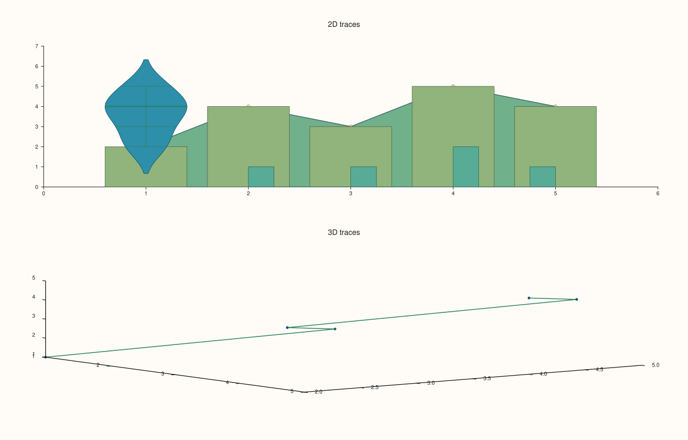
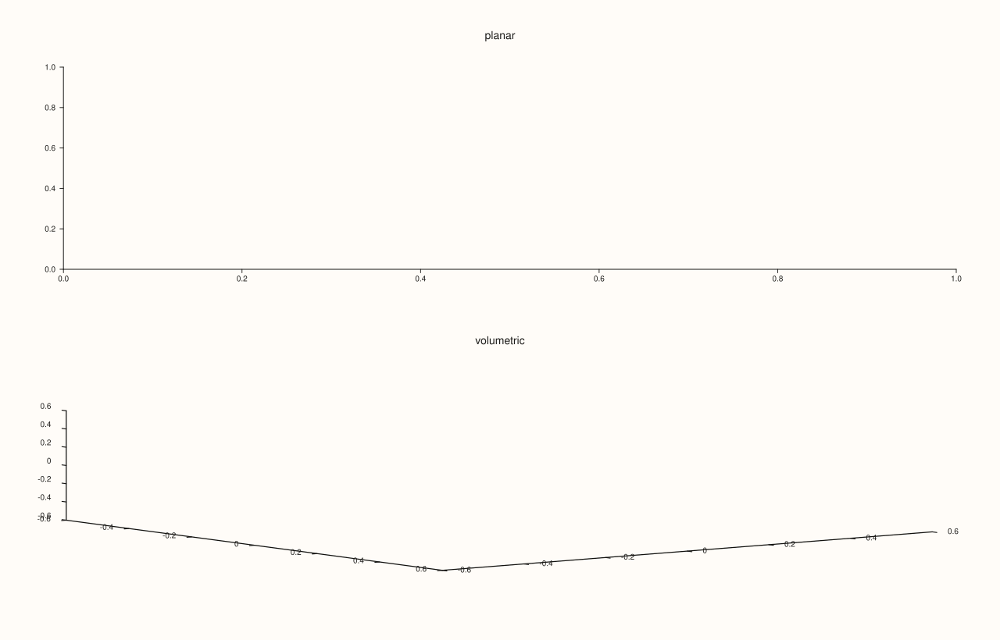
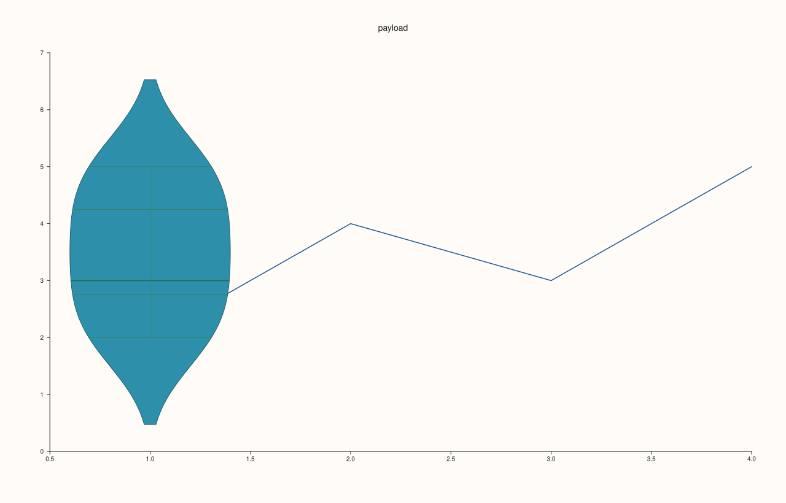
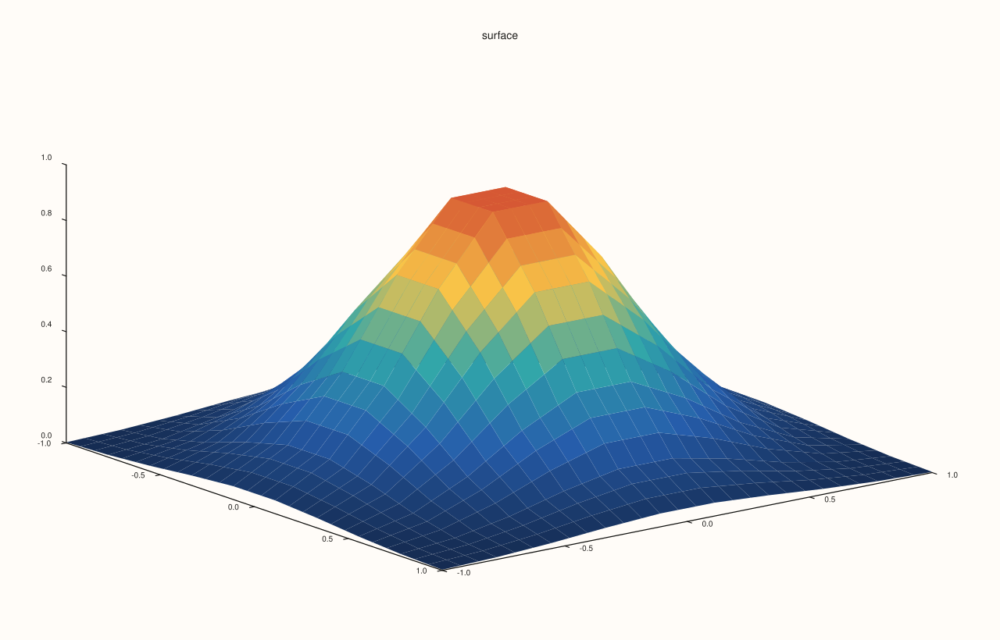

<!-- generated by PlussPl/docs/sphinx/tools/plotdocs.py from tools/specs/TraceKind.py; edit the spec -->

# TraceKind

[Back to Types and Options Reference](../../types_api_reference)

## What It Does

`TraceKind` names what a [`Trace`](../trace/kind.md) draws. Every trace-creation method of a pane makes a trace of one kind and returns it, and `Trace::kind()` reads the kind back. The kind decides which data the trace holds (`Trace::payload()` is a variant with one alternative per data shape) and which of the trace's styling calls have any visible effect: the surface options ([`ShadeMode`](ShadeMode.md), [`LightingMode`](LightingMode.md), [`MaterialProfile`](MaterialProfile.md)) matter for the surface kinds only, and `annotate_levels` for the contour kinds only.

2D kinds can be added only to a planar pane (`pane2`) and 3D kinds only to a volumetric pane (`pane3`); the wrong combination throws `pluss::Error` naming the method.

## Values

| Kind | Created by | Draws |
|---|---|---|
| `Trend` | `trend` | A connected line. |
| `Cloud` | `cloud` | Scattered points, optionally sized and coloured by data. |
| `Fieldmap` | `fieldmap` | A coloured grid of cells over x and y. |
| `Ribbon` | `ribbon` | A filled area between a curve and a base value. |
| `Spike` | `spike` | Vertical stems from a base to each value. |
| `Wedge` | `wedge` | The slices of a pie. |
| `Whisk` | `whisk` | Points with error bars. |
| `Band` | (internal) | A shaded band. |
| `Columns` | `columns`, `columns_h` | Bars, vertical or horizontal. |
| `Bucket` | `bucket` | A histogram of a sample. |
| `Quartet` | `quartet` | A box plot: quartiles, median and whiskers. |
| `Violin` | `violin` | A density shape; see [`ViolinOptions`](ViolinOptions.md). |
| `Radial` | `radial` | A curve in polar coordinates. |
| `Contour` | `contour` | Lines or fills of equal value of a gridded field. |
| `Isoband` | `isoband` | Filled bands between levels. |
| `Cloud3` | `cloud3` | Scattered points in 3D. |
| `Path3` | `path3` | A connected line in 3D. |
| `Spire3` | `spire3` | Vertical bars in 3D. |
| `Ridge3` | `ridge3` | Stacked ridgelines in 3D. |
| `IsoShell` | `isoshell` | Level surfaces of a 3D field. |
| `Sheet` | `sheet` | A surface over an x-y grid. |
| `Lattice` | `lattice` | A wireframe surface. |

## Examples

Example 1. One trace of each simple kind, created and read back with `kind()`. The integer is the position of the kind in the enumeration, which is what a stored value would hold. The 2D kinds go on a planar pane and the 3D kinds on a volumetric one, in the same figure.

```cpp
auto fig = studio("trace_kind_kinds");
fig.mosaic(2, 1);
const std::vector<double> x{1, 2, 3, 4, 5}, y{2, 4, 3, 5, 4};
auto name = [](TraceKind k) {
  const char* names[] = {"Trend", "Cloud", "Cloud3", "Fieldmap", "Ribbon", "Spike", "Wedge", "Whisk", "Band", "Columns", "Bucket", "Quartet",
                         "Violin", "Radial", "Contour", "Isoband", "Ridge3", "IsoShell", "Path3", "Spire3", "Sheet", "Lattice"};
  return std::string(names[static_cast<int>(k)]) + " (" + std::to_string(static_cast<int>(k)) + ")";
};
{
  auto& pane = fig.pane2("2D traces");
  std::cout << "trend:   " << name(pane.trend(x, y).kind()) << "\n";
  std::cout << "cloud:   " << name(pane.cloud(x, y).kind()) << "\n";
  std::cout << "spike:   " << name(pane.spike(x, y).kind()) << "\n";
  std::cout << "ribbon:  " << name(pane.ribbon(x, y).kind()) << "\n";
  std::cout << "columns: " << name(pane.columns(x, y).kind()) << "\n";
  std::cout << "bucket:  " << name(pane.bucket(y).kind()) << "\n";
  std::cout << "violin:  " << name(pane.violin(y).kind()) << "\n";
}
{
  auto& pane = fig.pane3("3D traces");
  std::cout << "cloud3:  " << name(pane.cloud3(x, y, x).kind()) << "\n";
  std::cout << "path3:   " << name(pane.path3(x, y, x).kind()) << "\n";
}
fig.save_svg("figure.svg");
```

### Output

```text
trend:   Trend (0)
cloud:   Cloud (1)
spike:   Spike (5)
ribbon:  Ribbon (4)
columns: Columns (9)
bucket:  Bucket (10)
violin:  Violin (12)
cloud3:  Cloud3 (2)
path3:   Path3 (18)
```



Example 2. The kind decides the pane. A 3D kind on a planar pane and a 2D kind on a volumetric pane are refused with `pluss::Error`, and the message names the method.

```cpp
auto fig = studio("trace_kind_wrong_pane");
const std::vector<double> x{1, 2, 3}, y{2, 4, 3};
try { fig.pane2("planar").cloud3(x, y, x); } catch (const pluss::Error& e) { std::cout << e.message() << "\n"; }
try { fig.pane3("volumetric").trend(x, y); } catch (const pluss::Error& e) { std::cout << e.message() << "\n"; }
fig.save_svg("figure.svg");
```

### Output

```text
cloud3 requires a volumetric pane
trend requires a planar pane
```



Example 3. The payload follows the kind. A `Trend` holds `TrendData` (x and y series), a `Violin` holds `ViolinData` (with its options), and `std::holds_alternative` tells them apart, which is how code that draws or exports a trace dispatches on it.

```cpp
auto fig = studio("trace_kind_payload");
auto& pane = fig.pane2("payload");
const std::vector<double> x{1, 2, 3, 4}, y{2, 4, 3, 5};
{
  Trace& t = pane.trend(x, y);
  std::cout << "trend: TrendData " << std::holds_alternative<TrendData>(t.payload()) << ", points " << std::get<TrendData>(t.payload()).x.numel() << "\n";
}
{
  Trace& v = pane.violin(y);
  std::cout << "violin: ViolinData " << std::holds_alternative<ViolinData>(v.payload()) << ", inner Box " << (std::get<ViolinData>(v.payload()).options.inner == ViolinInner::Box) << "\n";
}
fig.save_svg("figure.svg");
```

### Output

```text
trend: TrendData 1, points 4
violin: ViolinData 1, inner Box 1
```



Example 4. Which options a kind answers to. The same shade call on a `Trend` and on a `Sheet`: on the line nothing changes (the two SVG texts are equal), on the surface the figure changes. Style calls for a different kind than the trace are stored but have no visible effect.

```cpp
constexpr std::int64_t n = 10;
auto coord = pluss::series::linspace(-1.0, 1.0, n, pluss::ScalarType::Float64);
std::vector<double> bump(static_cast<std::size_t>(n * n));
for (std::int64_t i = 0; i < n; ++i)
  for (std::int64_t j = 0; j < n; ++j) {
    const double a = -1.0 + 2.0 * i / (n - 1), b = -1.0 + 2.0 * j / (n - 1);
    bump[static_cast<std::size_t>(i * n + j)] = std::exp(-3.0 * (a * a + b * b));
  }
auto z = pluss::make_series(bump, {n, n});
std::string line[2], surface[2];
const ShadeMode modes[2] = {ShadeMode::Faceted, ShadeMode::Smooth};
for (int i = 0; i < 2; ++i) {
  auto a = studio("kind_options_a");
  a.pane2("line").trend(std::vector<double>{1, 2, 3}, std::vector<double>{2, 4, 3}).shade(modes[i]);
  line[i] = a.to_svg();
  auto b = studio("kind_options_b");
  b.pane3("surface").sheet(coord, coord, z).shade(modes[i]);
  surface[i] = b.to_svg();
}
std::cout << "line: Faceted == Smooth: " << (line[0] == line[1]) << "\n";
std::cout << "sheet: Faceted == Smooth: " << (surface[0] == surface[1]) << "\n";
auto fig = studio("kind_options_out");
fig.pane3("surface").sheet(coord, coord, z).shade(ShadeMode::Smooth);
fig.save_svg("figure.svg");
```

### Output

```text
line: Faceted == Smooth: 1
sheet: Faceted == Smooth: 0
```



## Notes

- `Band` is the kind of an internal shaded band and has no public creation method; bands you add yourself are cues ([`Cues`](Cues.md)).
- A trace's kind never changes after it is created.
- A trace returned by a creation method stays valid for the life of its pane, and a pane for the life of its studio, however many are added afterwards.

## See Also

- [`Trace::kind`](../trace/kind.md), [`Trace::payload`](../trace/payload.md): read the kind and the data.
- [`Pane`](../../pane_api_reference.md): the creation methods.
- [`ShadeMode`](ShadeMode.md), [`LightingMode`](LightingMode.md), [`MaterialProfile`](MaterialProfile.md): surface options.

<div class="pluss-inline-prev-next">
  <a class="prev-link" href="TickFormat.html">
    <span class="label">Previous</span>
    <span class="title">TickFormat</span>
  </a>
  <a class="next-link" href="ViolinOptions.html">
    <span class="label">Next</span>
    <span class="title">ViolinOptions</span>
  </a>
</div>
