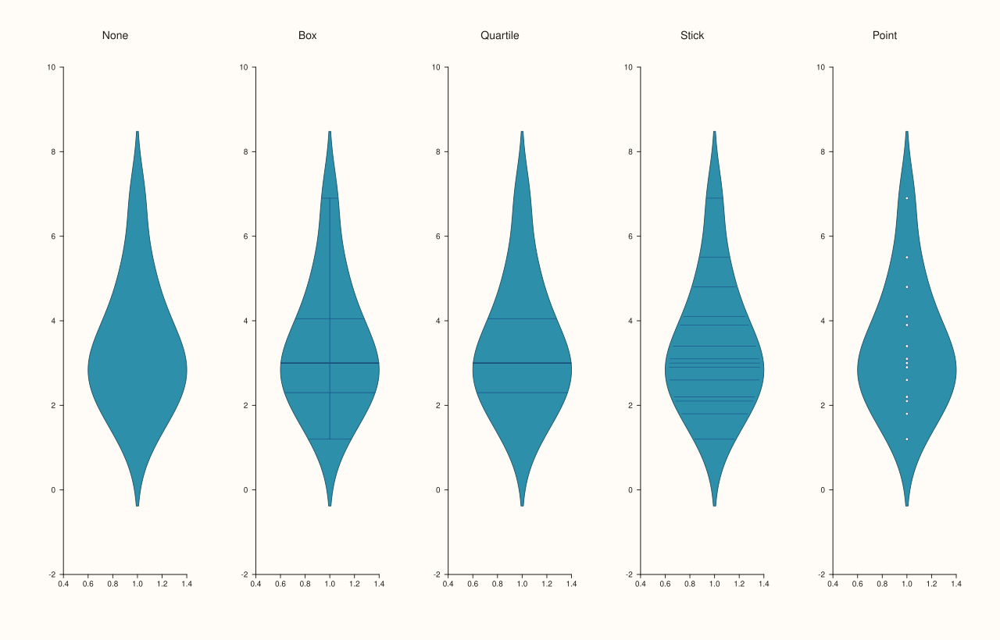
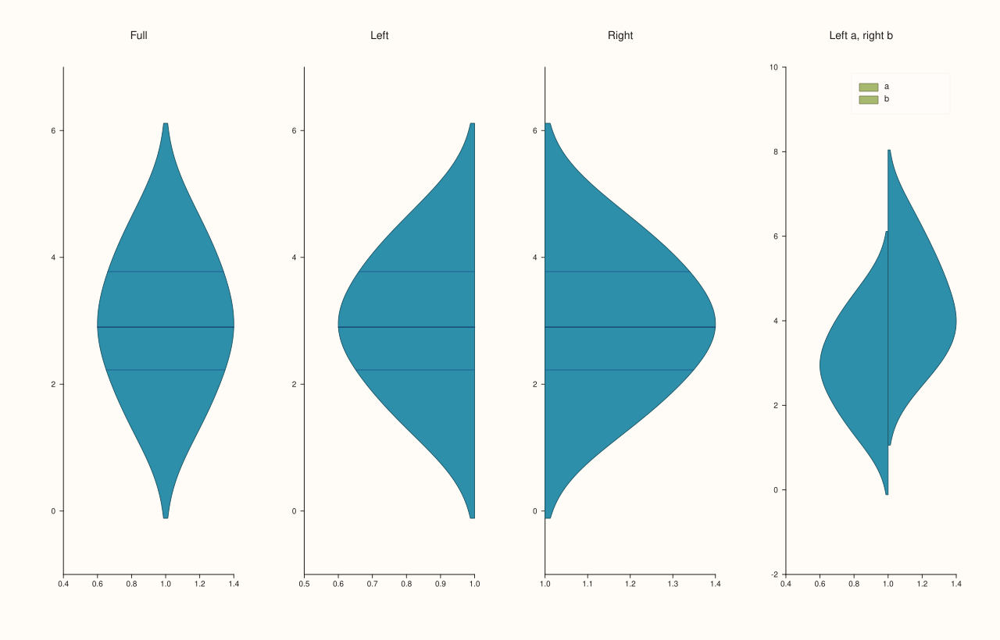
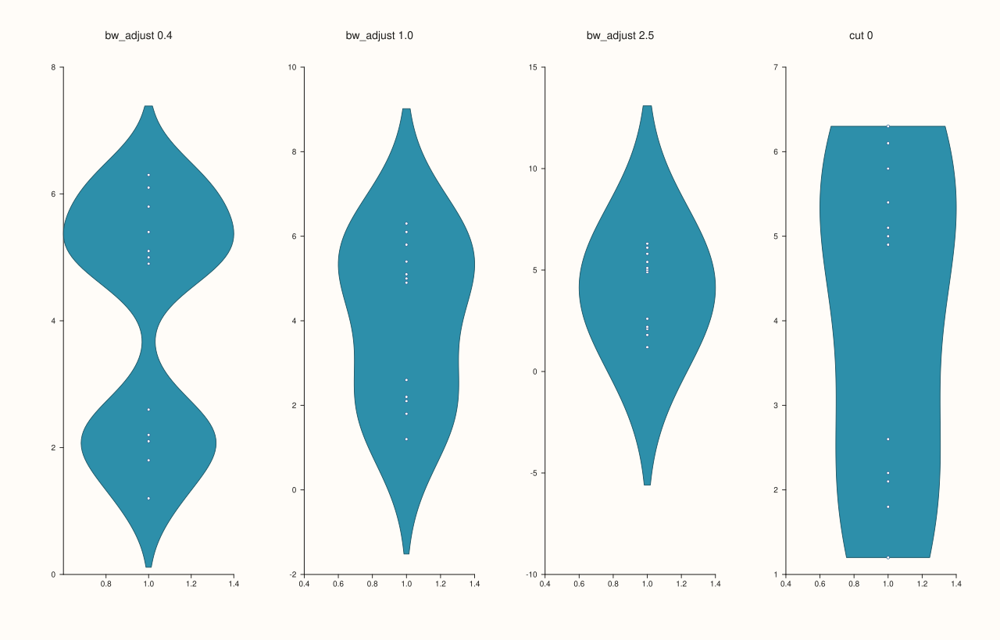
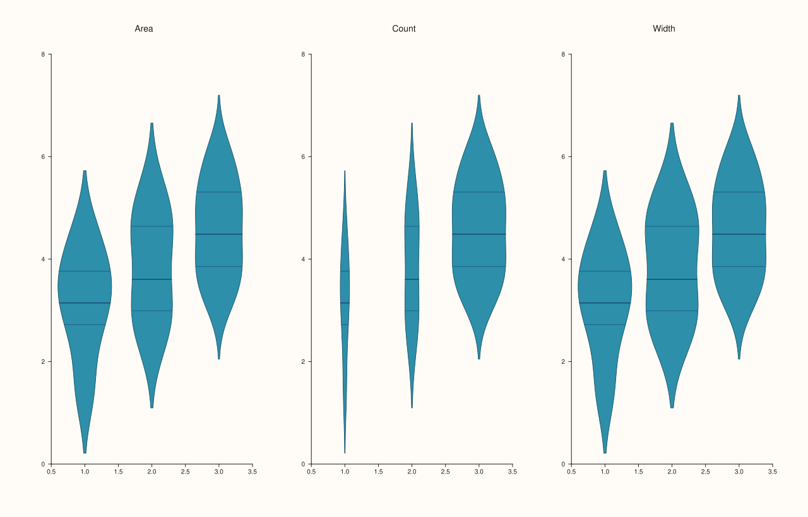
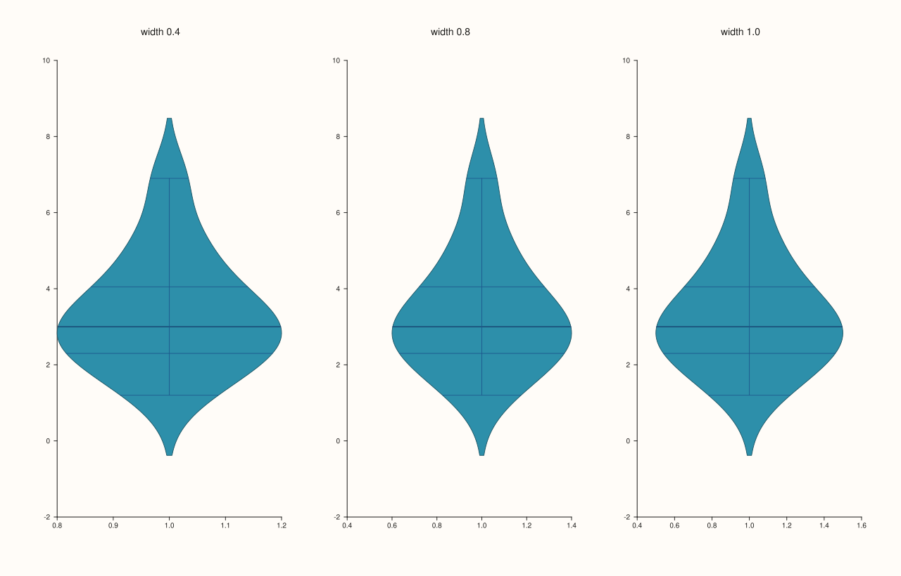
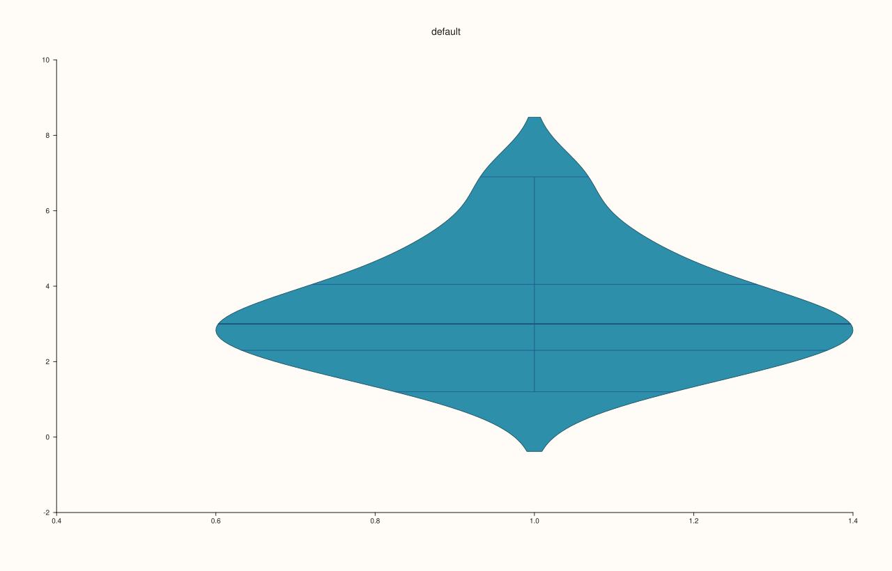

<!-- generated by PlussPl/docs/sphinx/tools/plotdocs.py from tools/specs/ViolinOptions.py; edit the spec -->

# ViolinOptions

[Back to Types and Options Reference](../../types_api_reference)

## What It Does

A violin draws the distribution of a sample as a mirrored density curve. `ViolinOptions` is the argument of the `violin` methods of a pane ([`Pane::violin`](../pane/violin.md)), in the overloads that take it after the values (and the groups). It controls the width of the shapes, how smooth the density is, how far the shape extends past the data, how several violins are scaled relative to one another, what is drawn inside the shape, and whether the full shape or one half is drawn.

The density is a kernel estimate. Its smoothness is chosen automatically from the sample, and `bw_adjust` multiplies that choice: a value below 1 follows the data more closely and shows more bumps, a value above 1 smooths more. `cut` says how far, in units of the smoothing width, the curve extends beyond the smallest and largest data values; with `cut = 0` the violin ends exactly at the data.

## Fields

| Field | Meaning | Default |
|---|---|---|
| `width` | The width of the widest violin, as a fraction of the space allotted to its group (1 fills it). | 0.8 |
| `bw_adjust` | Multiplier on the automatic smoothing width. Below 1 less smooth, above 1 smoother. | 1 |
| `cut` | How far the curve extends beyond the data, in smoothing widths. 0 ends it at the data. | 2 |
| `scale` | How several violins are sized relative to each other: see below. | `Area` |
| `inner` | What is drawn inside the shape: see below. | `Box` |
| `side` | `Full` (mirrored), `Left` or `Right` (half violins). | `Full` |

| `ViolinScale` | Meaning |
|---|---|
| `Area` | Every violin has the same area: wide violins are short. |
| `Count` | The width follows the number of observations: a larger group is wider. |
| `Width` | Every violin has the same maximum width, whatever its size. |

| `ViolinInner` | Drawn inside the shape |
|---|---|
| `None` | Nothing. |
| `Box` | A miniature box plot: the quartiles, the median and the whiskers. |
| `Quartile` | Lines at the three quartiles. |
| `Stick` | A tick for every observation. |
| `Point` | A dot for every observation. |

## Examples

Example 1. Every `inner` mark on the same sample. `Box` and `Quartile` summarise it; `Stick` and `Point` show every observation, which is the honest choice for a small sample; `None` leaves the plain density.

```cpp
const std::vector<double> sample{1.2, 1.8, 2.1, 2.2, 2.6, 2.9, 3.0, 3.1, 3.4, 3.9, 4.1, 4.8, 5.5, 6.9};
const ViolinInner inners[] = {ViolinInner::None, ViolinInner::Box, ViolinInner::Quartile, ViolinInner::Stick, ViolinInner::Point};
const char* names[] = {"None", "Box", "Quartile", "Stick", "Point"};
auto fig = studio("violin_inner");
fig.mosaic(1, 5);
for (int i = 0; i < 5; ++i) {
  auto& pane = fig.pane2(names[i]);
  ViolinOptions options;
  options.inner = inners[i];
  pane.violin(sample, options);
}
fig.save_svg("figure.svg");
```



Example 2. `side`. The full mirrored violin, and the left and right halves. Half violins let two samples share one position, one on each side, which is how to compare two groups directly.

```cpp
const std::vector<double> a{1.2, 1.8, 2.1, 2.6, 2.9, 3.0, 3.4, 3.9, 4.1, 4.8};
const std::vector<double> b{2.5, 3.1, 3.4, 3.8, 4.1, 4.4, 4.9, 5.3, 5.8, 6.6};
const ViolinSide sides[] = {ViolinSide::Full, ViolinSide::Left, ViolinSide::Right};
const char* names[] = {"Full", "Left", "Right"};
auto fig = studio("violin_side");
fig.mosaic(1, 4);
for (int i = 0; i < 3; ++i) {
  auto& pane = fig.pane2(names[i]);
  ViolinOptions options;
  options.side = sides[i];
  options.inner = ViolinInner::Quartile;
  pane.violin(a, options);
}
auto& paired = fig.pane2("Left a, right b");
ViolinOptions left, right;
left.side = ViolinSide::Left;
right.side = ViolinSide::Right;
left.inner = right.inner = ViolinInner::None;
paired.violin(a, left).label("a");
paired.violin(b, right).label("b");
paired.legend(KeyPlace::NorthEast);
fig.save_svg("figure.svg");
```



Example 3. `bw_adjust` and `cut`. The smoothing at 0.4, 1 and 2.5 times the automatic width: the small value shows the lumps of the sample as separate bumps, the large one a single smooth hill. The last pane has `cut = 0`, so the shape stops at the extreme data values instead of tailing off beyond them.

```cpp
const std::vector<double> sample{1.2, 1.8, 2.1, 2.2, 2.6, 4.9, 5.0, 5.1, 5.4, 5.8, 6.1, 6.3};
const double adjust[] = {0.4, 1.0, 2.5};
auto fig = studio("violin_bandwidth");
fig.mosaic(1, 4);
for (int i = 0; i < 3; ++i) {
  auto& pane = fig.pane2("bw_adjust " + std::to_string(adjust[i]).substr(0, 3));
  ViolinOptions options;
  options.bw_adjust = adjust[i];
  options.inner = ViolinInner::Point;
  pane.violin(sample, options);
}
auto& tight = fig.pane2("cut 0");
ViolinOptions options;
options.cut = 0.0;
options.inner = ViolinInner::Point;
tight.violin(sample, options);
fig.save_svg("figure.svg");
```



Example 4. `scale` for three groups of different sizes (6, 12 and 40 observations), drawn with the grouped form of `violin`. With `Area` the big group is not wider than the small ones; with `Count` its violin is much wider; with `Width` all three have the same maximum width.

```cpp
std::vector<double> group, values;
const int counts[3] = {6, 12, 40};
for (int g = 0; g < 3; ++g)
  for (int i = 0; i < counts[g]; ++i) {
    group.push_back(g + 1);
    values.push_back(3.0 + 0.8 * g + 1.2 * std::sin(1.7 * i + g) + 0.5 * std::cos(0.9 * i));
  }
const ViolinScale scales[] = {ViolinScale::Area, ViolinScale::Count, ViolinScale::Width};
const char* names[] = {"Area", "Count", "Width"};
auto fig = studio("violin_scale");
fig.mosaic(1, 3);
for (int i = 0; i < 3; ++i) {
  auto& pane = fig.pane2(names[i]);
  ViolinOptions options;
  options.scale = scales[i];
  options.inner = ViolinInner::Quartile;
  pane.violin(group, values, options);
}
fig.save_svg("figure.svg");
```



Example 5. `width`. The widest violin fills 0.4, 0.8 (the default) and 1.0 of its allotted space. The data are the same; only the horizontal scale of the shape changes.

```cpp
const std::vector<double> sample{1.2, 1.8, 2.1, 2.2, 2.6, 2.9, 3.0, 3.1, 3.4, 3.9, 4.1, 4.8, 5.5, 6.9};
const double widths[] = {0.4, 0.8, 1.0};
auto fig = studio("violin_width");
fig.mosaic(1, 3);
for (int i = 0; i < 3; ++i) {
  auto& pane = fig.pane2("width " + std::to_string(widths[i]).substr(0, 3));
  ViolinOptions options;
  options.width = widths[i];
  pane.violin(sample, options);
}
fig.save_svg("figure.svg");
```



Example 6. The defaults, read from a default-constructed value, and the form of `violin` with no options, which draws with them.

```cpp
const ViolinOptions d;
std::cout << "width " << d.width << ", bw_adjust " << d.bw_adjust << ", cut " << d.cut << "\n";
std::cout << "scale Area: " << (d.scale == ViolinScale::Area) << ", inner Box: " << (d.inner == ViolinInner::Box) << ", side Full: " << (d.side == ViolinSide::Full) << "\n";
const std::vector<double> sample{1.2, 1.8, 2.1, 2.2, 2.6, 2.9, 3.0, 3.1, 3.4, 3.9, 4.1, 4.8, 5.5, 6.9};
std::string svg[2];
for (int i = 0; i < 2; ++i) {
  auto fig = studio("violin_defaults");
  auto& pane = fig.pane2("violin");
  if (i == 0) pane.violin(sample); else pane.violin(sample, ViolinOptions{});
  svg[i] = fig.to_svg();
}
std::cout << "violin(values) == violin(values, ViolinOptions{}): " << (svg[0] == svg[1]) << "\n";
auto fig = studio("violin_defaults_out");
fig.pane2("default").violin(sample);
fig.save_svg("figure.svg");
```

### Output

```text
width 0.8, bw_adjust 1, cut 2
scale Area: 1, inner Box: 1, side Full: 1
violin(values) == violin(values, ViolinOptions{}): 1
```



## Notes

- A violin of a very small sample is mostly the smoothing: for fewer than about ten observations prefer `Point` or `Stick` inside so the data are visible.
- `cut` extends the shape past the data, where there is no data: a violin with a long tail beyond the last observation can suggest values that were never seen. `cut = 0` removes that.
- A trace's colour and label come from the [`Trace`](../trace/label.md) the `violin` method returns.

## See Also

- [`Pane::violin`](../pane/violin.md): draws a violin.
- [`Trace::stroke`](../trace/stroke.md), [`Trace::label`](../trace/label.md): style and name the violin.

<div class="pluss-inline-prev-next">
  <a class="prev-link" href="TraceKind.html">
    <span class="label">Previous</span>
    <span class="title">TraceKind</span>
  </a>
</div>
