# Flash Plotting API

`pluss::pl::flash` is the high-level plotting layer over `Studio` and `Pane`.

This reference is usage-first:

- `Signature`: user-facing callable form (`self` is explicit)
- `Notes`: behavior and when to use it
- `Example`: real code from `PlussPl/examples/docs/flash_api_capture_demo.cpp`
- `Output`: artifact generated by running that exact example (`.svg`, plus `.png` fallback for PDF)

## API Reference Style

### `acfplot`

#### Signature

```cpp
Studio& acfplot(self: Studio, values: SeriesLike, options: AcfPlotOptions = {});
```

#### Notes

Autocorrelation bars across lags; useful for seasonality and persistence checks.

#### Example

```{literalinclude} ../../examples/docs/snippets/keys/acfplot.cpp
:language: cpp
```

#### Output

```{only} html
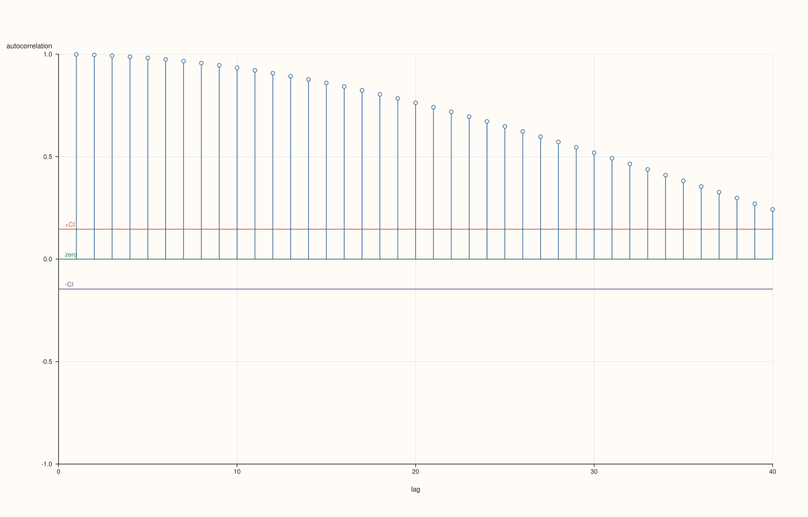
```

```{only} not html

```

### `actplot`

#### Signature

```cpp
Studio& actplot(self: Studio, values: SeriesLike, options: AutocorrelationPlotOptions = {});
```

#### Notes

Convenience autocorrelation wrapper with a compact options surface.

#### Example

```{literalinclude} ../../examples/docs/snippets/keys/actplot.cpp
:language: cpp
```

#### Output

```{only} html

```

```{only} not html

```

### `andrews_curves`

#### Signature

```cpp
Studio& andrews_curves(self: Studio, matrix_or_dataset, options: AndrewsCurvesOptions = {});
```

#### Notes

Maps each row to a smooth periodic curve for multivariate separation analysis.

#### Example

```{literalinclude} ../../examples/docs/snippets/keys/andrews_curves.cpp
:language: cpp
```

#### Output

```{only} html
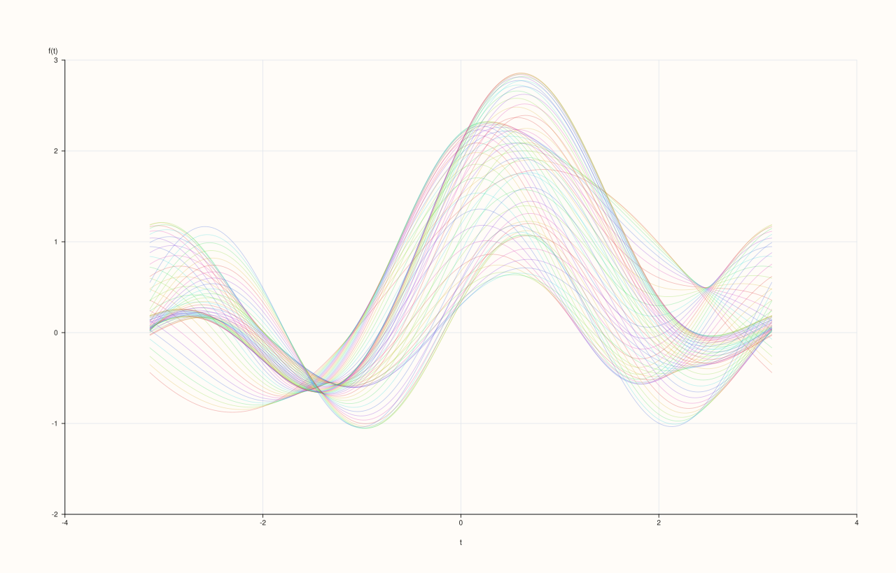
```

```{only} not html
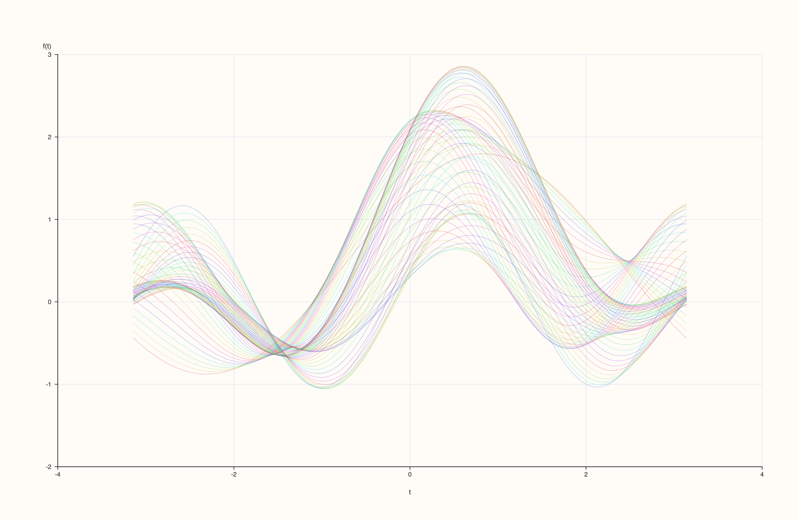
```

### `areaplot`

#### Signature

```cpp
Trace& areaplot(self: Pane, x: SeriesLike, y: SeriesLike, base: double = 0.0);
```

#### Notes

Fills the area between the signal and a baseline.

#### Example

```{literalinclude} ../../examples/docs/snippets/keys/areaplot.cpp
:language: cpp
```

#### Output

```{only} html
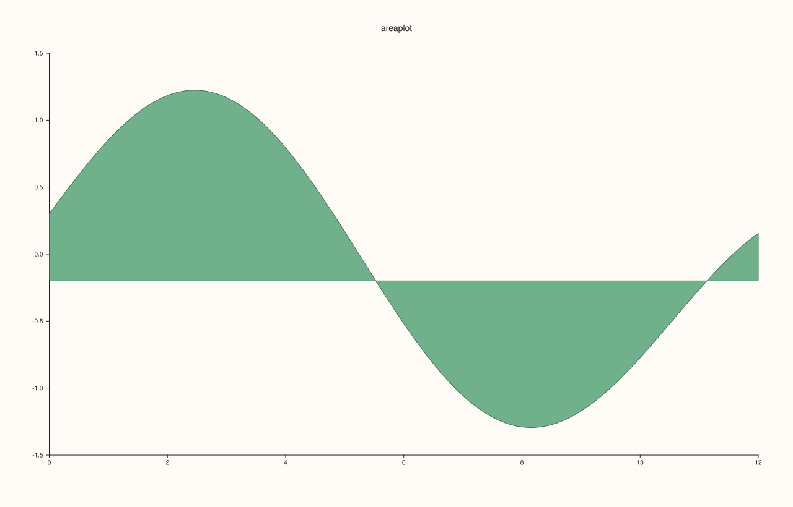
```

```{only} not html

```

### `bar3d`

#### Signature

```cpp
Trace& bar3d(self: Pane, x: SeriesLike, y: SeriesLike, z: SeriesLike);
```

#### Notes

3D bar-like rendering alias over `spire3`.

#### Example

```{literalinclude} ../../examples/docs/snippets/keys/bar3d.cpp
:language: cpp
```

#### Output

```{only} html

```

```{only} not html

```

### `barplot`

#### Signature

```cpp
Trace& barplot(self: Pane, x_or_categories, y_values, options: BarPlotOptions = {});
```

#### Notes

Categorical or numeric bars, with optional horizontal orientation.

#### Example

```{literalinclude} ../../examples/docs/snippets/keys/barplot.cpp
:language: cpp
```

#### Output

```{only} html
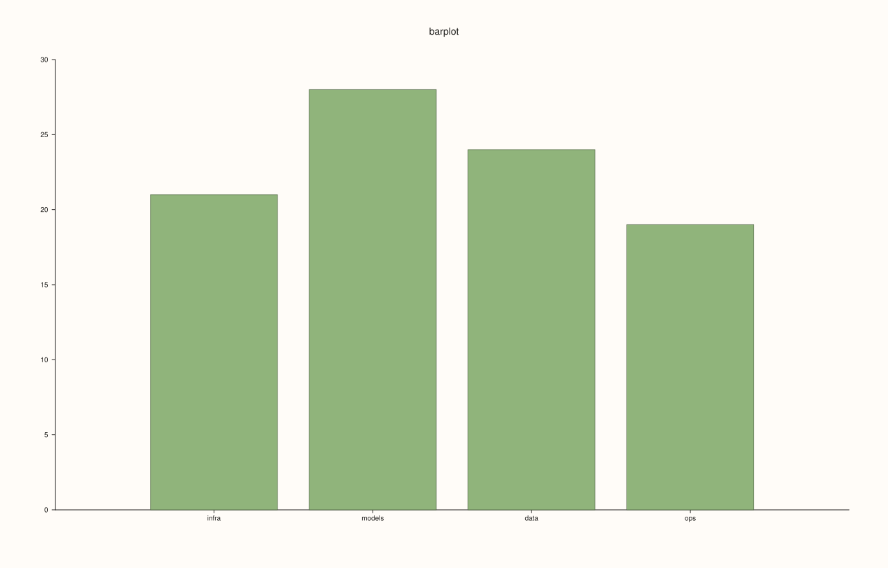
```

```{only} not html

```

### `bootstrapplot`

#### Signature

```cpp
Studio& bootstrapplot(self: Studio, values: SeriesLike, options: BootstrapPlotOptions = {});
```

#### Notes

Resampling-based distribution of a summary statistic (mean/median/std).

#### Example

```{literalinclude} ../../examples/docs/snippets/keys/bootstrapplot.cpp
:language: cpp
```

#### Output

```{only} html
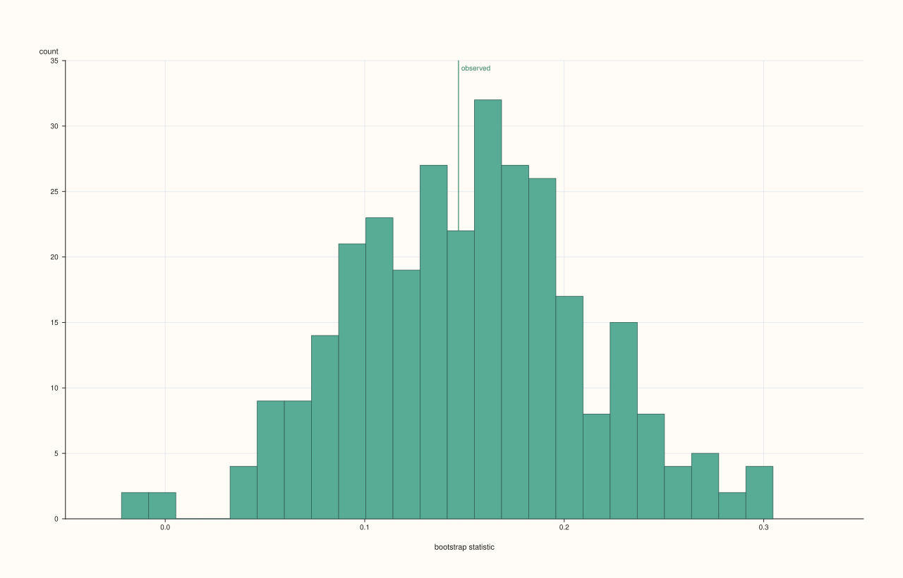
```

```{only} not html

```

### `boxenplot`

#### Signature

```cpp
Trace& boxenplot(self: Pane, values: SeriesLike);
```

#### Notes

Letter-value style alias currently routed through boxplot behavior.

#### Example

```{literalinclude} ../../examples/docs/snippets/keys/boxenplot.cpp
:language: cpp
```

#### Output

```{only} html
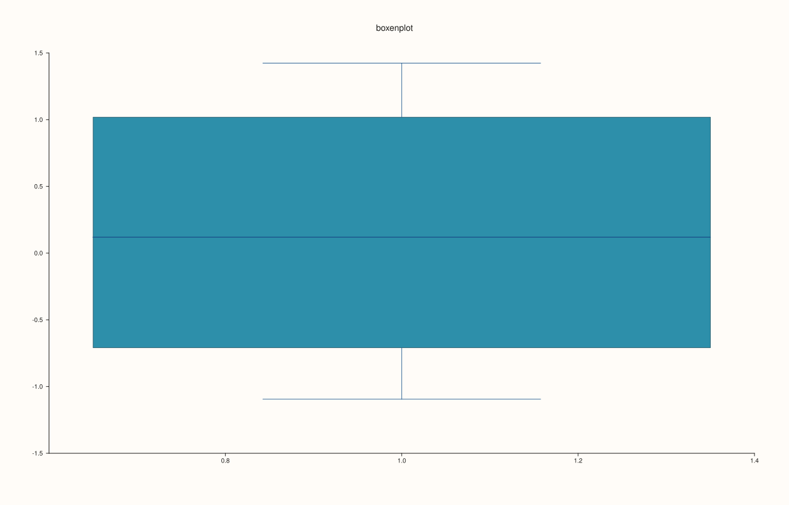
```

```{only} not html

```

### `boxplot`

#### Signature

```cpp
Trace& boxplot(self: Pane, values_or_grouped);
```

#### Notes

Quartile/whisker summary for distribution comparison.

#### Example

```{literalinclude} ../../examples/docs/snippets/keys/boxplot.cpp
:language: cpp
```

#### Output

```{only} html
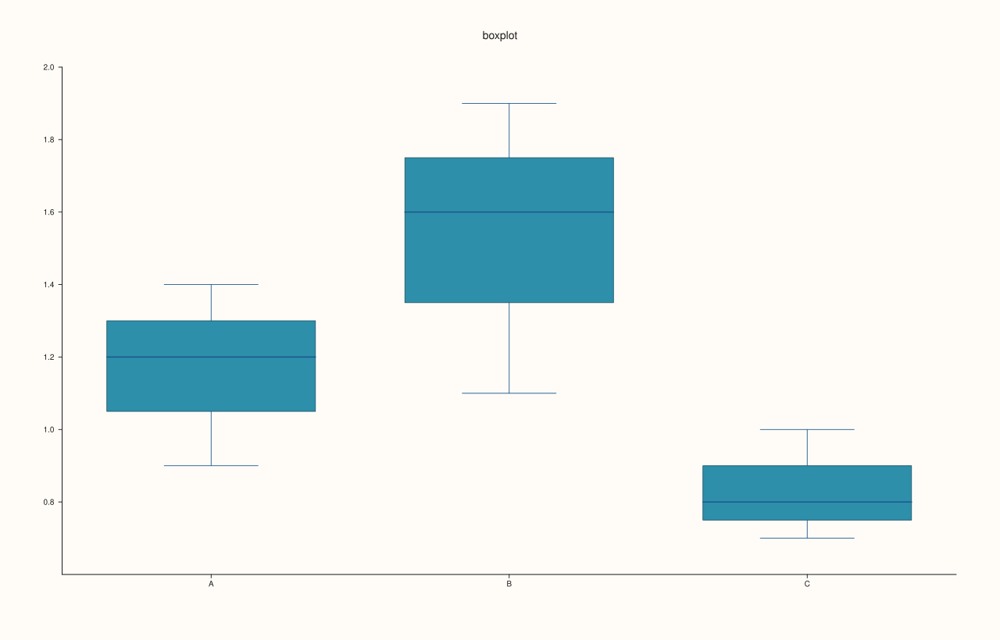
```

```{only} not html

```

### `catgridplot`

#### Signature

```cpp
Studio& catgridplot(self: Studio, groups, values[, hues], options: CatGridPlotOptions = {});
```

#### Notes

Facet grid for repeated categorical comparisons across slices.

#### Example

```{literalinclude} ../../examples/docs/snippets/keys/catgridplot.cpp
:language: cpp
```

#### Output

```{only} html

```

```{only} not html
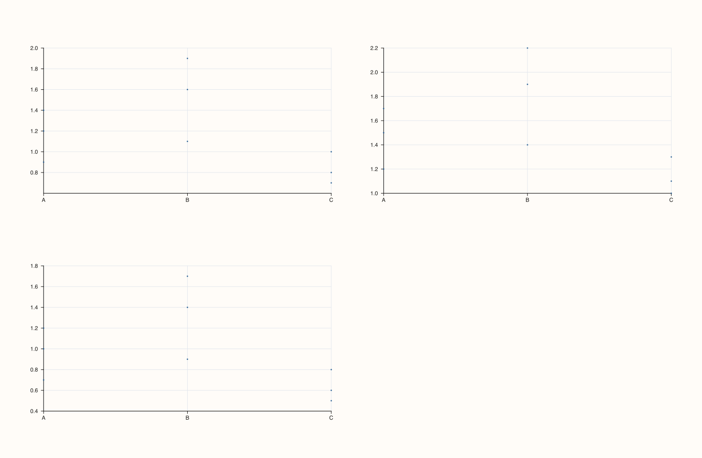
```

### `catplot`

#### Signature

```cpp
Trace& catplot(self: Pane, group, values[, hue], kind_or_options);
```

#### Notes

Unified categorical interface (`strip`, `swarm`, `box`, `violin`, `bar`, `count`).

#### Example

```{literalinclude} ../../examples/docs/snippets/keys/catplot.cpp
:language: cpp
```

#### Output

```{only} html

```

```{only} not html

```

### `ccfplot`

#### Signature

```cpp
Studio& ccfplot(self: Studio, x: SeriesLike, y: SeriesLike, options: CcfPlotOptions = {});
```

#### Notes

Cross-correlation against positive/negative lags for two signals.

#### Example

```{literalinclude} ../../examples/docs/snippets/keys/ccfplot.cpp
:language: cpp
```

#### Output

```{only} html
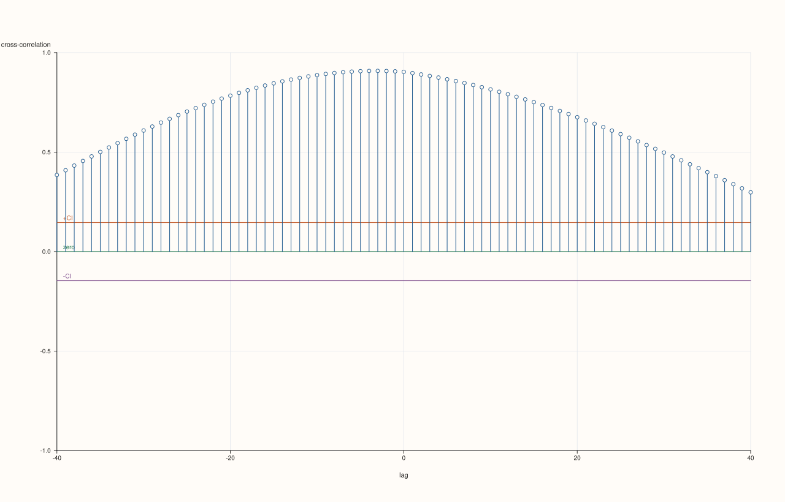
```

```{only} not html
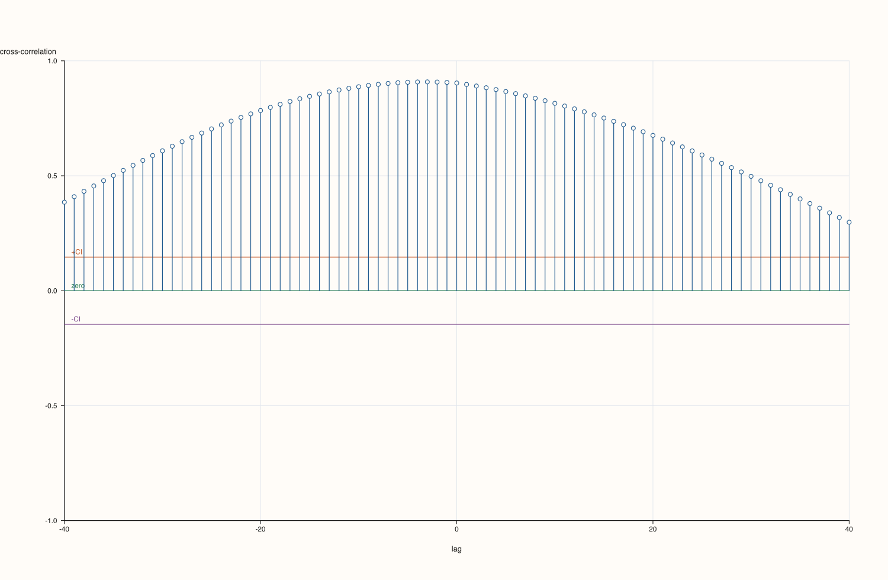
```

### `cloud3`

#### Signature

```cpp
Trace& cloud3(self: Pane, x: SeriesLike, y: SeriesLike, z: SeriesLike[, size, color]);
```

#### Notes

3D scatter cloud with optional point-size and color channels.

#### Example

```{literalinclude} ../../examples/docs/snippets/keys/cloud3.cpp
:language: cpp
```

#### Output

```{only} html

```

```{only} not html
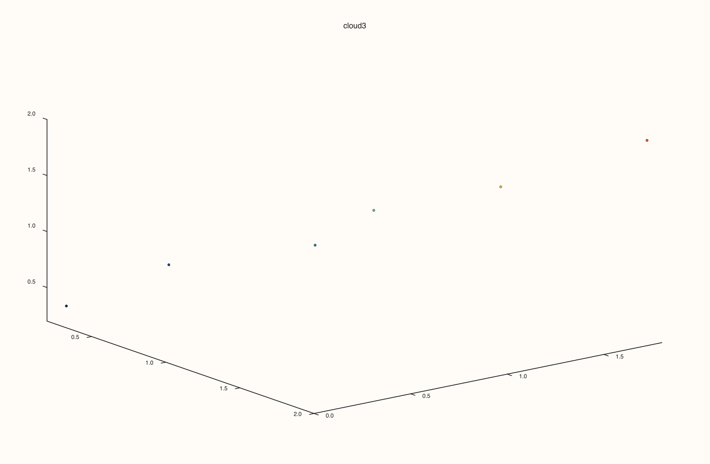
```

### `cloud4`

#### Signature

```cpp
Trace& cloud4(self: Pane
```

#### Notes

Studio, x: SeriesLike, y: SeriesLike, z: SeriesLike, w: SeriesLike, options: HyperPlotOptions = {});

#### Example

```{literalinclude} ../../examples/docs/snippets/keys/cloud4.cpp
:language: cpp
```

#### Output

```{only} html
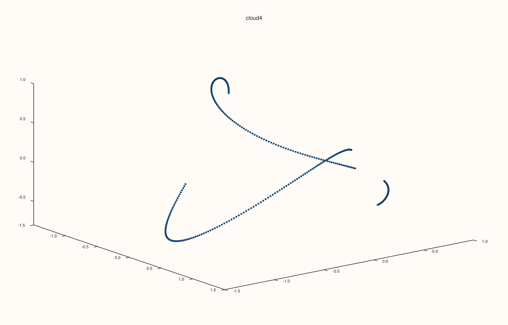
```

```{only} not html

```

### `clustermap`

#### Signature

```cpp
Trace& clustermap(self: Pane, x: SeriesLike, y: SeriesLike, z: SeriesLike, options: ClusterMapOptions = {});
```

#### Notes

Cluster-aware heatmap that reorders rows/columns by similarity.

#### Example

```{literalinclude} ../../examples/docs/snippets/keys/clustermap.cpp
:language: cpp
```

#### Output

```{only} html

```

```{only} not html
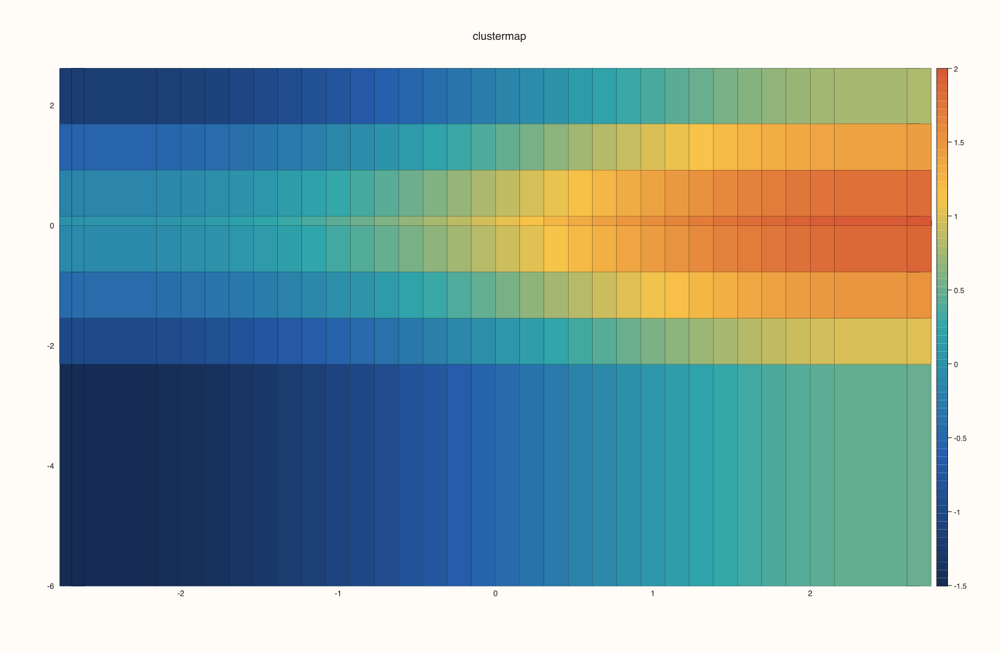
```

### `contour3D`

#### Signature

```cpp
Trace& contour3D(self: Pane, x: SeriesLike, y: SeriesLike, z: SeriesLike, level_count: int = 8);
```

#### Notes

3D contour-like ridges (alias over `ridge3`).

#### Example

```{literalinclude} ../../examples/docs/snippets/keys/contour3D.cpp
:language: cpp
```

#### Output

```{only} html
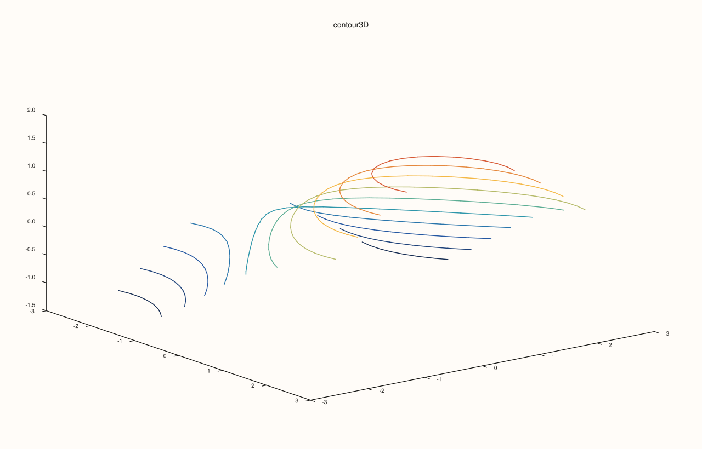
```

```{only} not html

```

### `countplot`

#### Signature

```cpp
Trace& countplot(self: Pane, values_or_categories, bins: int = 12);
```

#### Notes

Frequency chart for numeric bins or category counts.

#### Example

```{literalinclude} ../../examples/docs/snippets/keys/countplot.cpp
:language: cpp
```

#### Output

```{only} html
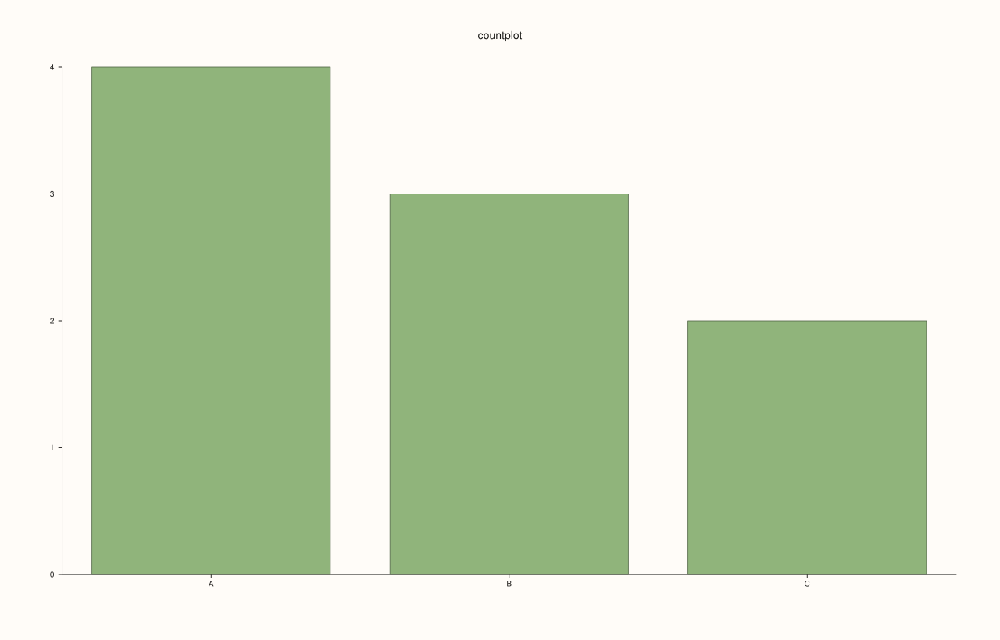
```

```{only} not html

```

### `disgridplot`

#### Signature

```cpp
Studio& disgridplot(self: Studio, values_facets, options_or_kind);
```

#### Notes

Facet grid for distribution views (`hist`, `density`, `ecdf`, `rug`).

#### Example

```{literalinclude} ../../examples/docs/snippets/keys/disgridplot.cpp
:language: cpp
```

#### Output

```{only} html
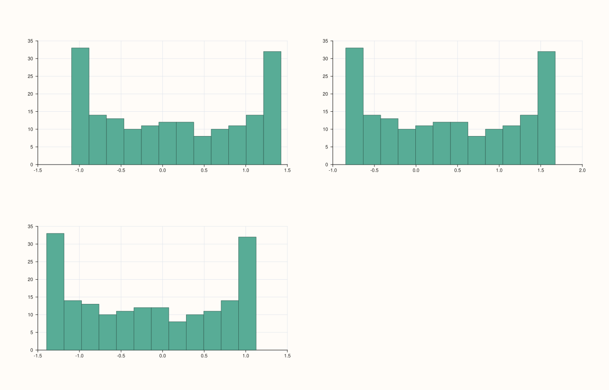
```

```{only} not html

```

### `displot`

#### Signature

```cpp
Trace& displot(self: Pane, values: SeriesLike, bins: int = 12);
```

#### Notes

Distribution shortcut alias for histogram.

#### Example

```{literalinclude} ../../examples/docs/snippets/keys/displot.cpp
:language: cpp
```

#### Output

```{only} html

```

```{only} not html
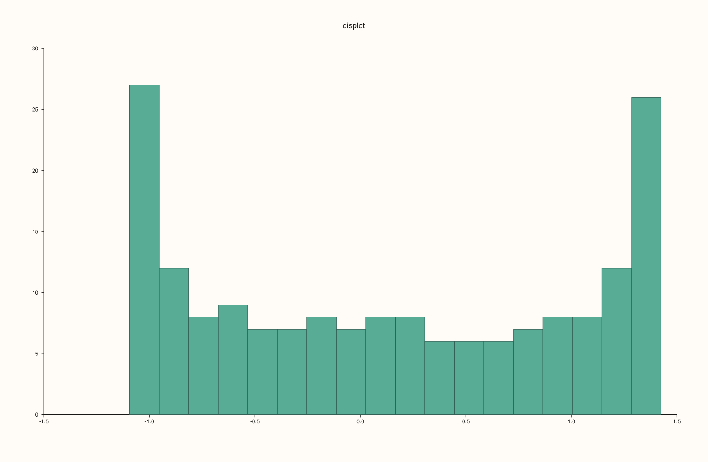
```

### `ecdfplot`

#### Signature

```cpp
Trace& ecdfplot(self: Pane, values: SeriesLike);
```

#### Notes

Empirical cumulative distribution function.

#### Example

```{literalinclude} ../../examples/docs/snippets/keys/ecdfplot.cpp
:language: cpp
```

#### Output

```{only} html

```

```{only} not html
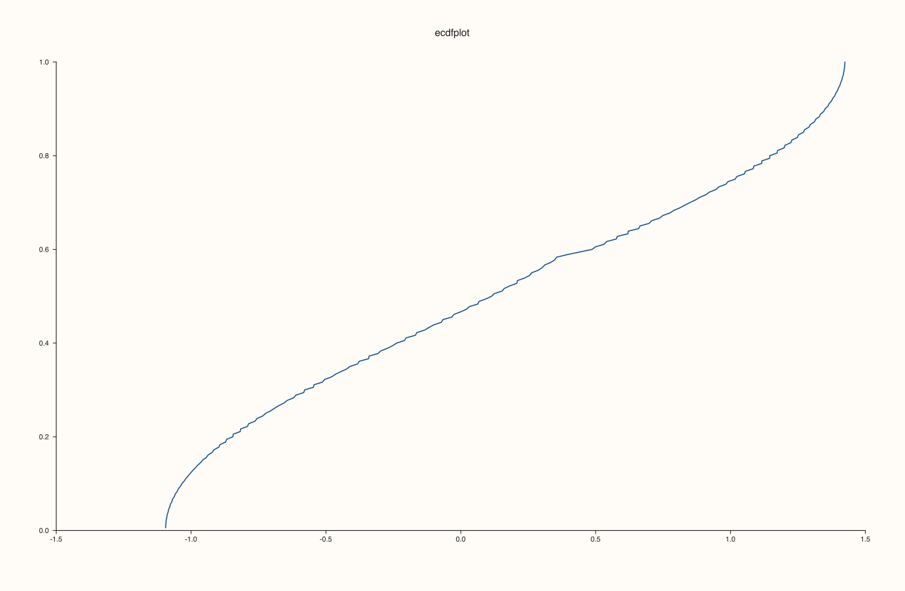
```

### `heatmap`

#### Signature

```cpp
Trace& heatmap(self: Pane, x: SeriesLike, y: SeriesLike, z: SeriesLike[, color_or_options]);
```

#### Notes

2D intensity map with masking/limits/scale-guide controls.

#### Example

```{literalinclude} ../../examples/docs/snippets/keys/heatmap.cpp
:language: cpp
```

#### Output

```{only} html
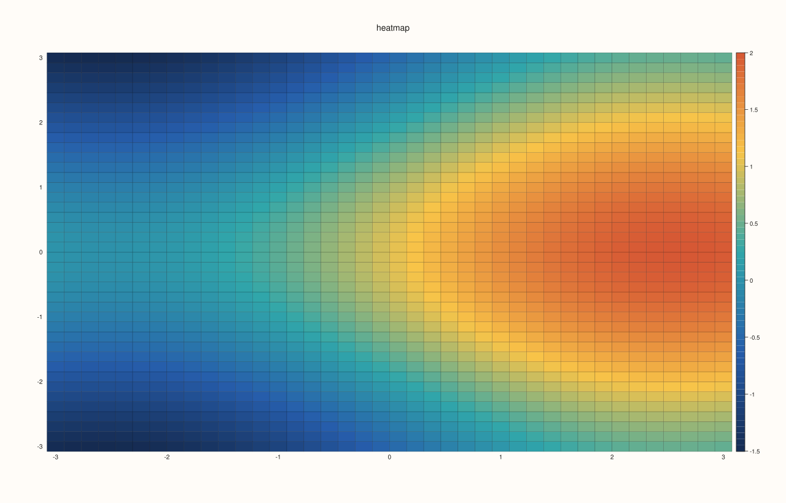
```

```{only} not html

```

### `hist3d`

#### Signature

```cpp
Trace& hist3d(self: Pane
```

#### Notes

Studio, x: SeriesLike, y: SeriesLike, options: Hist3DOptions = {});

#### Example

```{literalinclude} ../../examples/docs/snippets/keys/hist3d.cpp
:language: cpp
```

#### Output

```{only} html
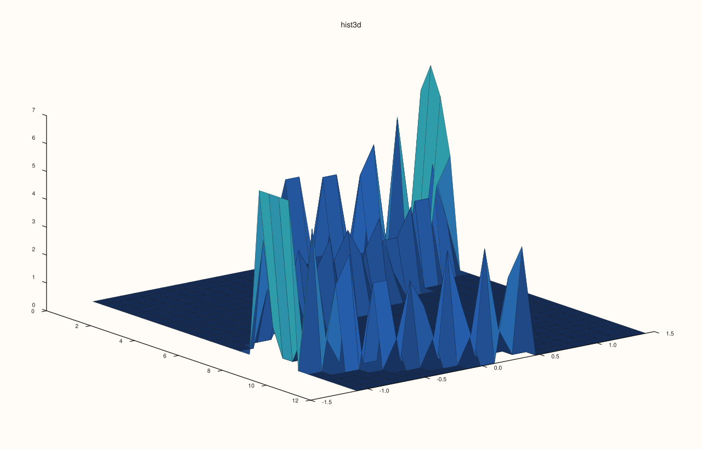
```

```{only} not html

```

### `histplot`

#### Signature

```cpp
Trace& histplot(self: Pane, values: SeriesLike, bins: int = 12);
```

#### Notes

Univariate histogram.

#### Example

```{literalinclude} ../../examples/docs/snippets/keys/histplot.cpp
:language: cpp
```

#### Output

```{only} html

```

```{only} not html
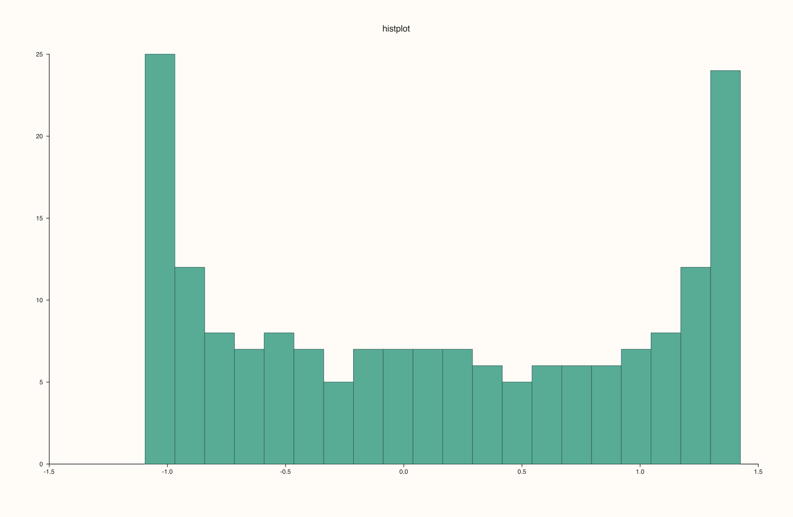
```

### `isoshell`

#### Signature

```cpp
Trace& isoshell(self: Pane, grid_values[, levels_or_level_count]);
```

#### Notes

Isosurface-style shell extraction from volumetric grids.

#### Example

```{literalinclude} ../../examples/docs/snippets/keys/isoshell.cpp
:language: cpp
```

#### Output

```{only} html

```

```{only} not html
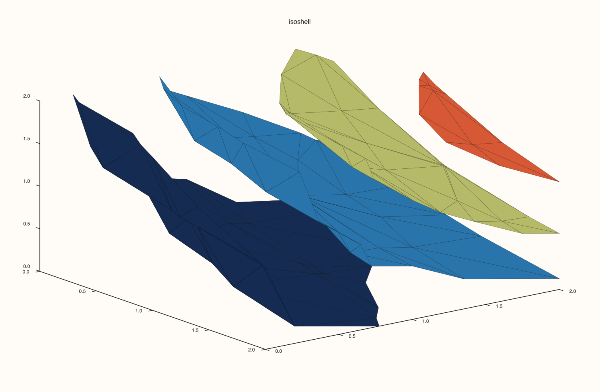
```

### `jointplot`

#### Signature

```cpp
Studio& jointplot(self: Studio, x: SeriesLike, y: SeriesLike, kind_or_options);
```

#### Notes

Joint + marginals composition for bivariate diagnostics.

#### Example

```{literalinclude} ../../examples/docs/snippets/keys/jointplot.cpp
:language: cpp
```

#### Output

```{only} html
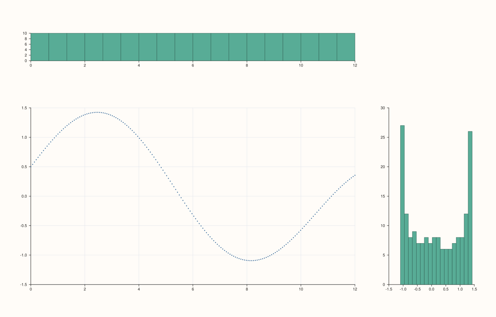
```

```{only} not html
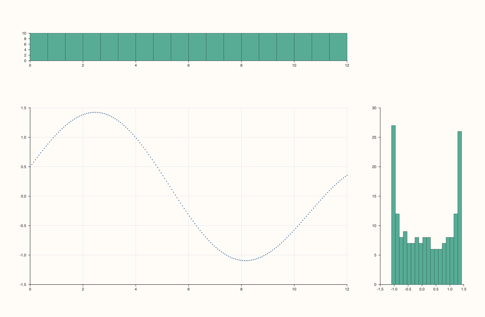
```

### `kdeplot`

#### Signature

```cpp
Trace& kdeplot(self: Pane, values: SeriesLike, points: int = 128);
```

#### Notes

Kernel density estimate rendered as a smooth curve.

#### Example

```{literalinclude} ../../examples/docs/snippets/keys/kdeplot.cpp
:language: cpp
```

#### Output

```{only} html

```

```{only} not html
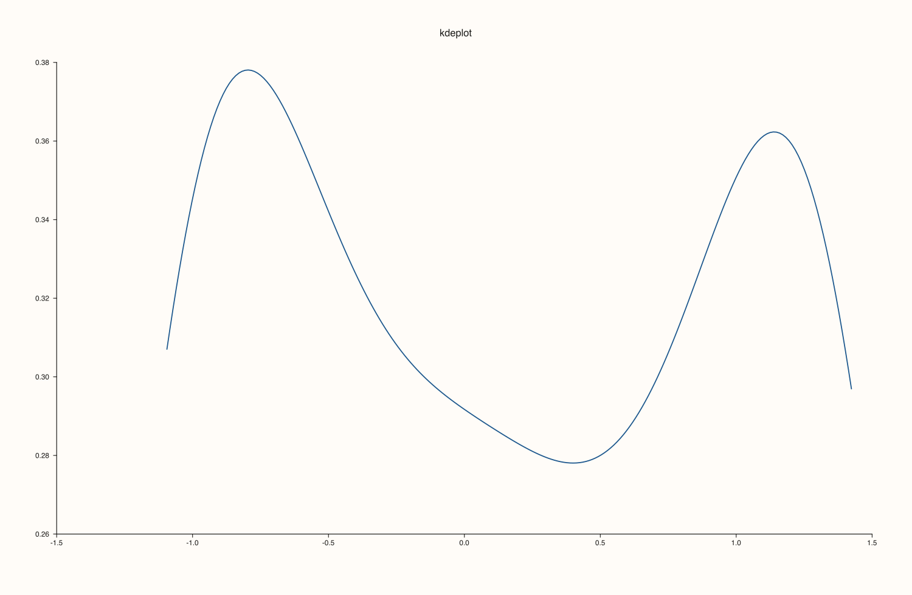
```

### `lagplot`

#### Signature

```cpp
Studio& lagplot(self: Studio, values: SeriesLike, options: LagPlotOptions = {});
```

#### Notes

Scatter of `x_t` vs `x_{t-lag}` for serial dependence.

#### Example

```{literalinclude} ../../examples/docs/snippets/keys/lagplot.cpp
:language: cpp
```

#### Output

```{only} html
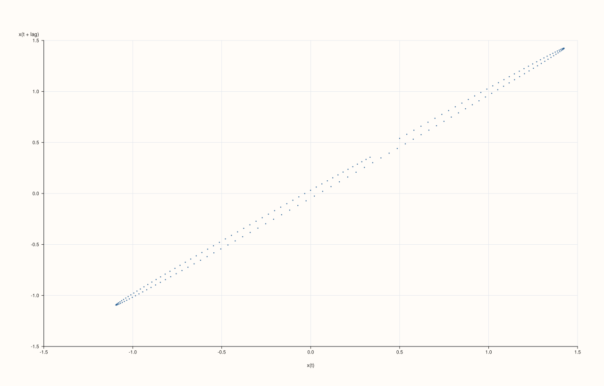
```

```{only} not html
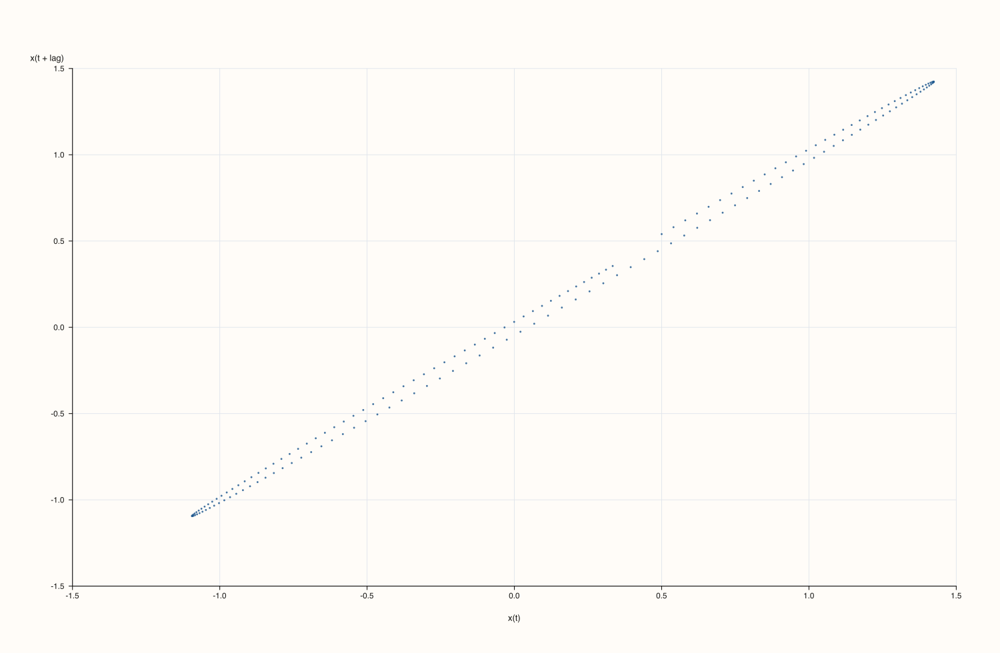
```

### `lattice`

#### Signature

```cpp
Trace& lattice(self: Pane
```

#### Notes

Studio, x: SeriesLike, y: SeriesLike, z: SeriesLike[, color]);

#### Example

```{literalinclude} ../../examples/docs/snippets/keys/lattice.cpp
:language: cpp
```

#### Output

```{only} html
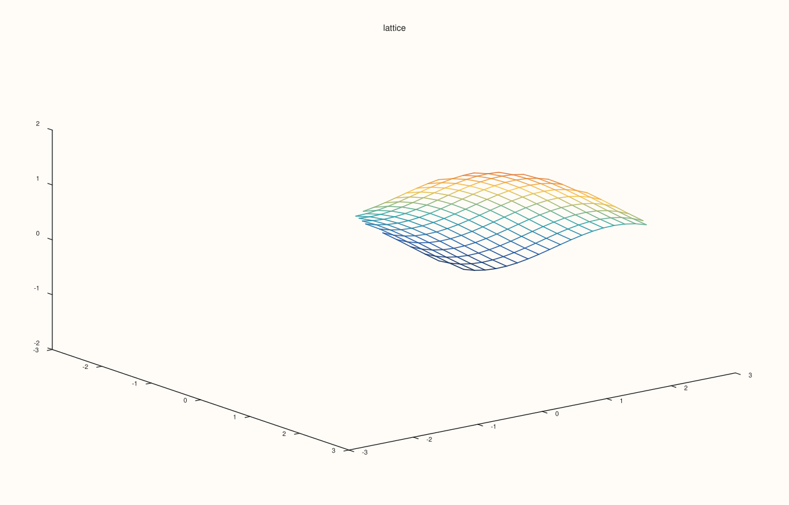
```

```{only} not html
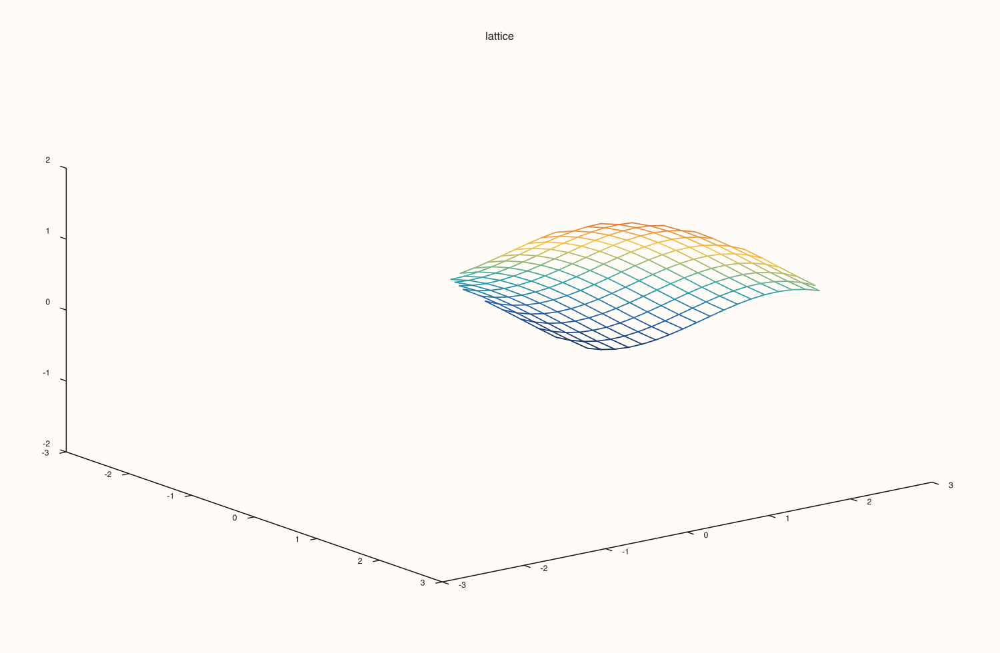
```

### `lineplot`

#### Signature

```cpp
Trace& lineplot(self: Pane, x: SeriesLike, y: SeriesLike[, hue]);
```

#### Notes

Line chart with optional grouped hue handling.

#### Example

```{literalinclude} ../../examples/docs/snippets/keys/lineplot.cpp
:language: cpp
```

#### Output

```{only} html

```

```{only} not html
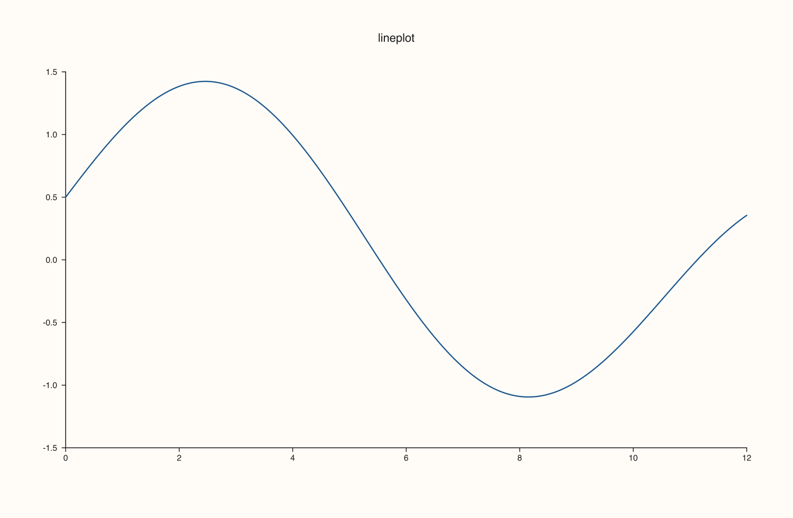
```

### `lmplot`

#### Signature

```cpp
Trace& lmplot(self: Studio, x: SeriesLike, y: SeriesLike[, options], title = {});
```

#### Notes

Regression convenience wrapper that allocates its own pane.

#### Example

```{literalinclude} ../../examples/docs/snippets/keys/lmplot.cpp
:language: cpp
```

#### Output

```{only} html

```

```{only} not html

```

### `pacfplot`

#### Signature

```cpp
Studio& pacfplot(self: Studio, values: SeriesLike, options: PacfPlotOptions = {});
```

#### Notes

Partial autocorrelation for AR order identification.

#### Example

```{literalinclude} ../../examples/docs/snippets/keys/pacfplot.cpp
:language: cpp
```

#### Output

```{only} html
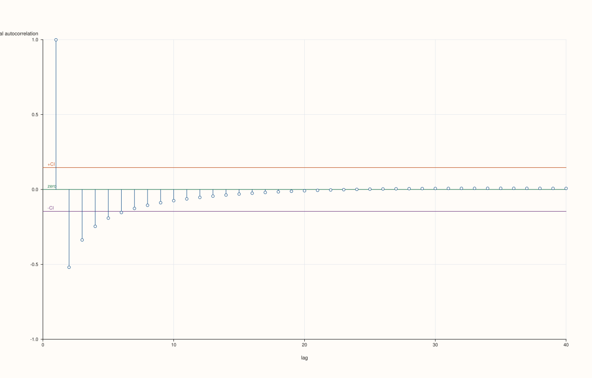
```

```{only} not html
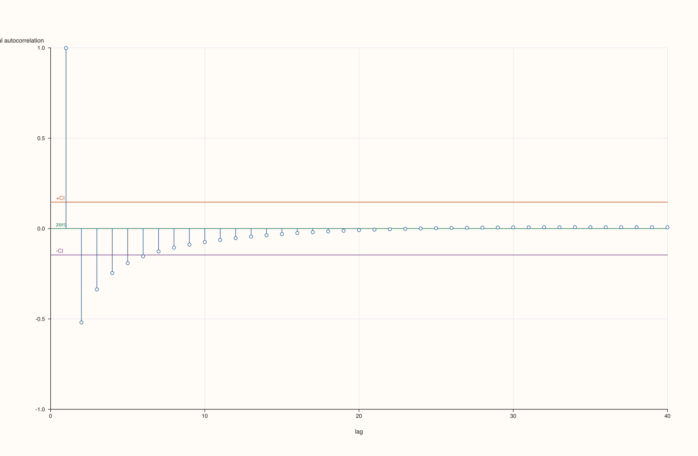
```

### `pairplot`

#### Signature

```cpp
Studio& pairplot(self: Studio, matrix_or_dataset_or_columns, options);
```

#### Notes

Pairwise matrix of feature relationships.

#### Example

```{literalinclude} ../../examples/docs/snippets/keys/pairplot.cpp
:language: cpp
```

#### Output

```{only} html

```

```{only} not html
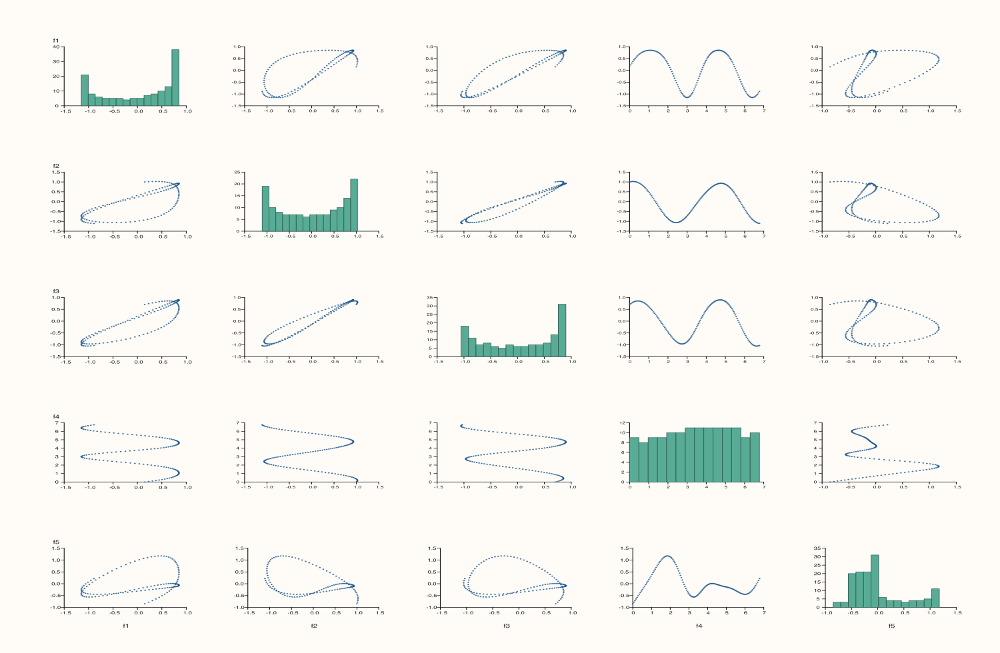
```

### `parallelplot`

#### Signature

```cpp
Studio& parallelplot(self: Studio, matrix_or_dataset_or_columns, options: ParallelCoordinatesOptions = {});
```

#### Notes

Parallel coordinates for high-dimensional row comparisons.

#### Example

```{literalinclude} ../../examples/docs/snippets/keys/parallelplot.cpp
:language: cpp
```

#### Output

```{only} html
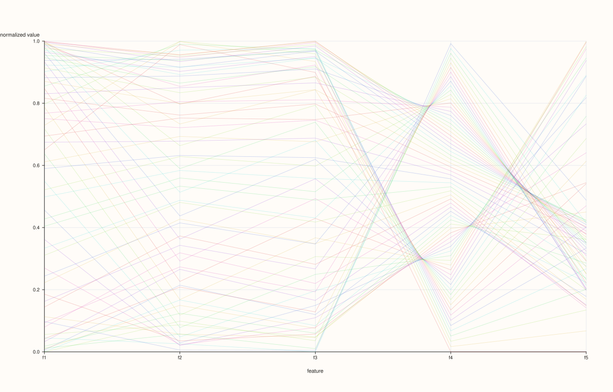
```

```{only} not html
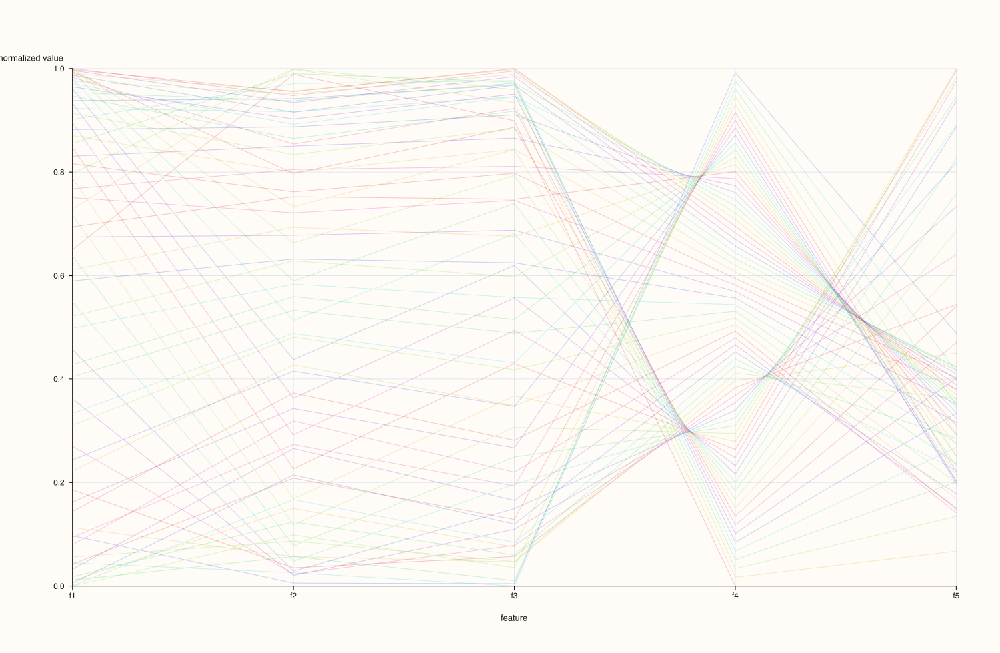
```

### `path3`

#### Signature

```cpp
Trace& path3(self: Pane
```

#### Notes

Studio, x: SeriesLike, y: SeriesLike, z: SeriesLike);

#### Example

```{literalinclude} ../../examples/docs/snippets/keys/path3.cpp
:language: cpp
```

#### Output

```{only} html

```

```{only} not html

```

### `path4`

#### Signature

```cpp
Trace& path4(self: Pane
```

#### Notes

Studio, x: SeriesLike, y: SeriesLike, z: SeriesLike, w: SeriesLike, options: HyperPlotOptions = {});

#### Example

```{literalinclude} ../../examples/docs/snippets/keys/path4.cpp
:language: cpp
```

#### Output

```{only} html
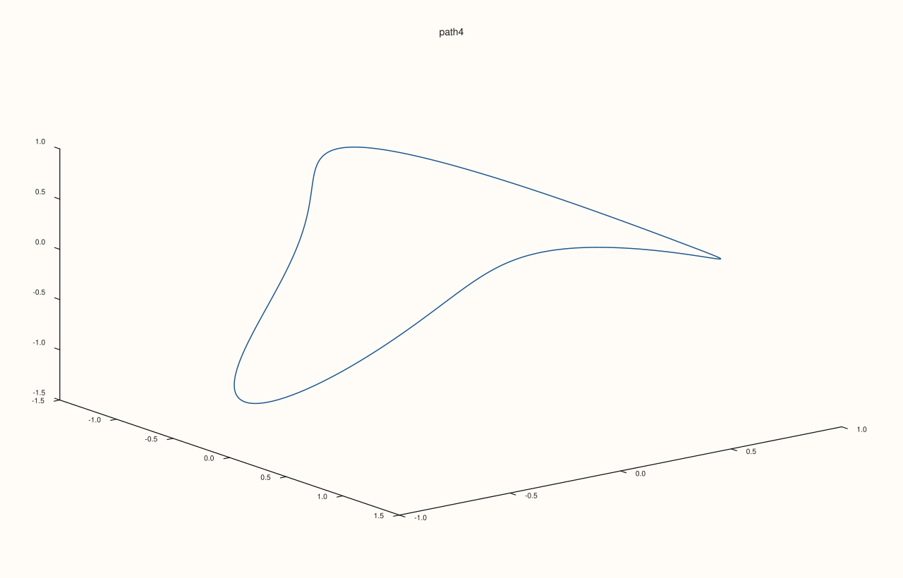
```

```{only} not html
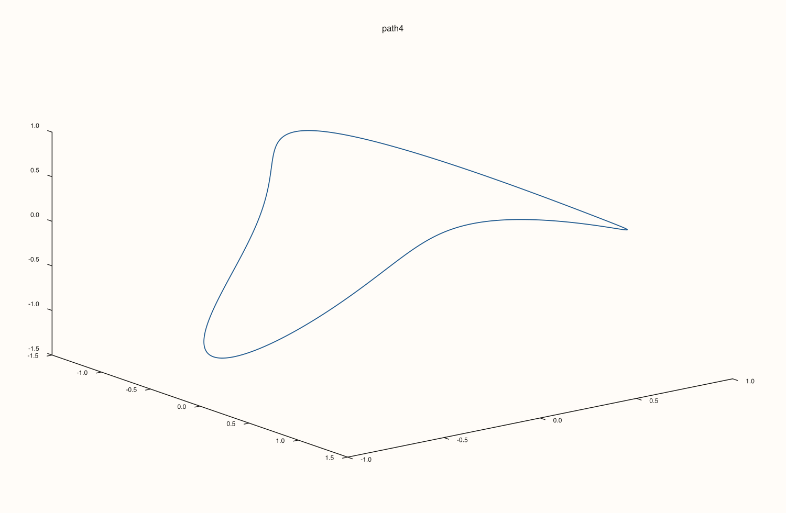
```

### `pieplot`

#### Signature

```cpp
Trace& pieplot(self: Pane, values: SeriesLike[, labels]);
```

#### Notes

Pie wedges from part-to-whole values.

#### Example

```{literalinclude} ../../examples/docs/snippets/keys/pieplot.cpp
:language: cpp
```

#### Output

```{only} html

```

```{only} not html
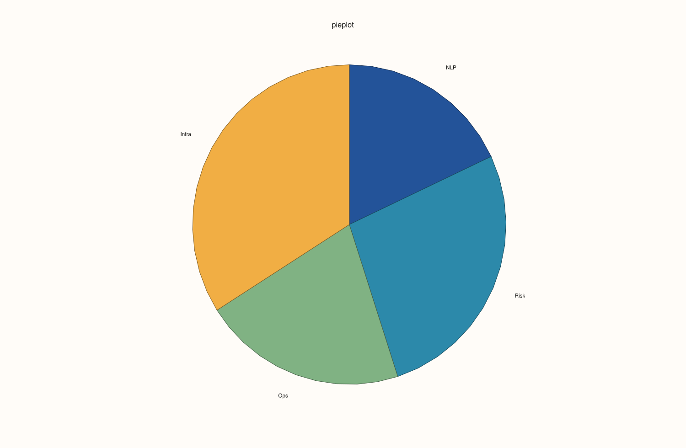
```

### `plot3D`

#### Signature

```cpp
Trace& plot3D(self: Pane, x: SeriesLike, y: SeriesLike, z: SeriesLike);
```

#### Notes

Matplotlib-style alias for 3D path plotting.

#### Example

```{literalinclude} ../../examples/docs/snippets/keys/plot3D.cpp
:language: cpp
```

#### Output

```{only} html
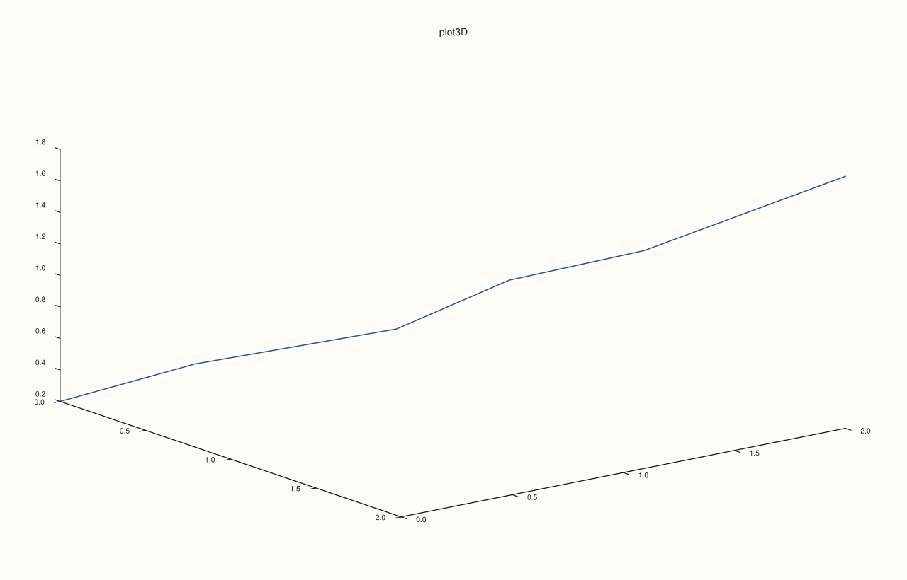
```

```{only} not html

```

### `plot_surface`

#### Signature

```cpp
Trace& plot_surface(self: Pane, x: SeriesLike, y: SeriesLike, z: SeriesLike);
```

#### Notes

Matplotlib-style alias for surface plotting (`sheet`).

#### Example

```{literalinclude} ../../examples/docs/snippets/keys/plot_surface.cpp
:language: cpp
```

#### Output

```{only} html

```

```{only} not html

```

### `plot_wireframe`

#### Signature

```cpp
Trace& plot_wireframe(self: Pane, x: SeriesLike, y: SeriesLike, z: SeriesLike);
```

#### Notes

Matplotlib-style alias for wireframe plotting (`lattice`).

#### Example

```{literalinclude} ../../examples/docs/snippets/keys/plot_wireframe.cpp
:language: cpp
```

#### Output

```{only} html
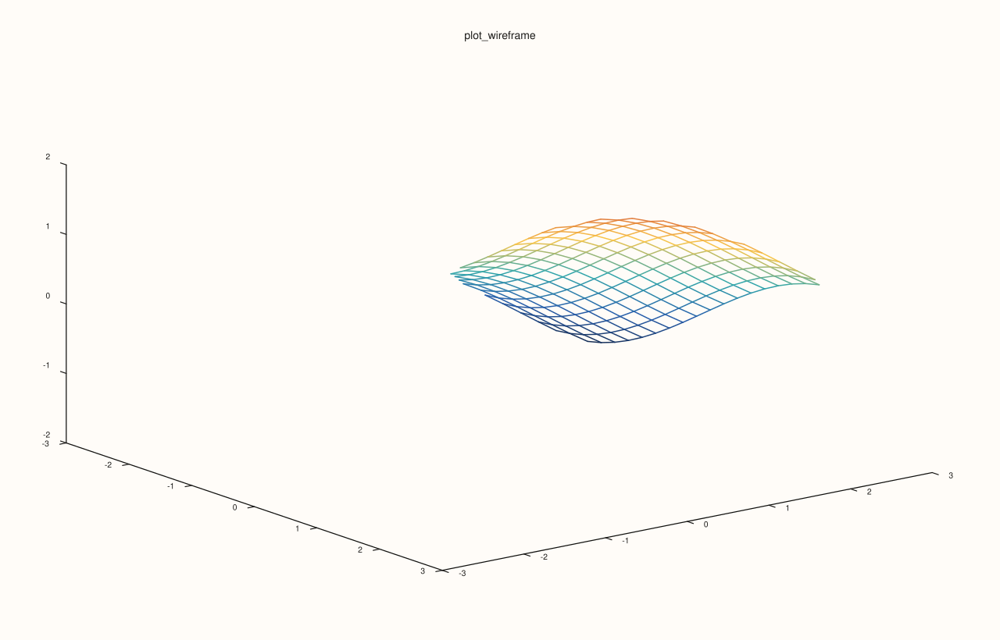
```

```{only} not html
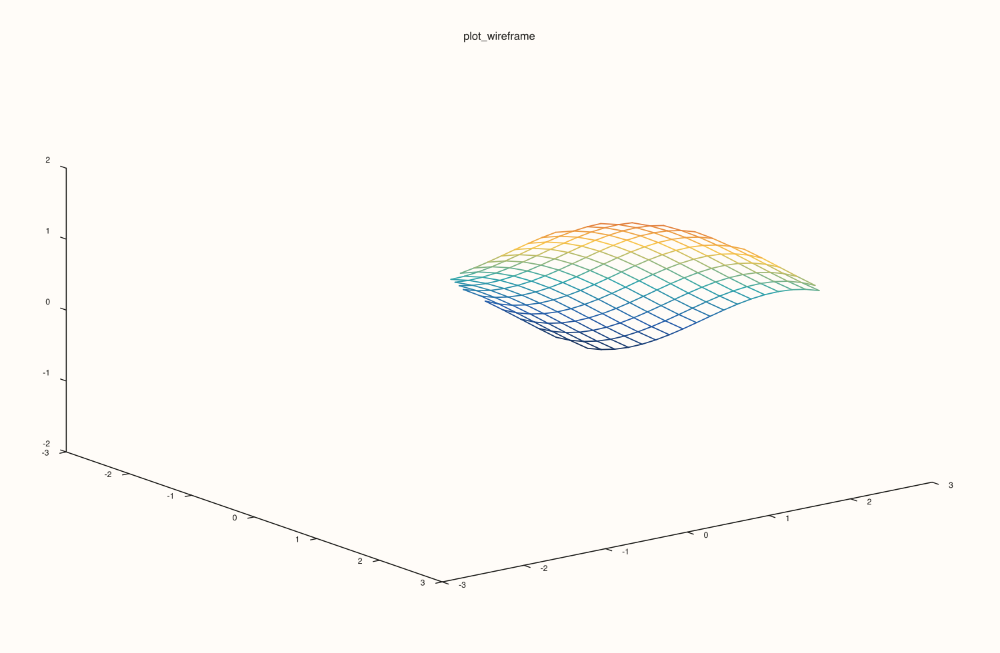
```

### `pointplot`

#### Signature

```cpp
Trace& pointplot(self: Pane, x: SeriesLike, y: SeriesLike, err: SeriesLike);
```

#### Notes

Mean/point trend with error whiskers.

#### Example

```{literalinclude} ../../examples/docs/snippets/keys/pointplot.cpp
:language: cpp
```

#### Output

```{only} html
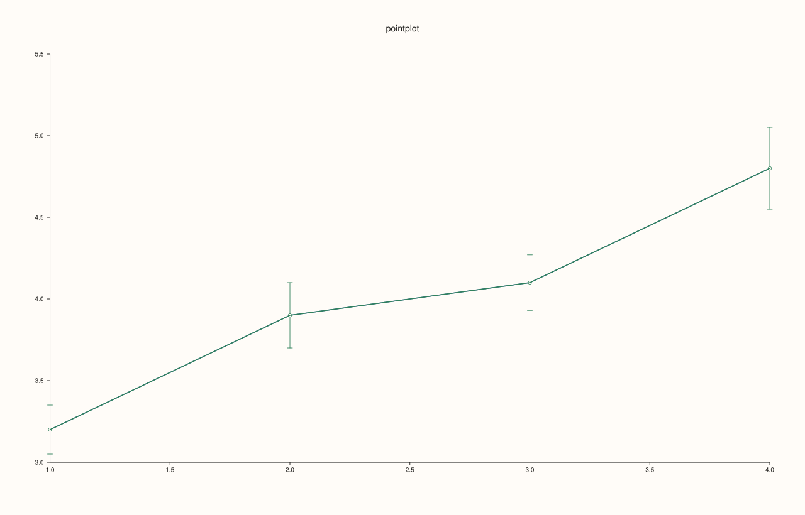
```

```{only} not html
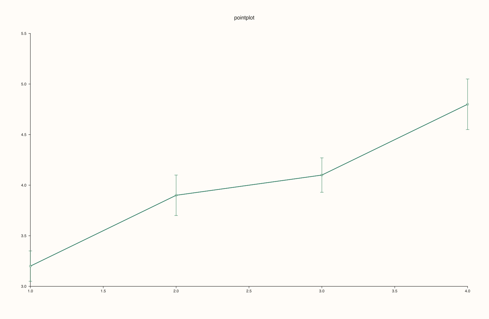
```

### `qqplot`

#### Signature

```cpp
Trace& qqplot(self: Pane
```

#### Notes

Studio, values: SeriesLike, options: QqPlotOptions = {});

#### Example

```{literalinclude} ../../examples/docs/snippets/keys/qqplot.cpp
:language: cpp
```

#### Output

```{only} html
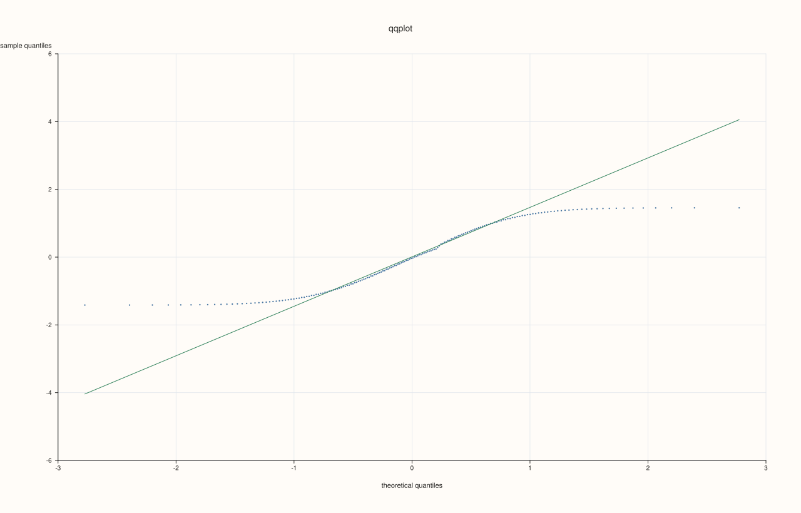
```

```{only} not html
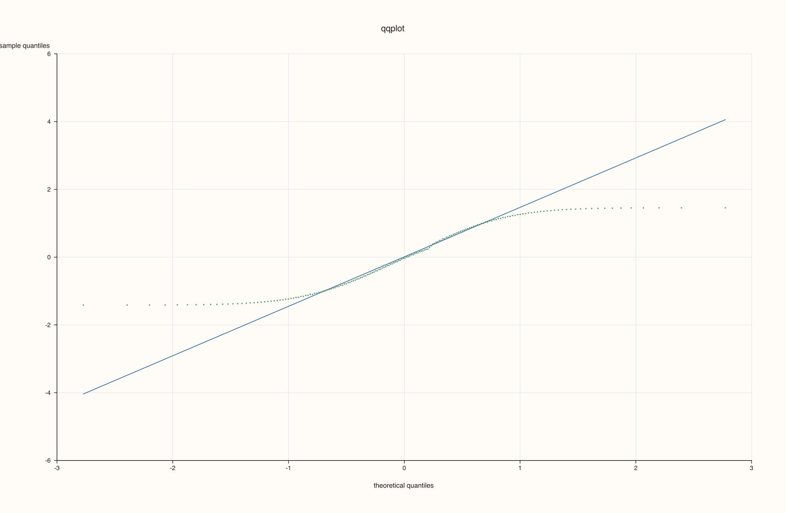
```

### `radviz`

#### Signature

```cpp
Studio& radviz(self: Studio, matrix_or_dataset, options: RadvizOptions = {});
```

#### Notes

Projects features to anchors on a circle for class separation.

#### Example

```{literalinclude} ../../examples/docs/snippets/keys/radviz.cpp
:language: cpp
```

#### Output

```{only} html
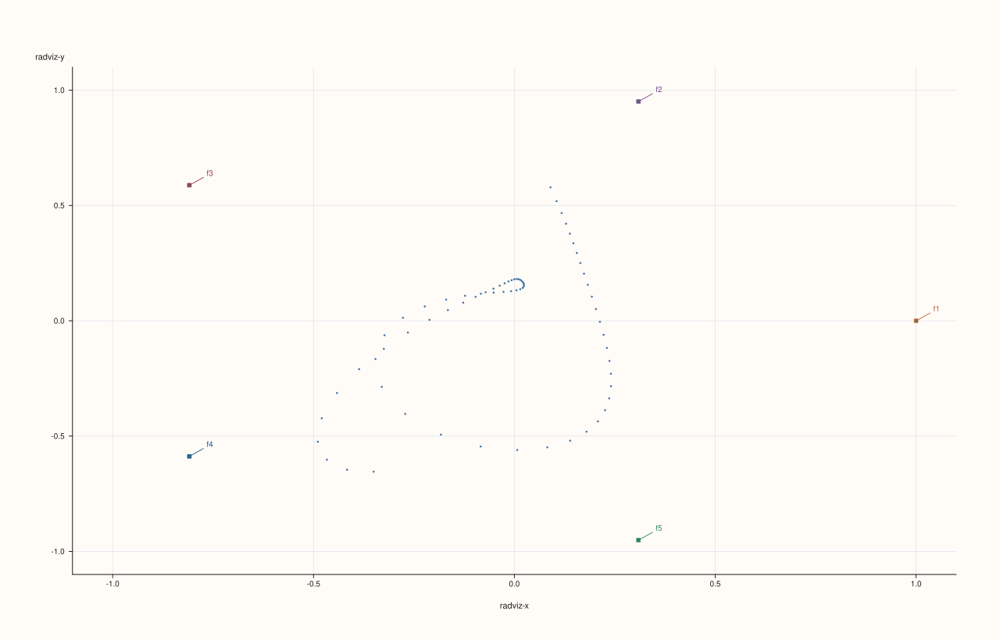
```

```{only} not html
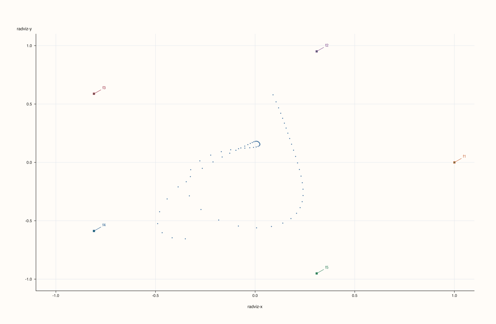
```

### `regplot`

#### Signature

```cpp
Trace& regplot(self: Pane, x: SeriesLike, y: SeriesLike, options: RegPlotOptions = {});
```

#### Notes

Scatter + fitted regression (optionally CI bands).

#### Example

```{literalinclude} ../../examples/docs/snippets/keys/regplot.cpp
:language: cpp
```

#### Output

```{only} html
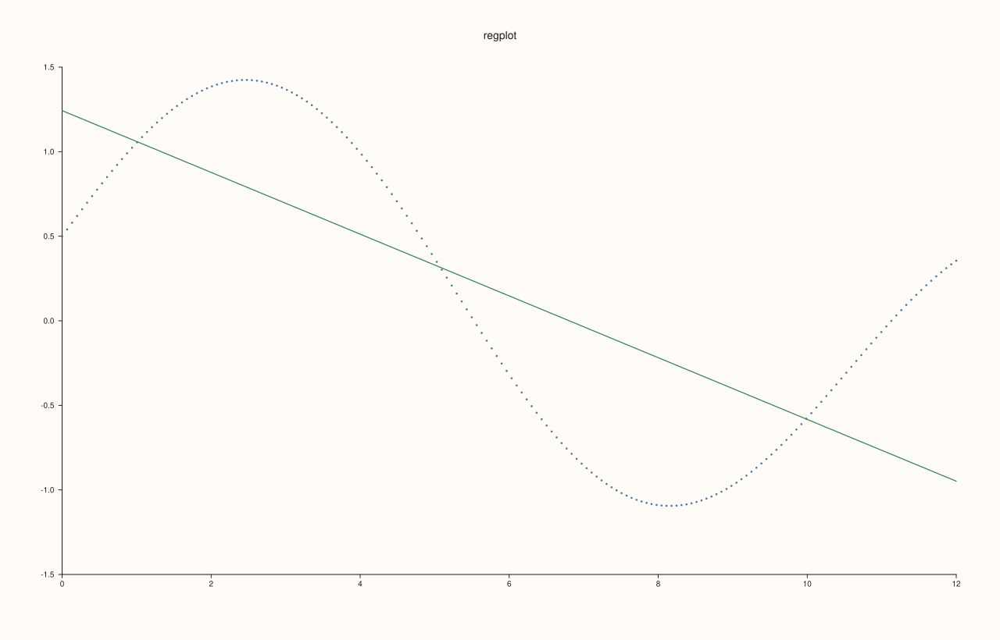
```

```{only} not html

```

### `relgridplot`

#### Signature

```cpp
Studio& relgridplot(self: Studio, xs_facets, ys_facets, options_or_kind);
```

#### Notes

Facet grid for relational plots (scatter/line/reg).

#### Example

```{literalinclude} ../../examples/docs/snippets/keys/relgridplot.cpp
:language: cpp
```

#### Output

```{only} html
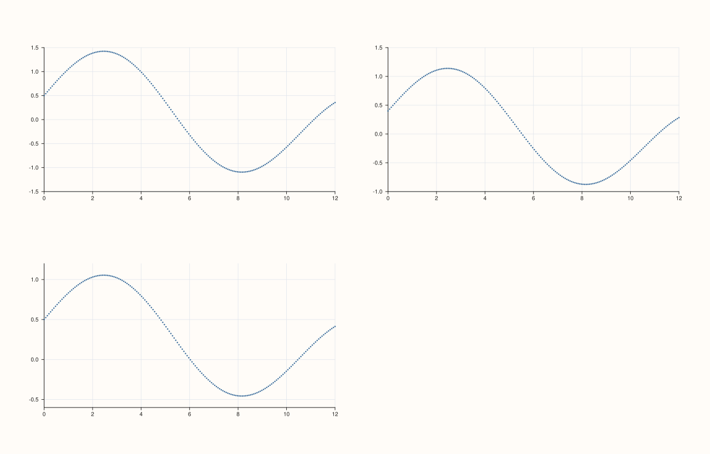
```

```{only} not html

```

### `relplot`

#### Signature

```cpp
Trace& relplot(self: Pane
```

#### Notes

Studio, x: SeriesLike, y: SeriesLike[, hue], kind = "scatter");

#### Example

```{literalinclude} ../../examples/docs/snippets/keys/relplot.cpp
:language: cpp
```

#### Output

```{only} html

```

```{only} not html

```

### `resid_acfplot`

#### Signature

```cpp
Studio& resid_acfplot(self: Studio, x: SeriesLike, y: SeriesLike, options: ResidAcfPlotOptions = {});
```

#### Notes

Fits regression, then runs ACF on residuals.

#### Example

```{literalinclude} ../../examples/docs/snippets/keys/resid_acfplot.cpp
:language: cpp
```

#### Output

```{only} html

```

```{only} not html

```

### `resid_histplot`

#### Signature

```cpp
Trace& resid_histplot(self: Pane
```

#### Notes

Studio, x: SeriesLike, y: SeriesLike, options: ResidHistPlotOptions = {});

#### Example

```{literalinclude} ../../examples/docs/snippets/keys/resid_histplot.cpp
:language: cpp
```

#### Output

```{only} html

```

```{only} not html

```

### `residplot`

#### Signature

```cpp
Trace& residplot(self: Pane, x: SeriesLike, y: SeriesLike[, options]);
```

#### Notes

Residual scatter against predictor axis.

#### Example

```{literalinclude} ../../examples/docs/snippets/keys/residplot.cpp
:language: cpp
```

#### Output

```{only} html

```

```{only} not html

```

### `ridge3`

#### Signature

```cpp
Trace& ridge3(self: Pane, x: SeriesLike, y: SeriesLike, z: SeriesLike, level_count_or_levels);
```

#### Notes

3D ridge layers over a surface grid.

#### Example

```{literalinclude} ../../examples/docs/snippets/keys/ridge3.cpp
:language: cpp
```

#### Output

```{only} html

```

```{only} not html

```

### `scatter3D`

#### Signature

```cpp
Trace& scatter3D(self: Pane, x: SeriesLike, y: SeriesLike, z: SeriesLike);
```

#### Notes

Matplotlib-style alias for `cloud3`.

#### Example

```{literalinclude} ../../examples/docs/snippets/keys/scatter3D.cpp
:language: cpp
```

#### Output

```{only} html

```

```{only} not html

```

### `scatterplot`

#### Signature

```cpp
Trace& scatterplot(self: Pane, x: SeriesLike, y: SeriesLike[, hue]);
```

#### Notes

2D scatter with optional hue grouping/binning.

#### Example

```{literalinclude} ../../examples/docs/snippets/keys/scatterplot.cpp
:language: cpp
```

#### Output

```{only} html

```

```{only} not html

```

### `scene3d`

#### Signature

```cpp
Pane& scene3d(self: Pane, options: Scene3DOptions);
```

#### Notes

Applies camera, lighting, theme, and preset orchestration for 3D panes.

#### Example

```{literalinclude} ../../examples/docs/snippets/keys/scene3d.cpp
:language: cpp
```

#### Output

```{only} html

```

```{only} not html

```

### `sheet`

#### Signature

```cpp
Trace& sheet(self: Pane
```

#### Notes

Studio, x: SeriesLike, y: SeriesLike, z: SeriesLike[, color]);

#### Example

```{literalinclude} ../../examples/docs/snippets/keys/sheet.cpp
:language: cpp
```

#### Output

```{only} html

```

```{only} not html

```

### `spire3`

#### Signature

```cpp
Trace& spire3(self: Pane, z_or_xyz[, color]);
```

#### Notes

3D spire/column rendering from grid-like data.

#### Example

```{literalinclude} ../../examples/docs/snippets/keys/spire3.cpp
:language: cpp
```

#### Output

```{only} html

```

```{only} not html

```

### `stepplot`

#### Signature

```cpp
Trace& stepplot(self: Pane, x: SeriesLike, y: SeriesLike);
```

#### Notes

Converts line input into right-step segments.

#### Example

```{literalinclude} ../../examples/docs/snippets/keys/stepplot.cpp
:language: cpp
```

#### Output

```{only} html

```

```{only} not html

```

### `stripplot`

#### Signature

```cpp
Trace& stripplot(self: Pane, group, values);
```

#### Notes

Raw points per category with minimal aggregation.

#### Example

```{literalinclude} ../../examples/docs/snippets/keys/stripplot.cpp
:language: cpp
```

#### Output

```{only} html

```

```{only} not html

```

### `summaryplot`

#### Signature

```cpp
Studio& summaryplot(self: Studio, columns, labels, options: SummaryOptions = {});
```

#### Notes

Statistical summary tables rendered into a figure layout.

#### Example

```{literalinclude} ../../examples/docs/snippets/keys/summaryplot.cpp
:language: cpp
```

#### Output

```{only} html

```

```{only} not html

```

### `swarmplot`

#### Signature

```cpp
Trace& swarmplot(self: Pane, group, values);
```

#### Notes

Alias of stripplot for dense categorical point clouds.

#### Example

```{literalinclude} ../../examples/docs/snippets/keys/swarmplot.cpp
:language: cpp
```

#### Output

```{only} html

```

```{only} not html

```

### `triplot`

#### Signature

```cpp
Studio& triplot(self: Studio, matrix_or_dataset, options: TriplotOptions = {});
```

#### Notes

Enumerates 3-feature combinations into small-multiple 3D panels.

#### Example

```{literalinclude} ../../examples/docs/snippets/keys/triplot.cpp
:language: cpp
```

#### Output

```{only} html

```

```{only} not html

```

### `violinplot`

#### Signature

```cpp
Trace& violinplot(self: Pane, values_or_grouped[, options]);
```

#### Notes

Density-shape distribution view, optionally grouped.

#### Example

```{literalinclude} ../../examples/docs/snippets/keys/violinplot.cpp
:language: cpp
```

#### Output

```{only} html

```

```{only} not html

```

### `whiskplot`

#### Signature

```cpp
Trace& whiskplot(self: Pane, x: SeriesLike, y: SeriesLike, err_or_explicit_bounds);
```

#### Notes

Error-whisker plotting with symmetric or explicit bounds.

#### Example

```{literalinclude} ../../examples/docs/snippets/keys/whiskplot.cpp
:language: cpp
```

#### Output

```{only} html

```

```{only} not html

```

### `rugplot`

#### Signature

```cpp
Trace& rugplot(self: Pane, values: SeriesLike, height: double = 0.08);
```

#### Notes

Draws small tick marks along an axis to visualize sample concentration.

#### Example

```{literalinclude} ../../examples/docs/snippets/keys/rugplot.cpp
:language: cpp
```

#### Output

```{only} html

```

```{only} not html

```

### `FacetGrid`

#### Signature

```cpp
Studio& FacetGrid(self: Studio, int64_t rows, int64_t cols, double gx = 18.0, double gy = 18.0);
```

#### Notes

Allocates a faceted 2D grid layout. You then populate panes manually.

#### Example

```{literalinclude} ../../examples/docs/snippets/keys/facetgrid.cpp
:language: cpp
```

#### Output

```{only} html

```

```{only} not html

```

### `PairGrid`

#### Signature

```cpp
Studio& PairGrid(self: Studio, int64_t dimensions, double gx = 14.0, double gy = 14.0);
```

#### Notes

Creates an NxN grid intended for pairwise matrix views.

#### Example

```{literalinclude} ../../examples/docs/snippets/keys/pairgrid.cpp
:language: cpp
```

#### Output

```{only} html

```

```{only} not html

```

### `JointGrid`

#### Signature

```cpp
Studio& JointGrid(self: Studio, double gx = 14.0, double gy = 14.0);
```

#### Notes

Creates the standard joint-layout scaffold (joint pane + top/right marginals).

#### Example

```{literalinclude} ../../examples/docs/snippets/keys/jointgrid.cpp
:language: cpp
```

#### Output

```{only} html

```

```{only} not html

```

### `facet_map_plot`

#### Signature

```cpp
Studio& facet_map_plot(self: Studio, int64_t rows, int64_t cols, mapper, double gx = 18.0, double gy = 18.0);
```

#### Notes

Runs a user mapper callback over each facet cell for custom per-pane drawing.

#### Example

```{literalinclude} ../../examples/docs/snippets/keys/facet_map_plot.cpp
:language: cpp
```

#### Output

```{only} html

```

```{only} not html

```

### `pairgrid_map_plot`

#### Signature

```cpp
Studio& pairgrid_map_plot(self: Studio, int64_t dimensions, mapper, double gx = 14.0, double gy = 14.0);
```

#### Notes

Runs a callback over all pair-grid cells and flags diagonal cells for specialized rendering.

#### Example

```{literalinclude} ../../examples/docs/snippets/keys/pairgrid_map_plot.cpp
:language: cpp
```

#### Output

```{only} html

```

```{only} not html

```

### `jointgrid_map_plot`

#### Signature

```cpp
Studio& jointgrid_map_plot(self: Studio, joint_mapper, marginal_mapper, double gx = 14.0, double gy = 14.0);
```

#### Notes

Runs separate callbacks for the central joint pane and marginal panes in a joint-grid layout.

#### Example

```{literalinclude} ../../examples/docs/snippets/keys/jointgrid_map_plot.cpp
:language: cpp
```

#### Output

```{only} html

```

```{only} not html

```
