# Flash Full Overload Reference

This page expands flash to one section per callable form (all overloads), using clean snippets and real generated outputs.

Pattern per section: Signature -> Notes -> Example -> Output.

## Complete Overload Catalog

### `acfplot (single form)`

#### Signature

```cpp
Studio& acfplot(self: Studio, SeriesLike values, const AcfPlotOptions& options = {});
```

#### Notes

Autocorrelation bars across lags; useful for seasonality and persistence checks.

#### Example

```{literalinclude} ../../examples/docs/snippets/keys/acfplot.cpp
:language: cpp
```

#### Output

```{only} html

```

```{only} not html

```

`Source section`: `flash_api.md`

### `actplot (single form)`

#### Signature

```cpp
Studio& actplot(self: Studio, SeriesLike values, const AutocorrelationPlotOptions& options = {});
```

#### Notes

Convenience autocorrelation wrapper with a compact options surface.

#### Example

```{literalinclude} ../../examples/docs/snippets/keys/actplot.cpp
:language: cpp
```

#### Output

```{only} html
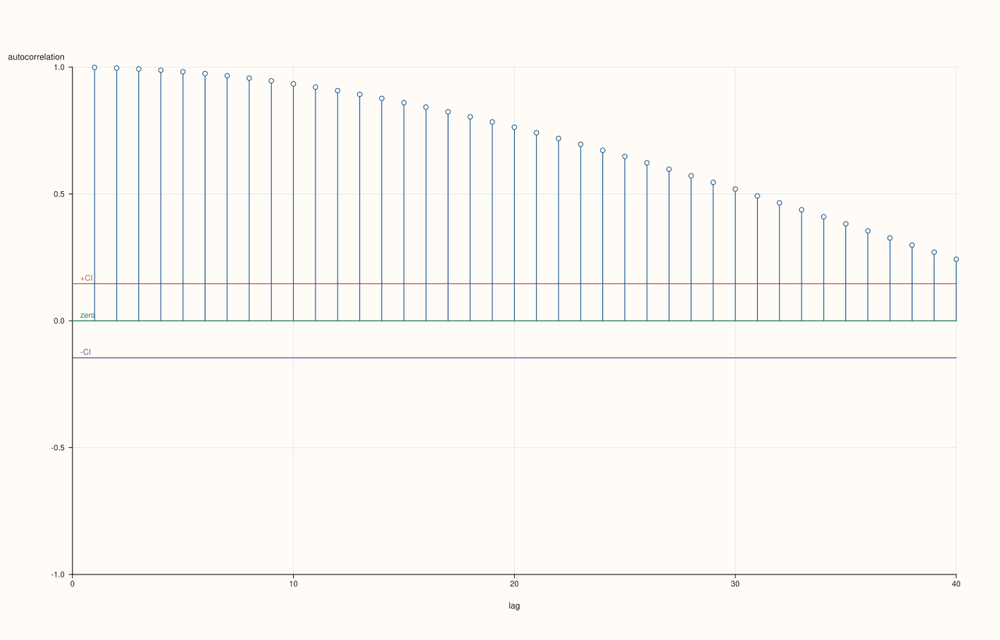
```

```{only} not html

```

`Source section`: `flash_api.md`

### `andrews_curves (overload 1)`

#### Signature

```cpp
Studio& andrews_curves(self: Studio, const std::vector<Series>& columns, const AndrewsCurvesOptions& options = {});
```

#### Notes

Maps each row to a smooth periodic curve for multivariate separation analysis.

#### Example

```{literalinclude} ../../examples/docs/snippets/keys/andrews_curves.cpp
:language: cpp
```

#### Output

```{only} html
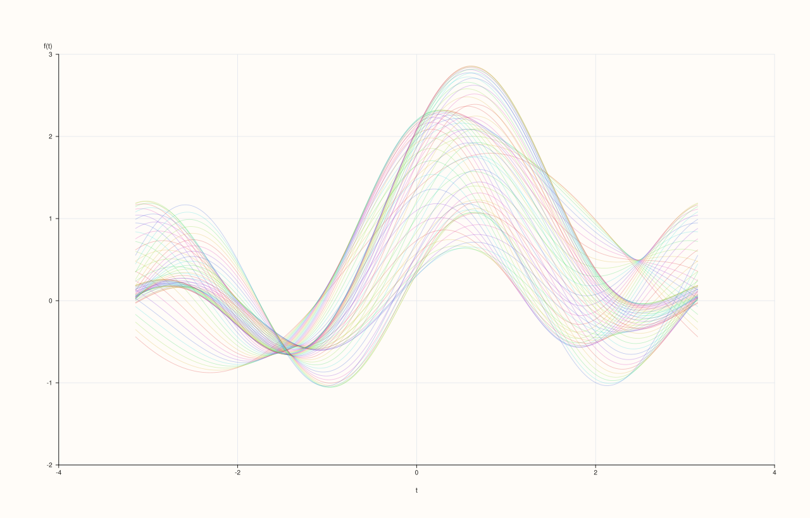
```

```{only} not html
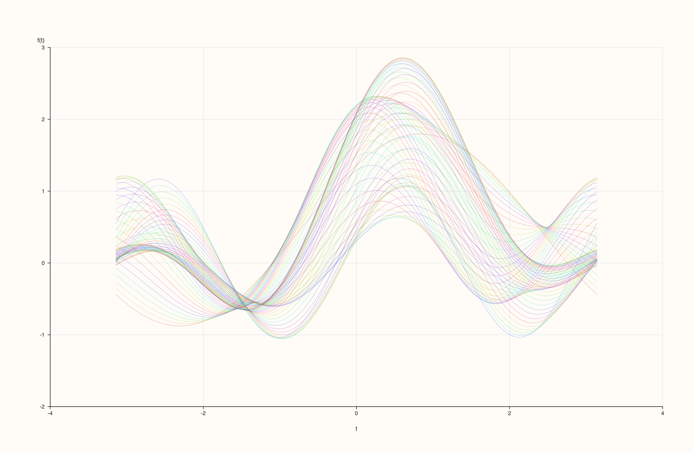
```

`Source section`: `flash_api.md`

### `andrews_curves (overload 2)`

#### Signature

```cpp
Studio& andrews_curves(self: Studio, const std::vector<Series>& columns, const Note& class_labels, const AndrewsCurvesOptions& options = {});
```

#### Notes

Maps each row to a smooth periodic curve for multivariate separation analysis.

#### Example

```{literalinclude} ../../examples/docs/snippets/keys/andrews_curves.cpp
:language: cpp
```

#### Output

```{only} html

```

```{only} not html

```

`Source section`: `flash_api.md`

### `andrews_curves (overload 3)`

#### Signature

```cpp
Studio& andrews_curves(self: Studio, const Dataset& data, const AndrewsCurvesOptions& options = {});
```

#### Notes

Maps each row to a smooth periodic curve for multivariate separation analysis.

#### Example

```{literalinclude} ../../examples/docs/snippets/keys/andrews_curves.cpp
:language: cpp
```

#### Output

```{only} html

```

```{only} not html

```

`Source section`: `flash_api.md`

### `andrews_curves (overload 4)`

#### Signature

```cpp
Studio& andrews_curves(self: Studio, const Series& matrix, const MatrixFrameOptions& frame_options, const AndrewsCurvesOptions& options = {});
```

#### Notes

Maps each row to a smooth periodic curve for multivariate separation analysis.

#### Example

```{literalinclude} ../../examples/docs/snippets/keys/andrews_curves.cpp
:language: cpp
```

#### Output

```{only} html

```

```{only} not html

```

`Source section`: `flash_api.md`

### `andrews_curves (overload 5)`

#### Signature

```cpp
Studio& andrews_curves(self: Studio, const Series& matrix, std::vector<std::string> feature_names, Axis feature_axis, const AndrewsCurvesOptions& options = {});
```

#### Notes

Maps each row to a smooth periodic curve for multivariate separation analysis.

#### Example

```{literalinclude} ../../examples/docs/snippets/keys/andrews_curves.cpp
:language: cpp
```

#### Output

```{only} html

```

```{only} not html

```

`Source section`: `flash_api.md`

### `andrews_curves (overload 6)`

#### Signature

```cpp
Studio& andrews_curves(self: Studio, const Series& matrix, const AndrewsCurvesOptions& options = {});
```

#### Notes

Maps each row to a smooth periodic curve for multivariate separation analysis.

#### Example

```{literalinclude} ../../examples/docs/snippets/keys/andrews_curves.cpp
:language: cpp
```

#### Output

```{only} html

```

```{only} not html

```

`Source section`: `flash_api.md`

### `areaplot (single form)`

#### Signature

```cpp
Trace& areaplot(self: Pane, SeriesLike x, SeriesLike y, double base = 0.0);
```

#### Notes

Fills the area between the signal and a baseline.

#### Example

```{literalinclude} ../../examples/docs/snippets/keys/areaplot.cpp
:language: cpp
```

#### Output

```{only} html
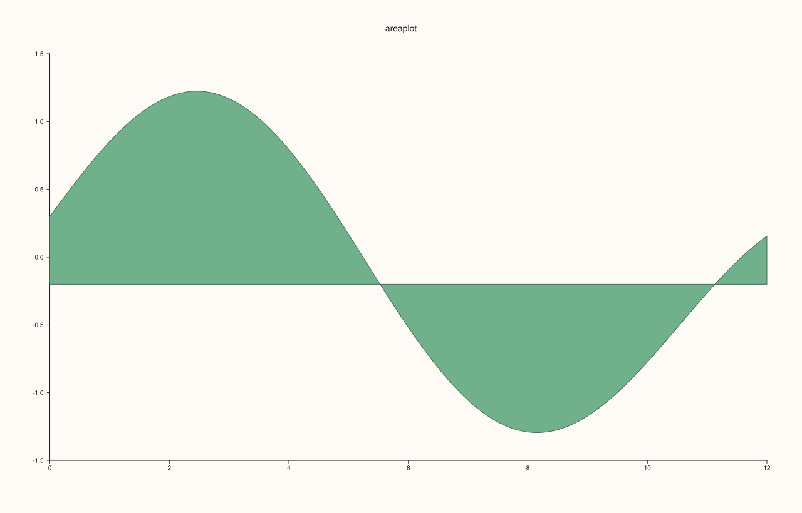
```

```{only} not html

```

`Source section`: `flash_api.md`

### `bar3d (single form)`

#### Signature

```cpp
Trace& bar3d(self: Pane, SeriesLike x, SeriesLike y, SeriesLike z);
```

#### Notes

3D bar-like rendering alias over `spire3`.

#### Example

```{literalinclude} ../../examples/docs/snippets/keys/bar3d.cpp
:language: cpp
```

#### Output

```{only} html

```

```{only} not html

```

`Source section`: `flash_api.md`

### `barplot (overload 1)`

#### Signature

```cpp
Trace& barplot(self: Pane, SeriesLike x, SeriesLike y, const BarPlotOptions& options = {});
```

#### Notes

Categorical or numeric bars, with optional horizontal orientation.

#### Example

```{literalinclude} ../../examples/docs/snippets/keys/barplot.cpp
:language: cpp
```

#### Output

```{only} html
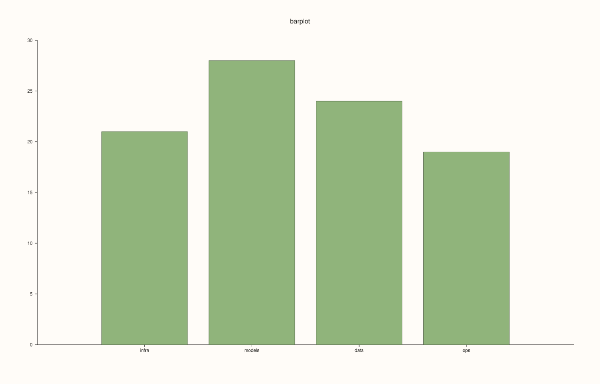
```

```{only} not html

```

`Source section`: `flash_api.md`

### `barplot (overload 2)`

#### Signature

```cpp
Trace& barplot(self: Pane, const Note& categories, const Series& values, const BarPlotOptions& options = {});
```

#### Notes

Categorical or numeric bars, with optional horizontal orientation.

#### Example

```{literalinclude} ../../examples/docs/snippets/keys/barplot.cpp
:language: cpp
```

#### Output

```{only} html

```

```{only} not html

```

`Source section`: `flash_api.md`

### `bootstrapplot (single form)`

#### Signature

```cpp
Studio& bootstrapplot(self: Studio, SeriesLike values, const BootstrapPlotOptions& options = {});
```

#### Notes

Resampling-based distribution of a summary statistic (mean/median/std).

#### Example

```{literalinclude} ../../examples/docs/snippets/keys/bootstrapplot.cpp
:language: cpp
```

#### Output

```{only} html
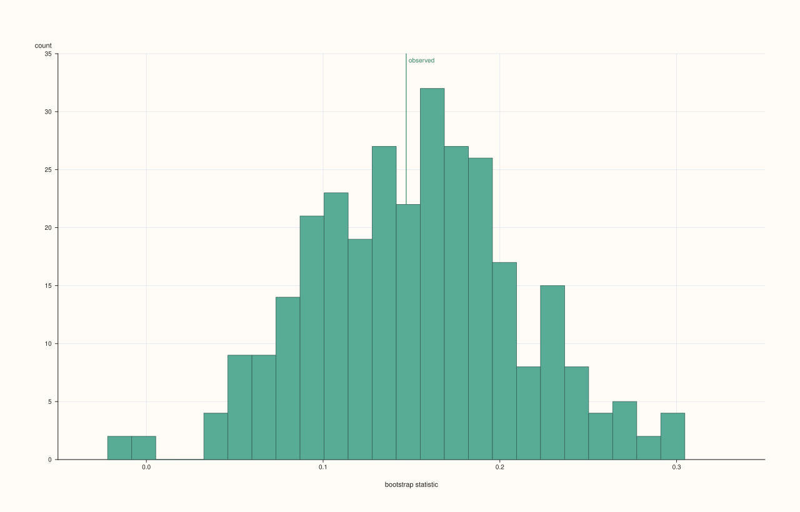
```

```{only} not html

```

`Source section`: `flash_api.md`

### `boxenplot (single form)`

#### Signature

```cpp
Trace& boxenplot(self: Pane, SeriesLike values);
```

#### Notes

Letter-value style alias currently routed through boxplot behavior.

#### Example

```{literalinclude} ../../examples/docs/snippets/keys/boxenplot.cpp
:language: cpp
```

#### Output

```{only} html
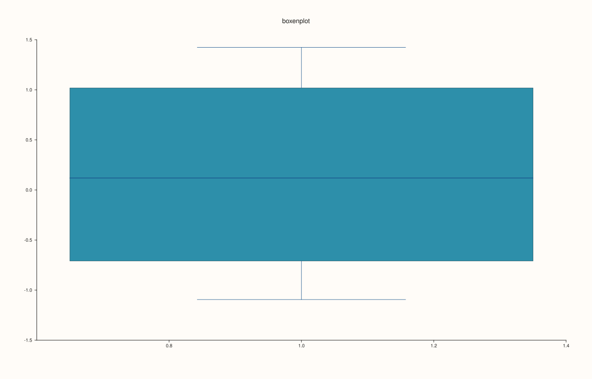
```

```{only} not html

```

`Source section`: `flash_api.md`

### `boxplot (overload 1)`

#### Signature

```cpp
Trace& boxplot(self: Pane, SeriesLike values);
```

#### Notes

Quartile/whisker summary for distribution comparison.

#### Example

```{literalinclude} ../../examples/docs/snippets/keys/boxplot.cpp
:language: cpp
```

#### Output

```{only} html
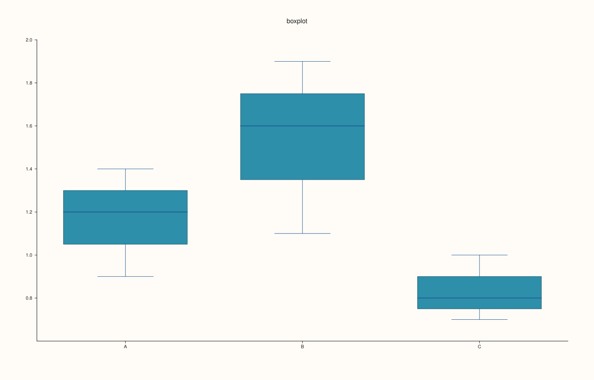
```

```{only} not html

```

`Source section`: `flash_api.md`

### `boxplot (overload 2)`

#### Signature

```cpp
Trace& boxplot(self: Pane, const Note& categories, const Series& values);
```

#### Notes

Quartile/whisker summary for distribution comparison.

#### Example

```{literalinclude} ../../examples/docs/snippets/keys/boxplot.cpp
:language: cpp
```

#### Output

```{only} html

```

```{only} not html

```

`Source section`: `flash_api.md`

### `boxplot (overload 3)`

#### Signature

```cpp
Trace& boxplot(self: Pane, SeriesLike group, SeriesLike values);
```

#### Notes

Quartile/whisker summary for distribution comparison.

#### Example

```{literalinclude} ../../examples/docs/snippets/keys/boxplot.cpp
:language: cpp
```

#### Output

```{only} html

```

```{only} not html

```

`Source section`: `flash_api.md`

### `catgridplot (overload 1)`

#### Signature

```cpp
Studio& catgridplot(self: Studio, const std::vector<Note>& groups, const std::vector<Series>& values, const CatGridPlotOptions& options = {});
```

#### Notes

Facet grid for repeated categorical comparisons across slices.

#### Example

```{literalinclude} ../../examples/docs/snippets/keys/catgridplot.cpp
:language: cpp
```

#### Output

```{only} html

```

```{only} not html
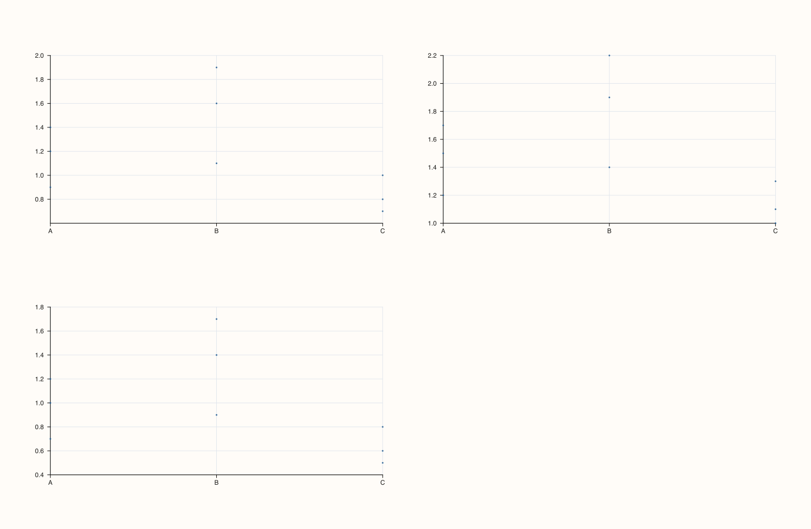
```

`Source section`: `flash_api.md`

### `catgridplot (overload 2)`

#### Signature

```cpp
Studio& catgridplot(self: Studio, const std::vector<Note>& groups, const std::vector<Series>& values, const std::vector<Note>& hues, const CatGridPlotOptions& options = {});
```

#### Notes

Facet grid for repeated categorical comparisons across slices.

#### Example

```{literalinclude} ../../examples/docs/snippets/keys/catgridplot.cpp
:language: cpp
```

#### Output

```{only} html

```

```{only} not html

```

`Source section`: `flash_api.md`

### `catplot (overload 1)`

#### Signature

```cpp
Trace& catplot(self: Pane, const Note& group, const Series& values, const CatPlotOptions& options = {});
```

#### Notes

Unified categorical interface (`strip`, `swarm`, `box`, `violin`, `bar`, `count`).

#### Example

```{literalinclude} ../../examples/docs/snippets/keys/catplot.cpp
:language: cpp
```

#### Output

```{only} html

```

```{only} not html

```

`Source section`: `flash_api.md`

### `catplot (overload 2)`

#### Signature

```cpp
Trace& catplot(self: Pane, const Note& group, const Series& values, const Note& hue, const CatPlotOptions& options = {});
```

#### Notes

Unified categorical interface (`strip`, `swarm`, `box`, `violin`, `bar`, `count`).

#### Example

```{literalinclude} ../../examples/docs/snippets/keys/catplot.cpp
:language: cpp
```

#### Output

```{only} html

```

```{only} not html

```

`Source section`: `flash_api.md`

### `catplot (overload 3)`

#### Signature

```cpp
Trace& catplot(self: Pane, const Note& group, const Series& values, std::string_view kind = "strip");
```

#### Notes

Unified categorical interface (`strip`, `swarm`, `box`, `violin`, `bar`, `count`).

#### Example

```{literalinclude} ../../examples/docs/snippets/keys/catplot.cpp
:language: cpp
```

#### Output

```{only} html

```

```{only} not html

```

`Source section`: `flash_api.md`

### `catplot (overload 4)`

#### Signature

```cpp
Trace& catplot(self: Pane, const Note& group, const Series& values, const Note& hue, std::string_view kind = "strip");
```

#### Notes

Unified categorical interface (`strip`, `swarm`, `box`, `violin`, `bar`, `count`).

#### Example

```{literalinclude} ../../examples/docs/snippets/keys/catplot.cpp
:language: cpp
```

#### Output

```{only} html

```

```{only} not html

```

`Source section`: `flash_api.md`

### `catplot (overload 5)`

#### Signature

```cpp
Trace& catplot(self: Pane, SeriesLike group, SeriesLike values, std::string_view kind = "strip");
```

#### Notes

Unified categorical interface (`strip`, `swarm`, `box`, `violin`, `bar`, `count`).

#### Example

```{literalinclude} ../../examples/docs/snippets/keys/catplot.cpp
:language: cpp
```

#### Output

```{only} html

```

```{only} not html

```

`Source section`: `flash_api.md`

### `ccfplot (single form)`

#### Signature

```cpp
Studio& ccfplot(self: Studio, SeriesLike x, SeriesLike y, const CcfPlotOptions& options = {});
```

#### Notes

Cross-correlation against positive/negative lags for two signals.

#### Example

```{literalinclude} ../../examples/docs/snippets/keys/ccfplot.cpp
:language: cpp
```

#### Output

```{only} html
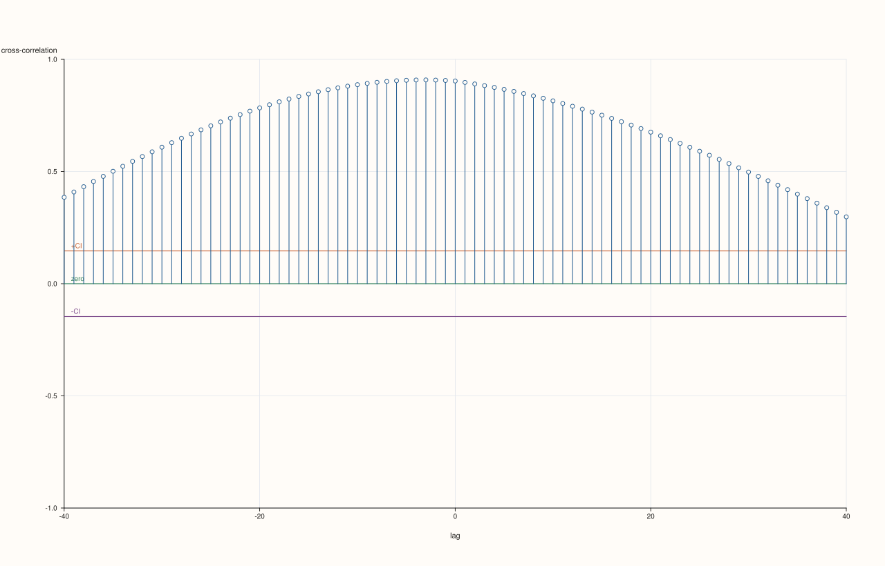
```

```{only} not html
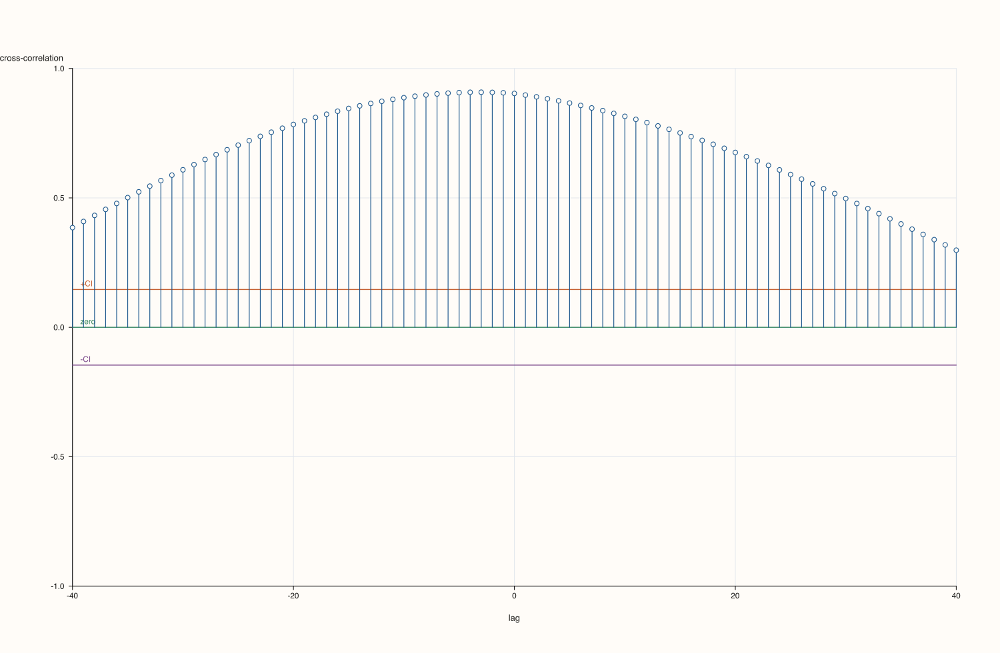
```

`Source section`: `flash_api.md`

### `cloud3 (overload 1)`

#### Signature

```cpp
Trace& cloud3(self: Pane, SeriesLike x, SeriesLike y, SeriesLike z);
```

#### Notes

3D scatter cloud with optional point-size and color channels.

#### Example

```{literalinclude} ../../examples/docs/snippets/keys/cloud3.cpp
:language: cpp
```

#### Output

```{only} html

```

```{only} not html
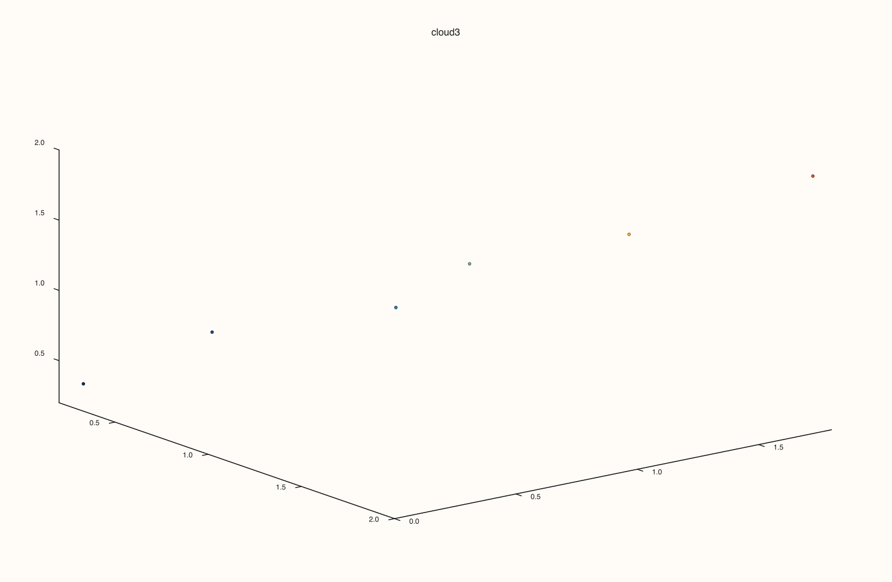
```

`Source section`: `flash_api.md`

### `cloud3 (overload 2)`

#### Signature

```cpp
Trace& cloud3(self: Pane, SeriesLike x, SeriesLike y, SeriesLike z, SeriesLike size);
```

#### Notes

3D scatter cloud with optional point-size and color channels.

#### Example

```{literalinclude} ../../examples/docs/snippets/keys/cloud3.cpp
:language: cpp
```

#### Output

```{only} html

```

```{only} not html

```

`Source section`: `flash_api.md`

### `cloud3 (overload 3)`

#### Signature

```cpp
Trace& cloud3(self: Pane, SeriesLike x, SeriesLike y, SeriesLike z, SeriesLike size, SeriesLike color);
```

#### Notes

3D scatter cloud with optional point-size and color channels.

#### Example

```{literalinclude} ../../examples/docs/snippets/keys/cloud3.cpp
:language: cpp
```

#### Output

```{only} html

```

```{only} not html

```

`Source section`: `flash_api.md`

### `cloud3 (overload 4)`

#### Signature

```cpp
Trace& cloud3(self: Studio, SeriesLike x, SeriesLike y, SeriesLike z, std::string title = {});
```

#### Notes

3D scatter cloud with optional point-size and color channels.

#### Example

```{literalinclude} ../../examples/docs/snippets/keys/cloud3.cpp
:language: cpp
```

#### Output

```{only} html

```

```{only} not html

```

`Source section`: `flash_api.md`

### `cloud4 (overload 1)`

#### Signature

```cpp
Trace& cloud4(self: Pane
```

#### Notes

Studio, x: SeriesLike, y: SeriesLike, z: SeriesLike, w: SeriesLike, options: HyperPlotOptions = {});

#### Example

```{literalinclude} ../../examples/docs/snippets/keys/cloud4.cpp
:language: cpp
```

#### Output

```{only} html
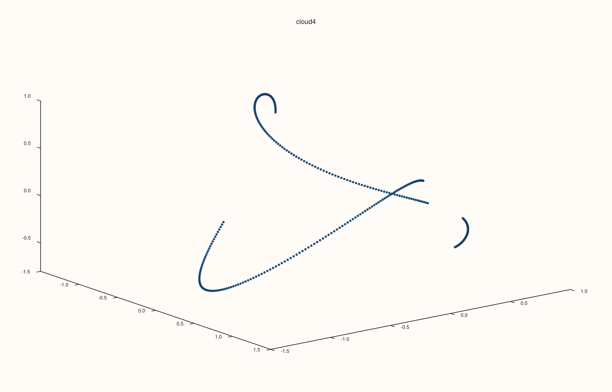
```

```{only} not html

```

`Source section`: `flash_api.md`

### `cloud4 (overload 2)`

#### Signature

```cpp
Trace& cloud4(self: Pane|Studio, x: SeriesLike, y: SeriesLike, z: SeriesLike, w: SeriesLike, options: HyperPlotOptions = {}, title: std::string = {});
```

#### Notes

Studio, x: SeriesLike, y: SeriesLike, z: SeriesLike, w: SeriesLike, options: HyperPlotOptions = {});

#### Example

```{literalinclude} ../../examples/docs/snippets/keys/cloud4.cpp
:language: cpp
```

#### Output

```{only} html

```

```{only} not html

```

`Source section`: `flash_api.md`

### `clustermap (overload 1)`

#### Signature

```cpp
Trace& clustermap(self: Pane, SeriesLike x, SeriesLike y, SeriesLike z);
```

#### Notes

Cluster-aware heatmap that reorders rows/columns by similarity.

#### Example

```{literalinclude} ../../examples/docs/snippets/keys/clustermap.cpp
:language: cpp
```

#### Output

```{only} html

```

```{only} not html
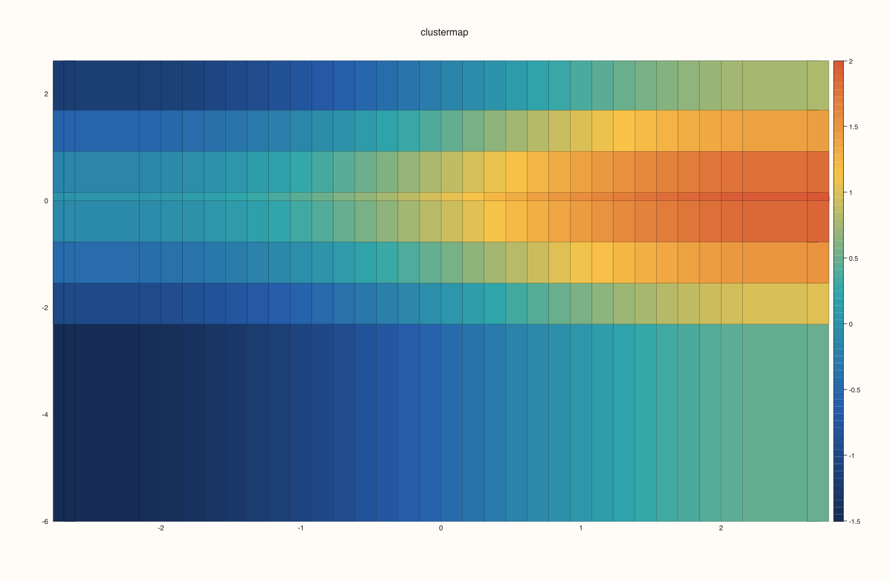
```

`Source section`: `flash_api.md`

### `clustermap (overload 2)`

#### Signature

```cpp
Trace& clustermap(self: Pane, SeriesLike x, SeriesLike y, SeriesLike z, const ClusterMapOptions& options);
```

#### Notes

Cluster-aware heatmap that reorders rows/columns by similarity.

#### Example

```{literalinclude} ../../examples/docs/snippets/keys/clustermap.cpp
:language: cpp
```

#### Output

```{only} html

```

```{only} not html

```

`Source section`: `flash_api.md`

### `contour3d (single form)`

#### Signature

```cpp
Trace& contour3D(self: Pane, SeriesLike x, SeriesLike y, SeriesLike z, int level_count = 8);
```

#### Notes

3D contour-like ridges (alias over `ridge3`).

#### Example

```{literalinclude} ../../examples/docs/snippets/keys/contour3D.cpp
:language: cpp
```

#### Output

```{only} html
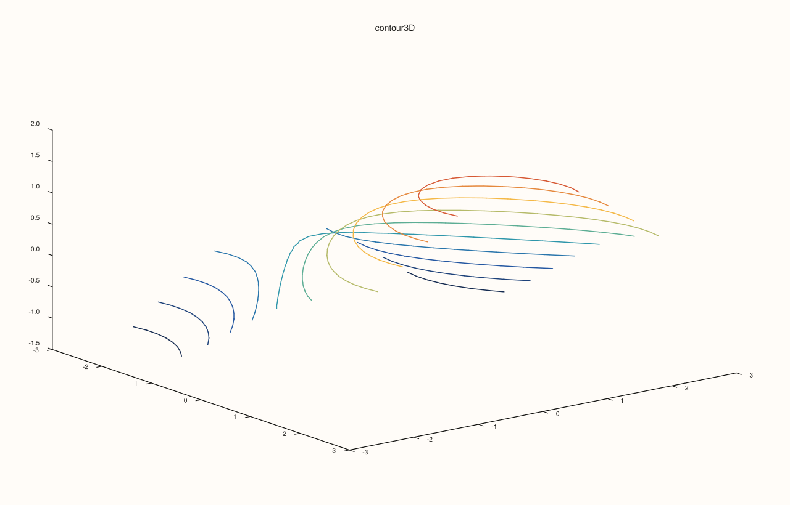
```

```{only} not html

```

`Source section`: `flash_api.md`

### `countplot (overload 1)`

#### Signature

```cpp
Trace& countplot(self: Pane, SeriesLike values, int bins = 12);
```

#### Notes

Frequency chart for numeric bins or category counts.

#### Example

```{literalinclude} ../../examples/docs/snippets/keys/countplot.cpp
:language: cpp
```

#### Output

```{only} html
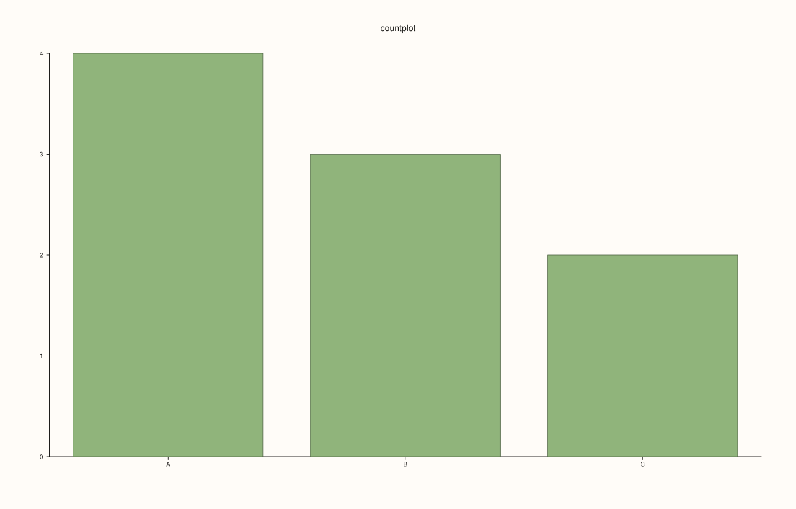
```

```{only} not html

```

`Source section`: `flash_api.md`

### `countplot (overload 2)`

#### Signature

```cpp
Trace& countplot(self: Pane, const Note& categories);
```

#### Notes

Frequency chart for numeric bins or category counts.

#### Example

```{literalinclude} ../../examples/docs/snippets/keys/countplot.cpp
:language: cpp
```

#### Output

```{only} html

```

```{only} not html

```

`Source section`: `flash_api.md`

### `disgridplot (overload 1)`

#### Signature

```cpp
Studio& disgridplot(self: Studio, const std::vector<Series>& values, const DisGridPlotOptions& options = {});
```

#### Notes

Facet grid for distribution views (`hist`, `density`, `ecdf`, `rug`).

#### Example

```{literalinclude} ../../examples/docs/snippets/keys/disgridplot.cpp
:language: cpp
```

#### Output

```{only} html
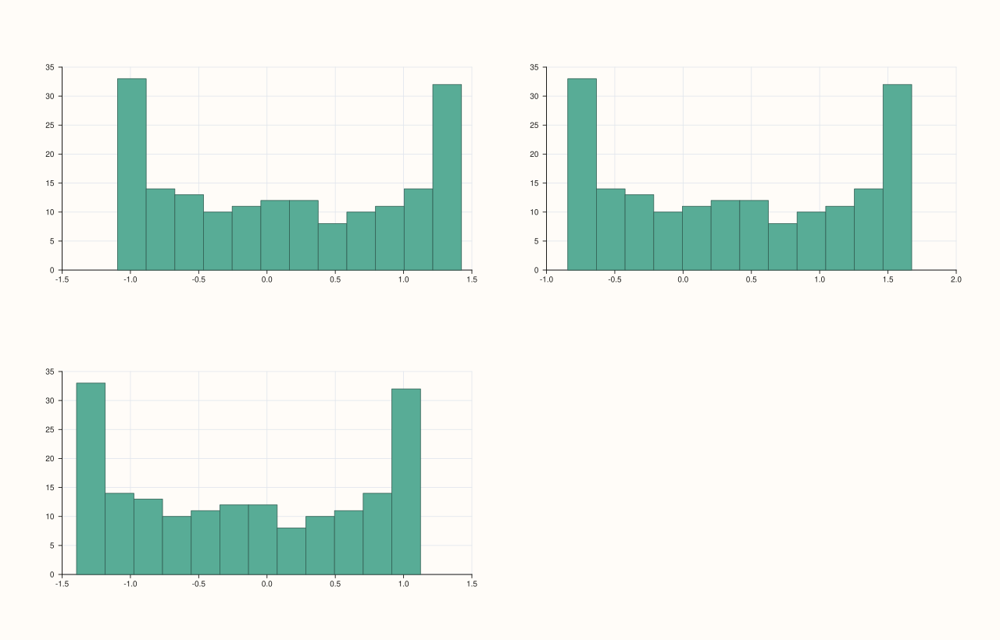
```

```{only} not html

```

`Source section`: `flash_api.md`

### `disgridplot (overload 2)`

#### Signature

```cpp
Studio& disgridplot(self: Studio, const std::vector<Series>& values, std::string_view kind);
```

#### Notes

Facet grid for distribution views (`hist`, `density`, `ecdf`, `rug`).

#### Example

```{literalinclude} ../../examples/docs/snippets/keys/disgridplot.cpp
:language: cpp
```

#### Output

```{only} html

```

```{only} not html

```

`Source section`: `flash_api.md`

### `displot (single form)`

#### Signature

```cpp
Trace& displot(self: Pane, SeriesLike values, int bins = 12);
```

#### Notes

Distribution shortcut alias for histogram.

#### Example

```{literalinclude} ../../examples/docs/snippets/keys/displot.cpp
:language: cpp
```

#### Output

```{only} html

```

```{only} not html
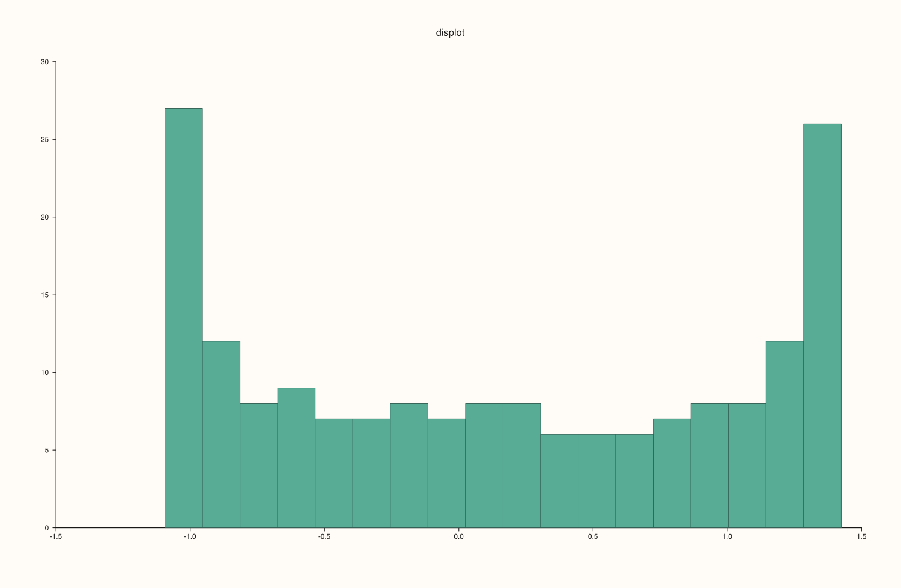
```

`Source section`: `flash_api.md`

### `ecdfplot (single form)`

#### Signature

```cpp
Trace& ecdfplot(self: Pane, SeriesLike values);
```

#### Notes

Empirical cumulative distribution function.

#### Example

```{literalinclude} ../../examples/docs/snippets/keys/ecdfplot.cpp
:language: cpp
```

#### Output

```{only} html

```

```{only} not html
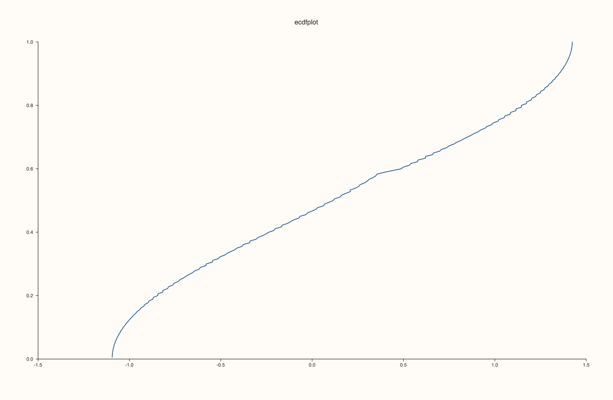
```

`Source section`: `flash_api.md`

### `heatmap (overload 1)`

#### Signature

```cpp
Trace& heatmap(self: Pane, SeriesLike x, SeriesLike y, SeriesLike z);
```

#### Notes

2D intensity map with masking/limits/scale-guide controls.

#### Example

```{literalinclude} ../../examples/docs/snippets/keys/heatmap.cpp
:language: cpp
```

#### Output

```{only} html
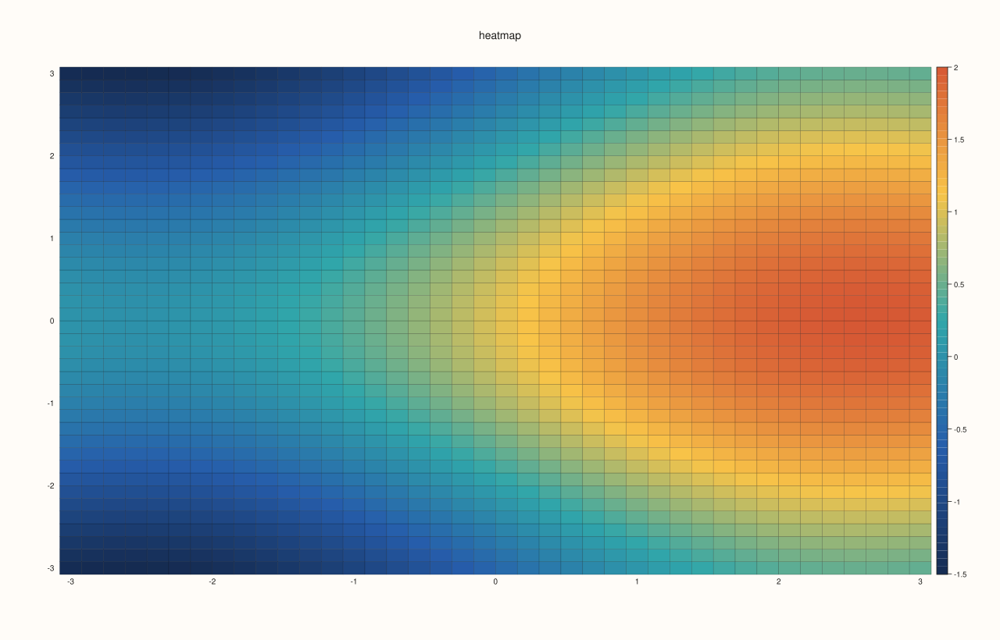
```

```{only} not html

```

`Source section`: `flash_api.md`

### `heatmap (overload 2)`

#### Signature

```cpp
Trace& heatmap(self: Pane, SeriesLike x, SeriesLike y, SeriesLike z, const HeatmapOptions& options);
```

#### Notes

2D intensity map with masking/limits/scale-guide controls.

#### Example

```{literalinclude} ../../examples/docs/snippets/keys/heatmap.cpp
:language: cpp
```

#### Output

```{only} html

```

```{only} not html

```

`Source section`: `flash_api.md`

### `heatmap (overload 3)`

#### Signature

```cpp
Trace& heatmap(self: Pane, SeriesLike x, SeriesLike y, SeriesLike z, SeriesLike c);
```

#### Notes

2D intensity map with masking/limits/scale-guide controls.

#### Example

```{literalinclude} ../../examples/docs/snippets/keys/heatmap.cpp
:language: cpp
```

#### Output

```{only} html

```

```{only} not html

```

`Source section`: `flash_api.md`

### `heatmap (overload 4)`

#### Signature

```cpp
Trace& heatmap(self: Pane, SeriesLike x, SeriesLike y, SeriesLike z, SeriesLike c, const HeatmapOptions& options);
```

#### Notes

2D intensity map with masking/limits/scale-guide controls.

#### Example

```{literalinclude} ../../examples/docs/snippets/keys/heatmap.cpp
:language: cpp
```

#### Output

```{only} html

```

```{only} not html

```

`Source section`: `flash_api.md`

### `hist3d (overload 1)`

#### Signature

```cpp
Trace& hist3d(self: Pane, SeriesLike x, SeriesLike y, const Hist3DOptions& options = {});
```

#### Notes

Studio, x: SeriesLike, y: SeriesLike, options: Hist3DOptions = {});

#### Example

```{literalinclude} ../../examples/docs/snippets/keys/hist3d.cpp
:language: cpp
```

#### Output

```{only} html
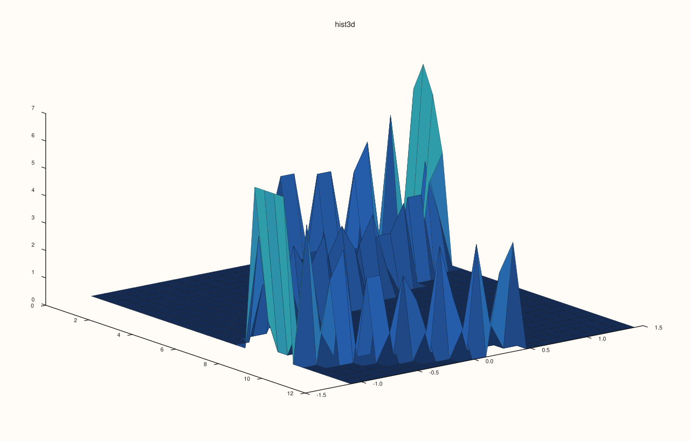
```

```{only} not html

```

`Source section`: `flash_api.md`

### `hist3d (overload 2)`

#### Signature

```cpp
Trace& hist3d(self: Studio, SeriesLike x, SeriesLike y, const Hist3DOptions& options = {}, std::string title = {});
```

#### Notes

Studio, x: SeriesLike, y: SeriesLike, options: Hist3DOptions = {});

#### Example

```{literalinclude} ../../examples/docs/snippets/keys/hist3d.cpp
:language: cpp
```

#### Output

```{only} html

```

```{only} not html

```

`Source section`: `flash_api.md`

### `histplot (single form)`

#### Signature

```cpp
Trace& histplot(self: Pane, SeriesLike values, int bins = 12);
```

#### Notes

Univariate histogram.

#### Example

```{literalinclude} ../../examples/docs/snippets/keys/histplot.cpp
:language: cpp
```

#### Output

```{only} html

```

```{only} not html
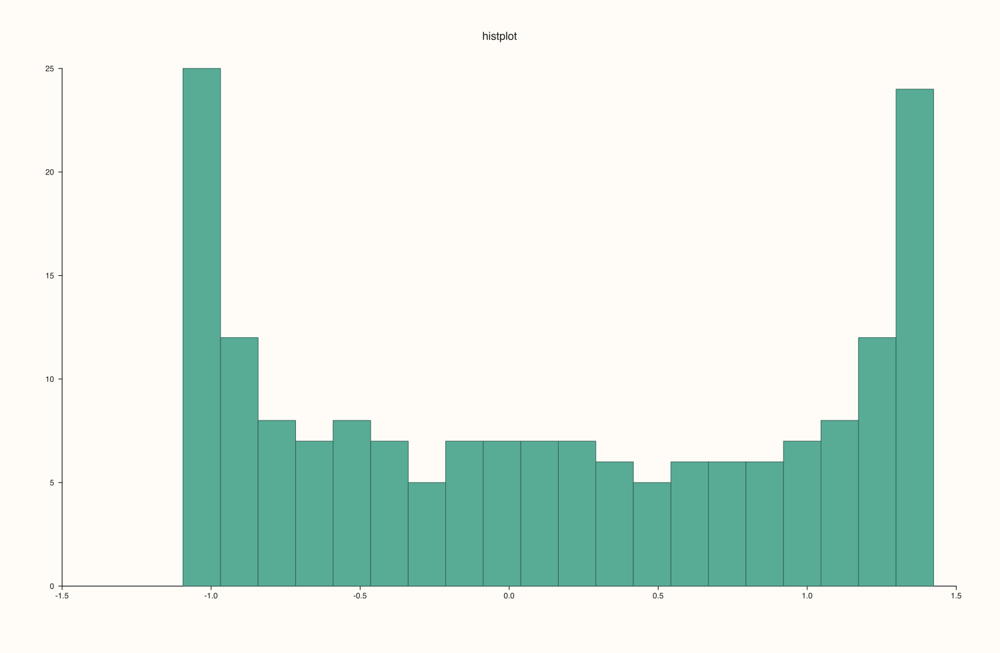
```

`Source section`: `flash_api.md`

### `isoshell (overload 1)`

#### Signature

```cpp
Trace& isoshell(self: Pane, SeriesLike values, int level_count = 4);
```

#### Notes

Isosurface-style shell extraction from volumetric grids.

#### Example

```{literalinclude} ../../examples/docs/snippets/keys/isoshell.cpp
:language: cpp
```

#### Output

```{only} html

```

```{only} not html
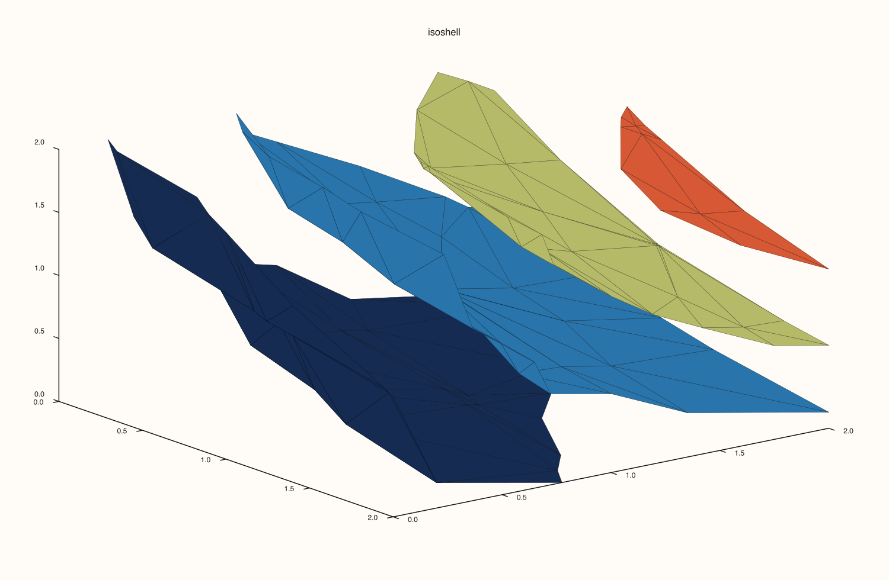
```

`Source section`: `flash_api.md`

### `isoshell (overload 2)`

#### Signature

```cpp
Trace& isoshell(self: Pane, SeriesLike x, SeriesLike y, SeriesLike z, SeriesLike values, int level_count = 4);
```

#### Notes

Isosurface-style shell extraction from volumetric grids.

#### Example

```{literalinclude} ../../examples/docs/snippets/keys/isoshell.cpp
:language: cpp
```

#### Output

```{only} html

```

```{only} not html

```

`Source section`: `flash_api.md`

### `isoshell (overload 3)`

#### Signature

```cpp
Trace& isoshell(self: Pane, SeriesLike x, SeriesLike y, SeriesLike z, SeriesLike values, SeriesLike levels);
```

#### Notes

Isosurface-style shell extraction from volumetric grids.

#### Example

```{literalinclude} ../../examples/docs/snippets/keys/isoshell.cpp
:language: cpp
```

#### Output

```{only} html

```

```{only} not html

```

`Source section`: `flash_api.md`

### `jointplot (overload 1)`

#### Signature

```cpp
Studio& jointplot(self: Studio, SeriesLike x, SeriesLike y, std::string_view kind = "scatter");
```

#### Notes

Joint + marginals composition for bivariate diagnostics.

#### Example

```{literalinclude} ../../examples/docs/snippets/keys/jointplot.cpp
:language: cpp
```

#### Output

```{only} html
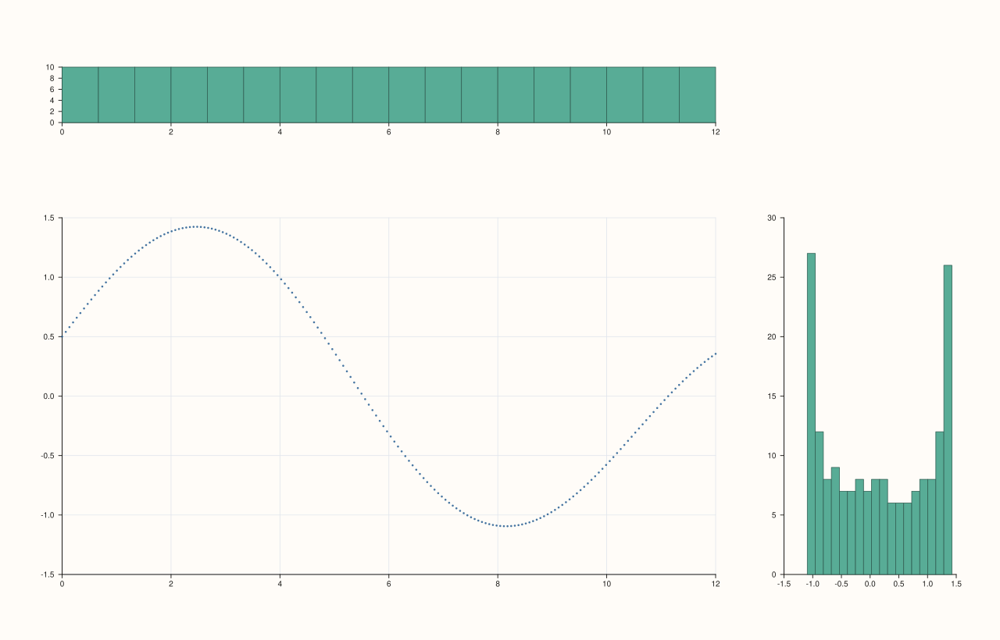
```

```{only} not html
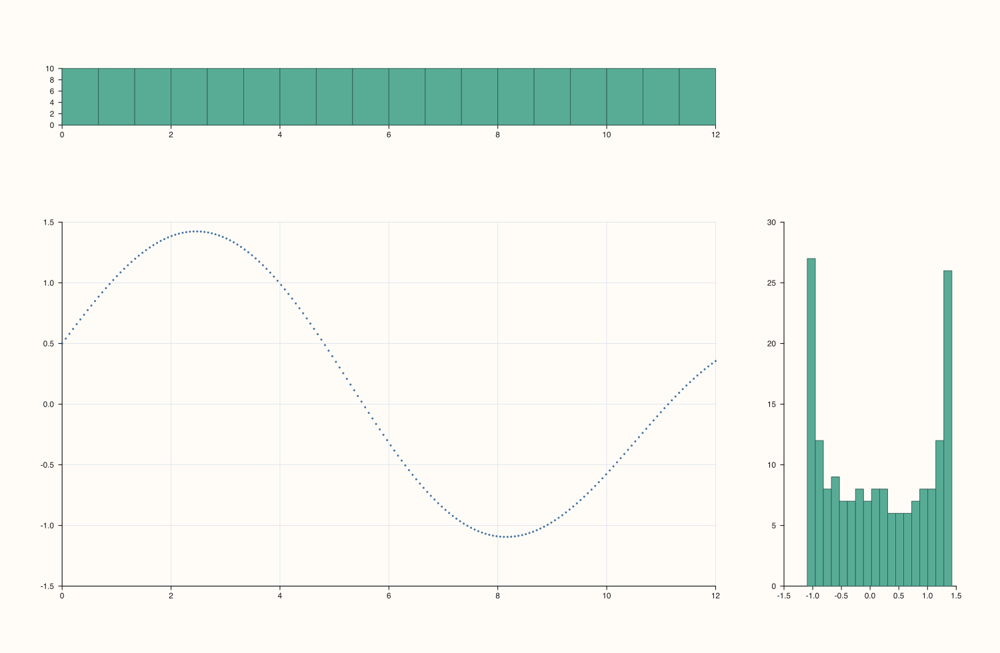
```

`Source section`: `flash_api.md`

### `jointplot (overload 2)`

#### Signature

```cpp
Studio& jointplot(self: Studio, SeriesLike x, SeriesLike y, const JointPlotOptions& options);
```

#### Notes

Joint + marginals composition for bivariate diagnostics.

#### Example

```{literalinclude} ../../examples/docs/snippets/keys/jointplot.cpp
:language: cpp
```

#### Output

```{only} html

```

```{only} not html

```

`Source section`: `flash_api.md`

### `jointplot (overload 3)`

#### Signature

```cpp
Studio& jointplot(self: Studio, const Dataset& data, std::string_view x_name, std::string_view y_name, std::string_view kind = "scatter");
```

#### Notes

Joint + marginals composition for bivariate diagnostics.

#### Example

```{literalinclude} ../../examples/docs/snippets/keys/jointplot.cpp
:language: cpp
```

#### Output

```{only} html

```

```{only} not html

```

`Source section`: `flash_api.md`

### `jointplot (overload 4)`

#### Signature

```cpp
Studio& jointplot(self: Studio, const Dataset& data, std::string_view x_name, std::string_view y_name, const JointPlotOptions& options);
```

#### Notes

Joint + marginals composition for bivariate diagnostics.

#### Example

```{literalinclude} ../../examples/docs/snippets/keys/jointplot.cpp
:language: cpp
```

#### Output

```{only} html

```

```{only} not html

```

`Source section`: `flash_api.md`

### `jointplot (overload 5)`

#### Signature

```cpp
Studio& jointplot(self: Studio, const Series& matrix, std::string_view x_name, std::string_view y_name, const MatrixFrameOptions& frame_options, std::string_view kind = "scatter");
```

#### Notes

Joint + marginals composition for bivariate diagnostics.

#### Example

```{literalinclude} ../../examples/docs/snippets/keys/jointplot.cpp
:language: cpp
```

#### Output

```{only} html

```

```{only} not html

```

`Source section`: `flash_api.md`

### `jointplot (overload 6)`

#### Signature

```cpp
Studio& jointplot(self: Studio, const Series& matrix, std::string_view x_name, std::string_view y_name, const MatrixFrameOptions& frame_options, const JointPlotOptions& options);
```

#### Notes

Joint + marginals composition for bivariate diagnostics.

#### Example

```{literalinclude} ../../examples/docs/snippets/keys/jointplot.cpp
:language: cpp
```

#### Output

```{only} html

```

```{only} not html

```

`Source section`: `flash_api.md`

### `jointplot (overload 7)`

#### Signature

```cpp
Studio& jointplot(self: Studio, const Series& matrix, std::string_view x_name, std::string_view y_name, std::vector<std::string> feature_names, Axis feature_axis, std::string_view kind = "scatter");
```

#### Notes

Joint + marginals composition for bivariate diagnostics.

#### Example

```{literalinclude} ../../examples/docs/snippets/keys/jointplot.cpp
:language: cpp
```

#### Output

```{only} html

```

```{only} not html

```

`Source section`: `flash_api.md`

### `jointplot (overload 8)`

#### Signature

```cpp
Studio& jointplot(self: Studio, const Series& matrix, std::string_view x_name, std::string_view y_name, std::vector<std::string> feature_names, Axis feature_axis, const JointPlotOptions& options);
```

#### Notes

Joint + marginals composition for bivariate diagnostics.

#### Example

```{literalinclude} ../../examples/docs/snippets/keys/jointplot.cpp
:language: cpp
```

#### Output

```{only} html

```

```{only} not html

```

`Source section`: `flash_api.md`

### `jointplot (overload 9)`

#### Signature

```cpp
Studio& jointplot(self: Studio, const Series& matrix, std::string_view x_name, std::string_view y_name, std::string_view kind = "scatter");
```

#### Notes

Joint + marginals composition for bivariate diagnostics.

#### Example

```{literalinclude} ../../examples/docs/snippets/keys/jointplot.cpp
:language: cpp
```

#### Output

```{only} html

```

```{only} not html

```

`Source section`: `flash_api.md`

### `jointplot (overload 10)`

#### Signature

```cpp
Studio& jointplot(self: Studio, const Series& matrix, std::string_view x_name, std::string_view y_name, const JointPlotOptions& options);
```

#### Notes

Joint + marginals composition for bivariate diagnostics.

#### Example

```{literalinclude} ../../examples/docs/snippets/keys/jointplot.cpp
:language: cpp
```

#### Output

```{only} html

```

```{only} not html

```

`Source section`: `flash_api.md`

### `jointplot (overload 11)`

#### Signature

```cpp
Studio& jointplot(self: Studio, const Series& matrix, const MatrixJointOptions& matrix_options, std::string_view kind = "scatter");
```

#### Notes

Joint + marginals composition for bivariate diagnostics.

#### Example

```{literalinclude} ../../examples/docs/snippets/keys/jointplot.cpp
:language: cpp
```

#### Output

```{only} html

```

```{only} not html

```

`Source section`: `flash_api.md`

### `jointplot (overload 12)`

#### Signature

```cpp
Studio& jointplot(self: Studio, const Series& matrix, const MatrixJointOptions& matrix_options, const JointPlotOptions& options);
```

#### Notes

Joint + marginals composition for bivariate diagnostics.

#### Example

```{literalinclude} ../../examples/docs/snippets/keys/jointplot.cpp
:language: cpp
```

#### Output

```{only} html

```

```{only} not html

```

`Source section`: `flash_api.md`

### `kdeplot (overload 1)`

#### Signature

```cpp
Trace& kdeplot(self: Pane, SeriesLike x, SeriesLike density);
```

#### Notes

Kernel density estimate rendered as a smooth curve.

#### Example

```{literalinclude} ../../examples/docs/snippets/keys/kdeplot.cpp
:language: cpp
```

#### Output

```{only} html

```

```{only} not html
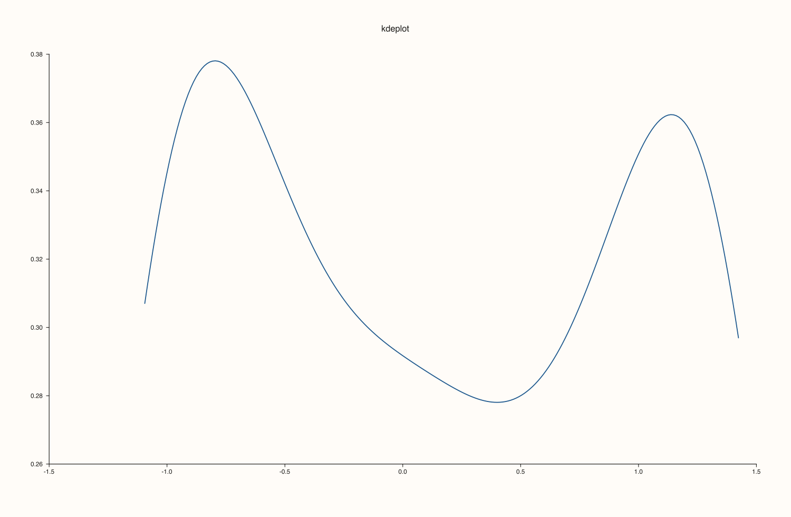
```

`Source section`: `flash_api.md`

### `kdeplot (overload 2)`

#### Signature

```cpp
Trace& kdeplot(self: Pane, SeriesLike values, std::int64_t points = 128);
```

#### Notes

Kernel density estimate rendered as a smooth curve.

#### Example

```{literalinclude} ../../examples/docs/snippets/keys/kdeplot.cpp
:language: cpp
```

#### Output

```{only} html

```

```{only} not html

```

`Source section`: `flash_api.md`

### `lagplot (single form)`

#### Signature

```cpp
Studio& lagplot(self: Studio, SeriesLike values, const LagPlotOptions& options = {});
```

#### Notes

Scatter of `x_t` vs `x_{t-lag}` for serial dependence.

#### Example

```{literalinclude} ../../examples/docs/snippets/keys/lagplot.cpp
:language: cpp
```

#### Output

```{only} html
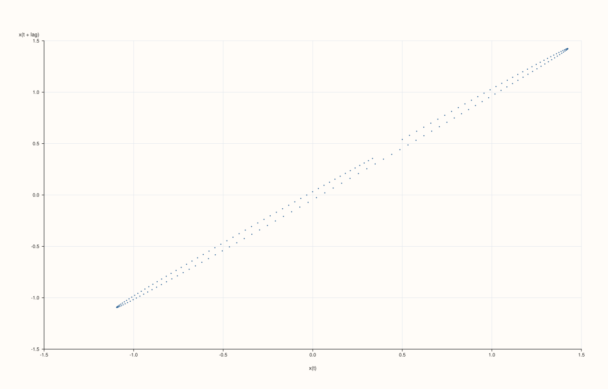
```

```{only} not html
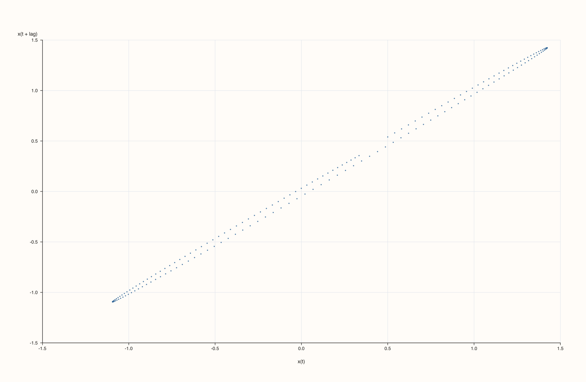
```

`Source section`: `flash_api.md`

### `lattice (overload 1)`

#### Signature

```cpp
Trace& lattice(self: Pane, SeriesLike x, SeriesLike y, SeriesLike z);
```

#### Notes

Studio, x: SeriesLike, y: SeriesLike, z: SeriesLike[, color]);

#### Example

```{literalinclude} ../../examples/docs/snippets/keys/lattice.cpp
:language: cpp
```

#### Output

```{only} html
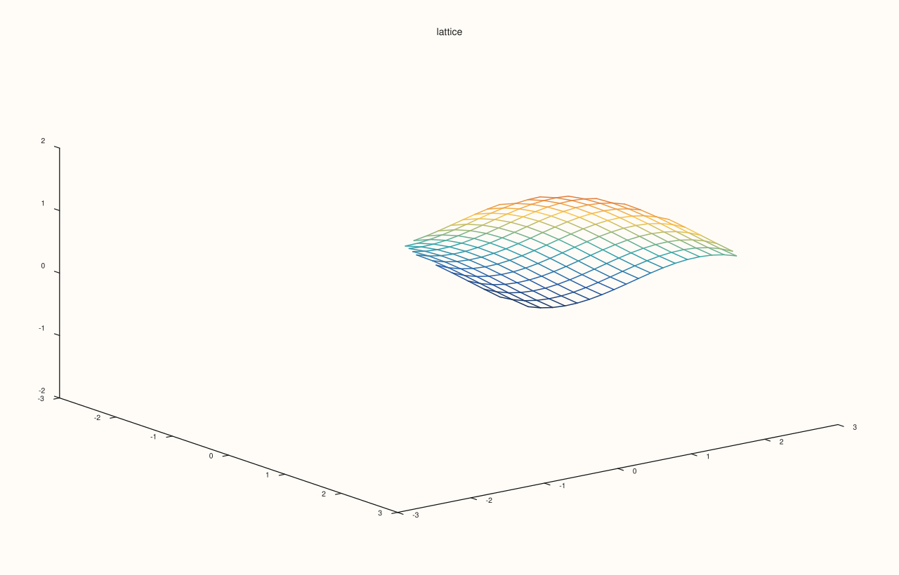
```

```{only} not html
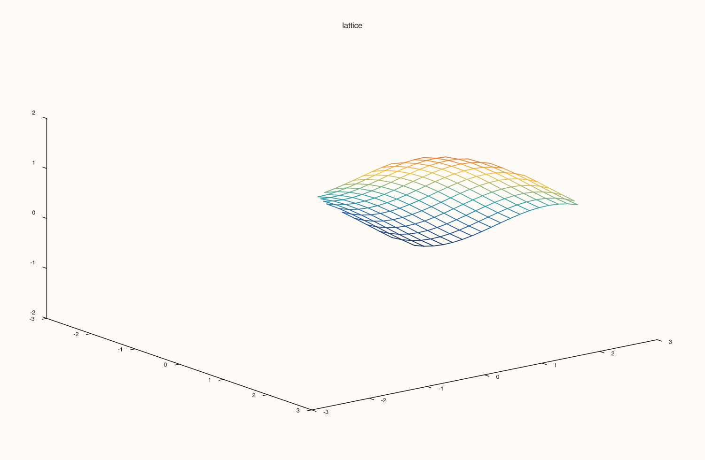
```

`Source section`: `flash_api.md`

### `lattice (overload 2)`

#### Signature

```cpp
Trace& lattice(self: Pane, SeriesLike x, SeriesLike y, SeriesLike z, SeriesLike c);
```

#### Notes

Studio, x: SeriesLike, y: SeriesLike, z: SeriesLike[, color]);

#### Example

```{literalinclude} ../../examples/docs/snippets/keys/lattice.cpp
:language: cpp
```

#### Output

```{only} html

```

```{only} not html

```

`Source section`: `flash_api.md`

### `lattice (overload 3)`

#### Signature

```cpp
Trace& lattice(self: Studio, SeriesLike x, SeriesLike y, SeriesLike z, std::string title = {});
```

#### Notes

Studio, x: SeriesLike, y: SeriesLike, z: SeriesLike[, color]);

#### Example

```{literalinclude} ../../examples/docs/snippets/keys/lattice.cpp
:language: cpp
```

#### Output

```{only} html

```

```{only} not html

```

`Source section`: `flash_api.md`

### `lineplot (overload 1)`

#### Signature

```cpp
Trace& lineplot(self: Pane, SeriesLike x, SeriesLike y);
```

#### Notes

Line chart with optional grouped hue handling.

#### Example

```{literalinclude} ../../examples/docs/snippets/keys/lineplot.cpp
:language: cpp
```

#### Output

```{only} html

```

```{only} not html
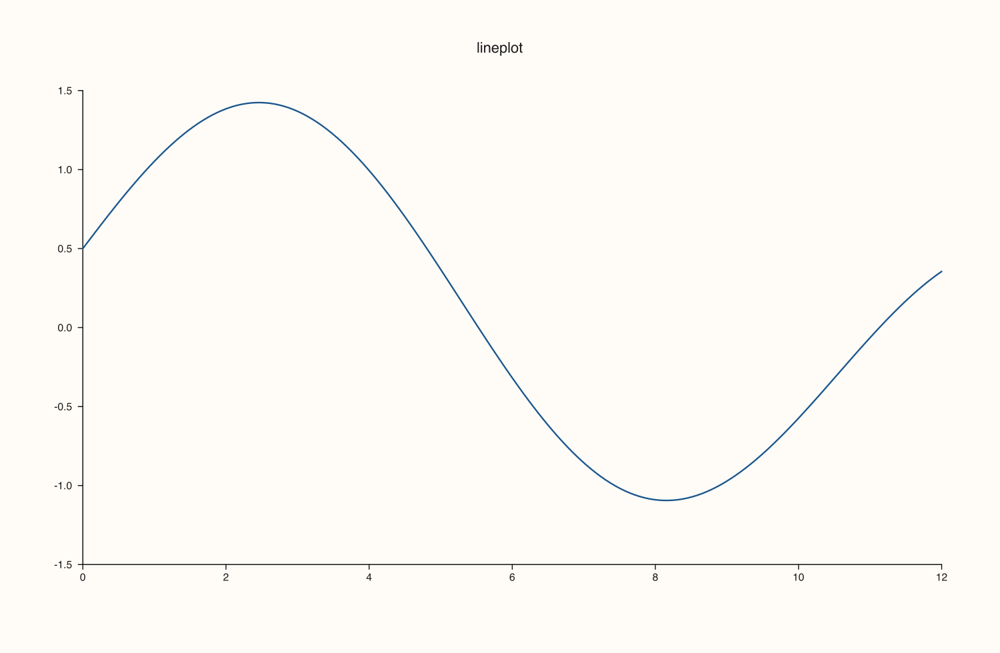
```

`Source section`: `flash_api.md`

### `lineplot (overload 2)`

#### Signature

```cpp
Trace& lineplot(self: Pane, SeriesLike x, SeriesLike y, const Note& hue);
```

#### Notes

Line chart with optional grouped hue handling.

#### Example

```{literalinclude} ../../examples/docs/snippets/keys/lineplot.cpp
:language: cpp
```

#### Output

```{only} html

```

```{only} not html

```

`Source section`: `flash_api.md`

### `lineplot (overload 3)`

#### Signature

```cpp
Trace& lineplot(self: Pane, SeriesLike x, SeriesLike y, SeriesLike hue);
```

#### Notes

Line chart with optional grouped hue handling.

#### Example

```{literalinclude} ../../examples/docs/snippets/keys/lineplot.cpp
:language: cpp
```

#### Output

```{only} html

```

```{only} not html

```

`Source section`: `flash_api.md`

### `lmplot (overload 1)`

#### Signature

```cpp
Trace& lmplot(self: Studio, SeriesLike x, SeriesLike y, std::string title = {});
```

#### Notes

Regression convenience wrapper that allocates its own pane.

#### Example

```{literalinclude} ../../examples/docs/snippets/keys/lmplot.cpp
:language: cpp
```

#### Output

```{only} html

```

```{only} not html

```

`Source section`: `flash_api.md`

### `lmplot (overload 2)`

#### Signature

```cpp
Trace& lmplot(self: Studio, SeriesLike x, SeriesLike y, const RegPlotOptions& options, std::string title = {});
```

#### Notes

Regression convenience wrapper that allocates its own pane.

#### Example

```{literalinclude} ../../examples/docs/snippets/keys/lmplot.cpp
:language: cpp
```

#### Output

```{only} html

```

```{only} not html

```

`Source section`: `flash_api.md`

### `pacfplot (single form)`

#### Signature

```cpp
Studio& pacfplot(self: Studio, SeriesLike values, const PacfPlotOptions& options = {});
```

#### Notes

Partial autocorrelation for AR order identification.

#### Example

```{literalinclude} ../../examples/docs/snippets/keys/pacfplot.cpp
:language: cpp
```

#### Output

```{only} html
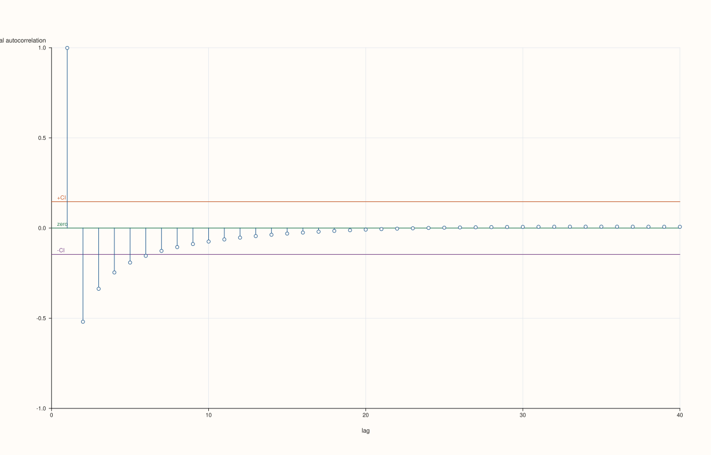
```

```{only} not html
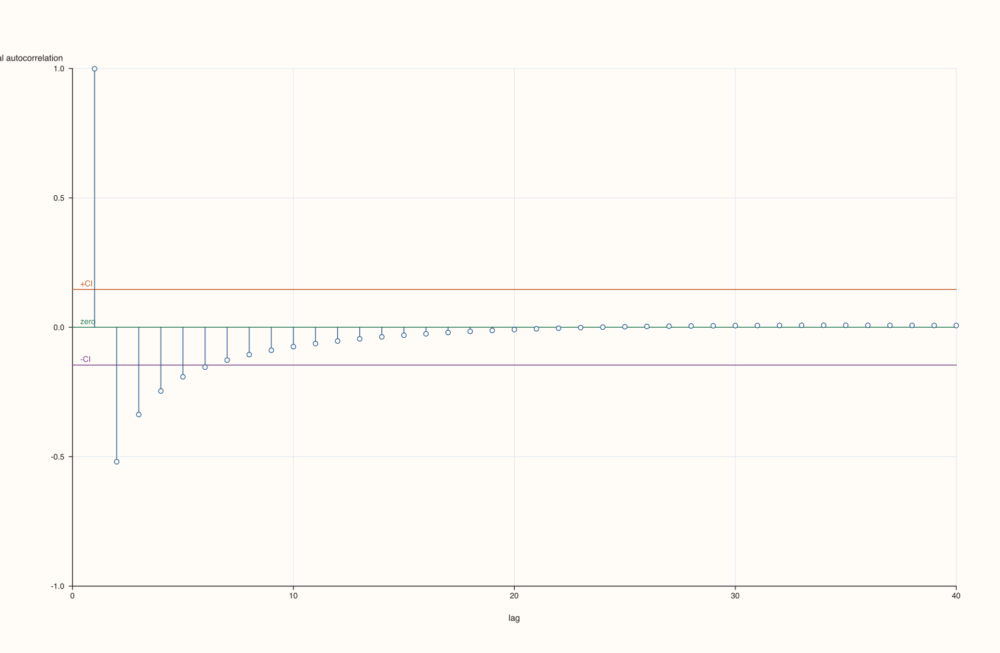
```

`Source section`: `flash_api.md`

### `pairplot (overload 1)`

#### Signature

```cpp
Studio& pairplot(self: Studio, const std::vector<Series>& columns, const PairPlotOptions& options = {});
```

#### Notes

Pairwise matrix of feature relationships.

#### Example

```{literalinclude} ../../examples/docs/snippets/keys/pairplot.cpp
:language: cpp
```

#### Output

```{only} html

```

```{only} not html
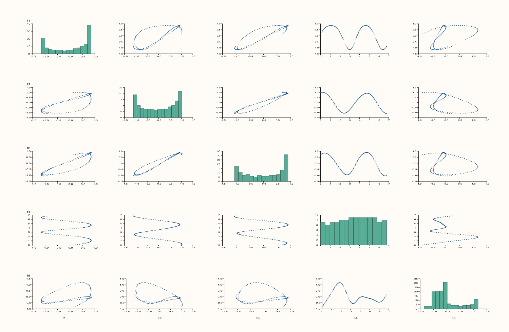
```

`Source section`: `flash_api.md`

### `pairplot (overload 2)`

#### Signature

```cpp
Studio& pairplot(self: Studio, const Dataset& data, const PairPlotOptions& options = {});
```

#### Notes

Pairwise matrix of feature relationships.

#### Example

```{literalinclude} ../../examples/docs/snippets/keys/pairplot.cpp
:language: cpp
```

#### Output

```{only} html

```

```{only} not html

```

`Source section`: `flash_api.md`

### `pairplot (overload 3)`

#### Signature

```cpp
Studio& pairplot(self: Studio, const Series& matrix, const MatrixFrameOptions& frame_options, const PairPlotOptions& options = {});
```

#### Notes

Pairwise matrix of feature relationships.

#### Example

```{literalinclude} ../../examples/docs/snippets/keys/pairplot.cpp
:language: cpp
```

#### Output

```{only} html

```

```{only} not html

```

`Source section`: `flash_api.md`

### `pairplot (overload 4)`

#### Signature

```cpp
Studio& pairplot(self: Studio, const Series& matrix, std::vector<std::string> feature_names, Axis feature_axis, const PairPlotOptions& options = {});
```

#### Notes

Pairwise matrix of feature relationships.

#### Example

```{literalinclude} ../../examples/docs/snippets/keys/pairplot.cpp
:language: cpp
```

#### Output

```{only} html

```

```{only} not html

```

`Source section`: `flash_api.md`

### `pairplot (overload 5)`

#### Signature

```cpp
Studio& pairplot(self: Studio, const Series& matrix, const PairPlotOptions& options = {});
```

#### Notes

Pairwise matrix of feature relationships.

#### Example

```{literalinclude} ../../examples/docs/snippets/keys/pairplot.cpp
:language: cpp
```

#### Output

```{only} html

```

```{only} not html

```

`Source section`: `flash_api.md`

### `parallelplot (overload 1)`

#### Signature

```cpp
Studio& parallelplot(self: Studio, const std::vector<Series>& columns, const ParallelCoordinatesOptions& options = {});
```

#### Notes

Parallel coordinates for high-dimensional row comparisons.

#### Example

```{literalinclude} ../../examples/docs/snippets/keys/parallelplot.cpp
:language: cpp
```

#### Output

```{only} html
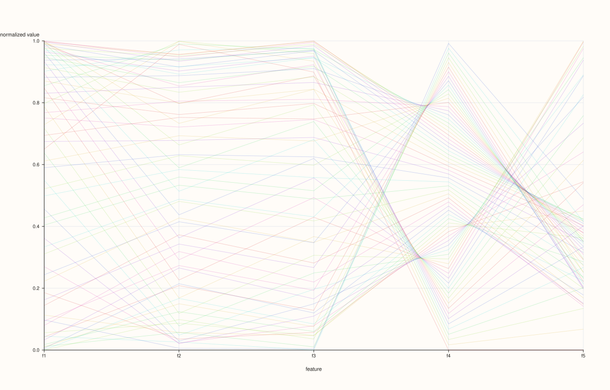
```

```{only} not html
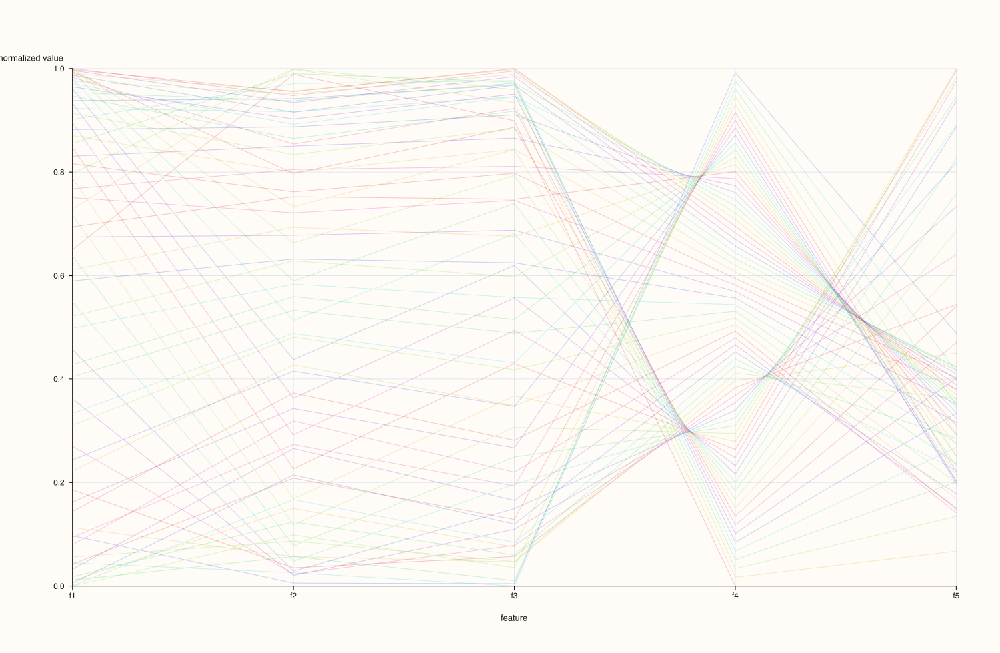
```

`Source section`: `flash_api.md`

### `parallelplot (overload 2)`

#### Signature

```cpp
Studio& parallelplot(self: Studio, const std::vector<Series>& columns, const Note& class_labels, const ParallelCoordinatesOptions& options = {});
```

#### Notes

Parallel coordinates for high-dimensional row comparisons.

#### Example

```{literalinclude} ../../examples/docs/snippets/keys/parallelplot.cpp
:language: cpp
```

#### Output

```{only} html

```

```{only} not html

```

`Source section`: `flash_api.md`

### `parallelplot (overload 3)`

#### Signature

```cpp
Studio& parallelplot(self: Studio, const Dataset& data, const ParallelCoordinatesOptions& options = {});
```

#### Notes

Parallel coordinates for high-dimensional row comparisons.

#### Example

```{literalinclude} ../../examples/docs/snippets/keys/parallelplot.cpp
:language: cpp
```

#### Output

```{only} html

```

```{only} not html

```

`Source section`: `flash_api.md`

### `parallelplot (overload 4)`

#### Signature

```cpp
Studio& parallelplot(self: Studio, const Series& matrix, const MatrixFrameOptions& frame_options, const ParallelCoordinatesOptions& options = {});
```

#### Notes

Parallel coordinates for high-dimensional row comparisons.

#### Example

```{literalinclude} ../../examples/docs/snippets/keys/parallelplot.cpp
:language: cpp
```

#### Output

```{only} html

```

```{only} not html

```

`Source section`: `flash_api.md`

### `parallelplot (overload 5)`

#### Signature

```cpp
Studio& parallelplot(self: Studio, const Series& matrix, std::vector<std::string> feature_names, Axis feature_axis, const ParallelCoordinatesOptions& options = {});
```

#### Notes

Parallel coordinates for high-dimensional row comparisons.

#### Example

```{literalinclude} ../../examples/docs/snippets/keys/parallelplot.cpp
:language: cpp
```

#### Output

```{only} html

```

```{only} not html

```

`Source section`: `flash_api.md`

### `parallelplot (overload 6)`

#### Signature

```cpp
Studio& parallelplot(self: Studio, const Series& matrix, const ParallelCoordinatesOptions& options = {});
```

#### Notes

Parallel coordinates for high-dimensional row comparisons.

#### Example

```{literalinclude} ../../examples/docs/snippets/keys/parallelplot.cpp
:language: cpp
```

#### Output

```{only} html

```

```{only} not html

```

`Source section`: `flash_api.md`

### `path3 (overload 1)`

#### Signature

```cpp
Trace& path3(self: Pane, SeriesLike x, SeriesLike y, SeriesLike z);
```

#### Notes

Studio, x: SeriesLike, y: SeriesLike, z: SeriesLike);

#### Example

```{literalinclude} ../../examples/docs/snippets/keys/path3.cpp
:language: cpp
```

#### Output

```{only} html

```

```{only} not html

```

`Source section`: `flash_api.md`

### `path3 (overload 2)`

#### Signature

```cpp
Trace& path3(self: Studio, SeriesLike x, SeriesLike y, SeriesLike z, std::string title = {});
```

#### Notes

Connected 3D trajectory through ordered samples.

#### Example

```{literalinclude} ../../examples/docs/snippets/keys/path3.cpp
:language: cpp
```

#### Output

```{only} html

```

```{only} not html

```

`Source section`: `flash_scene_animation_api.md`

### `path4 (overload 1)`

#### Signature

```cpp
Trace& path4(self: Pane
```

#### Notes

Studio, x: SeriesLike, y: SeriesLike, z: SeriesLike, w: SeriesLike, options: HyperPlotOptions = {});

#### Example

```{literalinclude} ../../examples/docs/snippets/keys/path4.cpp
:language: cpp
```

#### Output

```{only} html
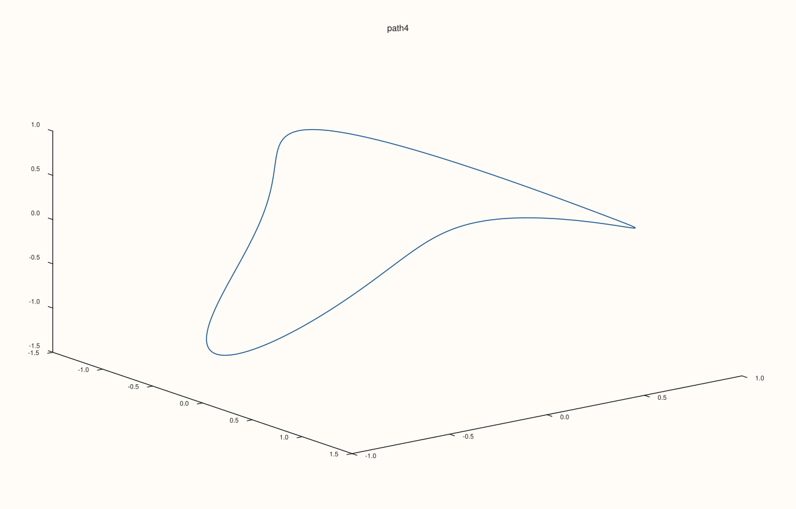
```

```{only} not html
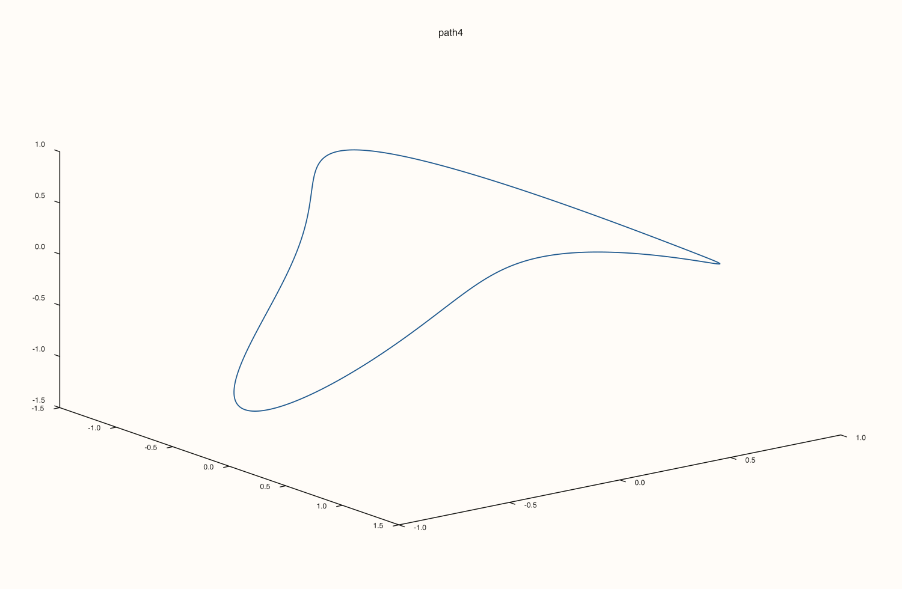
```

`Source section`: `flash_api.md`

### `path4 (overload 2)`

#### Signature

```cpp
Trace& path4(self: Pane|Studio, x: SeriesLike, y: SeriesLike, z: SeriesLike, w: SeriesLike, options: HyperPlotOptions = {}, title: std::string = {});
```

#### Notes

Studio, x: SeriesLike, y: SeriesLike, z: SeriesLike, w: SeriesLike, options: HyperPlotOptions = {});

#### Example

```{literalinclude} ../../examples/docs/snippets/keys/path4.cpp
:language: cpp
```

#### Output

```{only} html

```

```{only} not html

```

`Source section`: `flash_api.md`

### `pieplot (overload 1)`

#### Signature

```cpp
Trace& pieplot(self: Pane, SeriesLike values);
```

#### Notes

Pie wedges from part-to-whole values.

#### Example

```{literalinclude} ../../examples/docs/snippets/keys/pieplot.cpp
:language: cpp
```

#### Output

```{only} html

```

```{only} not html
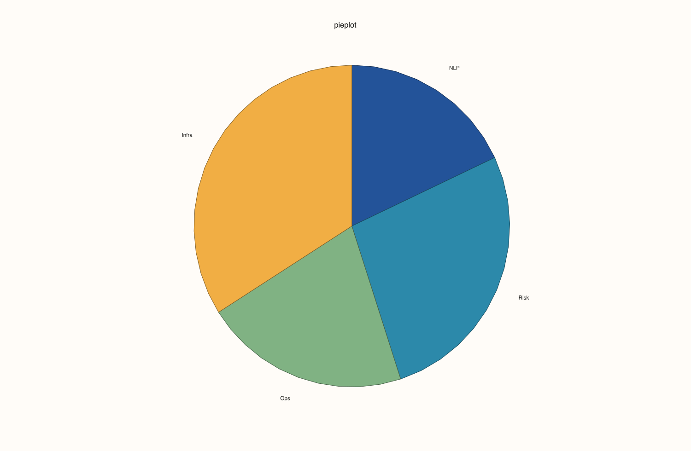
```

`Source section`: `flash_api.md`

### `pieplot (overload 2)`

#### Signature

```cpp
Trace& pieplot(self: Pane, SeriesLike values, std::vector<std::string> labels);
```

#### Notes

Pie wedges from part-to-whole values.

#### Example

```{literalinclude} ../../examples/docs/snippets/keys/pieplot.cpp
:language: cpp
```

#### Output

```{only} html

```

```{only} not html

```

`Source section`: `flash_api.md`

### `plot3d (single form)`

#### Signature

```cpp
Trace& plot3D(self: Pane, SeriesLike x, SeriesLike y, SeriesLike z);
```

#### Notes

Matplotlib-style alias for 3D path plotting.

#### Example

```{literalinclude} ../../examples/docs/snippets/keys/plot3D.cpp
:language: cpp
```

#### Output

```{only} html
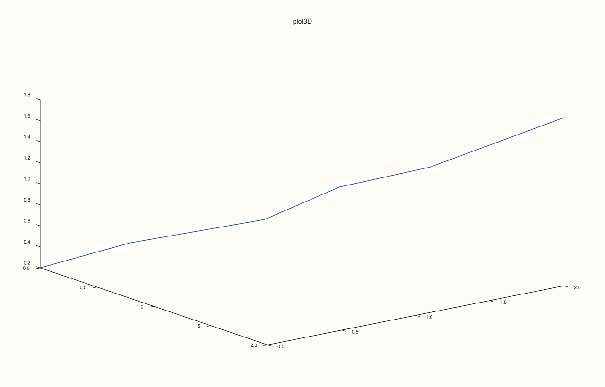
```

```{only} not html

```

`Source section`: `flash_api.md`

### `plot_surface (single form)`

#### Signature

```cpp
Trace& plot_surface(self: Pane, SeriesLike x, SeriesLike y, SeriesLike z);
```

#### Notes

Matplotlib-style alias for surface plotting (`sheet`).

#### Example

```{literalinclude} ../../examples/docs/snippets/keys/plot_surface.cpp
:language: cpp
```

#### Output

```{only} html

```

```{only} not html

```

`Source section`: `flash_api.md`

### `plot_wireframe (single form)`

#### Signature

```cpp
Trace& plot_wireframe(self: Pane, SeriesLike x, SeriesLike y, SeriesLike z);
```

#### Notes

Matplotlib-style alias for wireframe plotting (`lattice`).

#### Example

```{literalinclude} ../../examples/docs/snippets/keys/plot_wireframe.cpp
:language: cpp
```

#### Output

```{only} html
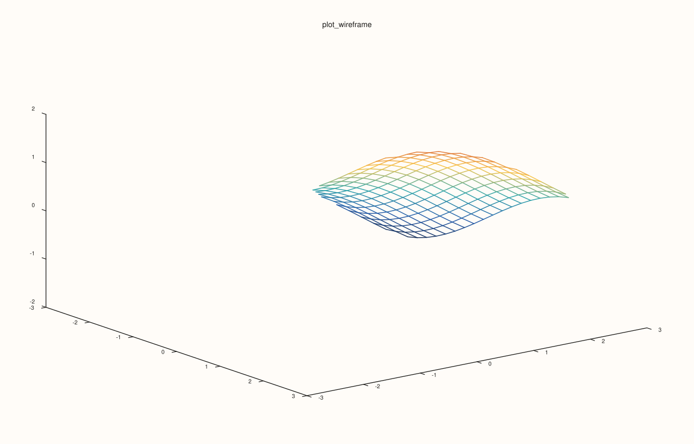
```

```{only} not html
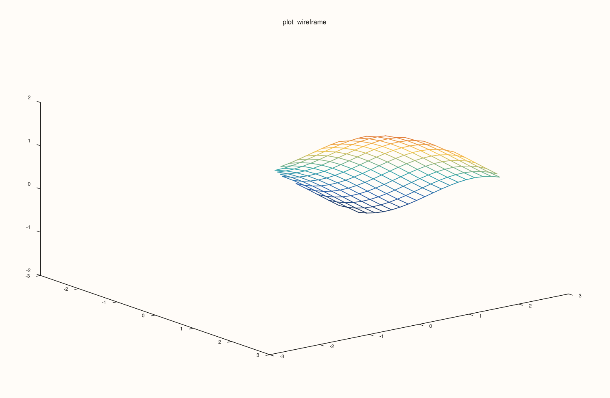
```

`Source section`: `flash_api.md`

### `pointplot (single form)`

#### Signature

```cpp
Trace& pointplot(self: Pane, SeriesLike x, SeriesLike y, SeriesLike err);
```

#### Notes

Mean/point trend with error whiskers.

#### Example

```{literalinclude} ../../examples/docs/snippets/keys/pointplot.cpp
:language: cpp
```

#### Output

```{only} html
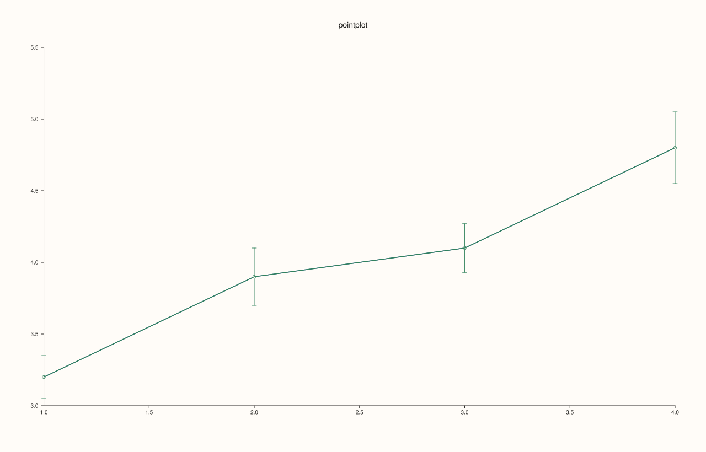
```

```{only} not html
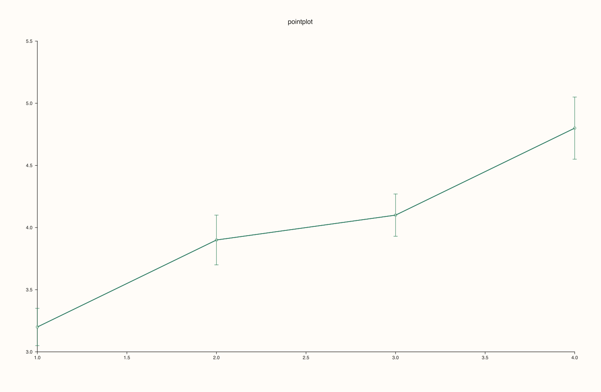
```

`Source section`: `flash_api.md`

### `qqplot (overload 1)`

#### Signature

```cpp
Trace& qqplot(self: Pane, SeriesLike values, const QqPlotOptions& options = {});
```

#### Notes

Studio, values: SeriesLike, options: QqPlotOptions = {});

#### Example

```{literalinclude} ../../examples/docs/snippets/keys/qqplot.cpp
:language: cpp
```

#### Output

```{only} html
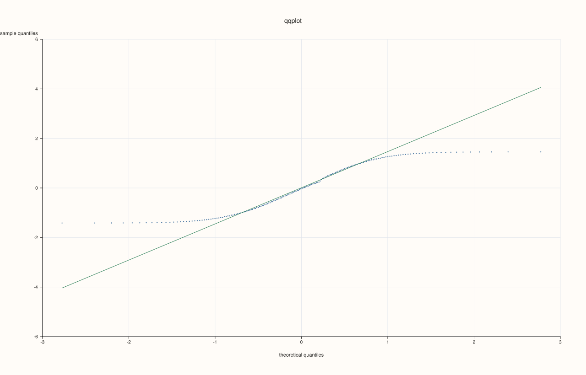
```

```{only} not html
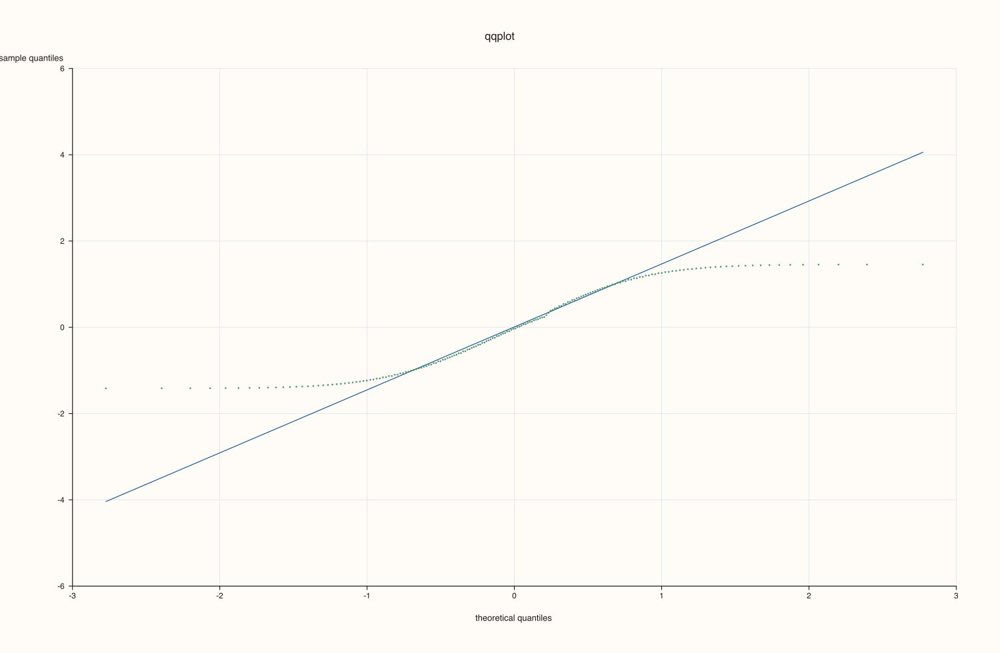
```

`Source section`: `flash_api.md`

### `qqplot (overload 2)`

#### Signature

```cpp
Trace& qqplot(self: Studio, SeriesLike values, const QqPlotOptions& options = {}, std::string title = {});
```

#### Notes

Studio, values: SeriesLike, options: QqPlotOptions = {});

#### Example

```{literalinclude} ../../examples/docs/snippets/keys/qqplot.cpp
:language: cpp
```

#### Output

```{only} html

```

```{only} not html

```

`Source section`: `flash_api.md`

### `radviz (overload 1)`

#### Signature

```cpp
Studio& radviz(self: Studio, const std::vector<Series>& columns, const RadvizOptions& options = {});
```

#### Notes

Projects features to anchors on a circle for class separation.

#### Example

```{literalinclude} ../../examples/docs/snippets/keys/radviz.cpp
:language: cpp
```

#### Output

```{only} html
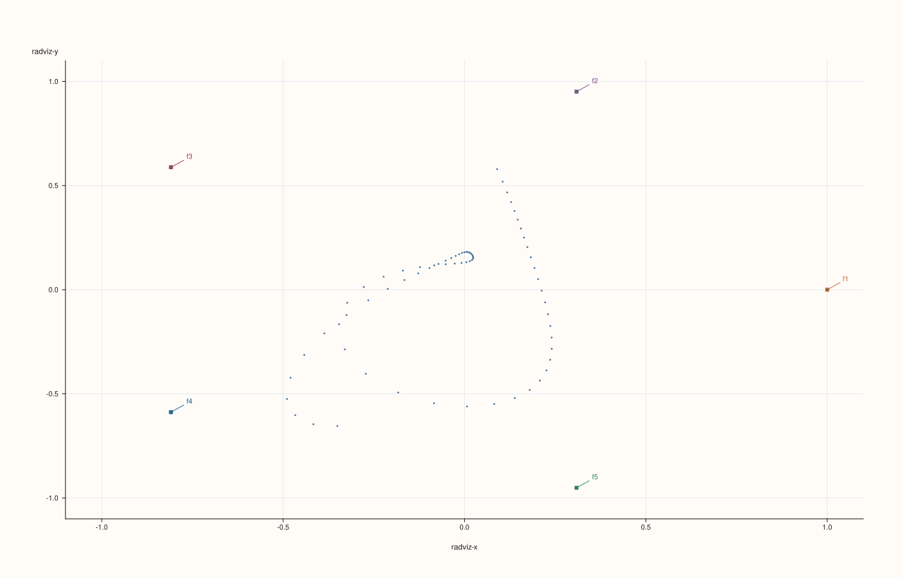
```

```{only} not html
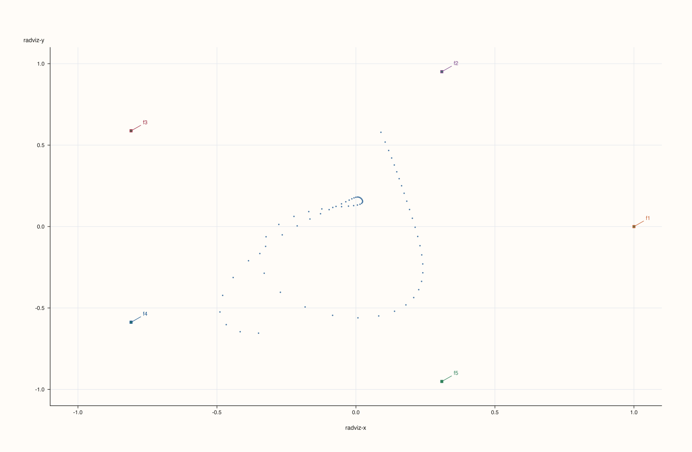
```

`Source section`: `flash_api.md`

### `radviz (overload 2)`

#### Signature

```cpp
Studio& radviz(self: Studio, const std::vector<Series>& columns, const Note& class_labels, const RadvizOptions& options = {});
```

#### Notes

Projects features to anchors on a circle for class separation.

#### Example

```{literalinclude} ../../examples/docs/snippets/keys/radviz.cpp
:language: cpp
```

#### Output

```{only} html

```

```{only} not html

```

`Source section`: `flash_api.md`

### `radviz (overload 3)`

#### Signature

```cpp
Studio& radviz(self: Studio, const Dataset& data, const RadvizOptions& options = {});
```

#### Notes

Projects features to anchors on a circle for class separation.

#### Example

```{literalinclude} ../../examples/docs/snippets/keys/radviz.cpp
:language: cpp
```

#### Output

```{only} html

```

```{only} not html

```

`Source section`: `flash_api.md`

### `radviz (overload 4)`

#### Signature

```cpp
Studio& radviz(self: Studio, const Series& matrix, const MatrixFrameOptions& frame_options, const RadvizOptions& options = {});
```

#### Notes

Projects features to anchors on a circle for class separation.

#### Example

```{literalinclude} ../../examples/docs/snippets/keys/radviz.cpp
:language: cpp
```

#### Output

```{only} html

```

```{only} not html

```

`Source section`: `flash_api.md`

### `radviz (overload 5)`

#### Signature

```cpp
Studio& radviz(self: Studio, const Series& matrix, std::vector<std::string> feature_names, Axis feature_axis, const RadvizOptions& options = {});
```

#### Notes

Projects features to anchors on a circle for class separation.

#### Example

```{literalinclude} ../../examples/docs/snippets/keys/radviz.cpp
:language: cpp
```

#### Output

```{only} html

```

```{only} not html

```

`Source section`: `flash_api.md`

### `radviz (overload 6)`

#### Signature

```cpp
Studio& radviz(self: Studio, const Series& matrix, const RadvizOptions& options = {});
```

#### Notes

Projects features to anchors on a circle for class separation.

#### Example

```{literalinclude} ../../examples/docs/snippets/keys/radviz.cpp
:language: cpp
```

#### Output

```{only} html

```

```{only} not html

```

`Source section`: `flash_api.md`

### `regplot (single form)`

#### Signature

```cpp
Trace& regplot(self: Pane, SeriesLike x, SeriesLike y, const RegPlotOptions& options = {});
```

#### Notes

Scatter + fitted regression (optionally CI bands).

#### Example

```{literalinclude} ../../examples/docs/snippets/keys/regplot.cpp
:language: cpp
```

#### Output

```{only} html
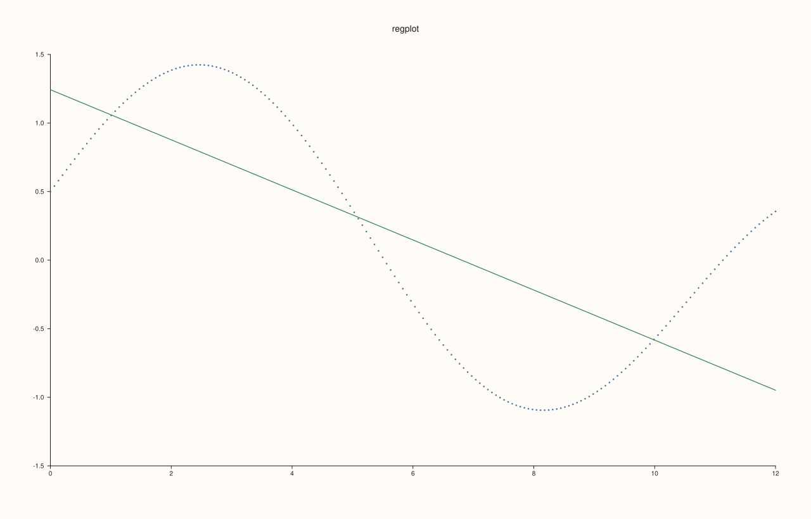
```

```{only} not html

```

`Source section`: `flash_api.md`

### `relgridplot (overload 1)`

#### Signature

```cpp
Studio& relgridplot(self: Studio, const std::vector<Series>& xs, const std::vector<Series>& ys, const RelGridPlotOptions& options = {});
```

#### Notes

Facet grid for relational plots (scatter/line/reg).

#### Example

```{literalinclude} ../../examples/docs/snippets/keys/relgridplot.cpp
:language: cpp
```

#### Output

```{only} html
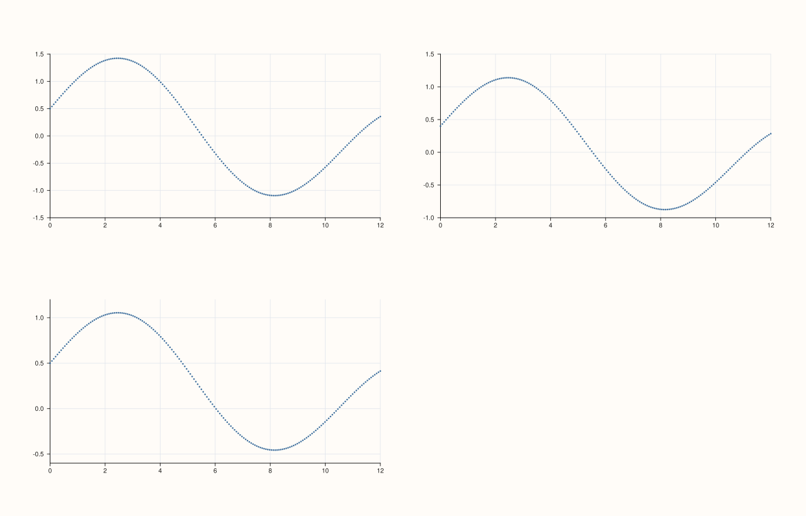
```

```{only} not html

```

`Source section`: `flash_api.md`

### `relgridplot (overload 2)`

#### Signature

```cpp
Studio& relgridplot(self: Studio, const std::vector<Series>& xs, const std::vector<Series>& ys, std::string_view kind);
```

#### Notes

Facet grid for relational plots (scatter/line/reg).

#### Example

```{literalinclude} ../../examples/docs/snippets/keys/relgridplot.cpp
:language: cpp
```

#### Output

```{only} html

```

```{only} not html

```

`Source section`: `flash_api.md`

### `relplot (overload 1)`

#### Signature

```cpp
Trace& relplot(self: Pane, SeriesLike x, SeriesLike y, std::string_view kind = "scatter");
```

#### Notes

Studio, x: SeriesLike, y: SeriesLike[, hue], kind = "scatter");

#### Example

```{literalinclude} ../../examples/docs/snippets/keys/relplot.cpp
:language: cpp
```

#### Output

```{only} html

```

```{only} not html

```

`Source section`: `flash_api.md`

### `relplot (overload 2)`

#### Signature

```cpp
Trace& relplot(self: Pane, SeriesLike x, SeriesLike y, const Note& hue, std::string_view kind = "scatter");
```

#### Notes

Studio, x: SeriesLike, y: SeriesLike[, hue], kind = "scatter");

#### Example

```{literalinclude} ../../examples/docs/snippets/keys/relplot.cpp
:language: cpp
```

#### Output

```{only} html

```

```{only} not html

```

`Source section`: `flash_api.md`

### `relplot (overload 3)`

#### Signature

```cpp
Trace& relplot(self: Pane, SeriesLike x, SeriesLike y, SeriesLike hue, std::string_view kind = "scatter");
```

#### Notes

Studio, x: SeriesLike, y: SeriesLike[, hue], kind = "scatter");

#### Example

```{literalinclude} ../../examples/docs/snippets/keys/relplot.cpp
:language: cpp
```

#### Output

```{only} html

```

```{only} not html

```

`Source section`: `flash_api.md`

### `relplot (overload 4)`

#### Signature

```cpp
Trace& relplot(self: Studio, SeriesLike x, SeriesLike y, std::string_view kind = "scatter", std::string title = {});
```

#### Notes

Studio, x: SeriesLike, y: SeriesLike[, hue], kind = "scatter");

#### Example

```{literalinclude} ../../examples/docs/snippets/keys/relplot.cpp
:language: cpp
```

#### Output

```{only} html

```

```{only} not html

```

`Source section`: `flash_api.md`

### `relplot (overload 5)`

#### Signature

```cpp
Trace& relplot(self: Studio, SeriesLike x, SeriesLike y, const Note& hue, std::string_view kind = "scatter", std::string title = {});
```

#### Notes

Studio, x: SeriesLike, y: SeriesLike[, hue], kind = "scatter");

#### Example

```{literalinclude} ../../examples/docs/snippets/keys/relplot.cpp
:language: cpp
```

#### Output

```{only} html

```

```{only} not html

```

`Source section`: `flash_api.md`

### `relplot (overload 6)`

#### Signature

```cpp
Trace& relplot(self: Studio, SeriesLike x, SeriesLike y, SeriesLike hue, std::string_view kind = "scatter", std::string title = {});
```

#### Notes

Studio, x: SeriesLike, y: SeriesLike[, hue], kind = "scatter");

#### Example

```{literalinclude} ../../examples/docs/snippets/keys/relplot.cpp
:language: cpp
```

#### Output

```{only} html

```

```{only} not html

```

`Source section`: `flash_api.md`

### `resid_acfplot (single form)`

#### Signature

```cpp
Studio& resid_acfplot(self: Studio, SeriesLike x, SeriesLike y, const ResidAcfPlotOptions& options = {});
```

#### Notes

Fits regression, then runs ACF on residuals.

#### Example

```{literalinclude} ../../examples/docs/snippets/keys/resid_acfplot.cpp
:language: cpp
```

#### Output

```{only} html

```

```{only} not html

```

`Source section`: `flash_api.md`

### `resid_histplot (overload 1)`

#### Signature

```cpp
Trace& resid_histplot(self: Pane, SeriesLike x, SeriesLike y, const ResidHistPlotOptions& options = {});
```

#### Notes

Studio, x: SeriesLike, y: SeriesLike, options: ResidHistPlotOptions = {});

#### Example

```{literalinclude} ../../examples/docs/snippets/keys/resid_histplot.cpp
:language: cpp
```

#### Output

```{only} html

```

```{only} not html

```

`Source section`: `flash_api.md`

### `resid_histplot (overload 2)`

#### Signature

```cpp
Trace& resid_histplot(self: Studio, SeriesLike x, SeriesLike y, const ResidHistPlotOptions& options = {}, std::string title = {});
```

#### Notes

Studio, x: SeriesLike, y: SeriesLike, options: ResidHistPlotOptions = {});

#### Example

```{literalinclude} ../../examples/docs/snippets/keys/resid_histplot.cpp
:language: cpp
```

#### Output

```{only} html

```

```{only} not html

```

`Source section`: `flash_api.md`

### `residplot (overload 1)`

#### Signature

```cpp
Trace& residplot(self: Pane, SeriesLike x, SeriesLike y, const RegPlotOptions& options);
```

#### Notes

Residual scatter against predictor axis.

#### Example

```{literalinclude} ../../examples/docs/snippets/keys/residplot.cpp
:language: cpp
```

#### Output

```{only} html

```

```{only} not html

```

`Source section`: `flash_api.md`

### `residplot (overload 2)`

#### Signature

```cpp
Trace& residplot(self: Pane, SeriesLike x, SeriesLike y);
```

#### Notes

Residual scatter against predictor axis.

#### Example

```{literalinclude} ../../examples/docs/snippets/keys/residplot.cpp
:language: cpp
```

#### Output

```{only} html

```

```{only} not html

```

`Source section`: `flash_api.md`

### `ridge3 (overload 1)`

#### Signature

```cpp
Trace& ridge3(self: Pane, SeriesLike x, SeriesLike y, SeriesLike z);
```

#### Notes

3D ridge layers over a surface grid.

#### Example

```{literalinclude} ../../examples/docs/snippets/keys/ridge3.cpp
:language: cpp
```

#### Output

```{only} html

```

```{only} not html

```

`Source section`: `flash_api.md`

### `ridge3 (overload 2)`

#### Signature

```cpp
Trace& ridge3(self: Pane, SeriesLike x, SeriesLike y, SeriesLike z, SeriesLike levels);
```

#### Notes

3D ridge layers over a surface grid.

#### Example

```{literalinclude} ../../examples/docs/snippets/keys/ridge3.cpp
:language: cpp
```

#### Output

```{only} html

```

```{only} not html

```

`Source section`: `flash_api.md`

### `ridge3 (overload 3)`

#### Signature

```cpp
Trace& ridge3(self: Pane, SeriesLike x, SeriesLike y, SeriesLike z, int level_count);
```

#### Notes

3D ridge layers over a surface grid.

#### Example

```{literalinclude} ../../examples/docs/snippets/keys/ridge3.cpp
:language: cpp
```

#### Output

```{only} html

```

```{only} not html

```

`Source section`: `flash_api.md`

### `scatter3d (single form)`

#### Signature

```cpp
Trace& scatter3D(self: Pane, SeriesLike x, SeriesLike y, SeriesLike z);
```

#### Notes

Matplotlib-style alias for `cloud3`.

#### Example

```{literalinclude} ../../examples/docs/snippets/keys/scatter3D.cpp
:language: cpp
```

#### Output

```{only} html

```

```{only} not html

```

`Source section`: `flash_api.md`

### `scatterplot (overload 1)`

#### Signature

```cpp
Trace& scatterplot(self: Pane, SeriesLike x, SeriesLike y);
```

#### Notes

2D scatter with optional hue grouping/binning.

#### Example

```{literalinclude} ../../examples/docs/snippets/keys/scatterplot.cpp
:language: cpp
```

#### Output

```{only} html

```

```{only} not html

```

`Source section`: `flash_api.md`

### `scatterplot (overload 2)`

#### Signature

```cpp
Trace& scatterplot(self: Pane, SeriesLike x, SeriesLike y, const Note& hue);
```

#### Notes

2D scatter with optional hue grouping/binning.

#### Example

```{literalinclude} ../../examples/docs/snippets/keys/scatterplot.cpp
:language: cpp
```

#### Output

```{only} html

```

```{only} not html

```

`Source section`: `flash_api.md`

### `scatterplot (overload 3)`

#### Signature

```cpp
Trace& scatterplot(self: Pane, SeriesLike x, SeriesLike y, SeriesLike hue);
```

#### Notes

2D scatter with optional hue grouping/binning.

#### Example

```{literalinclude} ../../examples/docs/snippets/keys/scatterplot.cpp
:language: cpp
```

#### Output

```{only} html

```

```{only} not html

```

`Source section`: `flash_api.md`

### `scene3d (single form)`

#### Signature

```cpp
Pane& scene3d(self: Pane, options: Scene3DOptions);
```

#### Notes

Applies camera, lighting, theme, and preset orchestration for 3D panes.

#### Example

```{literalinclude} ../../examples/docs/snippets/keys/scene3d.cpp
:language: cpp
```

#### Output

```{only} html

```

```{only} not html

```

`Source section`: `flash_api.md`

### `sheet (overload 1)`

#### Signature

```cpp
Trace& sheet(self: Pane, SeriesLike x, SeriesLike y, SeriesLike z);
```

#### Notes

Studio, x: SeriesLike, y: SeriesLike, z: SeriesLike[, color]);

#### Example

```{literalinclude} ../../examples/docs/snippets/keys/sheet.cpp
:language: cpp
```

#### Output

```{only} html

```

```{only} not html

```

`Source section`: `flash_api.md`

### `sheet (overload 2)`

#### Signature

```cpp
Trace& sheet(self: Pane, SeriesLike x, SeriesLike y, SeriesLike z, SeriesLike c);
```

#### Notes

Studio, x: SeriesLike, y: SeriesLike, z: SeriesLike[, color]);

#### Example

```{literalinclude} ../../examples/docs/snippets/keys/sheet.cpp
:language: cpp
```

#### Output

```{only} html

```

```{only} not html

```

`Source section`: `flash_api.md`

### `sheet (overload 3)`

#### Signature

```cpp
Trace& sheet(self: Studio, SeriesLike x, SeriesLike y, SeriesLike z, std::string title = {});
```

#### Notes

Studio, x: SeriesLike, y: SeriesLike, z: SeriesLike[, color]);

#### Example

```{literalinclude} ../../examples/docs/snippets/keys/sheet.cpp
:language: cpp
```

#### Output

```{only} html

```

```{only} not html

```

`Source section`: `flash_api.md`

### `spire3 (overload 1)`

#### Signature

```cpp
Trace& spire3(self: Pane, SeriesLike z);
```

#### Notes

3D spire/column rendering from grid-like data.

#### Example

```{literalinclude} ../../examples/docs/snippets/keys/spire3.cpp
:language: cpp
```

#### Output

```{only} html

```

```{only} not html

```

`Source section`: `flash_api.md`

### `spire3 (overload 2)`

#### Signature

```cpp
Trace& spire3(self: Pane, SeriesLike y, SeriesLike z);
```

#### Notes

3D spire/column rendering from grid-like data.

#### Example

```{literalinclude} ../../examples/docs/snippets/keys/spire3.cpp
:language: cpp
```

#### Output

```{only} html

```

```{only} not html

```

`Source section`: `flash_api.md`

### `spire3 (overload 3)`

#### Signature

```cpp
Trace& spire3(self: Pane, SeriesLike x, SeriesLike y, SeriesLike z);
```

#### Notes

3D spire/column rendering from grid-like data.

#### Example

```{literalinclude} ../../examples/docs/snippets/keys/spire3.cpp
:language: cpp
```

#### Output

```{only} html

```

```{only} not html

```

`Source section`: `flash_api.md`

### `spire3 (overload 4)`

#### Signature

```cpp
Trace& spire3(self: Pane, SeriesLike x, SeriesLike y, SeriesLike z, SeriesLike c);
```

#### Notes

3D spire/column rendering from grid-like data.

#### Example

```{literalinclude} ../../examples/docs/snippets/keys/spire3.cpp
:language: cpp
```

#### Output

```{only} html

```

```{only} not html

```

`Source section`: `flash_api.md`

### `stepplot (single form)`

#### Signature

```cpp
Trace& stepplot(self: Pane, SeriesLike x, SeriesLike y);
```

#### Notes

Converts line input into right-step segments.

#### Example

```{literalinclude} ../../examples/docs/snippets/keys/stepplot.cpp
:language: cpp
```

#### Output

```{only} html

```

```{only} not html

```

`Source section`: `flash_api.md`

### `stripplot (overload 1)`

#### Signature

```cpp
Trace& stripplot(self: Pane, const Note& categories, const Series& values);
```

#### Notes

Raw points per category with minimal aggregation.

#### Example

```{literalinclude} ../../examples/docs/snippets/keys/stripplot.cpp
:language: cpp
```

#### Output

```{only} html

```

```{only} not html

```

`Source section`: `flash_api.md`

### `stripplot (overload 2)`

#### Signature

```cpp
Trace& stripplot(self: Pane, SeriesLike group, SeriesLike values);
```

#### Notes

Raw points per category with minimal aggregation.

#### Example

```{literalinclude} ../../examples/docs/snippets/keys/stripplot.cpp
:language: cpp
```

#### Output

```{only} html

```

```{only} not html

```

`Source section`: `flash_api.md`

### `summaryplot (single form)`

#### Signature

```cpp
Studio& summaryplot(self: Studio, const std::vector<Series>& columns, const std::vector<std::string>& labels, const SummaryOptions& options = {});
```

#### Notes

Statistical summary tables rendered into a figure layout.

#### Example

```{literalinclude} ../../examples/docs/snippets/keys/summaryplot.cpp
:language: cpp
```

#### Output

```{only} html

```

```{only} not html

```

`Source section`: `flash_api.md`

### `swarmplot (single form)`

#### Signature

```cpp
Trace& swarmplot(self: Pane, SeriesLike group, SeriesLike values);
```

#### Notes

Alias of stripplot for dense categorical point clouds.

#### Example

```{literalinclude} ../../examples/docs/snippets/keys/swarmplot.cpp
:language: cpp
```

#### Output

```{only} html

```

```{only} not html

```

`Source section`: `flash_api.md`

### `triplot (overload 1)`

#### Signature

```cpp
Studio& triplot(self: Studio, const std::vector<Series>& columns, const TriplotOptions& options = {});
```

#### Notes

Enumerates 3-feature combinations into small-multiple 3D panels.

#### Example

```{literalinclude} ../../examples/docs/snippets/keys/triplot.cpp
:language: cpp
```

#### Output

```{only} html

```

```{only} not html

```

`Source section`: `flash_api.md`

### `triplot (overload 2)`

#### Signature

```cpp
Studio& triplot(self: Studio, const Dataset& data, const TriplotOptions& options = {});
```

#### Notes

Enumerates 3-feature combinations into small-multiple 3D panels.

#### Example

```{literalinclude} ../../examples/docs/snippets/keys/triplot.cpp
:language: cpp
```

#### Output

```{only} html

```

```{only} not html

```

`Source section`: `flash_api.md`

### `triplot (overload 3)`

#### Signature

```cpp
Studio& triplot(self: Studio, const Series& matrix, const MatrixFrameOptions& frame_options, const TriplotOptions& options = {});
```

#### Notes

Enumerates 3-feature combinations into small-multiple 3D panels.

#### Example

```{literalinclude} ../../examples/docs/snippets/keys/triplot.cpp
:language: cpp
```

#### Output

```{only} html

```

```{only} not html

```

`Source section`: `flash_api.md`

### `triplot (overload 4)`

#### Signature

```cpp
Studio& triplot(self: Studio, const Series& matrix, std::vector<std::string> feature_names, Axis feature_axis, const TriplotOptions& options = {});
```

#### Notes

Enumerates 3-feature combinations into small-multiple 3D panels.

#### Example

```{literalinclude} ../../examples/docs/snippets/keys/triplot.cpp
:language: cpp
```

#### Output

```{only} html

```

```{only} not html

```

`Source section`: `flash_api.md`

### `triplot (overload 5)`

#### Signature

```cpp
Studio& triplot(self: Studio, const Series& matrix, const TriplotOptions& options = {});
```

#### Notes

Enumerates 3-feature combinations into small-multiple 3D panels.

#### Example

```{literalinclude} ../../examples/docs/snippets/keys/triplot.cpp
:language: cpp
```

#### Output

```{only} html

```

```{only} not html

```

`Source section`: `flash_api.md`

### `violinplot (overload 1)`

#### Signature

```cpp
Trace& violinplot(self: Pane, SeriesLike values);
```

#### Notes

Density-shape distribution view, optionally grouped.

#### Example

```{literalinclude} ../../examples/docs/snippets/keys/violinplot.cpp
:language: cpp
```

#### Output

```{only} html

```

```{only} not html

```

`Source section`: `flash_api.md`

### `violinplot (overload 2)`

#### Signature

```cpp
Trace& violinplot(self: Pane, SeriesLike values, const ViolinOptions& options);
```

#### Notes

Density-shape distribution view, optionally grouped.

#### Example

```{literalinclude} ../../examples/docs/snippets/keys/violinplot.cpp
:language: cpp
```

#### Output

```{only} html

```

```{only} not html

```

`Source section`: `flash_api.md`

### `violinplot (overload 3)`

#### Signature

```cpp
Trace& violinplot(self: Pane, const Note& categories, const Series& values);
```

#### Notes

Density-shape distribution view, optionally grouped.

#### Example

```{literalinclude} ../../examples/docs/snippets/keys/violinplot.cpp
:language: cpp
```

#### Output

```{only} html

```

```{only} not html

```

`Source section`: `flash_api.md`

### `violinplot (overload 4)`

#### Signature

```cpp
Trace& violinplot(self: Pane, const Note& categories, const Series& values, const ViolinOptions& options);
```

#### Notes

Density-shape distribution view, optionally grouped.

#### Example

```{literalinclude} ../../examples/docs/snippets/keys/violinplot.cpp
:language: cpp
```

#### Output

```{only} html

```

```{only} not html

```

`Source section`: `flash_api.md`

### `violinplot (overload 5)`

#### Signature

```cpp
Trace& violinplot(self: Pane, SeriesLike group, SeriesLike values);
```

#### Notes

Density-shape distribution view, optionally grouped.

#### Example

```{literalinclude} ../../examples/docs/snippets/keys/violinplot.cpp
:language: cpp
```

#### Output

```{only} html

```

```{only} not html

```

`Source section`: `flash_api.md`

### `violinplot (overload 6)`

#### Signature

```cpp
Trace& violinplot(self: Pane, SeriesLike group, SeriesLike values, const ViolinOptions& options);
```

#### Notes

Density-shape distribution view, optionally grouped.

#### Example

```{literalinclude} ../../examples/docs/snippets/keys/violinplot.cpp
:language: cpp
```

#### Output

```{only} html

```

```{only} not html

```

`Source section`: `flash_api.md`

### `whiskplot (overload 1)`

#### Signature

```cpp
Trace& whiskplot(self: Pane, SeriesLike x, SeriesLike y, SeriesLike err);
```

#### Notes

Error-whisker plotting with symmetric or explicit bounds.

#### Example

```{literalinclude} ../../examples/docs/snippets/keys/whiskplot.cpp
:language: cpp
```

#### Output

```{only} html

```

```{only} not html

```

`Source section`: `flash_api.md`

### `whiskplot (overload 2)`

#### Signature

```cpp
Trace& whiskplot(self: Pane, SeriesLike x, SeriesLike y, SeriesLike yneg, SeriesLike ypos, SeriesLike xneg, SeriesLike xpos);
```

#### Notes

Error-whisker plotting with symmetric or explicit bounds.

#### Example

```{literalinclude} ../../examples/docs/snippets/keys/whiskplot.cpp
:language: cpp
```

#### Output

```{only} html

```

```{only} not html

```

`Source section`: `flash_api.md`

### `rugplot (single form)`

#### Signature

```cpp
Trace& rugplot(self: Pane, SeriesLike values, double height = 0.08);
```

#### Notes

Draws small tick marks along an axis to visualize sample concentration.

#### Example

```{literalinclude} ../../examples/docs/snippets/keys/rugplot.cpp
:language: cpp
```

#### Output

```{only} html

```

```{only} not html

```

`Source section`: `flash_api.md`

### `facetgrid (single form)`

#### Signature

```cpp
Studio& FacetGrid(self: Studio, std::int64_t rows, std::int64_t cols, double gx = 18.0, double gy = 18.0);
```

#### Notes

Allocates a faceted 2D grid layout. You then populate panes manually.

#### Example

```{literalinclude} ../../examples/docs/snippets/keys/facetgrid.cpp
:language: cpp
```

#### Output

```{only} html

```

```{only} not html

```

`Source section`: `flash_api.md`

### `pairgrid (single form)`

#### Signature

```cpp
Studio& PairGrid(self: Studio, std::int64_t dimensions, double gx = 14.0, double gy = 14.0);
```

#### Notes

Creates an NxN grid intended for pairwise matrix views.

#### Example

```{literalinclude} ../../examples/docs/snippets/keys/pairgrid.cpp
:language: cpp
```

#### Output

```{only} html

```

```{only} not html

```

`Source section`: `flash_api.md`

### `jointgrid (single form)`

#### Signature

```cpp
Studio& JointGrid(self: Studio, double gx = 14.0, double gy = 14.0);
```

#### Notes

Creates the standard joint-layout scaffold (joint pane + top/right marginals).

#### Example

```{literalinclude} ../../examples/docs/snippets/keys/jointgrid.cpp
:language: cpp
```

#### Output

```{only} html

```

```{only} not html

```

`Source section`: `flash_api.md`

### `facet_map_plot (single form)`

#### Signature

```cpp
requires std::invocable<Mapper, Pane&, std::int64_t, std::int64_t> inline Studio& facet_map_plot(self: Studio, std::int64_t rows, std::int64_t cols, SeriesLike mapper, double gx = 18.0, double gy = 18.0);
```

#### Notes

Runs a user mapper callback over each facet cell for custom per-pane drawing.

#### Example

```{literalinclude} ../../examples/docs/snippets/keys/facet_map_plot.cpp
:language: cpp
```

#### Output

```{only} html

```

```{only} not html

```

`Source section`: `flash_api.md`

### `pairgrid_map_plot (single form)`

#### Signature

```cpp
requires std::invocable<Mapper, Pane&, std::int64_t, std::int64_t, bool> inline Studio& pairgrid_map_plot(self: Studio, std::int64_t dimensions, SeriesLike mapper, double gx = 14.0, double gy = 14.0);
```

#### Notes

Runs a callback over all pair-grid cells and flags diagonal cells for specialized rendering.

#### Example

```{literalinclude} ../../examples/docs/snippets/keys/pairgrid_map_plot.cpp
:language: cpp
```

#### Output

```{only} html

```

```{only} not html

```

`Source section`: `flash_api.md`

### `jointgrid_map_plot (single form)`

#### Signature

```cpp
requires std::invocable<JointMapper, Pane&> && std::invocable<MarginalMapper, Pane&, bool> inline Studio& jointgrid_map_plot(self: Studio, SeriesLike joint_mapper, SeriesLike marginal_mapper, double gx = 14.0, double gy = 14.0);
```

#### Notes

Runs separate callbacks for the central joint pane and marginal panes in a joint-grid layout.

#### Example

```{literalinclude} ../../examples/docs/snippets/keys/jointgrid_map_plot.cpp
:language: cpp
```

#### Output

```{only} html

```

```{only} not html

```

`Source section`: `flash_api.md`

### `color_palette (single form)`

#### Signature

```cpp
inline PaletteRamp color_palette(std::string_view name = "ocean");
```

#### Notes

Returns a named palette ramp (`ocean`, `thermal`, `lagoon`, `meadow`, `neutral`, plus seaborn-like names).

#### Example

```{literalinclude} ../../examples/docs/snippets/keys/color_palette.cpp
:language: cpp
```

#### Output

```{only} html

```

```{only} not html

```

`Source section`: `flash_theme_api.md`

### `despine (single form)`

#### Signature

```cpp
Pane& despine(self: Pane, enable: bool = true) noexcept;
```

#### Notes

Keeps the plotting content while removing pane-frame emphasis for cleaner minimalist charts.

#### Example

```{literalinclude} ../../examples/docs/snippets/keys/despine.cpp
:language: cpp
```

#### Output

```{only} html

```

```{only} not html

```

`Source section`: `flash_theme_api.md`

### `horizontal_grid (single form)`

#### Signature

```cpp
Pane& horizontal_grid(self: Pane, enable: bool = true) noexcept;
```

#### Notes

Applies y-major grid only (with x-grid suppressed) for time-series readability.

#### Example

```{literalinclude} ../../examples/docs/snippets/keys/horizontal_grid.cpp
:language: cpp
```

#### Output

```{only} html

```

```{only} not html

```

`Source section`: `flash_theme_api.md`

### `load_dataset (single form)`

#### Signature

```cpp
inline std::optional<Dataset> load_dataset(std::string_view name);
```

#### Notes

Loads built-in dataset bundles (currently `tips`, `flights`) for quick exploratory plotting flows.

#### Example

```{literalinclude} ../../examples/docs/snippets/keys/load_dataset.cpp
:language: cpp
```

#### Output

```{only} html

```

```{only} not html

```

`Source section`: `flash_theme_api.md`

### `plotting_context (single form)`

#### Signature

```cpp
Studio& plotting_context(self: Studio, width: double, height: double, tick_font_scale: double = 1.0, axis_label_font_scale: double = 1.0);
```

#### Notes

Alias of `set_context(...)`; applies figure extent and tick/label scaling.

#### Example

```{literalinclude} ../../examples/docs/snippets/keys/plotting_context.cpp
:language: cpp
```

#### Output

```{only} html

```

```{only} not html

```

`Source section`: `flash_theme_api.md`

### `set_context (overload 1)`

#### Signature

```cpp
Studio& set_context(self: Studio, width: double, height: double, tick_font_scale: double = 1.0, axis_label_font_scale: double = 1.0);
```

#### Notes

Primary context entry point. Use explicit dimensions or semantic context presets (`Paper`, `Notebook`, `Talk`, `Poster`).

#### Example

```{literalinclude} ../../examples/docs/snippets/keys/set_context.cpp
:language: cpp
```

#### Output

```{only} html

```

```{only} not html

```

`Source section`: `flash_theme_api.md`

### `set_context (overload 2)`

#### Signature

```cpp
Studio& set_context(self: Studio, context: FlashContext, width: std::optional<double> = std::nullopt, height: std::optional<double> = std::nullopt);
```

#### Notes

Primary context entry point. Use explicit dimensions or semantic context presets (`Paper`, `Notebook`, `Talk`, `Poster`).

#### Example

```{literalinclude} ../../examples/docs/snippets/keys/set_context.cpp
:language: cpp
```

#### Output

```{only} html

```

```{only} not html

```

`Source section`: `flash_theme_api.md`

### `set_style (overload 1)`

#### Signature

```cpp
Pane& set_style(self: Pane, style: GridStyle = GridStyle::Major);
```

#### Notes

Low-level style primitive for a single pane (`Darkgrid`, `Lightgrid`, `Sandgrid`, `Dark`, `Light`, `Sand`).

#### Example

```{literalinclude} ../../examples/docs/snippets/keys/set_style.cpp
:language: cpp
```

#### Output

```{only} html

```

```{only} not html

```

`Source section`: `flash_theme_api.md`

### `set_style (overload 2)`

#### Signature

```cpp
Pane& set_style(self: Pane, style: FlashStyle);
```

#### Notes

Low-level style primitive for a single pane (`Darkgrid`, `Lightgrid`, `Sandgrid`, `Dark`, `Light`, `Sand`).

#### Example

```{literalinclude} ../../examples/docs/snippets/keys/set_style.cpp
:language: cpp
```

#### Output

```{only} html

```

```{only} not html

```

`Source section`: `flash_theme_api.md`

### `tight_layout (single form)`

#### Signature

```cpp
Studio& tight_layout(self: Studio, padding: double = 6.0);
```

#### Notes

Compacts pane spacing after content has been placed in a mosaic.

#### Example

```{literalinclude} ../../examples/docs/snippets/keys/tight_layout.cpp
:language: cpp
```

#### Output

```{only} html

```

```{only} not html

```

`Source section`: `flash_theme_api.md`

### `export4_frames (single form)`

#### Signature

```cpp
std::int64_t export4_frames(x: SeriesLike, y: SeriesLike, z: SeriesLike, w: SeriesLike, options: HyperFrameExportOptions = {});
```

#### Notes

Exports a sweep of static frames (`png`/`svg`/`pdf`) for offline animation workflows.

#### Example

```{literalinclude} ../../examples/docs/snippets/keys/export4_frames.cpp
:language: cpp
```

#### Output

```{only} html

```

```{only} not html

```

`Source section`: `flash_scene_animation_api.md`

### `trace3d (overload 1)`

#### Signature

```cpp
Trace& trace3d(self: Trace, options: Trace3DOptions);
```

#### Notes

Post-processes a 3D trace with shading/material/lighting presets.

#### Example

```{literalinclude} ../../examples/docs/snippets/keys/trace3d.cpp
:language: cpp
```

#### Output

```{only} html

```

```{only} not html

```

`Source section`: `flash_scene_animation_api.md`

### `trace3d (overload 2)`

#### Signature

```cpp
Trace& trace_preset3d(self: Trace, preset: TracePreset3D);
```

#### Notes

Post-processes a 3D trace with shading/material/lighting presets.

#### Example

```{literalinclude} ../../examples/docs/snippets/keys/trace3d.cpp
:language: cpp
```

#### Output

```{only} html

```

```{only} not html

```

`Source section`: `flash_scene_animation_api.md`

