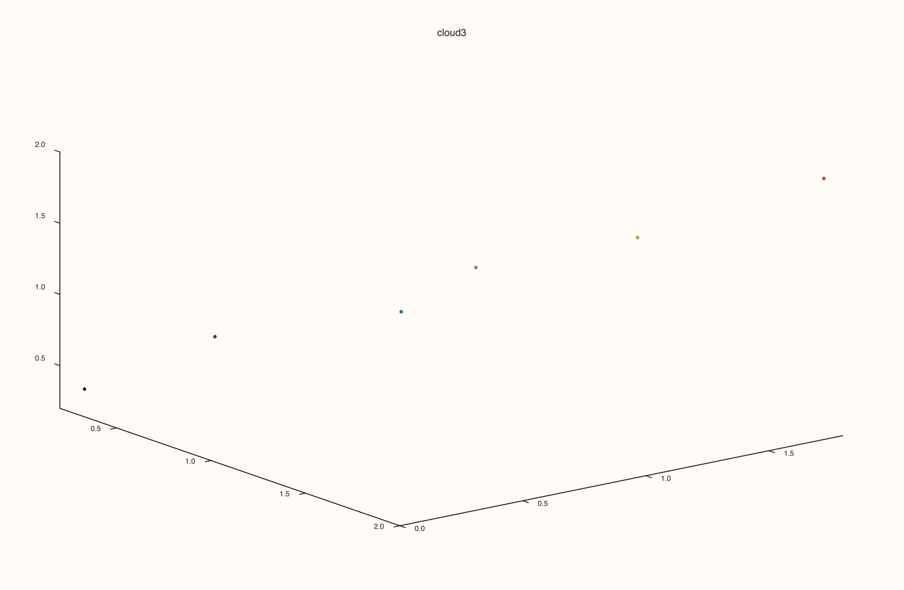
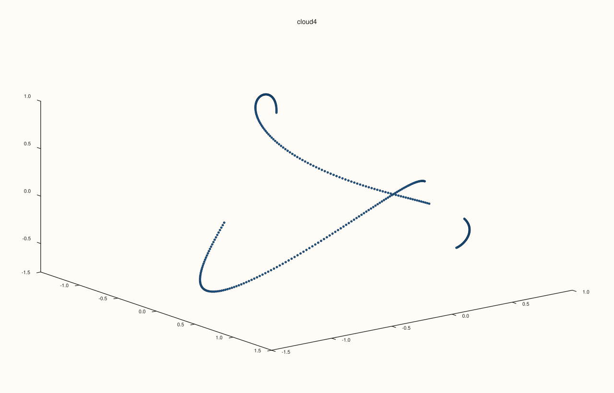
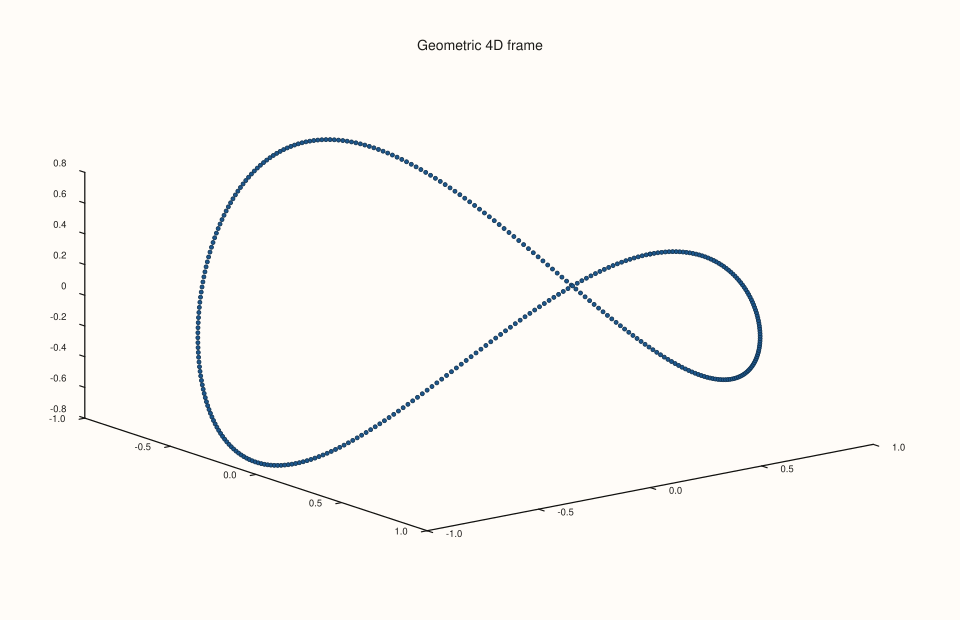
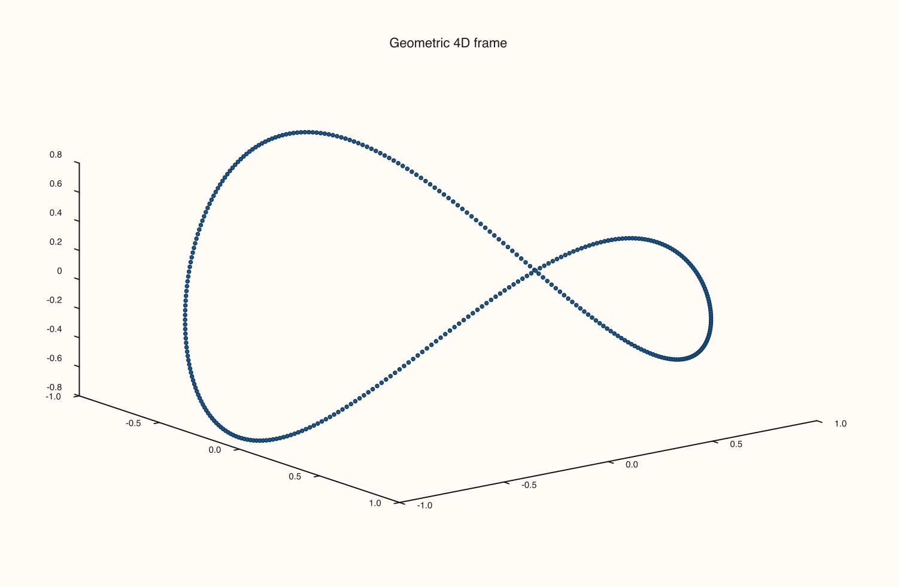
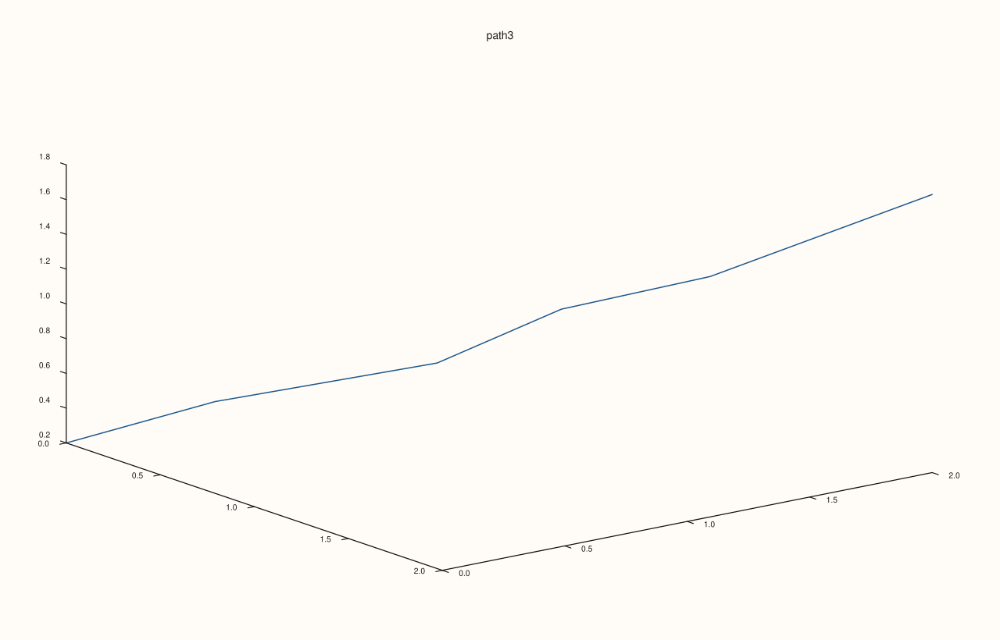
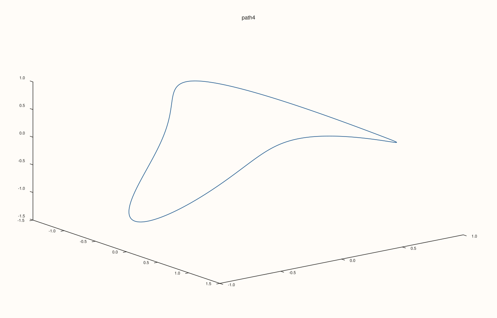
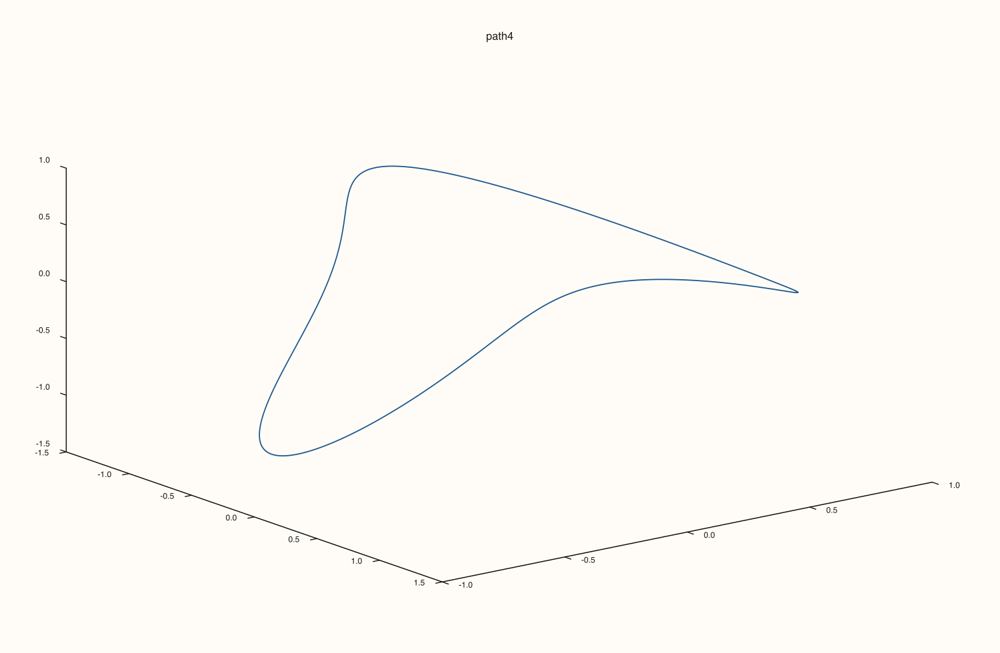
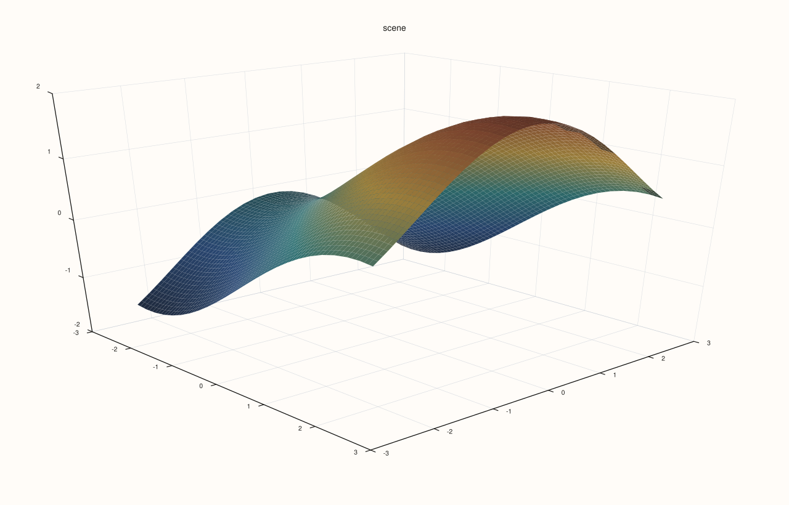
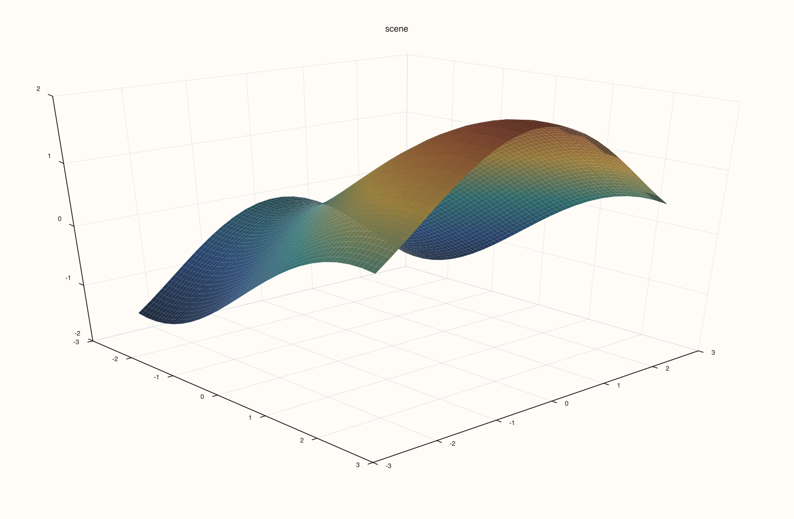
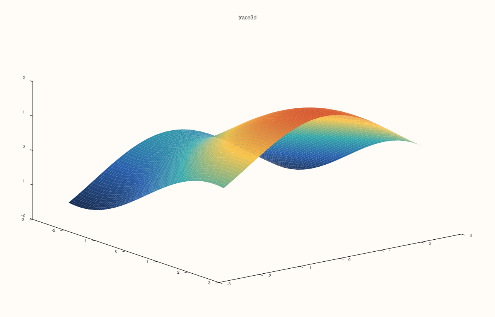

# Flash 3D and 4D Scene API

Scene/camera helpers and high-dimensional motion/projection methods in `pluss::pl::flash`.

## API Reference Style

### `flash::cloud3`

#### Signature

```cpp
Trace& cloud3(self: Pane, x: SeriesLike, y: SeriesLike, z: SeriesLike);
Trace& cloud3(self: Pane, x: SeriesLike, y: SeriesLike, z: SeriesLike, size: SeriesLike);
Trace& cloud3(self: Pane, x: SeriesLike, y: SeriesLike, z: SeriesLike, size: SeriesLike, color: SeriesLike);
```

#### Notes

3D scatter cloud with optional point size and color channels.

#### Example

```{literalinclude} ../../examples/docs/snippets/keys/cloud3.cpp
:language: cpp
```

#### Output

```{only} html

```

```{only} not html

```

### `flash::cloud4`

#### Signature

```cpp
Trace& cloud4(self: Pane|Studio, x: SeriesLike, y: SeriesLike, z: SeriesLike, w: SeriesLike, options: HyperPlotOptions = {}, title: std::string = {});
```

#### Notes

Projects 4D samples into 3D and renders point clouds; supports rotation and w-slicing in `HyperPlotOptions`.

#### Example

```{literalinclude} ../../examples/docs/snippets/keys/cloud4.cpp
:language: cpp
```

#### Output

```{only} html

```

```{only} not html

```

### `flash::export4_frames`

#### Signature

```cpp
std::int64_t export4_frames(x: SeriesLike, y: SeriesLike, z: SeriesLike, w: SeriesLike, options: HyperFrameExportOptions = {});
```

#### Notes

Exports a sweep of static frames (`png`/`svg`/`pdf`) for offline animation workflows.

#### Example

```{literalinclude} ../../examples/docs/snippets/keys/export4_frames.cpp
:language: cpp
```

#### Output

```{only} html

```

```{only} not html

```

### `flash::path3`

#### Signature

```cpp
Trace& path3(self: Pane|Studio, x: SeriesLike, y: SeriesLike, z: SeriesLike, title: std::string = {});
```

#### Notes

Connected 3D trajectory through ordered samples.

#### Example

```{literalinclude} ../../examples/docs/snippets/keys/path3.cpp
:language: cpp
```

#### Output

```{only} html

```

```{only} not html

```

### `flash::path4`

#### Signature

```cpp
Trace& path4(self: Pane|Studio, x: SeriesLike, y: SeriesLike, z: SeriesLike, w: SeriesLike, options: HyperPlotOptions = {}, title: std::string = {});
```

#### Notes

Projects a 4D trajectory into 3D and renders a connected path.

#### Example

```{literalinclude} ../../examples/docs/snippets/keys/path4.cpp
:language: cpp
```

#### Output

```{only} html

```

```{only} not html

```

### `flash::scene3d`

#### Signature

```cpp
Pane& scene3d(self: Pane, options: Scene3DOptions);
```

#### Notes

Applies coordinated 3D scene configuration: camera, lighting, grid style, and scene presets.

#### Example

```{literalinclude} ../../examples/docs/snippets/keys/scene3d.cpp
:language: cpp
```

#### Output

```{only} html

```

```{only} not html

```

### `flash::trace3d`

#### Signature

```cpp
Trace& trace3d(self: Trace, options: Trace3DOptions);
Trace& trace_preset3d(self: Trace, preset: TracePreset3D);
```

#### Notes

Post-processes a 3D trace with shading/material/lighting presets.

#### Example

```{literalinclude} ../../examples/docs/snippets/keys/trace3d.cpp
:language: cpp
```

#### Output

```{only} html

```

```{only} not html

```

### `flash::animate3`

#### Signature

```cpp
bool animate3(x: SeriesLike, y: SeriesLike, z: SeriesLike, options: Animation3Options = {});
```

#### Notes

Interactive webview animation (not a static render call). For doc previews, use `path3`/`cloud3` outputs with the same source data.

#### Example

```cpp
pluss::pl::flash::Animation3Options options;
options.title = "3D simulation";
options.sweep_speed_deg_per_sec = 18.0;
options.snapshot_prefix = "flash3d";

const bool opened = pluss::pl::flash::animate3(x, y, z, options);
```

#### Output

```{only} html

```

```{only} not html

```

### `flash::animate4`

#### Signature

```cpp
bool animate4(x: SeriesLike, y: SeriesLike, z: SeriesLike, w: SeriesLike, options: HyperAnimationOptions = {});
```

#### Notes

Interactive geometric 4D animation in a webview with live sweep controls; use `export4_frames` for deterministic artifacts.

#### Example

```cpp
pluss::pl::flash::HyperAnimationOptions options;
options.title = "Geometric 4D simulation";
options.sweep_plane = pluss::pl::flash::HyperAnimateSweepPlane::XW;
options.sweep_speed_deg_per_sec = 22.0;

const bool opened = pluss::pl::flash::animate4(x4, y4, z4, w4, options);
```

#### Output

```{only} html

```

```{only} not html

```
