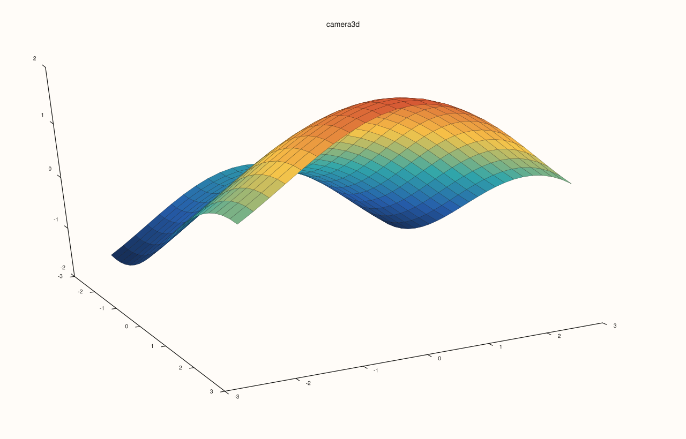
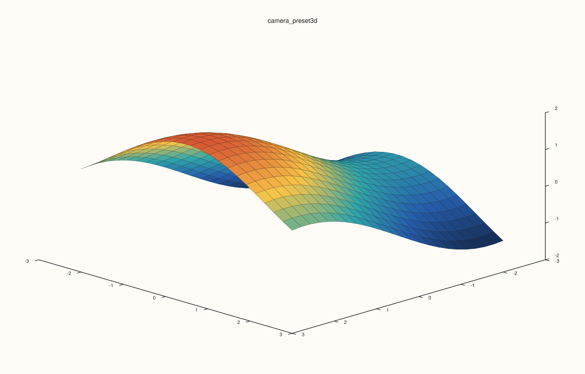
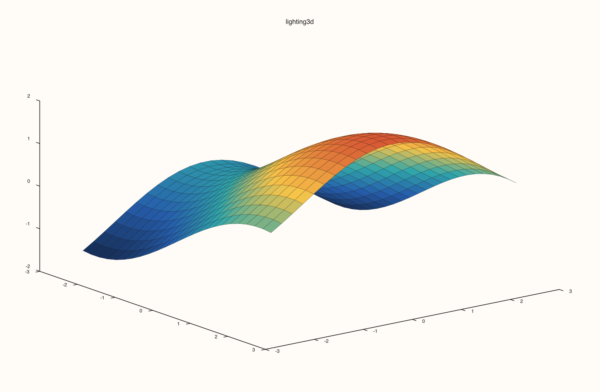
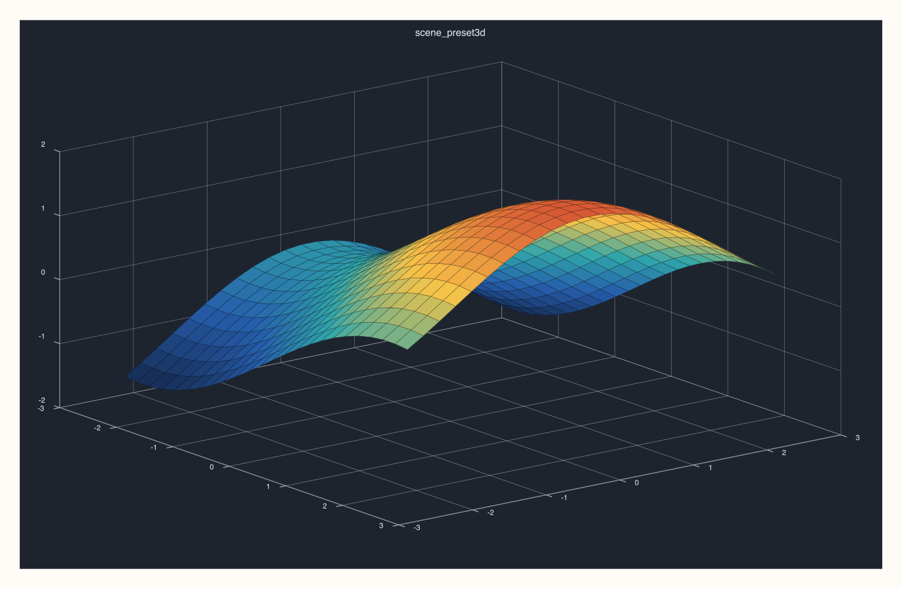

# Flash Scene Presets and 3D Control API

Explicit reference for `pluss::pl::flash` scene/camera/lighting preset helpers.

## API Reference Style

### `flash::camera3d`

#### Signature

```cpp
Pane& camera3d(self: Pane, options: Camera3DOptions);
Pane& camera3d(self: Pane, azimuth_deg: double, elevation_deg: double, projection: ProjectionKind = ProjectionKind::Orthographic, view_angle_deg: double = 30.0);
```

#### Notes

Sets camera orientation/projection on a 3D pane.

#### Example

```{literalinclude} ../../examples/docs/snippets/keys/camera3d.cpp
:language: cpp
```

#### Output

```{only} html

```

```{only} not html

```

### `flash::camera_preset3d`

#### Signature

```cpp
Pane& camera_preset3d(self: Pane, preset: CameraPreset3D);
```

#### Notes

Applies a named camera setup (`Spatial`, `TopDown`, `Front`, `Side`, `Isometric`).

#### Example

```{literalinclude} ../../examples/docs/snippets/keys/camera_preset3d.cpp
:language: cpp
```

#### Output

```{only} html

```

```{only} not html

```

### `flash::lighting3d`

#### Signature

```cpp
Pane& lighting3d(self: Pane, options: Lighting3DOptions);
```

#### Notes

Configures directional/light-rig composition for 3D traces.

#### Example

```{literalinclude} ../../examples/docs/snippets/keys/lighting3d.cpp
:language: cpp
```

#### Output

```{only} html

```

```{only} not html

```

### `flash::theme_preset3d`

#### Signature

```cpp
Pane& theme_preset3d(self: Pane, preset: ThemePreset3D);
```

#### Notes

Applies a 3D-focused theme preset (`Paper`, `Ocean`, `Slate`, `Mist`).

#### Example

```{literalinclude} ../../examples/docs/snippets/keys/theme_preset3d.cpp
:language: cpp
```

#### Output

```{only} html

```

```{only} not html

```

### `flash::scene_preset3d`

#### Signature

```cpp
Pane& scene_preset3d(self: Pane, preset: ScenePreset3D);
```

#### Notes

Applies coordinated camera/theme/lighting defaults (`Survey`, `Presentation`, `Studio`, `Topology`).

#### Example

```{literalinclude} ../../examples/docs/snippets/keys/scene_preset3d.cpp
:language: cpp
```

#### Output

```{only} html

```

```{only} not html

```

### `flash::trace_preset3d`

#### Signature

```cpp
Trace& trace_preset3d(self: Trace, preset: TracePreset3D);
```

#### Notes

Applies trace-level 3D material/shading profile (`Path`, `Cloud`, `Surface`, `Wireframe`, `Spire`, `Volume`).

#### Example

```{literalinclude} ../../examples/docs/snippets/keys/trace_preset3d.cpp
:language: cpp
```

#### Output

```{only} html

```

```{only} not html

```
