# Flash Theming API

`pluss::pl::flash` style/context helpers for figure sizing, pane styling, and palette policy.

## API Reference Style

### `flash::color_palette`

#### Signature

```cpp
PaletteRamp color_palette(name: std::string_view = "ocean");
```

#### Notes

Returns a named palette ramp (`ocean`, `thermal`, `lagoon`, `meadow`, `neutral`, plus seaborn-like names).

#### Example

```{literalinclude} ../../examples/docs/snippets/keys/color_palette.cpp
:language: cpp
```

#### Output

```{only} html
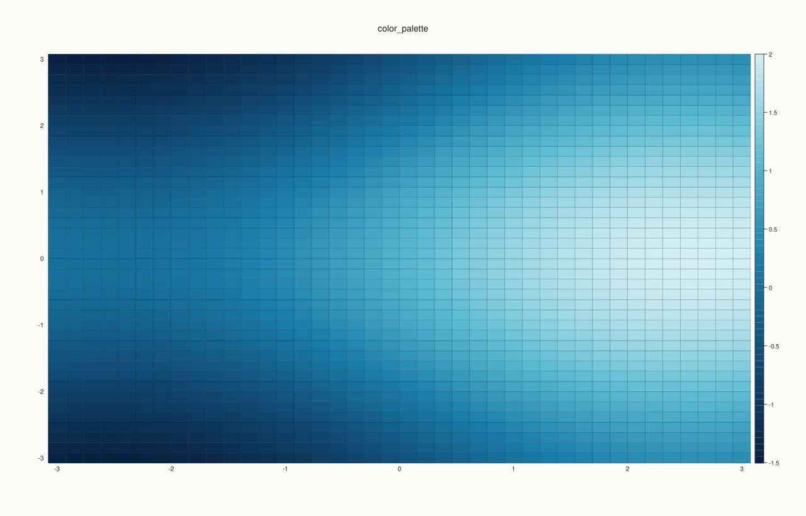
```

```{only} not html
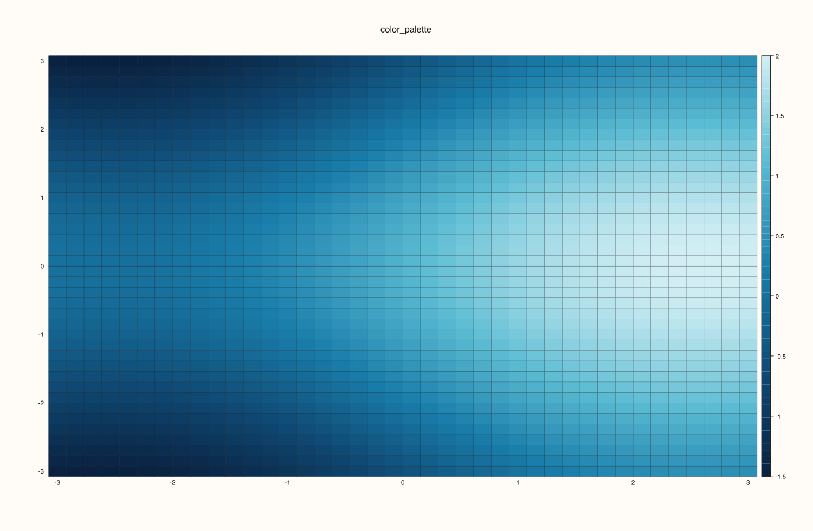
```

### `flash::despine`

#### Signature

```cpp
Pane& despine(self: Pane, enable: bool = true) noexcept;
```

#### Notes

Keeps the plotting content while removing pane-frame emphasis for cleaner minimalist charts.

#### Example

```{literalinclude} ../../examples/docs/snippets/keys/despine.cpp
:language: cpp
```

#### Output

```{only} html
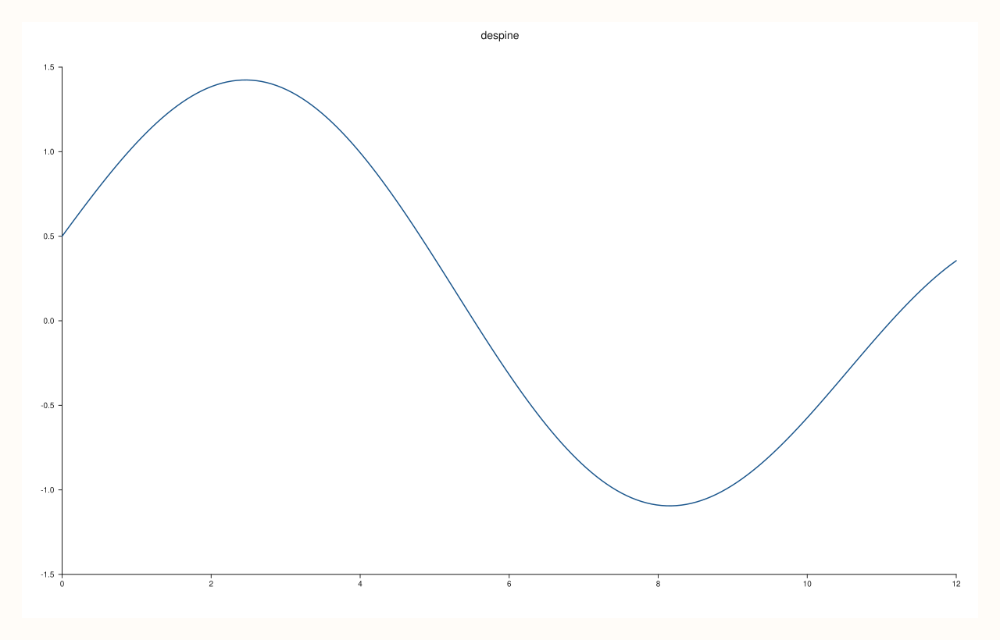
```

```{only} not html

```

### `flash::horizontal_grid`

#### Signature

```cpp
Pane& horizontal_grid(self: Pane, enable: bool = true) noexcept;
```

#### Notes

Applies y-major grid only (with x-grid suppressed) for time-series readability.

#### Example

```{literalinclude} ../../examples/docs/snippets/keys/horizontal_grid.cpp
:language: cpp
```

#### Output

```{only} html

```

```{only} not html

```

### `flash::load_dataset`

#### Signature

```cpp
std::optional<Dataset> load_dataset(name: std::string_view);
```

#### Notes

Loads built-in dataset bundles (currently `tips`, `flights`) for quick exploratory plotting flows.

#### Example

```{literalinclude} ../../examples/docs/snippets/keys/load_dataset.cpp
:language: cpp
```

#### Output

```{only} html
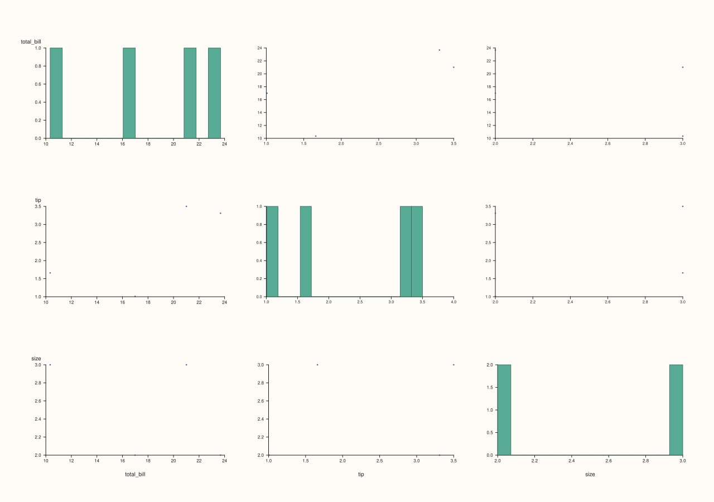
```

```{only} not html
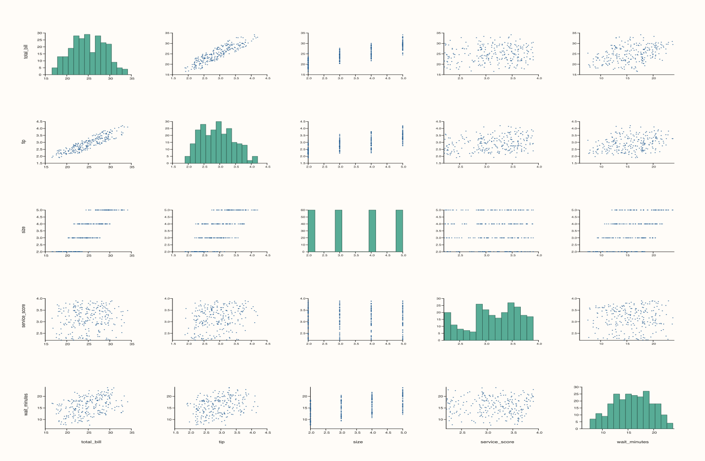
```

### `flash::plotting_context`

#### Signature

```cpp
Studio& plotting_context(self: Studio, width: double, height: double, tick_font_scale: double = 1.0, axis_label_font_scale: double = 1.0);
```

#### Notes

Alias of `set_context(...)`; applies figure extent and tick/label scaling.

#### Example

```{literalinclude} ../../examples/docs/snippets/keys/plotting_context.cpp
:language: cpp
```

#### Output

```{only} html
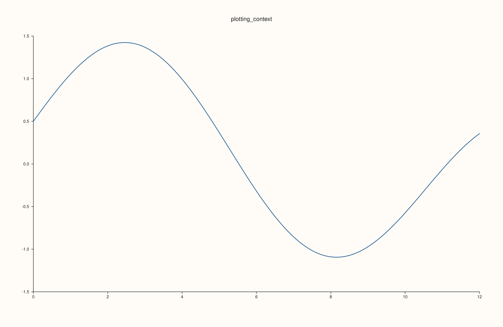
```

```{only} not html
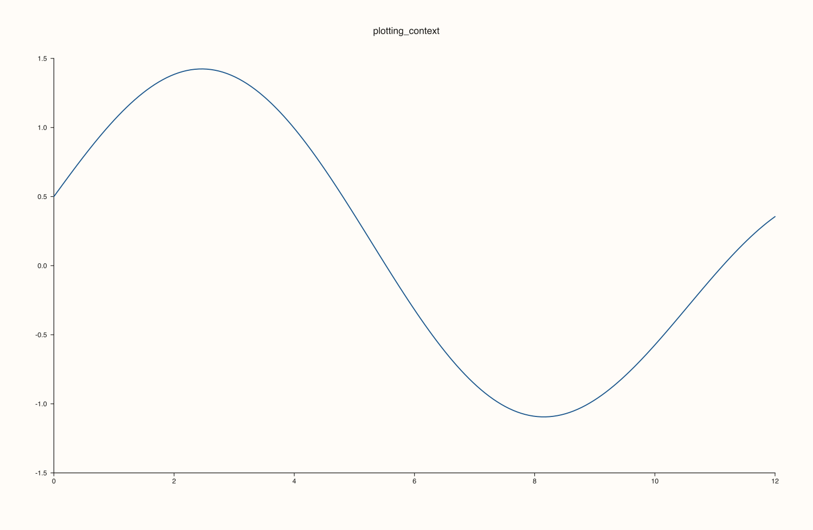
```

### `flash::set_context`

#### Signature

```cpp
Studio& set_context(self: Studio, width: double, height: double, tick_font_scale: double = 1.0, axis_label_font_scale: double = 1.0);
Studio& set_context(self: Studio, context: FlashContext, width: std::optional<double> = std::nullopt, height: std::optional<double> = std::nullopt);
```

#### Notes

Primary context entry point. Use explicit dimensions or semantic context presets (`Paper`, `Notebook`, `Talk`, `Poster`).

#### Example

```{literalinclude} ../../examples/docs/snippets/keys/set_context.cpp
:language: cpp
```

#### Output

```{only} html

```

```{only} not html
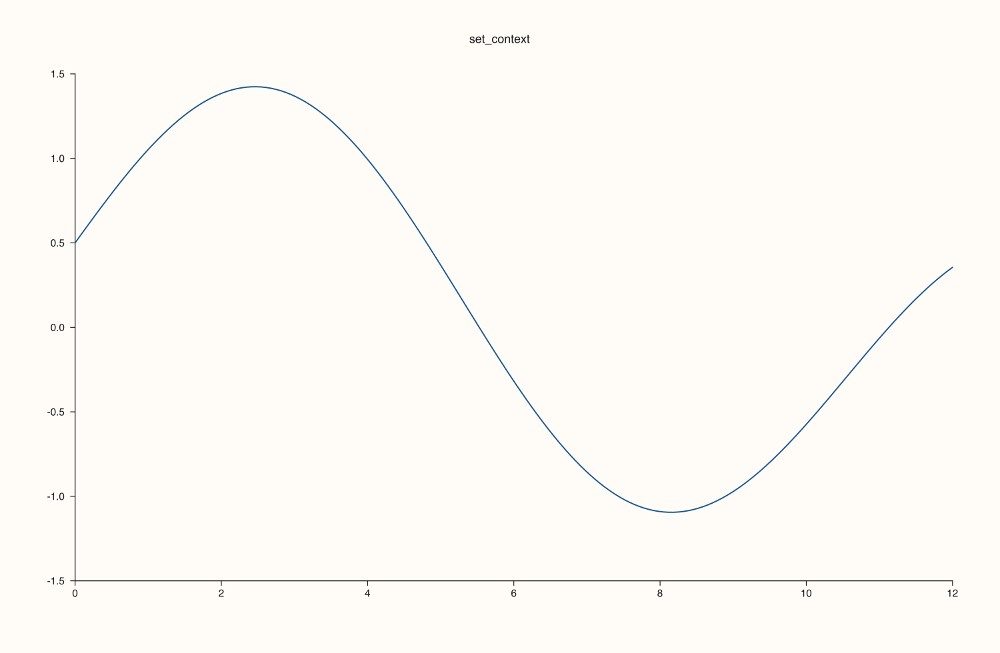
```

### `flash::set_style`

#### Signature

```cpp
Pane& set_style(self: Pane, style: GridStyle = GridStyle::Major);
Pane& set_style(self: Pane, style: FlashStyle);
```

#### Notes

Low-level style primitive for a single pane (`Darkgrid`, `Lightgrid`, `Sandgrid`, `Dark`, `Light`, `Sand`).

#### Example

```{literalinclude} ../../examples/docs/snippets/keys/set_style.cpp
:language: cpp
```

#### Output

```{only} html
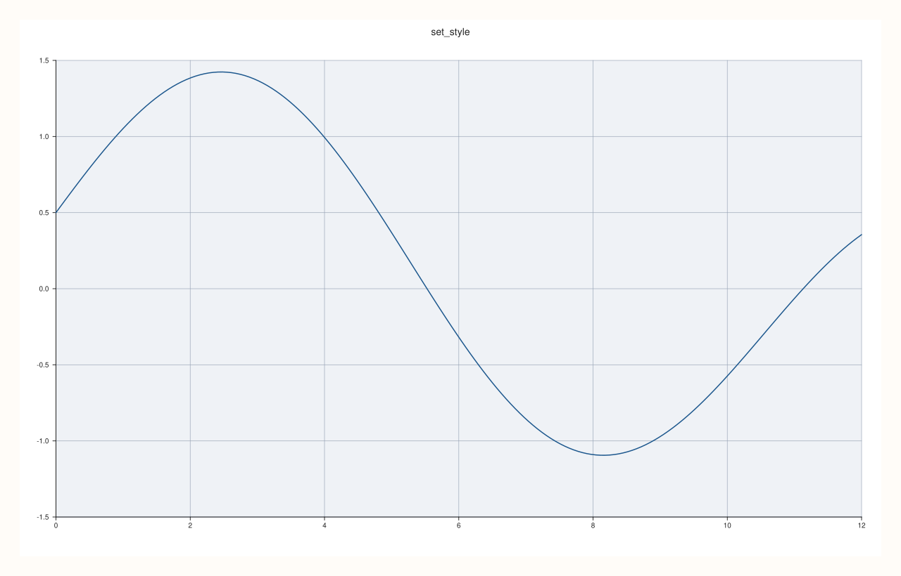
```

```{only} not html

```

### `flash::set_theme` (Pane)

#### Signature

```cpp
Pane& set_theme(self: Pane, options: FlashThemeOptions);
Pane& set_theme(self: Pane, style: FlashStyle, context: FlashContext = FlashContext::Inherit, borderless: bool = false, horizontal_grid: bool = false);
```

#### Notes

Applies local theme policy to one pane, including style, context font scales, and grid/border rules.

#### Example

```{literalinclude} ../../examples/docs/snippets/keys/set_theme_pane.cpp
:language: cpp
```

#### Output

```{only} html
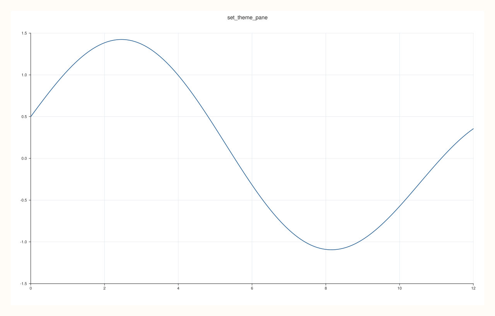
```

```{only} not html
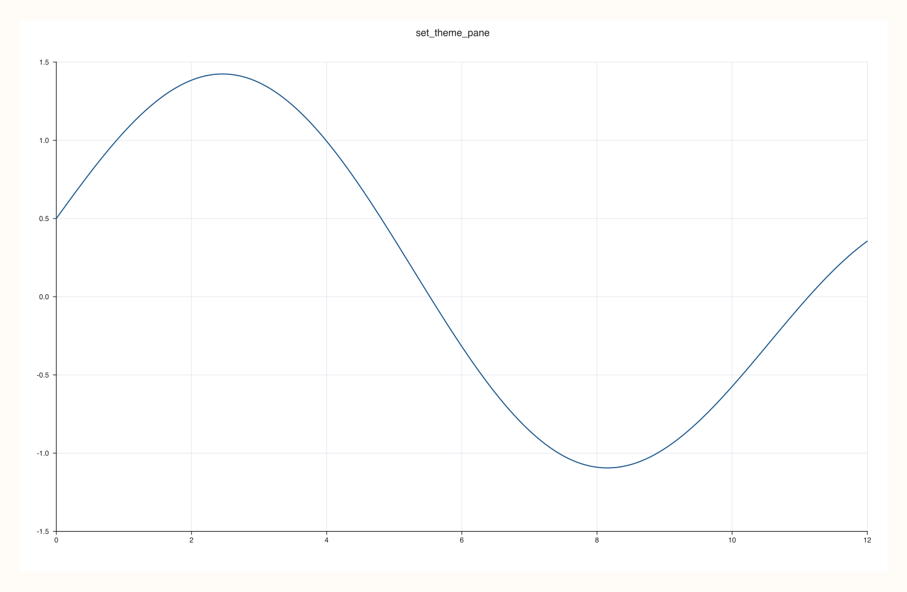
```

### `flash::set_theme` (Studio)

#### Signature

```cpp
Studio& set_theme(self: Studio, options: FlashThemeOptions);
Studio& set_theme(self: Studio, theme: Theme = Theme::paper());
```

#### Notes

Applies style defaults and context sizing across the full figure and existing panes.

#### Example

```{literalinclude} ../../examples/docs/snippets/keys/set_theme_studio.cpp
:language: cpp
```

#### Output

```{only} html

```

```{only} not html
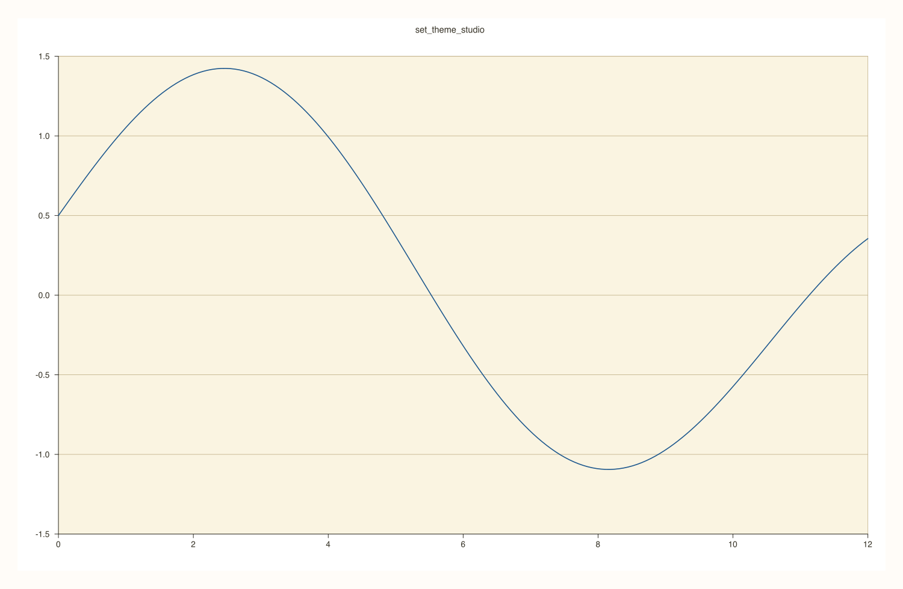
```

### `flash::tight_layout`

#### Signature

```cpp
Studio& tight_layout(self: Studio, padding: double = 6.0);
```

#### Notes

Compacts pane spacing after content has been placed in a mosaic.

#### Example

```{literalinclude} ../../examples/docs/snippets/keys/tight_layout.cpp
:language: cpp
```

#### Output

```{only} html
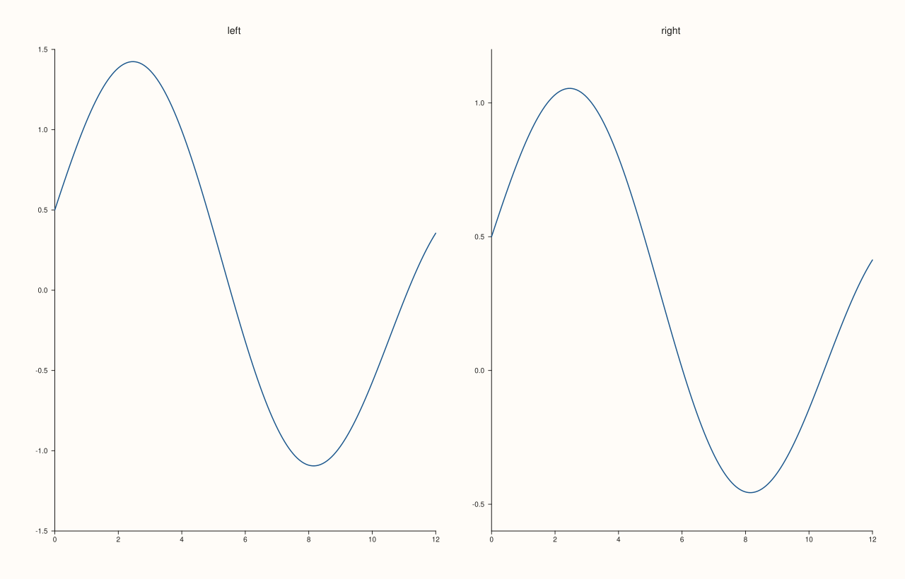
```

```{only} not html
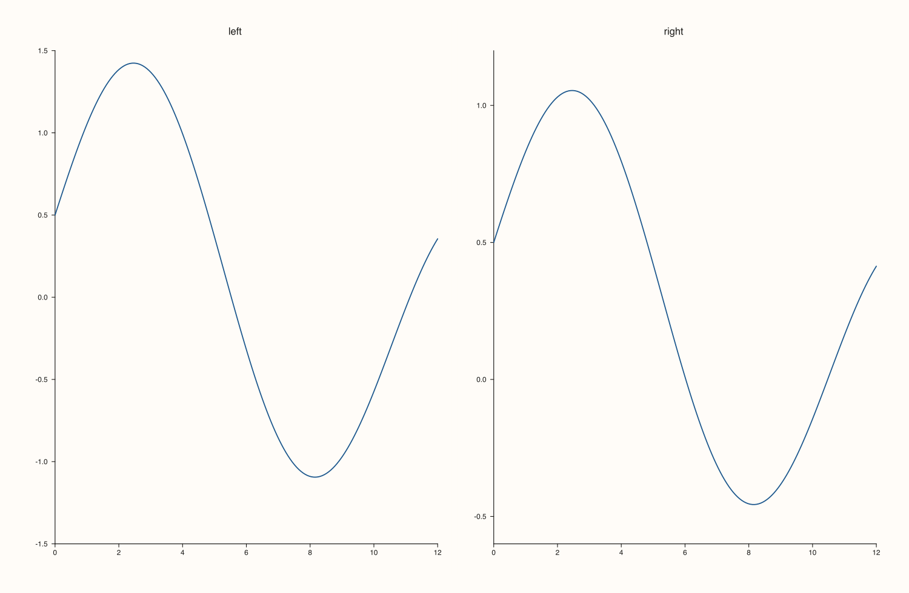
```
