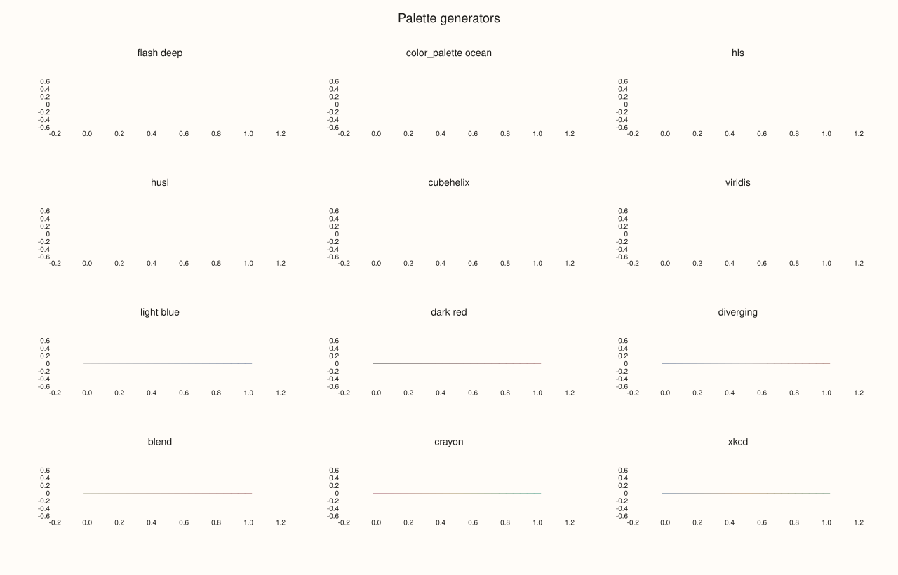
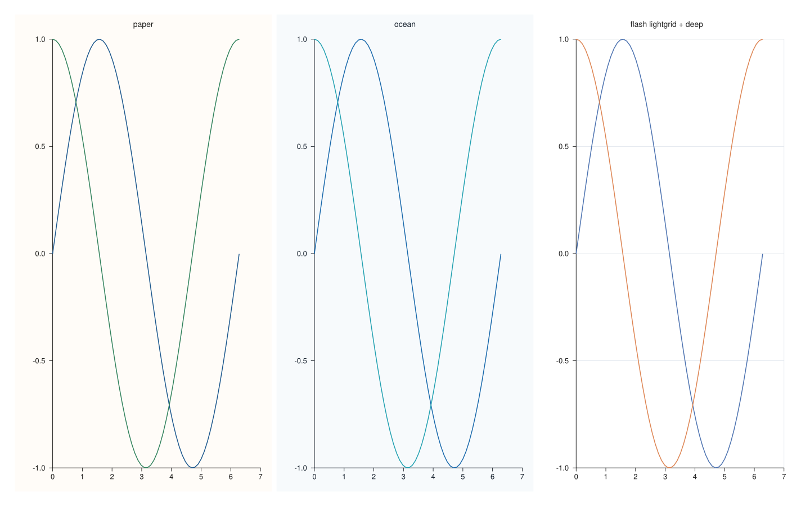

<!-- generated from colour_and_style.md.in by PlussMa/docs/tools/render_guide.py; edit the template -->

# Colour and style

[Back to PlussPl by example](../guide.md)

Colour carries data and style carries the look of a whole figure. This page uses the palette generators, applies them to a field, restyles the same chart with three themes, and shows how to wrap any table so the `flash` functions can read it by column name.

## How it works

A palette is a `PaletteRamp`: an ordered list of colours that data values map through, sampled with `sample(position)` from 0 to 1. The generators build one: `flash_palette`, `color_palette`, `hls_palette`, `husl_palette`, `cubehelix_palette`, `mpl_palette`, `light_palette`, `dark_palette`, `diverging_palette`, `blend_palette`, `crayon_palette` and `xkcd_palette`. A trace uses a ramp through `.palette(ramp)`. A **theme** restyles a whole figure (`Theme::paper()`, `Theme::ocean()`, `flash::flash_theme()`), a **context** scales fonts for a use (`set_context`), and helpers tidy a pane (`despine`, `tickless`, `horizontal_grid`, `tight_layout`).

## Palettes and themes

The program prints the first and last colour of each generator, draws each as a strip of a field, draws the same chart under three themes, and wraps a small table as a dataset.

```cpp
#include <pluss/pl/plusspl.h>
#include <pluss/pluss.h>

#include <cmath>
#include <cstdlib>
#include <filesystem>
#include <iostream>

using namespace pluss::pl;

static std::string out(const char *name) {
  const char *dir = std::getenv("PLUSSMA_GUIDE_ASSETS");
  return ((dir ? std::filesystem::path(dir) : std::filesystem::path(".")) / name).string();
}


int main() {
  // 1. Every palette generator returns a PaletteRamp, a list of stops you can sample between 0 and 1.
  const std::vector<std::pair<std::string, PaletteRamp>> palettes{
      {"flash deep", flash::flash_palette()},         {"color_palette ocean", flash::color_palette("ocean")}, {"hls", flash::hls_palette(6)},
      {"husl", flash::husl_palette(6)},               {"cubehelix", flash::cubehelix_palette(6)},               {"viridis", flash::mpl_palette("viridis")},
      {"light blue", flash::light_palette(Rgba::from_u8(40, 90, 170), 6)}, {"dark red", flash::dark_palette(Rgba::from_u8(180, 40, 40), 6)},
      {"diverging", flash::diverging_palette(Rgba::from_u8(40, 90, 170), Rgba::from_u8(190, 60, 40), 7)},
      {"blend", flash::blend_palette({Rgba::from_u8(255, 255, 200), Rgba::from_u8(200, 60, 60)})}, {"crayon", flash::crayon_palette()}, {"xkcd", flash::xkcd_palette()}};
  for (const auto &[name, ramp] : palettes) {
    const auto first = ramp.sample(0.0), last = ramp.sample(1.0);
    std::cout << name << ": first (" << static_cast<int>(first.red * 255) << ", " << static_cast<int>(first.green * 255) << ", " << static_cast<int>(first.blue * 255) << ") last ("
              << static_cast<int>(last.red * 255) << ", " << static_cast<int>(last.green * 255) << ", " << static_cast<int>(last.blue * 255) << ")\n";
  }

  // 2. Apply them: the same ramp of values drawn as a strip with each palette.
  auto fig = studio("palettes");
  fig.mosaic(4, 3);
  fig.headline("Palette generators");
  auto x = pluss::series::linspace(0.0, 1.0, 24, pluss::ScalarType::Float64);
  auto y = pluss::series::zeros({1}, pluss::ScalarType::Float64);
  auto z = x.unsqueeze(0);
  for (const auto &[name, ramp] : palettes) {
    auto &pane = fig.pane2(name);
    pane.fieldmap(x, y, z).palette(ramp);
    flash::tickless(pane);
  }
  fig.show();

  // 3. Themes and contexts restyle the whole figure at once; the same chart in three styles.
  auto data = pluss::series::linspace(0.0, 6.28, 60, pluss::ScalarType::Float64);
  auto styled = studio("themes");
  styled.mosaic(1, 3);
  for (const auto &[label, theme] : std::vector<std::pair<std::string, Theme>>{{"paper", Theme::paper()}, {"ocean", Theme::ocean()}, {"flash lightgrid + deep", flash::flash_theme()}}) {
    flash::set_theme(styled, theme);
    auto &pane = styled.pane2(label);
    pane.trend(data, data.sin());
    pane.trend(data, data.cos());
    flash::despine(pane);
    flash::horizontal_grid(pane);
  }
  flash::set_context(styled, flash::FlashContext::Talk);
  flash::tight_layout(styled);
  styled.show();

  // 4. The datasets are plain data: Dataset::from_table wraps any DataFrame so the flash functions can take it by column name.
  auto frame = pluss::table::DataFrame({{"x", pluss::make_series({1.0, 2.0, 3.0, 4.0})}, {"y", pluss::make_series({2.0, 3.5, 3.0, 5.0})}});
  const auto wrapped = flash::Dataset::from_table(frame);
  std::cout << "wrapped dataset: " << wrapped.nrows() << " rows, " << wrapped.ncols() << " columns; size() reports (" << wrapped.size().first << ", " << wrapped.size().second << ")\n";
  std::cout << "bundled datasets: " << flash::get_dataset_names().numel() << "\n";
}
```

Output

```text
flash deep: first (76, 114, 176) last (100, 181, 205)
color_palette ocean: first (9, 33, 64) last (211, 239, 244)
hls: first (215, 49, 49) last (215, 49, 215)
husl: first (225, 55, 55) last (225, 55, 225)
cubehelix: first (185, 49, 49) last (185, 49, 185)
viridis: first (44, 52, 125) last (248, 230, 84)
light blue: first (255, 255, 255) last (40, 90, 170)
dark red: first (0, 0, 0) last (180, 40, 40)
diverging: first (40, 90, 170) last (190, 60, 40)
blend: first (255, 255, 200) last (200, 60, 60)
crayon: first (239, 71, 111) last (6, 214, 160)
xkcd: first (49, 117, 187) last (89, 182, 116)
wrapped dataset: 4 rows, 2 columns; size() reports (4, 2)
bundled datasets: 13
```




Each line lists a palette's first and last colour as red, green and blue between 0 and 255: the sequential palettes (light blue, dark red, viridis) run from light to dark or the reverse, the diverging palette runs between two hues, and the categorical ones (husl, hls, crayon, xkcd) are chosen to be distinct rather than ordered. The strips make the same point visually. The theme figure draws the same two curves in three styles, with `despine` removing the top and right axis lines and `horizontal_grid` keeping only horizontal grid lines, and the context set to a talk size. `Dataset::from_table` turns any `DataFrame` into a dataset, here four rows by two columns, so that functions taking a dataset and column names accept your own tables as well as the thirteen bundled ones.

## Decisions

- **Sequential, diverging or categorical:** sequential for ordered values, diverging for values with a meaningful centre such as zero, categorical for groups.
- **A theme for the whole figure:** set it once, then style panes only where they differ.
- **Context for the medium:** a talk needs larger text than a paper.
- **Your own data:** wrap it with `Dataset::from_table` to use the by-name `flash` functions.

## Pitfalls

The program below makes 3 mistakes on purpose and prints the message each one produces.

```cpp
#include <pluss/pl/plusspl.h>
#include <pluss/pluss.h>

#include <iostream>

using namespace pluss::pl;

template <class F> static void report(const char *what, F &&call) {
  try {
    call();
    std::cout << what << ": no error\n";
  } catch (const pluss::Error &e) {
    std::cout << what << ": " << e.message() << "\n";
  }
}

int main() {
  auto x = pluss::series::linspace(0.0, 1.0, 5, pluss::ScalarType::Float64);
  auto y = x.sin();
  auto y3 = pluss::series::linspace(0.0, 1.0, 3, pluss::ScalarType::Float64);
  auto flat = pluss::make_series({1.0, 2.0, 3.0, 4.0});
  auto matrix = pluss::series::linspace(0.0, 1.0, 20, pluss::ScalarType::Float64).reshape({4, 5});
  auto empty = pluss::series::zeros({0}, pluss::ScalarType::Float64);
  auto groups = pluss::make_note({"a", "b", "c"});
  report("a palette of zero colours", [&] { flash::hls_palette(0); });
  report("a negative palette size", [&] { flash::husl_palette(-3); });
  report("a canvas with a negative size", [&] { auto f = studio("c"); flash::set_context(f, -5.0, 100.0); });
}
```

Output

```text
a palette of zero colours: flash::hls_palette: n must be at least 1
a negative palette size: flash::hls_palette: n must be at least 1
a canvas with a negative size: size: width and height must be finite and positive
```
- **A palette of zero colours:** An empty palette has nothing to sample, so the generators insist on at least one colour.
- **A negative palette size:** The same check covers every generator that takes a size.
- **A canvas with a negative size:** A figure size must be finite and positive; pick a context with `FlashContext` instead of typing a size when you only want a medium.

Each message names the function that refused the input, so the fix is to correct the data before the call: check lengths and shapes where the data is built, not where it is drawn.

## Where next

Reference pages: [`flash::flash_palette`](../api/flash/flash_palette.md), [`flash::color_palette`](../api/flash/color_palette.md), [`flash::hls_palette`](../api/flash/hls_palette.md), [`flash::husl_palette`](../api/flash/husl_palette.md), [`flash::cubehelix_palette`](../api/flash/cubehelix_palette.md), [`flash::mpl_palette`](../api/flash/mpl_palette.md), [`flash::light_palette`](../api/flash/light_palette.md), [`flash::dark_palette`](../api/flash/dark_palette.md), [`flash::diverging_palette`](../api/flash/diverging_palette.md), [`flash::blend_palette`](../api/flash/blend_palette.md), [`flash::crayon_palette`](../api/flash/crayon_palette.md), [`flash::xkcd_palette`](../api/flash/xkcd_palette.md), [`flash::flash_theme`](../api/flash/flash_theme.md), [`flash::set_theme`](../api/flash/set_theme.md), [`flash::set_context`](../api/flash/set_context.md), [`flash::despine`](../api/flash/despine.md), [`flash::tickless`](../api/flash/tickless.md), [`flash::horizontal_grid`](../api/flash/horizontal_grid.md), [`flash::tight_layout`](../api/flash/tight_layout.md), [`flash::Dataset`](../api/flash/Dataset.md), [`flash::get_dataset_names`](../api/flash/get_dataset_names.md), [`PaletteRamp`](../api/types/PaletteRamp.md), [`Theme`](../api/types/Theme.md). Back to [PlussPl by example](../guide.md).
