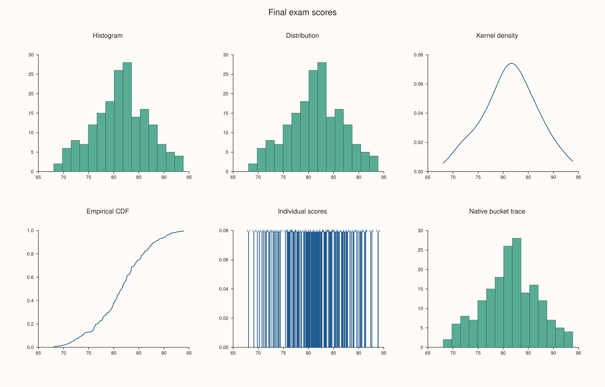
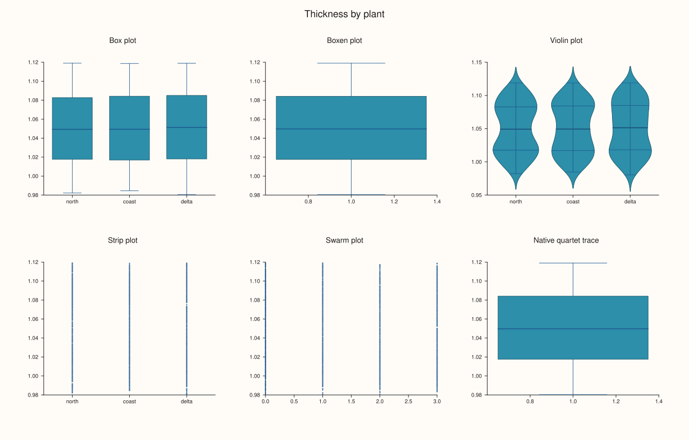
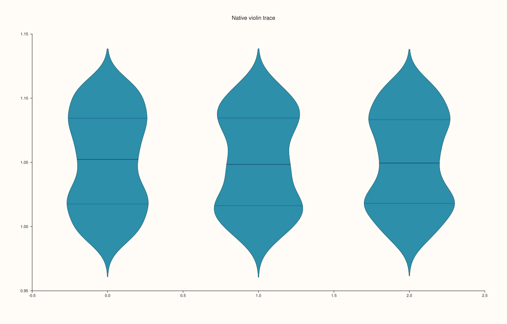
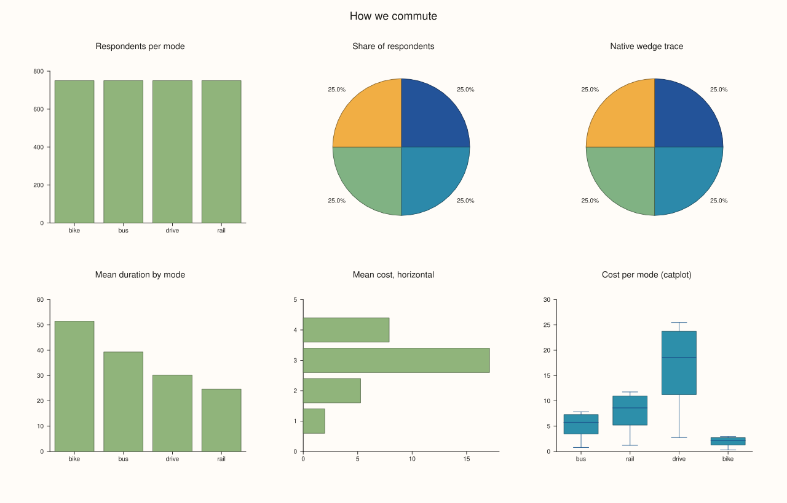

<!-- generated from distributions_and_groups.md.in by PlussMa/docs/tools/render_guide.py; edit the template -->

# Distributions and groups

[Back to PlussPl by example](../guide.md)

A mean hides the shape of the data. This page shows the shape of one variable six ways (an exam), compares a variable across groups five ways (manufactured batches by plant), and then counts and shares of categories (a commuting survey).

## How it works

A distribution of one variable is a histogram (`histplot`, `displot` or the native `bucket`), a smoothed density (`kdeplot`), a cumulative curve (`ecdfplot`), or the raw values along an axis (`rugplot`). Across groups the choices are the box (`boxplot`, the native `quartet`), the letter-value box (`boxenplot`), the density shape (`violinplot`, the native `violin`), and the individual points (`stripplot`, `swarmplot`). For categories, `countplot` counts, `barplot` plots a value per category, `pieplot` and the native `wedge` show shares, and `catplot` chooses the plot kind by name.

## One exam, six views

A hundred and eighty final-exam scores.

```cpp
#include <pluss/pl/plusspl.h>
#include <pluss/pluss.h>

#include <cmath>
#include <cstdlib>
#include <filesystem>
#include <iostream>

using namespace pluss::pl;

static std::string out(const char *name) {
  const char *dir = std::getenv("PLUSSMA_GUIDE_ASSETS");
  return ((dir ? std::filesystem::path(dir) : std::filesystem::path(".")) / name).string();
}

int main() {
  auto loaded = flash::load_dataset("exams");
  const auto exams = loaded->frame();
  auto final_exam = exams.features("final_exam").as_series();
  auto midterm = exams.features("midterm_1").as_series();
  std::cout << final_exam.numel() << " students; mean " << final_exam.mean().item<double>() << ", median " << final_exam.median().item<double>() << ", std " << final_exam.std().item<double>() << "\n";
  std::cout << "quartiles " << final_exam.quantile(0.25).item<double>() << " " << final_exam.quantile(0.5).item<double>() << " " << final_exam.quantile(0.75).item<double>() << "\n";

  auto fig = studio("exam_scores");
  fig.mosaic(2, 3);
  fig.headline("Final exam scores");
  auto &hist = fig.pane2("Histogram");
  flash::histplot(hist, final_exam, 15);
  auto &dist = fig.pane2("Distribution");
  flash::displot(dist, final_exam, 15);
  auto &kde = fig.pane2("Kernel density");
  flash::kdeplot(kde, final_exam);
  auto &ecdf = fig.pane2("Empirical CDF");
  flash::ecdfplot(ecdf, final_exam);
  auto &rug = fig.pane2("Individual scores");
  flash::rugplot(rug, final_exam);
  auto &bucket = fig.pane2("Native bucket trace");
  bucket.bucket(final_exam, 15);
  fig.show();

  // The ECDF answers "what share scored below x": read it from the data.
  for (double cut : {70.0, 75.0, 80.0})
    std::cout << "share below " << cut << ": " << (final_exam < cut).to(pluss::ScalarType::Float64).mean().item<double>() << "\n";
  std::cout << "correlation of the final with the first midterm: " << ((final_exam - final_exam.mean()) * (midterm - midterm.mean())).sum().item<double>() / std::sqrt((final_exam - final_exam.mean()).square().sum().item<double>() * (midterm - midterm.mean()).square().sum().item<double>()) << "\n";
}
```

Output

```text
180 students; mean 81.3861, median 81.53, std 5.37346
quartiles 77.87 81.57 85.14
share below 70: 0.0166667
share below 75: 0.127778
share below 80: 0.377778
correlation of the final with the first midterm: 0.645656
```


The scores have a mean of `81.4`, a median of `81.5` and a standard deviation of `5.4`; the quartiles are `77.9`, `81.6` and `85.1`. The empirical CDF is the picture to read quantities from, and the program reads the same quantities from the data: `1.7 %` scored below 70, `12.8 %` below 75 and `37.8 %` below 80. The correlation with the first midterm is `0.65`, a clear but not overwhelming relationship. The six panes show that the histogram, the distribution plot and the native bucket draw the same binning, while the density smooths it and the rug shows every score as a tick.

## Thickness by plant

Two thousand manufactured batches from three plants. The program prints the per-plant statistics and then draws the five group views.

```cpp
#include <pluss/pl/plusspl.h>
#include <pluss/pluss.h>

#include <cmath>
#include <cstdlib>
#include <filesystem>
#include <iostream>

using namespace pluss::pl;

static std::string out(const char *name) {
  const char *dir = std::getenv("PLUSSMA_GUIDE_ASSETS");
  return ((dir ? std::filesystem::path(dir) : std::filesystem::path(".")) / name).string();
}

int main() {
  auto loaded = flash::load_dataset("quality_batches");
  const auto batches = loaded->frame();
  auto thickness = batches.features("thickness").as_series();
  auto plant = batches.features("plant").as_note();
  std::cout << batches.ncases() << " batches\n";
  auto means = batches.group({.dropnull = true, .sort = true}).by({"plant"}).agg({{"batches", "thickness", pluss::table::DataFrame::GroupOp::Count}, {"mean", "thickness", pluss::table::DataFrame::GroupOp::Mean}, {"std", "thickness", pluss::table::DataFrame::GroupOp::Std}});
  std::cout << means.to_string() << "\n";

  auto fig = studio("quality_control");
  fig.mosaic(2, 3);
  fig.headline("Thickness by plant");
  auto &box = fig.pane2("Box plot");
  flash::boxplot(box, plant, thickness);
  auto &boxen = fig.pane2("Boxen plot");
  flash::boxenplot(boxen, thickness);
  auto &violin = fig.pane2("Violin plot");
  flash::violinplot(violin, plant, thickness);
  auto &strip = fig.pane2("Strip plot");
  flash::stripplot(strip, plant, thickness);
  auto &swarm = fig.pane2("Swarm plot");
  flash::swarmplot(swarm, pluss::series::arange(0, thickness.numel(), pluss::ScalarType::Float64).remainder(4.0), thickness);
  auto &quartet = fig.pane2("Native quartet trace");
  quartet.quartet(thickness);
  fig.show();

  // The native violin trace takes numeric group codes and its own options: here a narrower, smoother shape per plant.
  auto codes = pluss::series::arange(0, thickness.numel(), pluss::ScalarType::Float64).remainder(3.0);
  auto native = studio("quality_violin");
  auto &pane = native.pane2("Native violin trace");
  pane.violin(codes, thickness, ViolinOptions{.width = 0.6, .bw_adjust = 0.8, .inner = ViolinInner::Quartile});
  native.show();
  std::cout << "native violin written\n";
}
```

Output

```text
2000 batches
=================================================
     | plant  batches  mean         std          
-------------------------------------------------
0    | coast  700      1.050383571  0.03710219196
1    | delta  600      1.0512495    0.03815412028
2    | north  700      1.050387429  0.03745433594
-------------------------------------------------
[3 cs x 4 feat]
native violin written
```




The table is the first thing to read: the three plants have the same mean thickness, `1.050`, `1.051` and `1.050`, and the same standard deviation near `0.037`. When the summary statistics agree, the shape plots are the only way to tell whether the plants really are alike, and here they are: the box, violin and strip plots all show three overlapping populations. The native `violin` trace takes numeric group codes and a `ViolinOptions` (width, bandwidth adjustment, what to draw inside), shown in the second figure.

## How we commute

A survey of three thousand commuters: how many use each mode, the share, the mean duration and cost.

```cpp
#include <pluss/pl/plusspl.h>
#include <pluss/pluss.h>

#include <cmath>
#include <cstdlib>
#include <filesystem>
#include <iostream>

using namespace pluss::pl;

static std::string out(const char *name) {
  const char *dir = std::getenv("PLUSSMA_GUIDE_ASSETS");
  return ((dir ? std::filesystem::path(dir) : std::filesystem::path(".")) / name).string();
}


int main() {
  auto loaded = flash::load_dataset("commute_modes");
  const auto survey = loaded->frame();
  auto mode = survey.features("mode").as_note();
  auto duration = survey.features("duration_min").as_series();
  auto cost = survey.features("cost").as_series();
  auto city = survey.features("city").as_note();
  std::cout << survey.ncases() << " respondents\n";
  auto per_mode = survey.group({.dropnull = true, .sort = true}).by({"mode"}).agg({{"people", "duration_min", pluss::table::DataFrame::GroupOp::Count}, {"minutes", "duration_min", pluss::table::DataFrame::GroupOp::Mean}, {"cost", "cost", pluss::table::DataFrame::GroupOp::Mean}});
  std::cout << per_mode.to_string() << "\n";

  auto fig = studio("commute_survey");
  fig.mosaic(2, 3);
  fig.headline("How we commute");
  auto &count = fig.pane2("Respondents per mode");
  flash::countplot(count, mode);
  auto &share = fig.pane2("Share of respondents");
  flash::pieplot(share, per_mode.features("people").as_series());
  auto &wedge = fig.pane2("Native wedge trace");
  wedge.wedge(per_mode.features("people").as_series());
  auto &avg = fig.pane2("Mean duration by mode");
  flash::barplot(avg, per_mode.features("mode").as_note(), per_mode.features("minutes").as_series());
  auto &horiz = fig.pane2("Mean cost, horizontal");
  horiz.columns_h(per_mode.features("cost").as_series());
  auto &cat = fig.pane2("Cost per mode (catplot)");
  flash::catplot(cat, mode, cost, "box");
  fig.show();
  std::cout << "cities: " << city.unique().numel() << ", modes: " << mode.unique().numel() << "\n";
}
```

Output

```text
3000 respondents
==============================================
     | mode   people  minutes      cost       
----------------------------------------------
0    | bike   750     51.48552     1.974613333
1    | bus    750     39.29472     5.259533333
2    | drive  750     30.21141333  17.10558667
3    | rail   750     24.65761333  7.89204    
----------------------------------------------
[4 cs x 4 feat]
cities: 4, modes: 4
```


The survey has `750` respondents per mode, so the counts and the shares are equal by design. The summary table carries the substance: cycling takes the longest (`51.5` minutes) and costs the least (`1.97`), driving is fast (`30.2` minutes) and expensive (`17.1`), and rail is the fastest (`24.7` minutes) at a middling cost. The panes show counts (`countplot`), shares (`pieplot` and the native `wedge`), a value per category (`barplot`), horizontal columns (`columns_h`) and a distribution per category chosen by name (`catplot` with `"box"`).

## Decisions

- **Histogram or density:** a histogram shows the data's own bins; a density is smoother and hides small features.
- **Box, violin or points:** a box for a quick comparison, a violin for shape, points when there are few observations.
- **Summaries first:** print the means and counts; when they agree, the shape plots answer the question.
- **Pie or bars:** a pie for a few shares that add to a whole; bars for anything else.

## Pitfalls

The program below makes 4 mistakes on purpose and prints the message each one produces.

```cpp
#include <pluss/pl/plusspl.h>
#include <pluss/pluss.h>

#include <iostream>

using namespace pluss::pl;

template <class F> static void report(const char *what, F &&call) {
  try {
    call();
    std::cout << what << ": no error\n";
  } catch (const pluss::Error &e) {
    std::cout << what << ": " << e.message() << "\n";
  }
}

int main() {
  auto x = pluss::series::linspace(0.0, 1.0, 5, pluss::ScalarType::Float64);
  auto y = x.sin();
  auto y3 = pluss::series::linspace(0.0, 1.0, 3, pluss::ScalarType::Float64);
  auto flat = pluss::make_series({1.0, 2.0, 3.0, 4.0});
  auto matrix = pluss::series::linspace(0.0, 1.0, 20, pluss::ScalarType::Float64).reshape({4, 5});
  auto empty = pluss::series::zeros({0}, pluss::ScalarType::Float64);
  auto groups = pluss::make_note({"a", "b", "c"});
  report("a histogram of an empty series", [&] { auto f = studio("d"); flash::histplot(f.pane2("a"), empty); });
  report("a histogram with no bins", [&] { auto f = studio("d"); flash::histplot(f.pane2("a"), y, 0); });
  report("three groups for five values", [&] { auto f = studio("d"); flash::boxplot(f.pane2("a"), groups, y); });
  report("a plot kind that does not exist", [&] { auto f = studio("d"); flash::catplot(f.pane2("a"), groups, y3, "cake"); });
}
```

Output

```text
a histogram of an empty series: bucket: values must be a non-empty vector
a histogram with no bins: bucket: bins must be positive
three groups for five values: quartet: series lengths must match or broadcast from scalar
a plot kind that does not exist: unknown flash::catplot kind 'cake'  Valid values: strip, swarm, box, violin, bar, count
```
- **A histogram of an empty series:** Filter first, then check `numel()` before drawing.
- **A histogram with no bins:** The bin count must be positive.
- **Three groups for five values:** The group labels and the values must have one entry each; build both from the same table.
- **A plot kind that does not exist:** The message lists the valid kinds.

Each message names the function that refused the input, so the fix is to correct the data before the call: check lengths and shapes where the data is built, not where it is drawn.

## Where next

Reference pages: [`flash::histplot`](../api/flash/histplot.md), [`flash::displot`](../api/flash/displot.md), [`flash::kdeplot`](../api/flash/kdeplot.md), [`flash::ecdfplot`](../api/flash/ecdfplot.md), [`flash::rugplot`](../api/flash/rugplot.md), [`flash::boxplot`](../api/flash/boxplot.md), [`flash::boxenplot`](../api/flash/boxenplot.md), [`flash::violinplot`](../api/flash/violinplot.md), [`flash::stripplot`](../api/flash/stripplot.md), [`flash::swarmplot`](../api/flash/swarmplot.md), [`flash::countplot`](../api/flash/countplot.md), [`flash::barplot`](../api/flash/barplot.md), [`flash::pieplot`](../api/flash/pieplot.md), [`flash::catplot`](../api/flash/catplot.md), [`Pane::bucket`](../api/pane/bucket.md), [`Pane::quartet`](../api/pane/quartet.md), [`Pane::violin`](../api/pane/violin.md), [`Pane::wedge`](../api/pane/wedge.md), [`Pane::columns_h`](../api/pane/columns_h.md), [`ViolinOptions`](../api/types/ViolinOptions.md). Next: [Matrices and many variables](matrices_and_many_variables.md).
