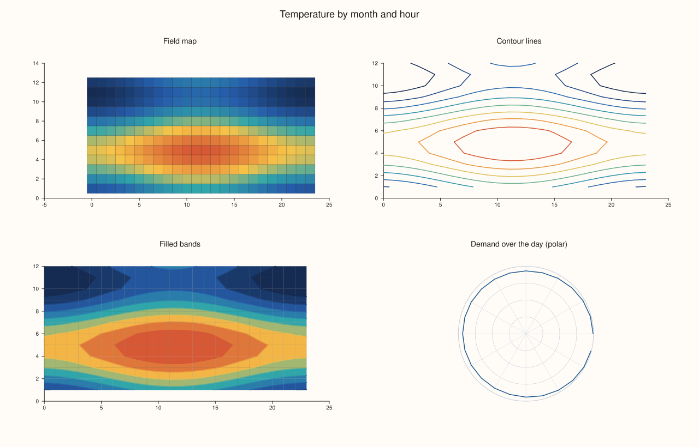

<!-- generated from fields_and_polar.md.in by PlussMa/docs/tools/render_guide.py; edit the template -->

# Fields and polar plots

[Back to PlussPl by example](../guide.md)

A field is a value at every point of a plane: temperature by month and hour, pressure over a map. This page turns 120 000 hourly readings into a field and draws it four ways: coloured cells, contour lines, filled bands and (for a cycle) a polar curve.

## How it works

A gridded field is a vector of x positions, a vector of y positions and a matrix of values. `fieldmap` colours each cell by its value; `contour` draws lines of equal value (given a level count or explicit levels); `isoband` fills the regions between levels; and `radial` draws a curve in polar coordinates from angles and radii. To make a field from raw readings you accumulate each reading into its cell and divide by the cell counts, which `Series::scatter_add` does without a loop.

## Temperature by month and hour

The program assigns each hourly reading to one of 12 x 24 cells, averages the cells, and draws the field. It then draws the mean demand at each hour of the day as a dial.

```cpp
#include <pluss/pl/plusspl.h>
#include <pluss/pluss.h>

#include <cmath>
#include <cstdlib>
#include <filesystem>
#include <iostream>

using namespace pluss::pl;

static std::string out(const char *name) {
  const char *dir = std::getenv("PLUSSMA_GUIDE_ASSETS");
  return ((dir ? std::filesystem::path(dir) : std::filesystem::path(".")) / name).string();
}


int main() {
  auto loaded = flash::load_dataset("weather_hourly");
  const auto weather = loaded->frame();
  auto temp = weather.features("temp_c").as_series();
  auto demand = weather.features("demand_mw").as_series();
  auto when = weather.features("timestamp").as_timeline();
  auto month = when.month().to(pluss::ScalarType::Int64) - 1;
  auto hour = when.hour().to(pluss::ScalarType::Int64);
  std::cout << temp.numel() << " readings, mean temperature " << temp.mean().item<double>() << "\n";

  // Mean temperature in each (month, hour) cell: add every reading into its cell, then divide by the cell counts.
  auto cell = month * 24 + hour;
  auto sums = pluss::series::zeros({12 * 24}, pluss::ScalarType::Float64).scatter_add(0, cell, temp);
  auto counts = pluss::series::zeros({12 * 24}, pluss::ScalarType::Float64).scatter_add(0, cell, pluss::series::ones({temp.numel()}, pluss::ScalarType::Float64));
  auto field = (sums / counts).reshape({12, 24});
  std::cout << "warmest cell " << field.max().item<double>() << ", coldest " << field.min().item<double>() << "\n";
  auto hours = pluss::series::arange(0, 24, pluss::ScalarType::Float64);
  auto months = pluss::series::arange(1, 13, pluss::ScalarType::Float64);

  auto fig = studio("weather_fields");
  fig.mosaic(2, 2);
  fig.headline("Temperature by month and hour");
  auto &map = fig.pane2("Field map");
  map.fieldmap(hours, months, field);
  auto &lines = fig.pane2("Contour lines");
  lines.contour(hours, months, field, 8);
  auto &bands = fig.pane2("Filled bands");
  bands.isoband(hours, months, field, 8);
  // The daily demand cycle on a 24-hour dial: angle is the hour, radius the mean demand at that hour.
  auto demand_by_hour = demand.grouped_mean(hour, 24);
  auto &dial = fig.pane2("Demand over the day (polar)");
  dial.radial(hours * (2.0 * 3.141592653589793 / 24.0), demand_by_hour);
  fig.show();
  std::cout << "peak demand at hour " << demand_by_hour.argmax().item<std::int64_t>() << ", trough at hour " << demand_by_hour.argmin().item<std::int64_t>() << "\n";
}
```

Output

```text
120000 readings, mean temperature 8.2631
warmest cell 27.2509, coldest -11.2412
peak demand at hour 23, trough at hour 16
```


There are `120000` readings with a mean of `8.26` degrees. Across the field the warmest cell is `27.3` and the coldest `-11.2`, the summer afternoon and the winter night, and the three field panes show the same surface as cells, as lines and as bands. The fourth pane wraps the daily demand cycle around a clock: the angle is the hour and the radius the mean demand, which peaks at hour `23` and has its trough at hour `16`.

## Decisions

- **Cells, lines or bands:** cells when every value matters, lines for reading values off, bands for the shape.
- **How many levels:** eight is a good start; more levels draw detail that the grid may not support.
- **Polar for cycles:** use a dial only for quantities that repeat around a circle, such as the hour of day or the compass direction.

## Pitfalls

The program below makes 3 mistakes on purpose and prints the message each one produces.

```cpp
#include <pluss/pl/plusspl.h>
#include <pluss/pluss.h>

#include <iostream>

using namespace pluss::pl;

template <class F> static void report(const char *what, F &&call) {
  try {
    call();
    std::cout << what << ": no error\n";
  } catch (const pluss::Error &e) {
    std::cout << what << ": " << e.message() << "\n";
  }
}

int main() {
  auto x = pluss::series::linspace(0.0, 1.0, 5, pluss::ScalarType::Float64);
  auto y = x.sin();
  auto y3 = pluss::series::linspace(0.0, 1.0, 3, pluss::ScalarType::Float64);
  auto flat = pluss::make_series({1.0, 2.0, 3.0, 4.0});
  auto matrix = pluss::series::linspace(0.0, 1.0, 20, pluss::ScalarType::Float64).reshape({4, 5});
  auto empty = pluss::series::zeros({0}, pluss::ScalarType::Float64);
  auto groups = pluss::make_note({"a", "b", "c"});
  report("a field from a flat z", [&] { auto f = studio("f"); f.pane2("a").fieldmap(x, x, y); });
  report("contour lines from a flat z", [&] { auto f = studio("f"); f.pane2("a").contour(x, x, y, 5); });
  report("an angle and a radius of different lengths", [&] { auto f = studio("f"); f.pane2("a").trend(x, y3); });
}
```

Output

```text
a field from a flat z: fieldmap: z must be a rank-2 matrix
contour lines from a flat z: contour: z must be a rank-2 matrix
an angle and a radius of different lengths: trend: series lengths must match or broadcast from scalar
```
- **A field from a flat z:** A field needs a matrix z; reshape the values to rows by columns first.
- **Contour lines from a flat z:** Contours need the same matrix.
- **An angle and a radius of different lengths:** Every trace needs matching lengths or a scalar to broadcast.

Each message names the function that refused the input, so the fix is to correct the data before the call: check lengths and shapes where the data is built, not where it is drawn.

## Where next

Reference pages: [`Pane::fieldmap`](../api/pane/fieldmap.md), [`Pane::contour`](../api/pane/contour.md), [`Pane::isoband`](../api/pane/isoband.md), [`Pane::radial`](../api/pane/radial.md). Next: [Three dimensions](three_dimensions.md).
