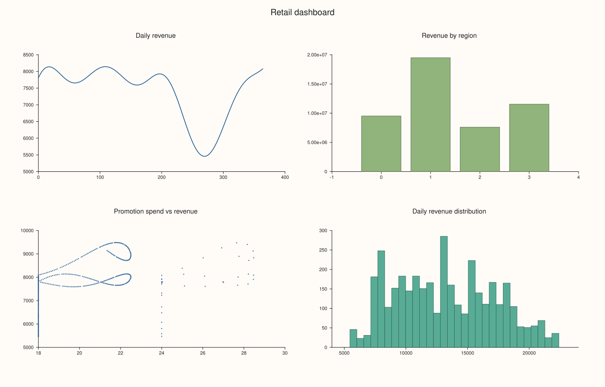
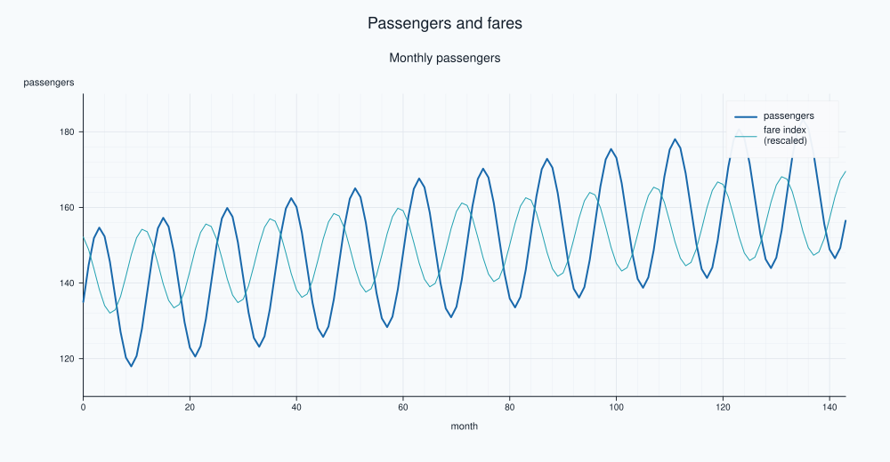

<!-- generated from figures_and_panes.md.in by PlussMa/docs/tools/render_guide.py; edit the template -->

# Figures, panes and traces

[Back to PlussPl by example](../guide.md)

Every figure in PlussPl is built the same way: a **Studio** (the figure) holds **panes** (the plotting areas), and a pane holds **traces** (the lines, points, bars and surfaces that are drawn). This page builds a one-page dashboard from ten years of retail data, then a report-quality figure with a theme, labels, limits, a legend and three export formats.

## How it works

`studio("name")` makes a figure. `fig.mosaic(rows, cols)` divides it into a grid, and each `fig.pane2("title")` (or `pane3` for a 3D pane) takes the next free cell, left to right and top to bottom. A pane creates traces with methods named after what they draw: `trend` draws a line, `cloud` points, `columns` bars, `bucket` a histogram. Every trace method takes your data as `Series` or `std::vector<double>` and returns the trace, so you can style it in the same expression (`.label("...")`, `.width(2.0f)`). A pane has axes you can label and limit, and the studio has a headline, a theme and a size. `fig.show()` displays the figure in a window; saving writes it to a file: `save_svg`, `save_png` or `save_pdf`.

The dashboard below uses all four steps at once. The data come from `flash::load_dataset`, a registry of thirteen realistic datasets that ship with the library; `Dataset::frame()` returns an ordinary `DataFrame`, so everything in the table guides applies to it.

## A retail dashboard

Ten years of daily sales. The program totals revenue by region, then draws four panes: the first year of revenue as a line, revenue by region as columns, promotion spend against revenue as points, and the distribution of daily revenue as a histogram.

```cpp
#include <pluss/pl/plusspl.h>
#include <pluss/pluss.h>

#include <cstdlib>
#include <filesystem>
#include <iostream>

using namespace pluss::pl;
using pluss::table::DataFrame;

static std::filesystem::path assets() {
  const char *dir = std::getenv("PLUSSMA_GUIDE_ASSETS");
  return dir ? std::filesystem::path(dir) : std::filesystem::path(".");
}

int main() {
  auto loaded = flash::load_dataset("retail_daily");
  const DataFrame sales = loaded->frame();
  std::cout << "rows " << sales.ncases() << ", features " << sales.nfeatures() << "\n";

  // 1. Revenue by region: group, sum, and read the totals back as plain Series for plotting.
  auto by_region = sales.group({.dropnull = true, .sort = true}).by({"region"}).agg({{"revenue", "revenue", DataFrame::GroupOp::Sum}});
  std::cout << by_region.to_string() << "\n";

  // 2. One figure, four panes.
  auto fig = studio("retail_dashboard");
  fig.mosaic(2, 2);
  fig.headline("Retail dashboard");
  auto revenue = sales.features("revenue").as_series();
  auto &trend = fig.pane2("Daily revenue");
  trend.trend(pluss::series::arange(0, 365, pluss::ScalarType::Float64), revenue.slice(0, 0, 365)).label("first year");
  auto &regions = fig.pane2("Revenue by region");
  regions.columns(pluss::series::arange(0, by_region.ncases(), pluss::ScalarType::Float64), by_region.features("revenue").as_series());
  auto &promo = fig.pane2("Promotion spend vs revenue");
  promo.cloud(sales.features("promo_spend").as_series().slice(0, 0, 500), revenue.slice(0, 0, 500));
  auto &dist = fig.pane2("Daily revenue distribution");
  dist.bucket(revenue, 30);
  fig.show();
  std::cout << "saved retail_dashboard.svg\n";
}
```

Output

```text
rows 3650, features 11
==========================
     | region  revenue    
--------------------------
0    | east    9513148.38 
1    | north   19499581.14
2    | south   7614943.01 
3    | west    11531757.49
--------------------------
[4 cs x 2 feat]
saved retail_dashboard.svg
```


The region totals are printed first because the figure alone would not tell you which region matters: the north is about 19.5 million, nearly twice the west (11.5 million) and almost three times the south (7.6 million). The four panes show four different views of the same table. `trend` draws one line through the first 365 days, `columns` one bar per region (the bar positions are the region indices, since a column trace needs numeric positions), `cloud` one point per day, and `bucket` bins the whole revenue series into 30 bars. The figure is saved as SVG into the guide's asset folder; the page you are reading embeds that file.

## A report-quality figure

Monthly passengers and fares, styled for a report: a theme chosen when the figure is made, labelled axes, explicit limits, a grid, a legend that has been moved and framed, and the figure written in three formats.

```cpp
#include <pluss/pl/plusspl.h>
#include <pluss/pluss.h>

#include <cmath>
#include <cstdlib>
#include <filesystem>
#include <iostream>

using namespace pluss::pl;

static std::string out(const char *name) {
  const char *dir = std::getenv("PLUSSMA_GUIDE_ASSETS");
  return ((dir ? std::filesystem::path(dir) : std::filesystem::path(".")) / name).string();
}

int main() {
  auto loaded = flash::load_dataset("flights");
  const auto flights = loaded->frame();
  auto passengers = flights.features("passengers").as_series();
  auto fare = flights.features("fare_index").as_series();
  auto month = pluss::series::arange(0, passengers.numel(), pluss::ScalarType::Float64);
  std::cout << passengers.numel() << " months, passengers from " << passengers.min().item<double>() << " to " << passengers.max().item<double>() << "\n";

  // 1. A theme is chosen when the figure is made; it applies to every pane created afterwards.
  Studio fig("styled_report", Theme::ocean());
  fig.size(1000.0, 520.0);
  fig.headline("Passengers and fares");
  auto &pane = fig.pane2("Monthly passengers");

  // 2. Two traces on one pane, each with a label for the legend and its own line width.
  pane.trend(month, passengers).label("passengers").width(2.0f);
  pane.trend(month, fare * (passengers.mean().item<double>() / fare.mean().item<double>())).label("fare index (rescaled)").width(1.0f);

  // 3. Axes: a label, explicit limits, a tick format, a grid style and a legend position.
  pane.x_label("month").y_label("passengers");
  pane.x_limits({0.0, passengers.numel() - 1.0});
  flash::set_style(pane, GridStyle::MajorMinor);
  pane.legend(KeyPlace::NorthWest);
  flash::legend_frame(pane, KeyFrame::Soft);
  flash::move_legend(pane, KeyPlace::NorthEast);
  std::cout << "figure " << fig.extent().width << " x " << fig.extent().height << ", panes " << fig.pane_count() << "\n";

  // 4. One figure, three formats.
  fig.save_svg(out("styled_report.svg"));
  fig.save_png(out("styled_report.png"), 144);
  fig.save_pdf(out("styled_report.pdf"));
  fig.show();   // opens a window; the documentation build captures the figure instead
  std::cout << "saved SVG, PNG and PDF: " << std::filesystem::exists(out("styled_report.svg")) << std::filesystem::exists(out("styled_report.png")) << std::filesystem::exists(out("styled_report.pdf")) << "\n";
}
```

Output

```text
144 months, passengers from 117.95 to 183.25
figure 1000 x 520, panes 1
saved SVG, PNG and PDF: 111
```


`Studio fig("name", Theme::ocean())` fixes the theme for every pane created afterwards; the two presets are `Theme::paper()` and `Theme::ocean()`. Two traces share one pane, each with a `label` that the legend uses and its own `width`. The axis calls (`x_label`, `y_label`, `x_limits`) are on the pane, and the legend and the grid are chosen with enumerations (`KeyPlace`, `KeyFrame`, `GridStyle`); the `flash::` helpers `set_style`, `legend_frame` and `move_legend` do the same through the convenience layer. The printed line confirms the size, 1000 by 520, and that the figure has one pane. The last line shows that one figure writes all three formats: SVG for the web and documents, PNG at a chosen resolution, and PDF.

## Decisions

- **One pane or many:** several traces share a pane when they share axes (a quantity and a comparable one); use a mosaic of panes when the axes differ.
- **SVG, PNG or PDF:** SVG scales and is the format of this guide; PNG when a tool needs a bitmap (the `dpi` argument sets the resolution); PDF for print.
- **Theme before panes:** a theme applies to the panes created after it, so set it when the studio is made.
- **A live window:** `fig.show()` (or `flash::show(fig)`) opens a viewer and is how the programs in this guide display a figure. When the environment variable `PLUSSPL_CAPTURE_DIR` names a directory, `show` writes `<figure name>.svg` there instead of opening a window, which is how the figures on these pages were produced and how a program runs without a display.

## Pitfalls

Every plotting call checks its arguments and names the problem. These five are the usual ones: a 3D trace on a 2D pane, a 2D trace on a 3D pane, vectors of different lengths, a heat map without a matrix, and a dataset name that does not exist.

```cpp
#include <pluss/pl/plusspl.h>
#include <pluss/pluss.h>

#include <cmath>
#include <cstdlib>
#include <filesystem>
#include <iostream>

using namespace pluss::pl;

static std::string out(const char *name) {
  const char *dir = std::getenv("PLUSSMA_GUIDE_ASSETS");
  return ((dir ? std::filesystem::path(dir) : std::filesystem::path(".")) / name).string();
}


int main() {
  const auto report = [](const auto &call) {
    try {
      call();
    } catch (const pluss::Error &e) {
      std::cout << e.message() << "\n";
    }
  };
  const std::vector<double> x{0, 1, 2, 3}, y{1, 4, 9, 16}, z{0, 1, 0, 1};
  auto fig = studio("mistakes");

  // 1. Each pane has a dimension. A 3D trace on a 2D pane is refused, and so is a 2D trace on a 3D pane.
  auto &flat = fig.pane2("flat");
  report([&] { flat.sheet(x, x, z); });
  auto &volume = fig.pane3("volume");
  report([&] { volume.trend(x, y); });

  // 2. Data that do not line up are refused, with the lengths named.
  report([&] { flat.trend(x, std::vector<double>{1, 2, 3}); });

  // 3. A field needs a matrix. Three vectors are not a grid.
  report([&] { flash::heatmap(flat, pluss::make_series(x), pluss::make_series(x), pluss::make_series(y)); });

  // 4. A dataset name that does not exist is not an error: load_dataset returns an empty optional, which must be checked.
  auto missing = flash::load_dataset("no_such_dataset");
  std::cout << "load_dataset(\"no_such_dataset\") has a value: " << missing.has_value() << "\n";
}
```

Output

```text
sheet requires a volumetric pane
trend requires a planar pane
trend: series lengths must match or broadcast from scalar
fieldmap: z must be a rank-2 matrix
load_dataset("no_such_dataset") has a value: 0
```
The dimension of a trace must match its pane: `sheet` needs a volumetric pane and `trend` a planar one. Lengths must agree or broadcast from a scalar. A field trace needs a rank-2 matrix for its values, not a third vector. And `load_dataset` does not throw for an unknown name: it returns an empty `std::optional`, so check it before use.

## Where next

Reference pages: [`Studio::pane2`](../api/studio/pane2.md), [`Studio::pane3`](../api/studio/pane3.md), [`Studio::mosaic`](../api/studio/mosaic.md), [`Studio::headline`](../api/studio/headline.md), [`Studio::save_svg`](../api/studio/save_svg.md), [`Studio::save_png`](../api/studio/save_png.md), [`Studio::save_pdf`](../api/studio/save_pdf.md), [`Studio::theme`](../api/studio/theme.md), [`Pane::trend`](../api/pane/trend.md), [`Pane::cloud`](../api/pane/cloud.md), [`Pane::columns`](../api/pane/columns.md), [`Pane::bucket`](../api/pane/bucket.md), [`Pane::x_label`](../api/pane/x_label.md), [`Pane::x_limits`](../api/pane/x_limits.md), [`Pane::legend`](../api/pane/legend.md), [`flash::load_dataset`](../api/flash/load_dataset.md), [`flash::set_style`](../api/flash/set_style.md), [`flash::legend_frame`](../api/flash/legend_frame.md), [`flash::move_legend`](../api/flash/move_legend.md), [`flash::show`](../api/flash/show.md), [`Theme`](../api/types/Theme.md), [`GridStyle`](../api/types/GridStyle.md), [`KeyPlace`](../api/types/KeyPlace.md), [`KeyFrame`](../api/types/KeyFrame.md). Next: [Relationships and trends](relationships_and_trends.md).
