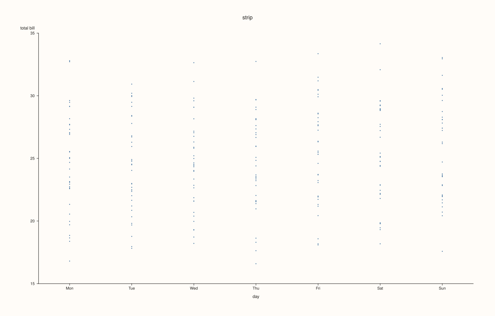
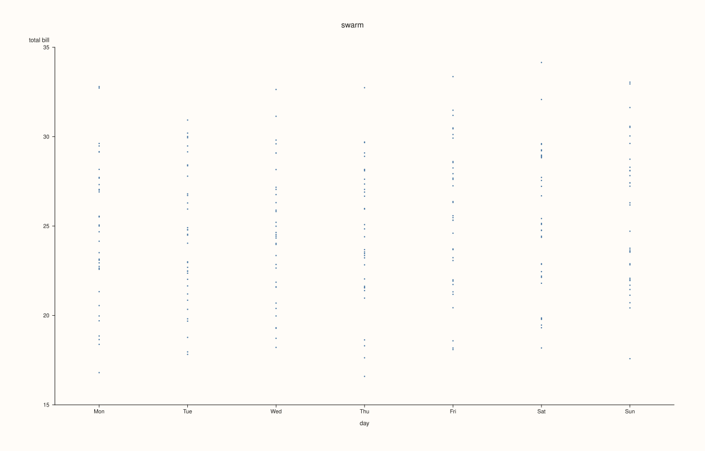
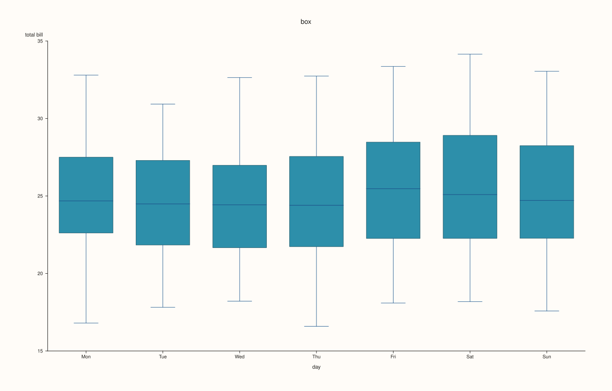
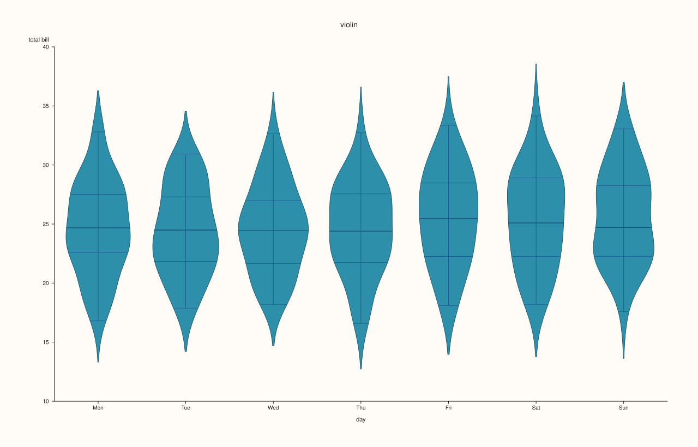
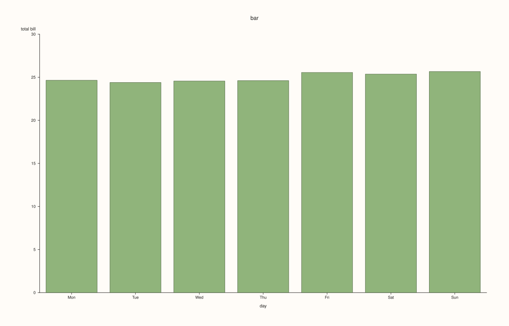
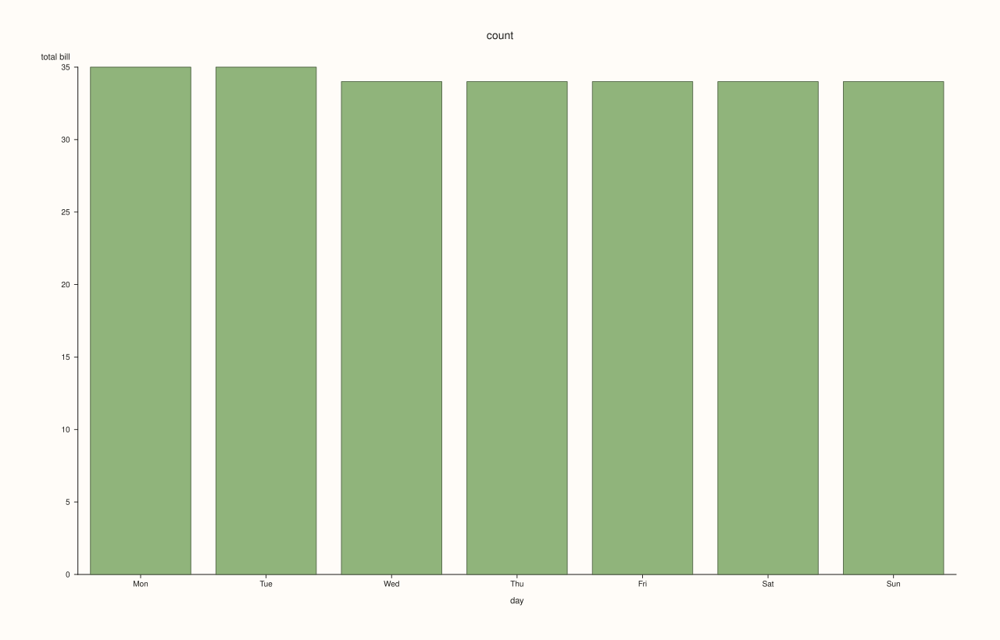
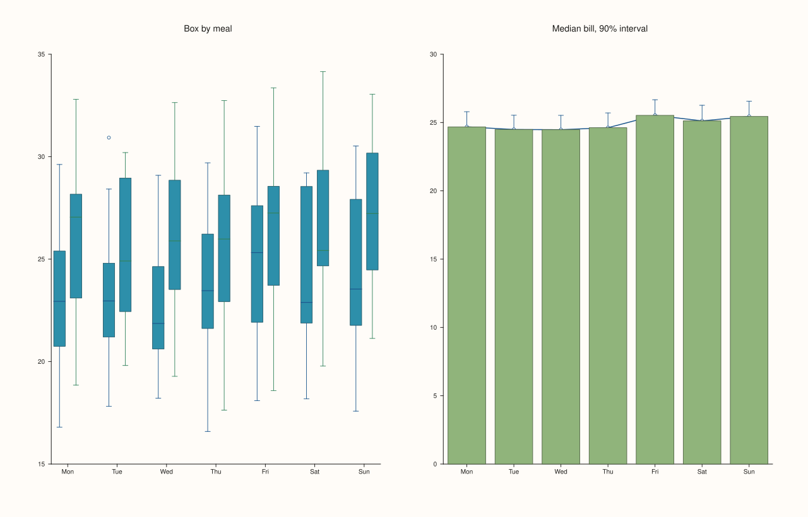
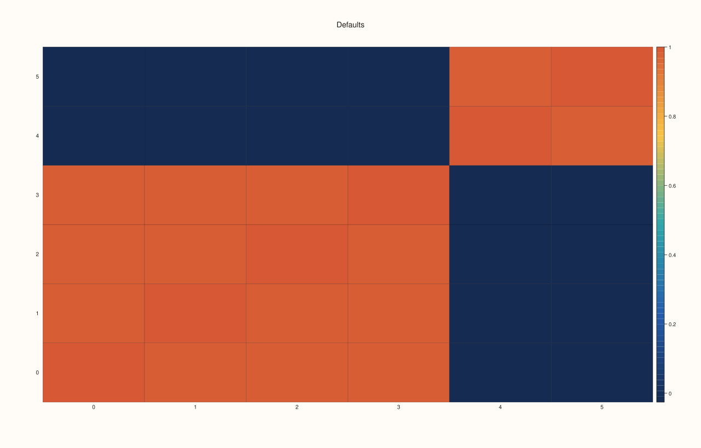
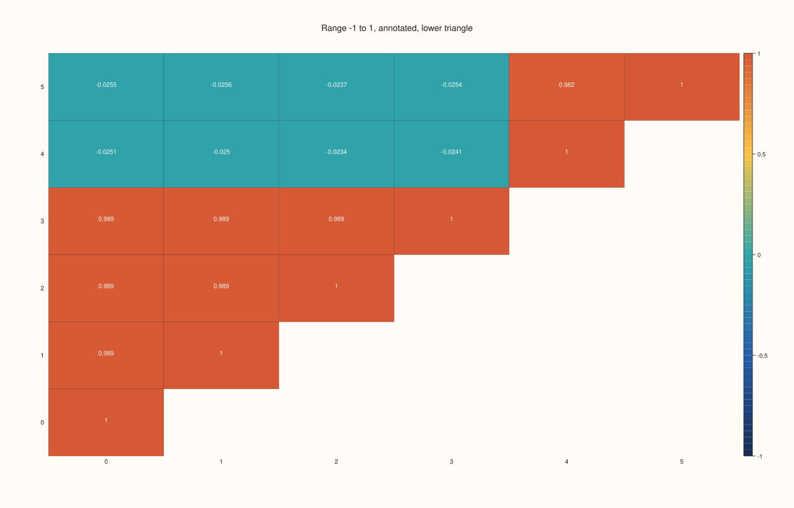
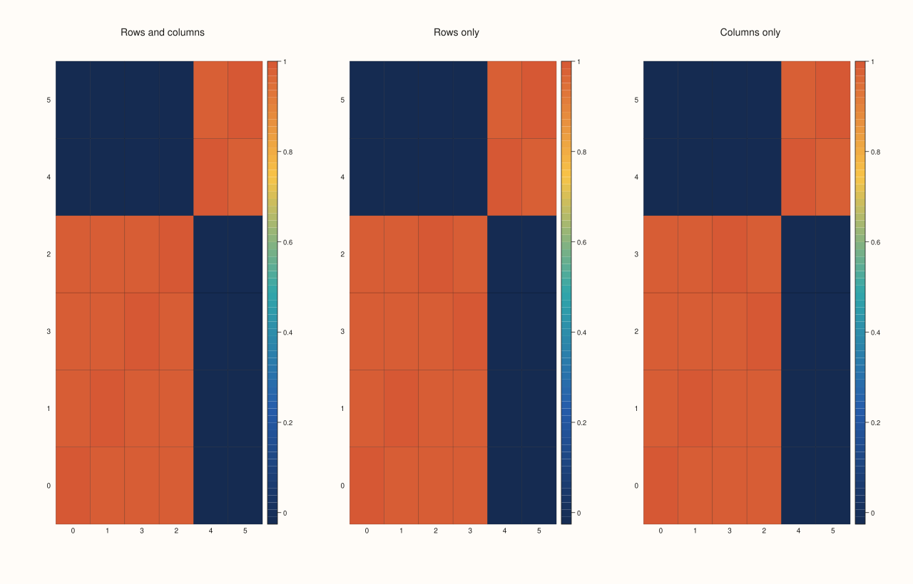

<!-- generated from flash_categories_matrices.md.in by PlussMa/docs/tools/render_guide.py; edit the template -->

# Categories and matrices from a dataset

[Back to PlussPl by example](../guide.md)

You have a dataset with a category column and a number column and want to compare groups, or a table of numbers and want to see which of them move together. This page draws the group comparison with `catplot` and the matrix views with `heatmap` and `clustermap`, all from the columns of a bundled dataset.

## How it works

These three functions take columns, not column names. You pull a text column out of a dataset's frame as a `Note` (`tips.features("day").as_note()`) and a numeric one as a `Series` (`tips.features("total_bill").as_series()`), then pass them in. This differs from `jointplot`, `pairplot` and `triplot`, which accept the `Dataset` and the names directly.

`catplot(pane, group, values, options)` draws one value per row against its group. `CatPlotOptions::kind` chooses what is drawn for each group: every point (`Strip`, `Swarm`), a box (`Box`), a density shape (`Violin`), a summary bar (`Bar`) or a count (`Count`). A fourth argument, a second `Note`, splits each group by a hue. For bars, `estimator` (`Mean`, `Median`) and `errorbar` (`None`, `CI`, `PI`, `Std`, `SE`) choose the summary and its interval. `heatmap(pane, x, y, z, options)` colours a matrix `z` whose columns sit at `x` and rows at `y`. `HeatmapOptions` fixes the colour range (`vmin`, `vmax`), prints each value (`annotate_levels`) and hides cells with a same-shape `mask`, where a zero hides the cell. `clustermap` reorders rows and columns so similar ones sit together, with `cluster_rows` and `cluster_cols` switching each direction.

## Groups, matrices and clusters

The program draws every `catplot` kind on the same bills by day, then a hue and the bar summary options, then a correlation matrix as a default heat map, a tuned one and the three clustered variants.

```cpp
#include <pluss/pl/plusspl.h>
#include <pluss/pluss.h>

#include <iostream>

using namespace pluss::pl;

int main() {
  auto loaded = flash::load_dataset("tips");
  const auto tips = loaded->frame();
  const auto day = tips.features("day").as_note();
  const auto meal = tips.features("meal").as_note();
  const auto bill = tips.features("total_bill").as_series();
  std::cout << tips.ncases() << " parties, " << day.unique().numel() << " days, " << meal.unique().numel() << " meals\n";

  // 1. One catplot per kind: the same bills by day.
  const std::vector<std::pair<const char *, flash::CatPlotKind>> kinds{{"strip", flash::CatPlotKind::Strip}, {"swarm", flash::CatPlotKind::Swarm}, {"box", flash::CatPlotKind::Box},
                                                                      {"violin", flash::CatPlotKind::Violin}, {"bar", flash::CatPlotKind::Bar},   {"count", flash::CatPlotKind::Count}};
  for (const auto &[name, kind] : kinds) {
    auto fig = studio(std::string("flash_cat_") + name);
    auto &pane = fig.pane2(name);
    flash::CatPlotOptions options;
    options.kind = kind;
    flash::catplot(pane, day, bill, options);
    pane.x_label("day").y_label("total bill");
    fig.show();
  }

  // 2. Options: a hue splits each day by meal, dodge places the groups side by side, the order fixes the day order, and for bars the estimator
  //    and error bar choose the summary (a median with a confidence interval here).
  auto grouped = studio("flash_cat_hue");
  grouped.mosaic(1, 2);
  flash::CatPlotOptions box;
  box.kind = flash::CatPlotKind::Box;
  box.dodge = true;
  box.order = {"Mon", "Tue", "Wed", "Thu", "Fri", "Sat", "Sun"};
  flash::catplot(grouped.pane2("Box by meal"), day, bill, meal, box);
  flash::CatPlotOptions bars;
  bars.kind = flash::CatPlotKind::Bar;
  bars.estimator = flash::CatEstimator::Median;
  bars.errorbar = flash::CatErrorBar::CI;
  bars.confidence_level = 0.9;
  bars.order = box.order;
  flash::catplot(grouped.pane2("Median bill, 90% interval"), day, bill, bars);
  grouped.show();

  // 3. A matrix from a dataset: the correlation of six factors, drawn with the defaults.
  auto factors = flash::load_dataset("factor_blocks")->frame();
  const int k = 6;
  std::vector<pluss::Series> rows;
  for (int i = 1; i <= k; ++i) rows.push_back(factors.features("factor_0" + std::to_string(i)).as_series().unsqueeze(0));
  auto correlation = rows[0].unite({rows[1], rows[2], rows[3], rows[4], rows[5]}, 0).corrcoef();
  auto axis = pluss::series::arange(0, k, pluss::ScalarType::Float64);
  std::cout << "correlation " << correlation.size(0) << " x " << correlation.size(1) << ", smallest " << correlation.min().item<double>() << ", largest off-diagonal "
            << (correlation - pluss::series::eye(k, pluss::ScalarType::Float64)).max().item<double>() << "\n";
  auto plain = studio("flash_heat_default");
  flash::heatmap(plain.pane2("Defaults"), axis, axis, correlation);
  plain.show();

  // 4. HeatmapOptions: fix the colour range to the full correlation scale, print the value in each cell, and keep only the lower triangle: a zero in the mask hides the cell.
  flash::HeatmapOptions heat;
  heat.vmin = -1.0;
  heat.vmax = 1.0;
  heat.annotate_levels = true;
  heat.mask = pluss::series::ones({k, k}, pluss::ScalarType::Float64).triu(1).eq(0.0);
  auto tuned = studio("flash_heat_options");
  flash::heatmap(tuned.pane2("Range -1 to 1, annotated, lower triangle"), axis, axis, correlation, heat);
  tuned.show();

  // 5. clustermap reorders rows and columns so similar ones sit together; cluster_rows and cluster_cols switch each direction.
  auto clusters = studio("flash_clustermap");
  clusters.mosaic(1, 3);
  flash::ClusterMapOptions both;
  flash::ClusterMapOptions rows_only;
  rows_only.cluster_cols = false;
  flash::ClusterMapOptions cols_only;
  cols_only.cluster_rows = false;
  flash::clustermap(clusters.pane2("Rows and columns"), axis, axis, correlation, both);
  flash::clustermap(clusters.pane2("Rows only"), axis, axis, correlation, rows_only);
  flash::clustermap(clusters.pane2("Columns only"), axis, axis, correlation, cols_only);
  clusters.show();
}
```

Output

```text
240 parties, 7 days, 2 meals
correlation 6 x 6, smallest -0.0256473, largest off-diagonal 0.989234
```
The six kinds of the same bills by day:













A hue with dodge on the left, and the median bill with a 90% interval on the right:



The correlation matrix with the defaults, and then with a fixed range, annotations and a mask:





Clustering rows and columns, rows only and columns only:



The first line reports 240 parties over seven days and two meals. The strip and swarm kinds show every party, the box and violin kinds summarise each day's spread, and the bar and count kinds reduce it to one number per day. In the hue figure, `order` fixes the days in calendar order, `dodge` puts the two meals side by side, and the bar panel shows a median with a 90% interval instead of a mean. The correlation matrix of the six factors is 6 by 6 with a smallest value near zero and a largest off-diagonal value of 0.989, which the heat map shows as a block of strongly related factors. Fixing the range to -1 to 1 makes colours comparable between matrices, `annotate_levels` prints each value, and the mask leaves only the lower triangle because the matrix is symmetric. The clustered maps move similar factors next to each other.

## Decisions

- **Every point, a summary, or a count:** points for small groups, a box or violin for spread, a bar for a comparison of averages, a count for how many.
- **Mean or median:** a median when a few large values would drag the mean.
- **Fix the range:** set `vmin` and `vmax` when two heat maps must be read against each other.
- **Mask a symmetric matrix:** hide one triangle so each pair appears once.

## Pitfalls

- **The mask runs the other way from what you may expect:** a zero in the mask hides the cell and a non-zero keeps it, so build it as "cells to keep".
- **Names do not work here:** `catplot`, `heatmap` and `clustermap` take columns; passing a column name string selects the kind, not a column.
- **A mask of the wrong size:** it must have the same number of elements as `z`.

## Where next

Reference pages: [`flash::catplot`](../api/flash/catplot.md), [`flash::heatmap`](../api/flash/heatmap.md), [`flash::clustermap`](../api/flash/clustermap.md), [`flash::load_dataset`](../api/flash/load_dataset.md). Back to [PlussPl by example](../guide.md), or on to [Flash from a dataset](flash_datasets.md).
