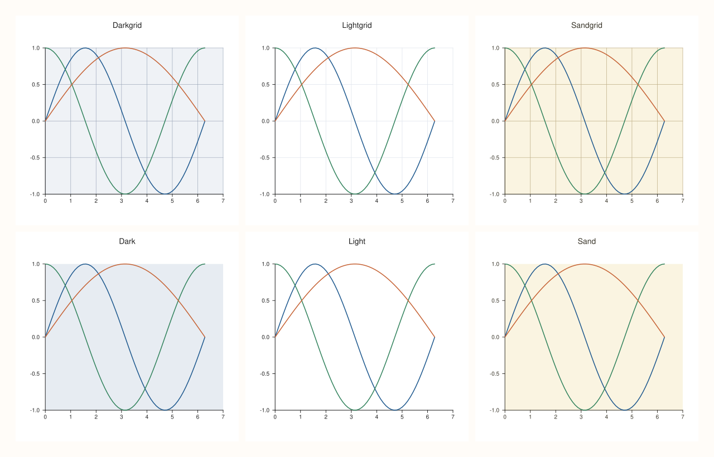
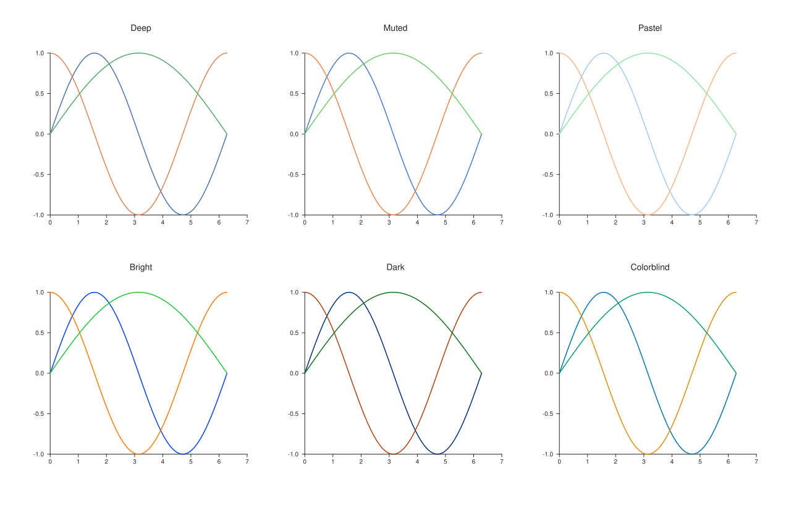
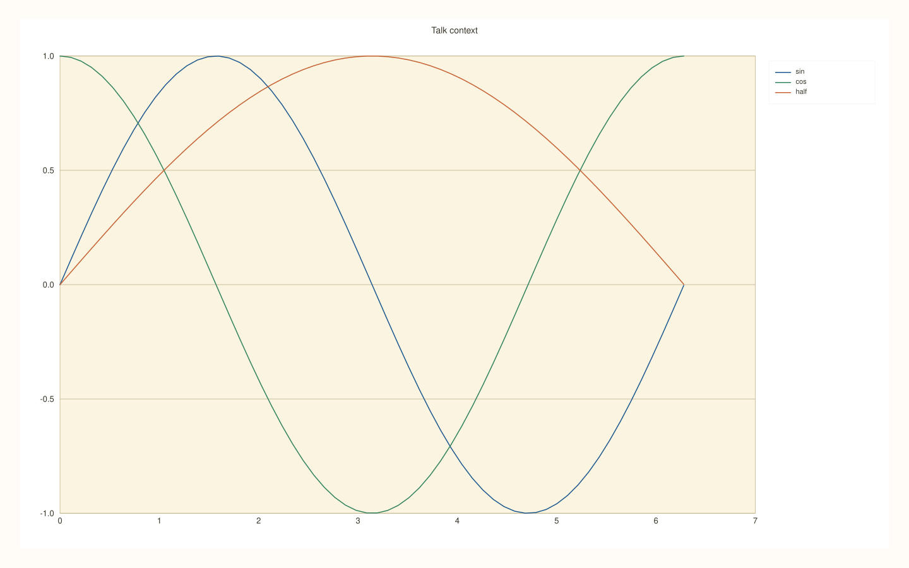
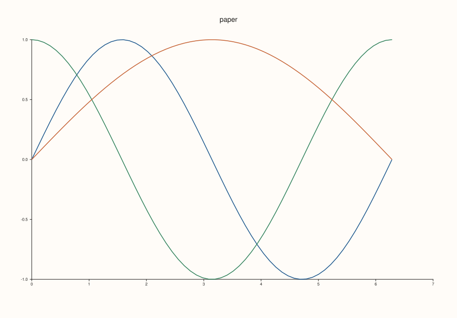
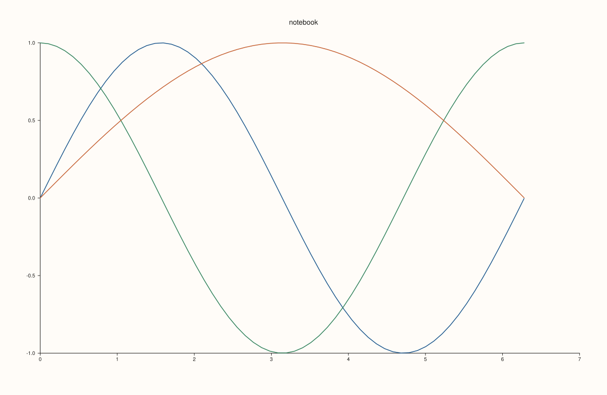
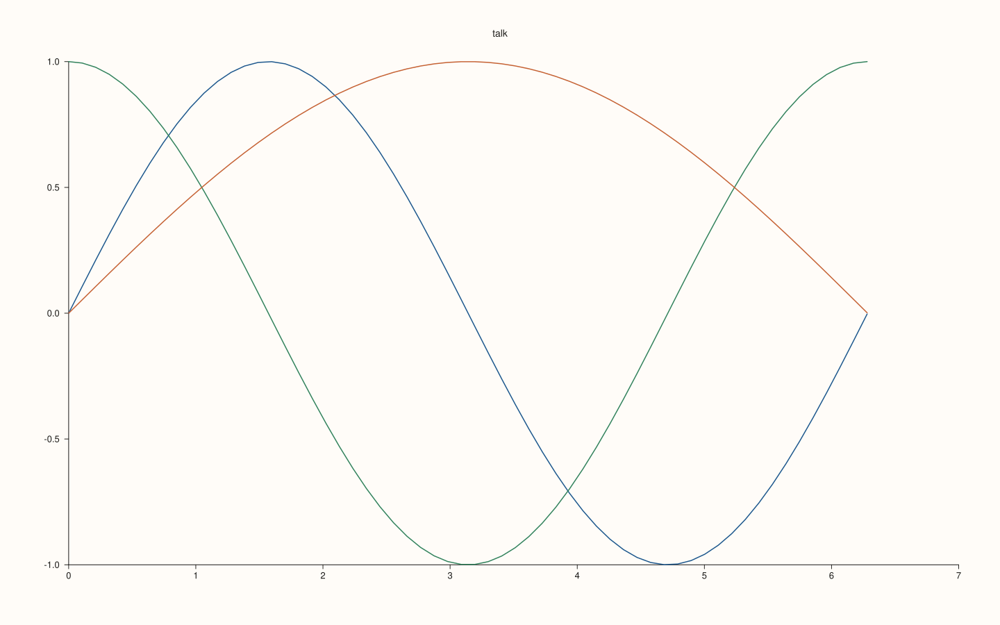
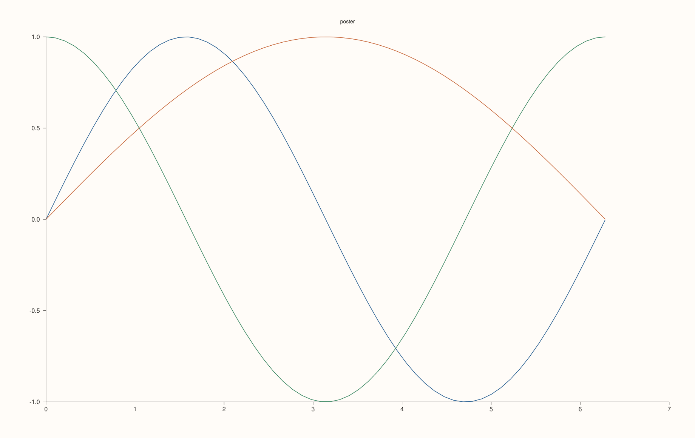

<!-- generated from flash_styles.md.in by PlussMa/docs/tools/render_guide.py; edit the template -->

# The flash style system

[Back to PlussPl by example](../guide.md)

The `flash` layer styles a figure with three independent choices: a **style** (the background and grid), a **palette** (the colours successive traces take) and a **context** (the size of the canvas and the text). This page draws the same chart under every choice, then sets a whole look from one options.

## How it works

`FlashStyle` has six values: `Darkgrid`, `Lightgrid`, `Sandgrid` (a shaded or tinted panel with grid lines) and `Dark`, `Light`, `Sand` (the same without the grid). `FlashPalette` has six: `Deep`, `Muted`, `Pastel`, `Bright`, `Dark`, `Colorblind`. `FlashContext` has `Inherit`, `Paper`, `Notebook`, `Talk` and `Poster`. They combine freely.

You apply them in one of three ways. `flash::set_theme(pane, style)` restyles one pane. `flash::set_theme(studio, flash::flash_theme(style, palette))` sets the style and palette for panes added afterwards. `flash::set_theme(studio, options)` takes a `FlashThemeOptions` that sets style, context, `borderless`, `horizontal_grid`, the legend's place, dock and shape, and an explicit width and height in one call.

## Styles, palettes, contexts

The program displays one chart under the six styles and under the six palettes, then sets a talk-sized sand figure from a `FlashThemeOptions`, and finally prints the canvas each context chooses.

```cpp
#include <pluss/pl/plusspl.h>
#include <pluss/pluss.h>

#include <cstdlib>
#include <filesystem>
#include <iostream>

using namespace pluss::pl;
using flash::FlashContext;
using flash::FlashPalette;
using flash::FlashStyle;

static std::string out(const char *name) {
  const char *dir = std::getenv("PLUSSMA_GUIDE_ASSETS");
  return ((dir ? std::filesystem::path(dir) : std::filesystem::path(".")) / name).string();
}

static void draw(Pane &pane, const char *title) {
  auto x = pluss::series::linspace(0.0, 6.28, 60, pluss::ScalarType::Float64);
  pane.trend(x, x.sin()).label("sin");
  pane.trend(x, x.cos()).label("cos");
  pane.trend(x, (x * 0.5).sin()).label("half");
  pane.title(title);
}

int main() {
  // 1. Six styles on one chart: dark/light/sand, each with or without a grid.
  const std::vector<std::pair<const char *, FlashStyle>> styles{{"Darkgrid", FlashStyle::Darkgrid}, {"Lightgrid", FlashStyle::Lightgrid}, {"Sandgrid", FlashStyle::Sandgrid},
                                                                {"Dark", FlashStyle::Dark},         {"Light", FlashStyle::Light},         {"Sand", FlashStyle::Sand}};
  auto fig = studio("flash_styles");
  fig.mosaic(2, 3);
  for (const auto &[name, style] : styles) {
    auto &pane = fig.pane2(name);
    draw(pane, name);
    flash::set_theme(pane, style);
  }
  fig.show();

  // 2. Six palettes: the colours a theme assigns to successive traces.
  const std::vector<std::pair<const char *, FlashPalette>> palettes{{"Deep", FlashPalette::Deep},     {"Muted", FlashPalette::Muted},   {"Pastel", FlashPalette::Pastel},
                                                                    {"Bright", FlashPalette::Bright}, {"Dark", FlashPalette::Dark},     {"Colorblind", FlashPalette::Colorblind}};
  auto pal = studio("flash_palettes");
  pal.mosaic(2, 3);
  for (const auto &[name, palette] : palettes) {
    flash::set_theme(pal, flash::flash_theme(FlashStyle::Lightgrid, palette));
    auto &pane = pal.pane2(name);
    draw(pane, name);
    const auto ramp = flash::flash_palette(palette);
    const auto c = ramp.sample(0.0);
    std::cout << name << " first colour (" << static_cast<int>(c.red * 255) << ", " << static_cast<int>(c.green * 255) << ", " << static_cast<int>(c.blue * 255) << ")\n";
  }
  pal.show();

  // 3. One options struct for style, context and layout: a talk-sized figure with a horizontal grid, no border and the legend outside.
  flash::FlashThemeOptions options;
  options.style = FlashStyle::Sandgrid;
  options.context = FlashContext::Talk;
  options.borderless = true;
  options.horizontal_grid = true;
  options.legend_place = KeyPlace::OutsideEast;
  auto talk = studio("flash_talk");
  flash::set_theme(talk, options);
  auto &pane = talk.pane2("Talk");
  draw(pane, "Talk context");
  talk.show();

  // 4. Contexts change only the scale: draw the same chart in each and print the canvas it picked.
  for (const auto &[name, context] : std::vector<std::pair<const char *, FlashContext>>{{"paper", FlashContext::Paper}, {"notebook", FlashContext::Notebook}, {"talk", FlashContext::Talk}, {"poster", FlashContext::Poster}}) {
    auto s = studio(std::string("flash_context_") + name);
    flash::set_context(s, context);
    auto &p = s.pane2(name);
    draw(p, name);
    const auto extent = s.extent();
    std::cout << name << " canvas " << extent.width << " x " << extent.height << "\n";
    s.show();
  }
}
```

Output

```text
Deep first colour (76, 114, 176)
Muted first colour (72, 120, 208)
Pastel first colour (161, 201, 244)
Bright first colour (2, 62, 255)
Dark first colour (0, 44, 127)
Colorblind first colour (1, 115, 178)
paper canvas 920 x 640
notebook canvas 1200 x 780
talk canvas 1440 x 900
poster canvas 1840 x 1160
```






The same chart in each context:









The first colour of each palette shows how they differ: `Deep` and `Muted` are saturated blues, `Pastel` is light, `Bright` is vivid and `Dark` is deep; `Colorblind` is a different set again, and the palette figure shows all six side by side. The canvas sizes show what a context does: `Paper` is 920 by 640, `Notebook` 1200 by 780, `Talk` 1440 by 900 and `Poster` 1840 by 1160, with text scaled to match. The options gathers every choice, so a report can define one `FlashThemeOptions` and apply it to every figure.

## Decisions

- **Style:** the grid styles for reading values, the plain ones when the picture carries the message.
- **Palette:** `Colorblind` for anything shared widely, `Pastel` for filled areas, `Deep` otherwise.
- **Context:** pick the medium once at the top of the program, then draw.
- **One value:** use `FlashThemeOptions` when the same look has to apply to many figures.

## Pitfalls

- **Styling after the panes exist:** `set_theme(studio, ...)` applies to panes created afterwards, so the program above sets the theme before each `pane2`. A pane that already exists keeps its look; restyle it with `set_theme(pane, style)`.
- **Forgetting that a context sets size:** `set_context` changes the canvas, so a figure sized by hand before it is resized by it. Set the context first and size afterwards.

## Where next

Reference pages: [`flash::flash_theme`](../api/flash/flash_theme.md), [`flash::set_theme`](../api/flash/set_theme.md), [`flash::set_context`](../api/flash/set_context.md), [`flash::flash_palette`](../api/flash/flash_palette.md). Back to [PlussPl by example](../guide.md), or on to [Flash from a dataset](flash_datasets.md).
