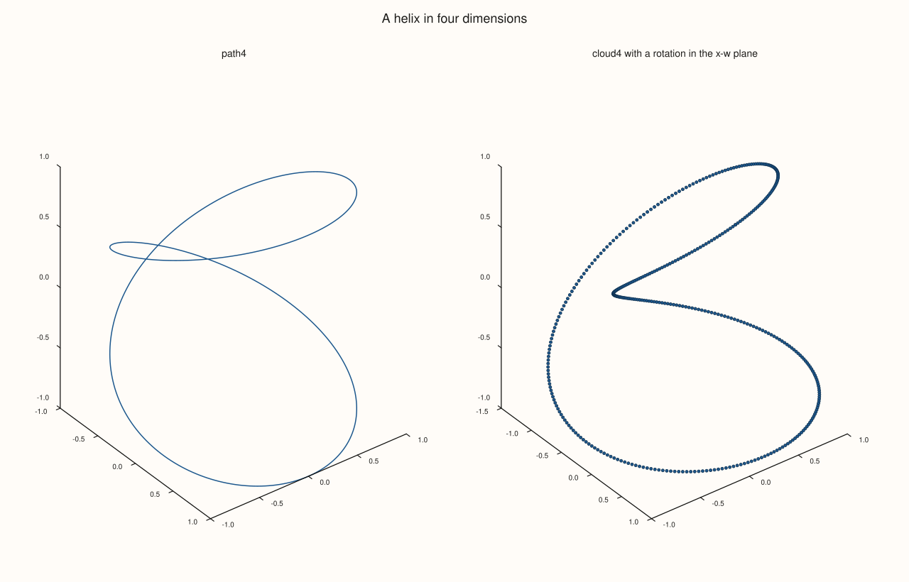

<!-- generated from four_dimensions_and_animation.md.in by PlussMa/docs/tools/render_guide.py; edit the template -->

# Four dimensions and animation

[Back to PlussPl by example](../guide.md)

A fourth coordinate cannot be drawn directly, so it is shown through a projection that you can rotate. This page draws a helix in four dimensions, builds the frames of a rotation, exports them for an animation, and shows how to open the live viewers.

## How it works

The 4D functions take four series (x, y, z and w). `path4` draws a trajectory and `cloud4` a point cloud, each projected to three dimensions: the options choose the projection (orthographic, perspective along w, or a slice of w) and the rotation angle in each of the six planes. Rotating in a plane that includes w (for example x-w) moves the shape through the fourth dimension, which is how its structure is seen. `hyper_animation_sequence` lists the options of every frame of a full turn, `export4_frames` writes those frames to a folder, and `animate3` and `animate4` open a live viewer.

## A helix in four dimensions

A path made of two circles that turn at different speeds, drawn as a path and as a cloud with a rotation, then exported as frames.

```cpp
#include <pluss/pl/plusspl.h>
#include <pluss/pluss.h>

#include <cmath>
#include <cstdlib>
#include <filesystem>
#include <iostream>

using namespace pluss::pl;

static std::string out(const char *name) {
  const char *dir = std::getenv("PLUSSMA_GUIDE_ASSETS");
  return ((dir ? std::filesystem::path(dir) : std::filesystem::path(".")) / name).string();
}


int main() {
  // A rotating helix in four dimensions: two circles of different speed.
  const std::int64_t n = 400;
  auto t = pluss::series::linspace(0.0, 4.0 * 3.141592653589793, n, pluss::ScalarType::Float64);
  auto x = t.cos(), y = t.sin(), z = (t * 0.5).cos(), w = (t * 0.5).sin();
  std::cout << "path of " << n << " points in four dimensions\n";

  // 1. A 4D path and a 4D cloud: the options choose how w is shown (perspective distance, a slice, or an orthographic drop).
  auto fig = studio("hyper_dimensions");
  fig.mosaic(1, 2);
  fig.headline("A helix in four dimensions");
  auto &path = fig.pane3("path4");
  flash::path4(path, x, y, z, w);
  auto &cloud = fig.pane3("cloud4 with a rotation in the x-w plane");
  flash::cloud4(cloud, x, y, z, w, flash::HyperPlotOptions{.rot_xw_deg = 40.0, .point_size = 6.0});
  fig.show();

  // 2. hyper_animation_sequence gives the options of every frame of a full turn in one plane.
  const auto frames = flash::hyper_animation_sequence(flash::HyperPlotOptions{}, flash::HyperSweepOptions{.frames = 12, .plane = flash::HyperSweepPlane::XW});
  std::cout << "a turn in the x-w plane in " << frames.size() << " frames; angle of frame 3: " << frames[3].rot_xw_deg << " degrees\n";

  // 3. export4_frames writes the frames to a folder, ready for a video tool.
  const auto directory = std::filesystem::path(std::getenv("PLUSSMA_GUIDE_ASSETS") ? std::getenv("PLUSSMA_GUIDE_ASSETS") : ".") / "hyper_frames";
  std::filesystem::remove_all(directory);
  flash::HyperFrameExportOptions options;
  options.output_dir = directory;
  options.format = flash::AnimationFrameFormat::Svg;
  options.sweep.frames = 6;
  const auto written = flash::export4_frames(x, y, z, w, options);
  std::cout << "frames written: " << written << "\n";
  std::filesystem::remove_all(directory);

  // 4. A live viewer: animate3 spins a 3D plot and animate4 sweeps a 4D one. They open a window, so run them only on request.
  if (std::getenv("PLUSSPL_WINDOW")) {
    flash::animate3(x, y, z);
    flash::animate4(x, y, z, w);
  } else {
    std::cout << "live viewers skipped (set PLUSSPL_WINDOW=1 to open animate3 and animate4)\n";
  }
}
```

Output

```text
path of 400 points in four dimensions
a turn in the x-w plane in 12 frames; angle of frame 3: 90 degrees
frames written: 6
live viewers skipped (set PLUSSPL_WINDOW=1 to open animate3 and animate4)
```


The path has `400` points. A full turn in the x-w plane is described by `12` frames, and frame 3 is at `90` degrees: the sequence divides the circle evenly. `export4_frames` wrote the six requested frames (as SVG here, PNG by default) into a folder, which a video tool can turn into an animation. The last line is deliberate: the live viewers open a window, so the program opens them only when `PLUSSPL_WINDOW` is set, and says so when it does not.

## Decisions

- **Projection:** perspective along w gives depth; orthographic is easier to read for a first look; a slice shows what is at one value of w.
- **Which plane to rotate:** a plane containing w, since rotations among x, y and z only turn a 3D picture.
- **Frames or a viewer:** export frames for a document or a video; use the viewers to explore.

## Pitfalls

The program below makes 2 mistakes on purpose and prints the message each one produces.

```cpp
#include <pluss/pl/plusspl.h>
#include <pluss/pluss.h>

#include <iostream>

using namespace pluss::pl;

template <class F> static void report(const char *what, F &&call) {
  try {
    call();
    std::cout << what << ": no error\n";
  } catch (const pluss::Error &e) {
    std::cout << what << ": " << e.message() << "\n";
  }
}

int main() {
  auto x = pluss::series::linspace(0.0, 1.0, 5, pluss::ScalarType::Float64);
  auto y = x.sin();
  auto y3 = pluss::series::linspace(0.0, 1.0, 3, pluss::ScalarType::Float64);
  auto flat = pluss::make_series({1.0, 2.0, 3.0, 4.0});
  auto matrix = pluss::series::linspace(0.0, 1.0, 20, pluss::ScalarType::Float64).reshape({4, 5});
  auto empty = pluss::series::zeros({0}, pluss::ScalarType::Float64);
  auto groups = pluss::make_note({"a", "b", "c"});
  report("a path with coordinates of different lengths", [&] { auto f = studio("h"); flash::path4(f.pane3("a"), x, y, y, y3); });
  report("a cloud with no points", [&] { auto f = studio("h"); flash::cloud4(f.pane3("a"), empty, empty, empty, empty); });
}
```

Output

```text
a path with coordinates of different lengths: flash::path4: x, y, z, w must have identical lengths
a cloud with no points: flash::cloud4: no points remain after projection/slice
```
- **A path with coordinates of different lengths:** All four coordinates must have the same length.
- **A cloud with no points:** A projection with nothing left to draw is an error, not an empty picture.

Each message names the function that refused the input, so the fix is to correct the data before the call: check lengths and shapes where the data is built, not where it is drawn.

## Where next

Reference pages: [`flash::path4`](../api/flash/path4.md), [`flash::cloud4`](../api/flash/cloud4.md), [`flash::hyper_animation_sequence`](../api/flash/hyper_animation_sequence.md), [`flash::export4_frames`](../api/flash/export4_frames.md), [`flash::animate3`](../api/flash/animate3.md), [`flash::animate4`](../api/flash/animate4.md). Next: [Colour and style](colour_and_style.md).
