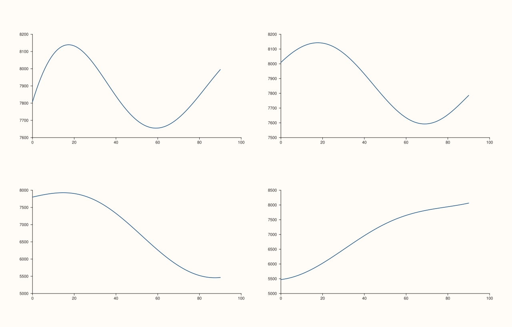
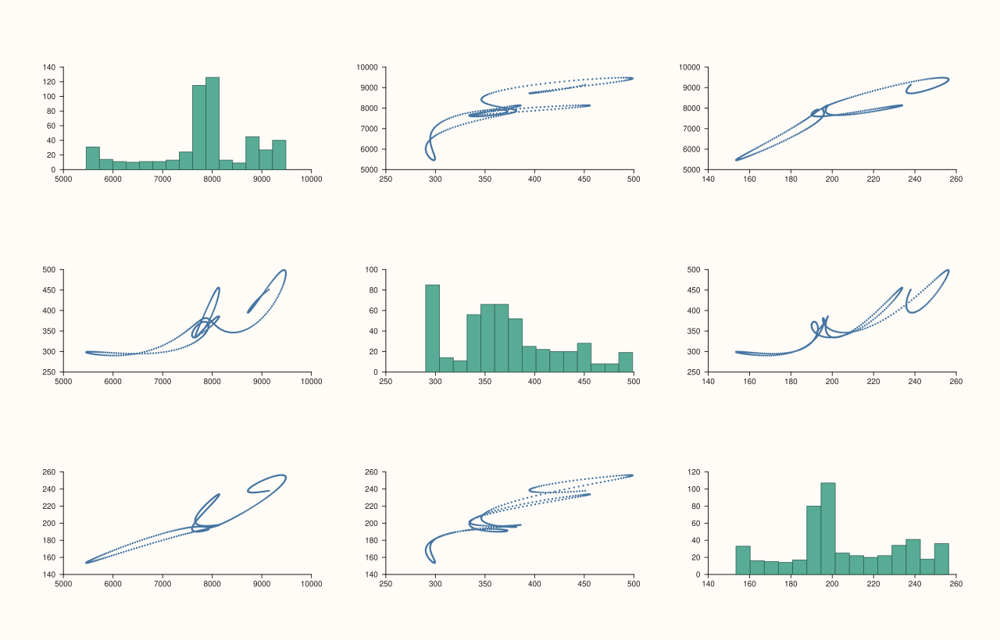
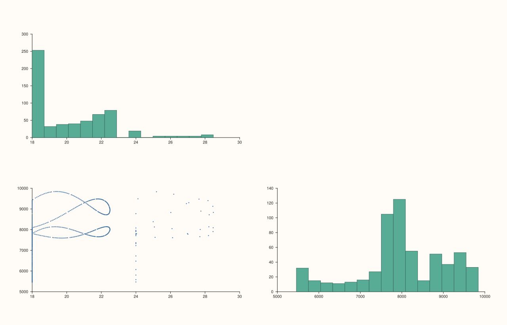
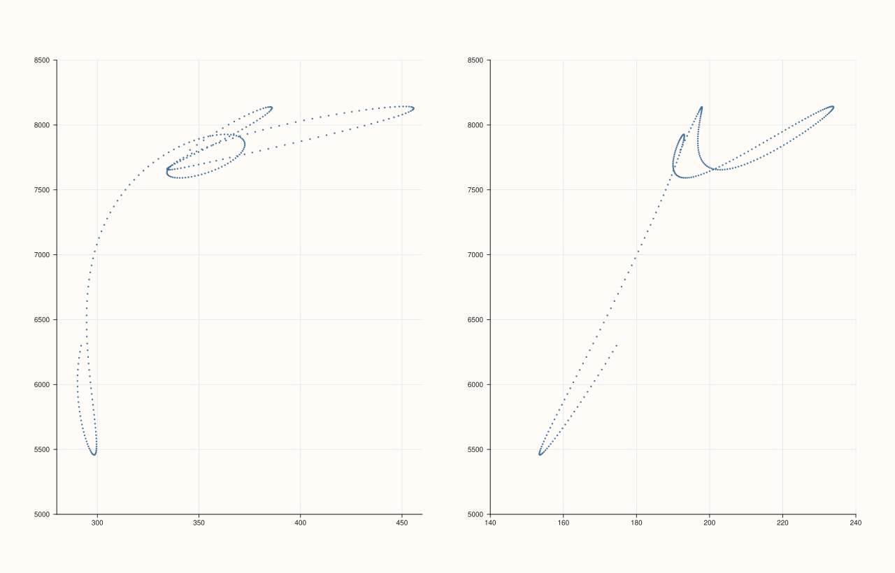
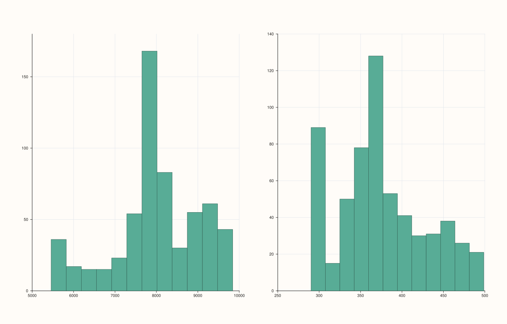
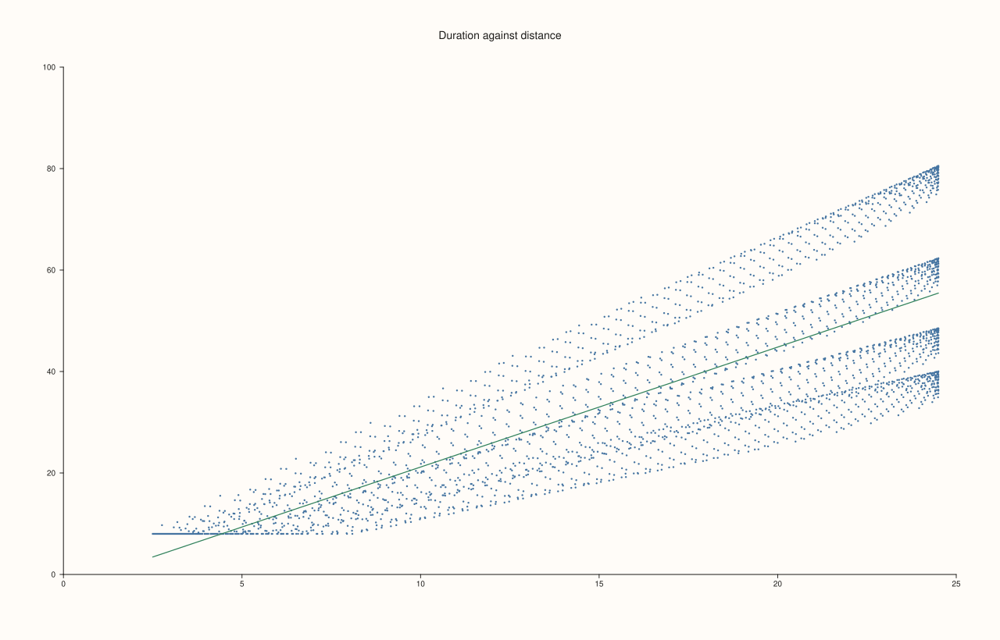
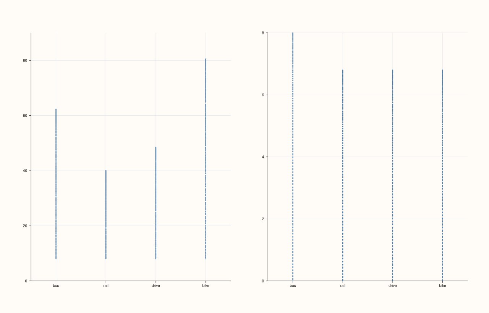
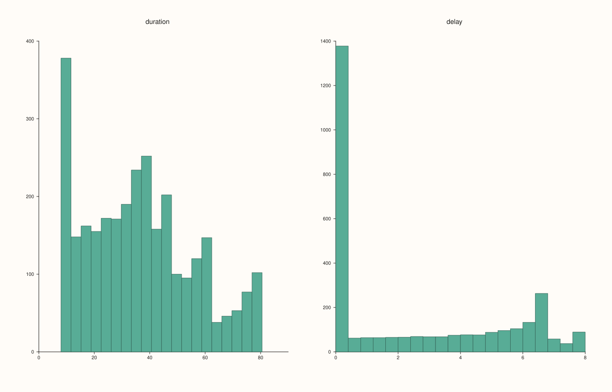
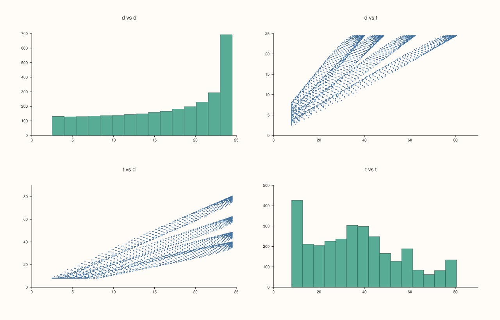
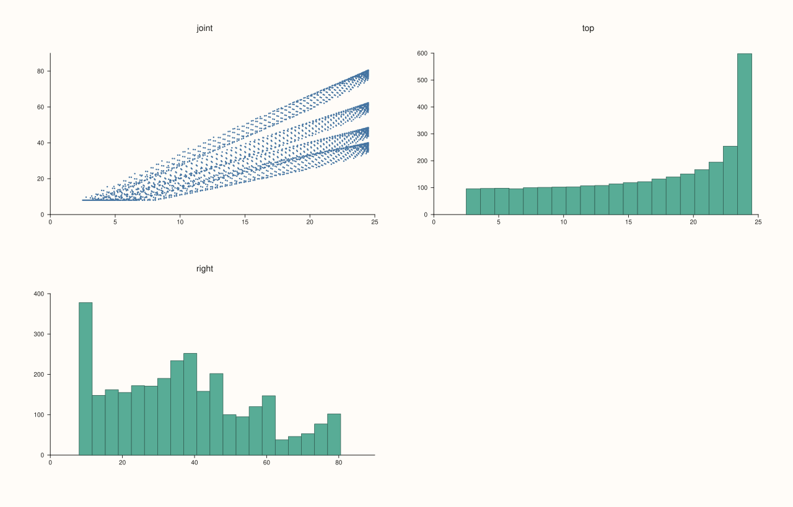

<!-- generated from grids_and_models.md.in by PlussMa/docs/tools/render_guide.py; edit the template -->

# Grids and linear models

[Back to PlussPl by example](../guide.md)

Small multiples (the same chart repeated across groups or variables) are laid out on a grid. This page fills grids by hand with mapper functions, uses the ready-made grid plots, draws a linear-model figure and category grids, and uses the three grid constructors.

## How it works

A grid is a studio with a fixed mosaic. The `*_map_plot` functions build the mosaic and call your function once per cell with the pane to draw into: `facet_map_plot` for a rows-by-columns grid, `pairgrid_map_plot` for a square of variables (the function also learns whether a cell is on the diagonal), and `jointgrid_map_plot` for a joint view with two marginals. The ready-made `relgridplot`, `disgridplot` and `catgridplot` take lists of series and draw a standard plot in each cell. `FacetGrid`, `PairGrid` and `JointGrid` only create the layout and leave you to fill the panes.

## Small multiples of retail revenue

Ten years of retail data as four quarters of revenue, every pair of three variables, revenue against promotion spend with its marginals, and the ready-made grids.

```cpp
#include <pluss/pl/plusspl.h>
#include <pluss/pluss.h>

#include <cmath>
#include <cstdlib>
#include <filesystem>
#include <iostream>

using namespace pluss::pl;

static std::string out(const char *name) {
  const char *dir = std::getenv("PLUSSMA_GUIDE_ASSETS");
  return ((dir ? std::filesystem::path(dir) : std::filesystem::path(".")) / name).string();
}


int main() {
  auto loaded = flash::load_dataset("retail_daily");
  const auto sales = loaded->frame();
  auto revenue = sales.features("revenue").as_series();
  auto footfall = sales.features("footfall").as_series();
  auto orders = sales.features("orders").as_series();
  auto promo = sales.features("promo_spend").as_series();
  std::cout << "series of " << revenue.numel() << " days\n";

  // 1. FacetGrid: a 2 x 2 grid of panes you fill yourself; here, one chart per calendar quarter of the first year.
  auto facets = studio("grids_facet");
  flash::facet_map_plot(facets, 2, 2, [&](Pane &pane, std::int64_t row, std::int64_t col) {
    const auto quarter = row * 2 + col;
    pane.trend(pluss::series::arange(0, 91, pluss::ScalarType::Float64), revenue.slice(0, quarter * 91, quarter * 91 + 91));
  });
  facets.show();

  // 2. PairGrid: every variable against every other; the mapper says what to draw in each cell and whether it is on the diagonal.
  auto pair = studio("grids_pair");
  std::vector<pluss::Series> vars{revenue.slice(0, 0, 500), footfall.slice(0, 0, 500), orders.slice(0, 0, 500)};
  flash::pairgrid_map_plot(pair, 3, [&](Pane &pane, std::int64_t row, std::int64_t col, bool diagonal) {
    if (diagonal) pane.bucket(vars[row], 15);
    else pane.cloud(vars[col], vars[row]);
  });
  pair.show();

  // 3. JointGrid: a joint view with its two marginals.
  auto joint = studio("grids_joint");
  flash::jointgrid_map_plot(joint, [&](Pane &pane) { pane.cloud(promo.slice(0, 0, 600), revenue.slice(0, 0, 600)); },
                            [&](Pane &pane, bool horizontal) { pane.bucket(horizontal ? promo.slice(0, 0, 600) : revenue.slice(0, 0, 600), 15); });
  joint.show();

  // 4. The ready-made grids: relational, categorical and distribution grids from lists of series.
  auto rel = studio("grids_rel");
  flash::relgridplot(rel, {footfall.slice(0, 0, 300), orders.slice(0, 0, 300)}, {revenue.slice(0, 0, 300), revenue.slice(0, 0, 300)}, "scatter");
  rel.show();
  auto dis = studio("grids_dis");
  flash::disgridplot(dis, {revenue.slice(0, 0, 600), footfall.slice(0, 0, 600)}, "hist");
  dis.show();
  std::cout << "five grid figures written\n";
}
```

Output

```text
series of 3650 days
five grid figures written
```










The program prints only that the series has `3650` days; the figures carry the content. The facet grid draws the same line plot for four consecutive quarters, so the shared pattern and the differences are visible side by side. The pair grid has a histogram on the diagonal (a variable against itself is its distribution) and a scatter everywhere else. The joint grid puts the scatter in the middle and a histogram of each variable on the sides. The mapper functions are ordinary C++ callables, so a cell can draw anything a pane can.

## A linear model and category grids

A commuting survey: duration against distance with a fitted line, category plots per mode, and the three grid constructors filled by hand.

```cpp
#include <pluss/pl/plusspl.h>
#include <pluss/pluss.h>

#include <cmath>
#include <cstdlib>
#include <filesystem>
#include <iostream>

using namespace pluss::pl;

static std::string out(const char *name) {
  const char *dir = std::getenv("PLUSSMA_GUIDE_ASSETS");
  return ((dir ? std::filesystem::path(dir) : std::filesystem::path(".")) / name).string();
}


int main() {
  auto loaded = flash::load_dataset("commute_modes");
  const auto survey = loaded->frame();
  auto distance = survey.features("distance_km").as_series();
  auto duration = survey.features("duration_min").as_series();
  auto mode = survey.features("mode").as_note();
  auto delay = survey.features("delay_min").as_series();
  const double dx = distance.mean().item<double>(), dy = duration.mean().item<double>();
  const double slope = ((distance - dx) * (duration - dy)).sum().item<double>() / (distance - dx).square().sum().item<double>();
  std::cout << "minutes per kilometre across all modes: " << slope << "\n";

  // 1. lmplot builds a whole figure: scatter, fitted line and a band.
  auto lm = studio("commute_lm");
  flash::lmplot(lm, distance, duration, "Duration against distance");
  lm.show();

  // 2. catgridplot: one category plot per grouping, in a grid.
  auto catgrid = studio("commute_catgrid");
  flash::catgridplot(catgrid, {mode, mode}, {duration, delay});
  catgrid.show();

  // 3. The grid constructors lay out panes for you to fill: FacetGrid (rows x columns), PairGrid (a square of variables) and JointGrid (joint plus marginals).
  auto facet = studio("commute_facet_grid");
  flash::FacetGrid(facet, 1, 2);
  facet.pane2("duration").bucket(duration, 20);
  facet.pane2("delay").bucket(delay, 20);
  facet.show();
  auto pair = studio("commute_pair_grid");
  flash::PairGrid(pair, 2);
  pair.pane2("d vs d").bucket(distance, 15);
  pair.pane2("d vs t").cloud(duration, distance);
  pair.pane2("t vs d").cloud(distance, duration);
  pair.pane2("t vs t").bucket(duration, 15);
  pair.show();
  auto joint = studio("commute_joint_grid");
  flash::JointGrid(joint);
  joint.pane2("joint").cloud(distance, duration);
  joint.pane2("top").bucket(distance, 20);
  joint.pane2("right").bucket(duration, 20);
  joint.show();
  std::cout << "five figures written\n";
}
```

Output

```text
minutes per kilometre across all modes: 2.3645
five figures written
```










Across all modes a kilometre adds about `2.36` minutes. `lmplot` builds a whole figure from two series: the scatter, the fitted line and a band around it. The category grid draws one category plot per pair of group and value lists. The three constructors only create the layout (`FacetGrid(studio, rows, cols)`, `PairGrid(studio, n)`, `JointGrid(studio)`) and you add the panes in order, which is useful when each cell is a different kind of plot.

## Decisions

- **A mapper or a ready-made grid:** use the ready-made grids for standard plots and a mapper when each cell needs its own logic.
- **Same axes across cells:** small multiples are only comparable if the scales match; keep the data units the same.
- **Constructors for irregular layouts:** `FacetGrid`, `PairGrid` and `JointGrid` when the cells are different kinds of plot.

## Pitfalls

The program below makes 4 mistakes on purpose and prints the message each one produces.

```cpp
#include <pluss/pl/plusspl.h>
#include <pluss/pluss.h>

#include <iostream>

using namespace pluss::pl;

template <class F> static void report(const char *what, F &&call) {
  try {
    call();
    std::cout << what << ": no error\n";
  } catch (const pluss::Error &e) {
    std::cout << what << ": " << e.message() << "\n";
  }
}

int main() {
  auto x = pluss::series::linspace(0.0, 1.0, 5, pluss::ScalarType::Float64);
  auto y = x.sin();
  auto y3 = pluss::series::linspace(0.0, 1.0, 3, pluss::ScalarType::Float64);
  auto flat = pluss::make_series({1.0, 2.0, 3.0, 4.0});
  auto matrix = pluss::series::linspace(0.0, 1.0, 20, pluss::ScalarType::Float64).reshape({4, 5});
  auto empty = pluss::series::zeros({0}, pluss::ScalarType::Float64);
  auto groups = pluss::make_note({"a", "b", "c"});
  report("a fit with x and y of different lengths", [&] { auto f = studio("g"); flash::regplot(f.pane2("a"), x, y3); });
  report("residuals of mismatched series", [&] { auto f = studio("g"); flash::residplot(f.pane2("a"), x, y3); });
  report("a joint view of mismatched series", [&] { auto f = studio("g"); flash::jointplot(f, x, y3, "scatter"); });
  report("a fit with a single point", [&] { auto f = studio("g"); flash::regplot(f.pane2("a"), pluss::make_series({1.0}), pluss::make_series({2.0})); });
}
```

Output

```text
a fit with x and y of different lengths: flash::finite_xy requires equal length x/y
residuals of mismatched series: flash::finite_xy requires equal length x/y
a joint view of mismatched series: flash::jointplot requires x/y with identical lengths
a fit with a single point: flash::regplot requires at least two finite x/y pairs
```
- **A fit with x and y of different lengths:** `regplot` and `residplot` pair each x with a y.
- **Residuals of mismatched series:** Same rule for residuals.
- **A joint view of mismatched series:** The joint view checks the lengths too.
- **A fit with a single point:** A line needs at least two finite pairs.

Each message names the function that refused the input, so the fix is to correct the data before the call: check lengths and shapes where the data is built, not where it is drawn.

## Where next

Reference pages: [`flash::facet_map_plot`](../api/flash/facet_map_plot.md), [`flash::pairgrid_map_plot`](../api/flash/pairgrid_map_plot.md), [`flash::jointgrid_map_plot`](../api/flash/jointgrid_map_plot.md), [`flash::relgridplot`](../api/flash/relgridplot.md), [`flash::disgridplot`](../api/flash/disgridplot.md), [`flash::catgridplot`](../api/flash/catgridplot.md), [`flash::lmplot`](../api/flash/lmplot.md), [`flash::FacetGrid`](../api/flash/FacetGrid.md), [`flash::PairGrid`](../api/flash/PairGrid.md), [`flash::JointGrid`](../api/flash/JointGrid.md). Next: [Time-series diagnostics](time_series_diagnostics.md).
