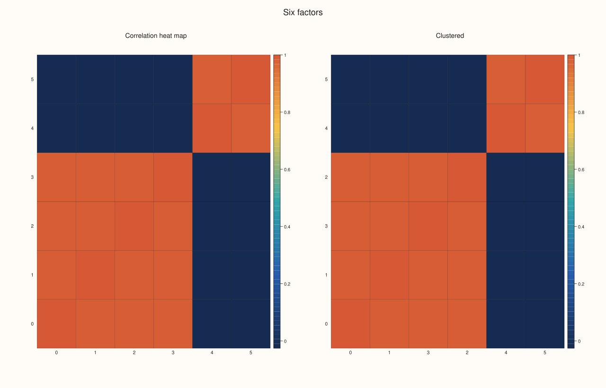
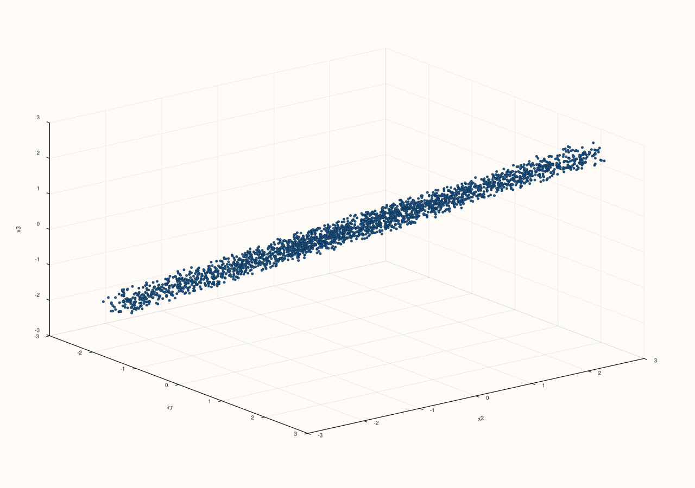
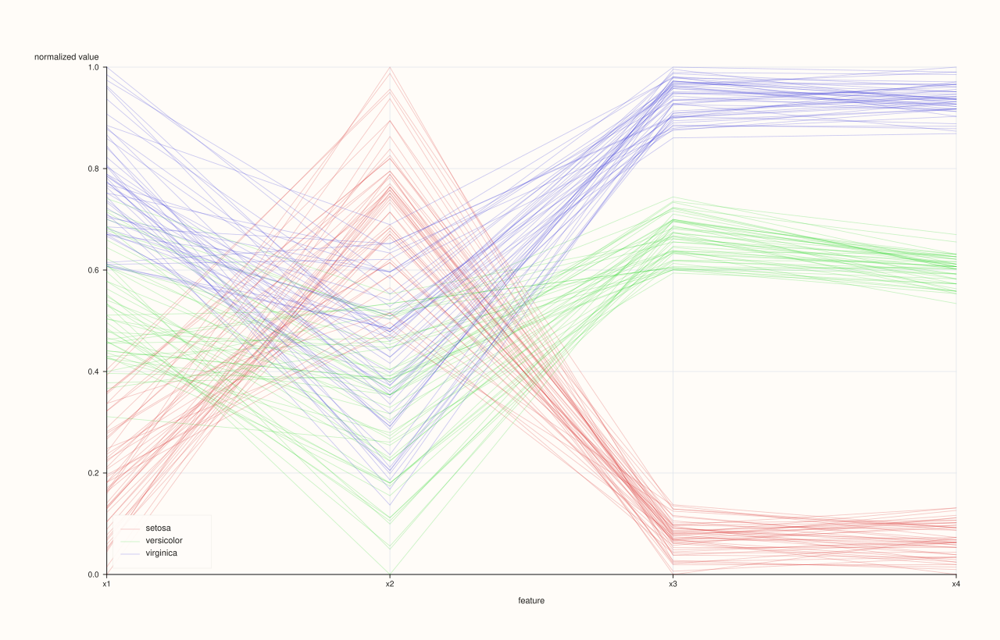
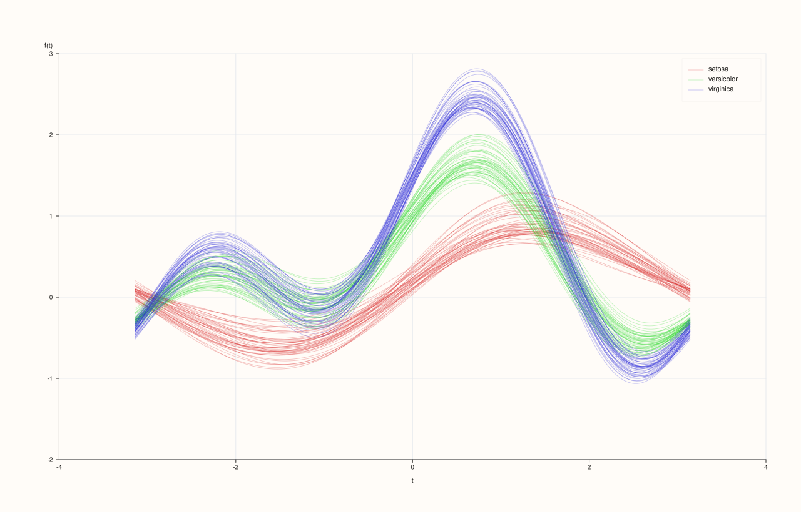
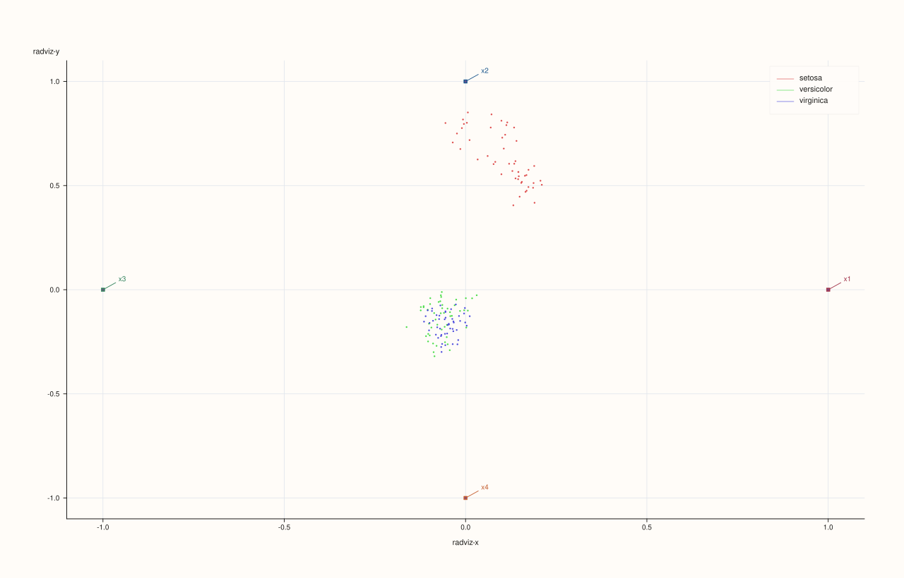
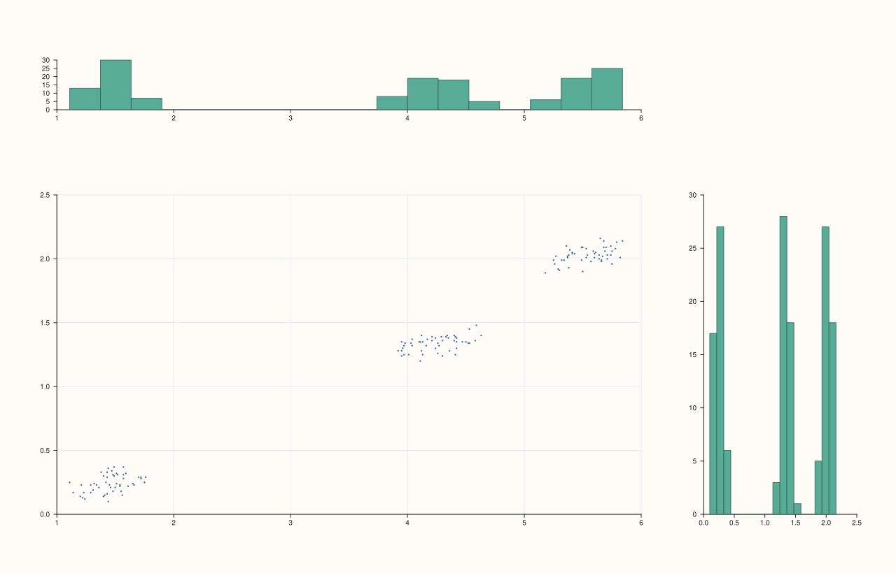
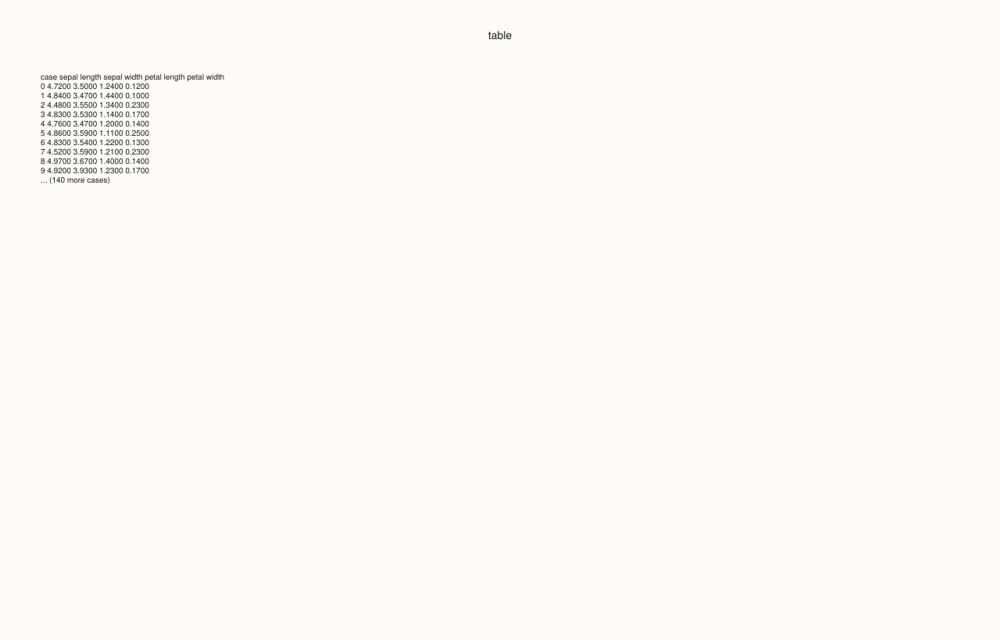

<!-- generated from matrices_and_many_variables.md.in by PlussMa/docs/tools/render_guide.py; edit the template -->

# Matrices and many variables

[Back to PlussPl by example](../guide.md)

When there are more than two variables, plots have to show many relationships at once. This page draws a correlation matrix as a heat map, then the multivariate views of three flower species: parallel coordinates, Andrews curves, a radial layout, a joint plot and a summary.

## How it works

A matrix of values is a heat map: `heatmap(pane, x, y, z)` takes the column positions, the row positions and the matrix, and `clustermap` reorders rows and columns so that similar ones sit together. The multivariate views take a list of columns (and optionally a group label for each row) and build a whole figure: `pairplot` and `triplot` for every pair and every triple, `parallelplot` for one line per row across all variables, `andrews_curves` for a smooth curve per row, `radviz` for a circular layout, `jointplot` for two variables with their marginals, and `summaryplot` for one summary per variable.

## Which factors move together?

Twelve measured factors for five thousand cases, of which the program takes six. It computes the correlation matrix and draws it as a heat map and as a clustered map; then it draws every pairwise view of four factors and the three-way view of three.

```cpp
#include <pluss/pl/plusspl.h>
#include <pluss/pluss.h>

#include <cmath>
#include <cstdlib>
#include <filesystem>
#include <iostream>

using namespace pluss::pl;

static std::string out(const char *name) {
  const char *dir = std::getenv("PLUSSMA_GUIDE_ASSETS");
  return ((dir ? std::filesystem::path(dir) : std::filesystem::path(".")) / name).string();
}


int main() {
  auto loaded = flash::load_dataset("factor_blocks");
  const auto data = loaded->frame();
  const int k = 6;
  std::vector<pluss::Series> columns;
  for (int i = 1; i <= k; ++i) columns.push_back(data.features("factor_0" + std::to_string(i)).as_series());
  auto stacked = columns[0].unsqueeze(0).unite({columns[1].unsqueeze(0), columns[2].unsqueeze(0), columns[3].unsqueeze(0), columns[4].unsqueeze(0), columns[5].unsqueeze(0)}, 0);
  auto correlation = stacked.corrcoef();
  std::cout << "correlation matrix " << correlation.size(0) << " x " << correlation.size(1) << "\n";
  std::cout << "largest off-diagonal correlation " << (correlation - pluss::series::eye(k, pluss::ScalarType::Float64)).abs().max().item<double>() << "\n";

  // Heat map of the correlation matrix: x and y are the column and row positions, z the matrix itself.
  auto axis = pluss::series::arange(0, k, pluss::ScalarType::Float64);
  auto fig = studio("factor_correlation");
  fig.mosaic(1, 2);
  fig.headline("Six factors");
  auto &heat = fig.pane2("Correlation heat map");
  flash::heatmap(heat, axis, axis, correlation);
  auto &cluster = fig.pane2("Clustered");
  flash::clustermap(cluster, axis, axis, correlation);
  fig.show();

  // Pairwise views of the first four factors, and the three-way view of factors one to three.
  auto pairs = studio("factor_pairs");
  flash::pairplot(pairs, {columns[0], columns[1], columns[2], columns[3]});
  pairs.show();
  auto tri = studio("factor_triplot");
  flash::triplot(tri, {columns[0], columns[1], columns[2]});
  tri.show();
}
```

Output

```text
correlation matrix 6 x 6
largest off-diagonal correlation 0.989234
```





The matrix is `6 x 6`, and the largest correlation between two different factors is `0.989`: some of these factors are nearly the same measurement. The heat map shows the structure as blocks of strong correlation, and the clustered map moves the blocks together. The pair plot confirms it factor by factor: strongly related pairs lie on a line and unrelated ones form a cloud, while the diagonal shows each factor's own distribution.

## Telling three species apart

A hundred and fifty flowers with four measurements each, in three species.

```cpp
#include <pluss/pl/plusspl.h>
#include <pluss/pluss.h>

#include <cmath>
#include <cstdlib>
#include <filesystem>
#include <iostream>

using namespace pluss::pl;

static std::string out(const char *name) {
  const char *dir = std::getenv("PLUSSMA_GUIDE_ASSETS");
  return ((dir ? std::filesystem::path(dir) : std::filesystem::path(".")) / name).string();
}


int main() {
  auto loaded = flash::load_dataset("petals");
  const auto petals = loaded->frame();
  auto species = petals.features("species").as_note();
  std::vector<pluss::Series> measures{petals.features("sepal_length").as_series(), petals.features("sepal_width").as_series(), petals.features("petal_length").as_series(), petals.features("petal_width").as_series()};
  auto means = petals.group({.dropnull = true, .sort = true}).by({"species"}).agg({{"petal_length", "petal_length", pluss::table::DataFrame::GroupOp::Mean}, {"petal_width", "petal_width", pluss::table::DataFrame::GroupOp::Mean}});
  std::cout << means.to_string() << "\n";

  auto parallel = studio("petal_parallel");
  flash::parallelplot(parallel, measures, species);
  parallel.show();
  auto andrews = studio("petal_andrews");
  flash::andrews_curves(andrews, measures, species);
  andrews.show();
  auto radviz = studio("petal_radviz");
  flash::radviz(radviz, measures, species);
  radviz.show();
  auto joint = studio("petal_joint");
  flash::jointplot(joint, measures[2], measures[3], "scatter");
  joint.show();
  auto summary = studio("petal_summary");
  flash::summaryplot(summary, measures, {"sepal length", "sepal width", "petal length", "petal width"});
  summary.show();
  std::cout << "five multivariate figures written\n";
}
```

Output

```text
============================================
     | species     petal_length  petal_width
--------------------------------------------
0    | setosa      1.4572        0.2412     
1    | versicolor  4.2422        1.336      
2    | virginica   5.5454        2.0284     
--------------------------------------------
[3 cs x 3 feat]
five multivariate figures written
```










The table separates the species before any plot is drawn: mean petal length is `1.46` for setosa, `4.24` for versicolor and `5.55` for virginica, and petal width `0.24`, `1.34` and `2.03`. The figures show the same separation in different ways. In the parallel plot the setosa lines run apart from the others through the petal measurements; in the Andrews curves the three species trace three bundles of curves; the radial layout pushes the species into three regions of the circle; the joint plot of the two petal measurements shows the clusters in the plane with their marginal histograms; and the summary plot reports each measurement's distribution. When one view does not separate groups, another often does.

## Decisions

- **Pairs or one number:** a pair plot when there are a few variables; a correlation heat map when there are many.
- **Cluster the matrix:** a clustered map reveals blocks that the raw order hides.
- **Colour by group:** pass the group labels to the multivariate views; the separation is the point.
- **Try more than one view:** parallel coordinates, Andrews curves and the radial layout fail and succeed on different data.

## Pitfalls

The program below makes 4 mistakes on purpose and prints the message each one produces.

```cpp
#include <pluss/pl/plusspl.h>
#include <pluss/pluss.h>

#include <iostream>

using namespace pluss::pl;

template <class F> static void report(const char *what, F &&call) {
  try {
    call();
    std::cout << what << ": no error\n";
  } catch (const pluss::Error &e) {
    std::cout << what << ": " << e.message() << "\n";
  }
}

int main() {
  auto x = pluss::series::linspace(0.0, 1.0, 5, pluss::ScalarType::Float64);
  auto y = x.sin();
  auto y3 = pluss::series::linspace(0.0, 1.0, 3, pluss::ScalarType::Float64);
  auto flat = pluss::make_series({1.0, 2.0, 3.0, 4.0});
  auto matrix = pluss::series::linspace(0.0, 1.0, 20, pluss::ScalarType::Float64).reshape({4, 5});
  auto empty = pluss::series::zeros({0}, pluss::ScalarType::Float64);
  auto groups = pluss::make_note({"a", "b", "c"});
  report("a heat map from a flat z", [&] { auto f = studio("m"); flash::heatmap(f.pane2("a"), x, flat, flat); });
  report("axes that do not match the matrix", [&] { auto f = studio("m"); flash::heatmap(f.pane2("a"), x, x, matrix); });
  report("a pair grid of columns of different lengths", [&] { auto f = studio("m"); flash::pairplot(f, {x, y3}); });
  report("a mask that is not the size of the matrix", [&] { auto f = studio("m"); flash::HeatmapOptions o; o.mask = pluss::make_series({1.0, 0.0}); flash::heatmap(f.pane2("a"), pluss::series::linspace(0.0, 4.0, 5, pluss::ScalarType::Float64), pluss::series::linspace(0.0, 3.0, 4, pluss::ScalarType::Float64), matrix, o); });
}
```

Output

```text
a heat map from a flat z: fieldmap: z must be a rank-2 matrix
axes that do not match the matrix: fieldmap: x/y must both be vectors with extents matching z columns/rows or full matrices matching z
a pair grid of columns of different lengths: flash::pairplot requires equal-length columns
a mask that is not the size of the matrix: flash::heatmap mask must match z element count
```
- **A heat map from a flat z:** `z` must be a matrix.
- **Axes that do not match the matrix:** The x extent must match the columns of z and y its rows; here a 4 by 5 matrix was given two 5-long axes.
- **A pair grid of columns of different lengths:** Every column must have the same number of rows.
- **A mask that is not the size of the matrix:** The mask needs one entry per cell of z; a zero hides the cell.

Each message names the function that refused the input, so the fix is to correct the data before the call: check lengths and shapes where the data is built, not where it is drawn.

## Where next

Reference pages: [`flash::heatmap`](../api/flash/heatmap.md), [`flash::clustermap`](../api/flash/clustermap.md), [`flash::pairplot`](../api/flash/pairplot.md), [`flash::triplot`](../api/flash/triplot.md), [`flash::parallelplot`](../api/flash/parallelplot.md), [`flash::andrews_curves`](../api/flash/andrews_curves.md), [`flash::radviz`](../api/flash/radviz.md), [`flash::jointplot`](../api/flash/jointplot.md), [`flash::summaryplot`](../api/flash/summaryplot.md). Next: [Grids and linear models](grids_and_models.md).
