<!-- generated from plot_window.md.in by PlussMa/docs/tools/render_guide.py; edit the template -->

# The plot window

[Back to PlussPl by example](../guide.md)

`Studio::show()` opens the figure in a window, and so does `show()` on any plot a table returns (`df.plot().line("month", "sales").show()`). The window is for looking: its menus change how the figure is drawn, so that you can smooth a line, put one series in focus, split the panels, switch to a log axis, fit a scatter or try another theme without editing the program. Every choice re-draws a copy of the figure, and Save writes what the window shows.

## The menus

The toolbar has, from left to right, **Theme**, **Colors**, **Reset**, **View** and **Save**.

| Menu | What it holds |
|---|---|
| Theme | The look of the whole figure: a grid style, a dark background, high contrast, or print-friendly gray. |
| Colors | The palette that the lines, bars and points take. |
| Reset | One entry, *Back to the original figure*, which clears every choice. |
| View | Everything that depends on the figure, in five groups: Series, Data, Draw, Analyze and Axes (and Histogram for a histogram). Each entry opens a list of options. |
| Save | PNG, PDF or SVG of the figure as it is shown now. |

Three rules make the menus easy to use together.

- **Only what applies is offered.** The window looks at the figure. A histogram has bins and a density curve but nothing to smooth; one line has nothing to put in focus; a pie has only the looks. A group with nothing to change does not appear.
- **A check mark shows the choice in effect.** The first option of every group is how the figure was drawn, and choosing it again undoes the group.
- **Choices combine.** Each group remembers its choice, and the figure is always re-drawn from the original with all of them applied, in a fixed order: the series that are shown, then the values (window, orientation and sort, transform, smoothing), then how the values are drawn, then the layout, then the analysis that is added on top (outliers, fit, guides, marks, statistics), then the axes and the looks. So *Index* then *Moving average* then *Log y* gives a smoothed index on a log axis, whichever you pick first.

## Theme and Colors

| Option | Effect |
|---|---|
| Original | The theme the figure was built with. |
| Light grid, Dark grid, Sand | The grid styles of the `flash` layer. |
| Midnight | A dark background with light lines. |
| Ocean | The blue and teal theme. |
| High contrast | Black on white with saturated colors and thicker lines. |
| Print (gray) | Black on white and shades of gray. |

Colors lists `Deep`, `Muted`, `Pastel`, `Bright`, `Dark` and `Colorblind` (the `flash` palettes), `Ocean` and `Gray`. A color choice is applied after the theme, so a palette can be tried on any background. Opacity that the plot set for itself is kept.

## View: Series

These groups appear when one pane holds two to twenty-four series.

| Group | Options | Effect |
|---|---|---|
| Isolate | All series, then *Only* each series | Keeps one series and removes the rest. |
| Focus | No focus, then each series | Draws one series thick and fades the others, which stay as context. Guides, marks, fits and statistics added afterwards belong to the series in focus. |
| Layout | Overlaid, One panel per series, Panels with the same y range, Grid of panels | Splits one pane into a pane for each series, stacked with a shared x axis or arranged in a grid. Not offered when the figure already has several panes. |

## View: Data

| Group | Options | Effect |
|---|---|---|
| Window | Everything, Last 50%, Last 25%, Last 10%, First 50%, First 25% | Shows part of the series, by x. The y range refits to what is left. |
| Orientation | As drawn, Horizontal (or Vertical) bars | Turns a bar chart, moving the category labels and the axis labels with it. |
| Sort | As drawn, Smallest first, Largest first, Label A to Z, Label Z to A | Reorders labeled bars; each bar keeps its label. Sorting follows the orientation, so the first bar is the one at the top of a horizontal chart. |
| Transform | As drawn, Index (start = 100), % change since start, % change per step, Change per step, Running total, Z-score, Scaled 0 to 1, Share of total (%) | Replaces the values of every series with the transformed values, each series on its own, and names the transform on the axis label. A step-to-step change has one value fewer than the series. |
| Smooth | As drawn, Moving average (3, 7, 15, 31, 61), Exponential (fast, slow) | Smooths lines and filled areas. A moving average is centered and uses the neighbours an edge has; only widths up to half the series are offered. |
| Raw data | Hidden, Faint | With Smooth, keeps the unsmoothed line faintly behind the smoothed one. |

## View: Draw

| Group | Options | Effect |
|---|---|---|
| Draw as | As drawn, Line, Steps, Filled area, Stems, Points, Line with points | Draws a line series in another form. Overlapping areas are drawn translucent; an area or stems hang from zero when the values come near it and from just below the data otherwise. |
| Line width | As drawn, Thin, Thick, Heavy | Scales the width of lines and stems. |
| Dot size | As drawn, Small, Large, Huge | Scales the markers of a scatter. |
| Opacity | As drawn, Faint, Light, Solid | Sets how opaque scatter markers are, which shows where they pile up. |

## View: Histogram

| Group | Options | Effect |
|---|---|---|
| Bins | As drawn, Automatic, 5, 8, 12, 20, 30, 50 | Changes the number of bars. Automatic uses a rule that follows the data's spread and size. |
| Bars show | Counts, Density, Cumulative count, Cumulative share | Changes what the bar heights measure. A density has bars of total area one; a cumulative share reaches one. |
| Curve | None, Density (narrow, default, wide), Normal fit | Adds a smooth curve at the height of the bars, on the scale chosen in *Bars show*. |

## View: Analyze

| Group | Options | Effect |
|---|---|---|
| Outliers | Not marked, Highlight, Hide | For a scatter: finds the points beyond 1.5 interquartile ranges on x or y, and draws them large in a second color or removes them. |
| Density | Plain points, Shade by local density | For a scatter of 30 points or more: colors each point by how crowded its neighbourhood is, so that a cloud that fills a blob shows its core. |
| Fit line | None, Linear, Quadratic, Cubic, Robust line, Smooth curve | For a scatter: adds a fit through the points (those that Outliers has set aside are left out) and names it in the legend. |
| Guides | None, Mean, Median, Mean +/- 1 SD, Mean +/- 2 SD, Middle 50%, Smallest and largest | Draws reference lines and bands for each series (along x for a histogram) and labels them with their values. |
| Mark | None, Highest and lowest, Last value, First and last, Every value | Labels points with their values. *Every value* is offered when no series has more than 40 points. |
| Statistics | None, Summary line | Writes the count, mean, standard deviation, minimum, median and maximum under the pane (and the correlation for a scatter). |

Guides, marks and statistics are measured on the values as the earlier groups left them: after a transform or smoothing they describe the transformed or smoothed series.

## View: Axes

| Group | Options | Effect |
|---|---|---|
| Legend | As drawn, Top right, Top left, Bottom right, Bottom left, Outside, Hidden | Moves or hides the legend. A fit, an outlier overlay or a curve is named in the legend, so a legend appears for them unless it is hidden. |
| Grid | As drawn, None, Major lines, Major and minor | Sets the grid of every pane that has axes. |
| Aspect | As drawn, Wide (16:9), Classic (4:3), Square, Tall (3:4) | Changes the shape of the figure, keeping its area. |
| Axis text | As drawn, Small, Large, Huge | Scales the axis labels and tick labels. |
| Scale | Linear, Log y, Log x, Log x and y, Symmetric log y | Changes the axis scale of lines and scatters. A log axis is offered only when every value is positive; if an earlier choice (a z-score, say) makes values non-positive, the symmetric log is used instead. |
| Y range | Automatic, Tight to the data, From zero, Centered on zero, Padded | Sets the y range. |

## The same views from code

The window's menus are built from two public functions, so the same views are available to a program. `views::groups(figure)` lists the groups that apply to a figure, each with its id, title, section and option ids; `views::apply(figure, choices)` returns a copy with the choices (a map from group id to option id) applied together. The figure itself is never changed.

The program lists what a figure of four prices offers, applies two choices and shows what changed, then does the same for a histogram and a scatter.

```cpp
#include <pluss/pl/plusspl.h>
#include <pluss/pluss.h>

#include <cmath>
#include <cstdlib>
#include <filesystem>
#include <iostream>
#include <map>

using namespace pluss::pl;

static std::string out(const char *name) {
  const char *dir = std::getenv("PLUSSMA_GUIDE_ASSETS");
  return ((dir ? std::filesystem::path(dir) : std::filesystem::path(".")) / name).string();
}

// A small deterministic generator, so that the program prints the same numbers every time.
static double next_uniform(unsigned long long &state) {
  state = state * 6364136223846793005ULL + 1442695040888963407ULL;
  return static_cast<double>((state >> 33) & 0xFFFFFF) / 16777216.0;
}

static double next_normal(unsigned long long &state) {
  double sum = 0.0;
  for (int i = 0; i < 12; ++i) sum += next_uniform(state);
  return sum - 6.0;
}

static void list_groups(const char *name, const Studio &figure) {
  std::cout << name << " offers:\n";
  for (const auto &group : views::groups(figure)) {
    std::cout << "  " << (group.section.empty() ? "(own menu)" : group.section) << " / " << group.title << ": ";
    for (std::size_t i = 0; i < group.options.size(); ++i) {
      std::cout << (i ? ", " : "") << group.options[i].id;
    }
    std::cout << "\n";
  }
}

static std::vector<double> first_values(const Studio &figure, std::size_t trace, std::size_t count) {
  const auto &data = std::get<TrendData>(figure.panes()[0].traces()[trace].payload());
  const auto all = data.y.to(pluss::ScalarType::Float64).host<double>().array().data;
  return {all.begin(), all.begin() + static_cast<std::ptrdiff_t>(std::min(count, all.size()))};
}

int main() {
  unsigned long long state = 2024;

  // Four prices that start at different levels and wander.
  Studio prices("prices");
  prices.headline("Four prices");
  Pane &pane = prices.pane2();
  auto day = pluss::series::linspace(1.0, 120.0, 120, pluss::ScalarType::Float64);
  const char *names[] = {"Alpha", "Beta", "Gamma", "Delta"};
  const double starts[] = {104.0, 115.0, 106.0, 105.0};
  for (int k = 0; k < 4; ++k) {
    std::vector<double> y(120);
    double level = starts[k];
    for (auto &v : y) {
      level += 2.0 * next_normal(state) + 0.2;
      v = level;
    }
    pane.trend(day, pluss::make_series(y, {120})).label(names[k]);
  }
  pane.legend(KeyPlace::NorthWest).x_label("day").y_label("price");
  list_groups("the price figure", prices);

  // A set of choices rewrites a copy of the figure; the figure itself is never changed.
  views::Choices smooth_index{{"transform", "index"}, {"smooth", "ma7"}};
  Studio indexed = views::apply(prices, smooth_index);
  const auto raw = first_values(prices, 1, 3);
  const auto shown = first_values(indexed, 1, 3);
  std::cout << "\nBeta, first three values as drawn:      " << raw[0] << " " << raw[1] << " " << raw[2] << "\n";
  std::cout << "Beta after Index and a 7-point average: " << shown[0] << " " << shown[1] << " " << shown[2] << "\n";
  std::cout << "y axis label is now: " << indexed.panes()[0].y_axis().label << "\n";

  prices.save_svg(out("views_prices.svg"));
  indexed.save_svg(out("views_prices_indexed.svg"));
  views::apply(prices, {{"layout", "stack"}}).save_svg(out("views_prices_stack.svg"));
  views::apply(prices, {{"focus", "t1"}, {"guides", "sd1"}, {"marks", "extremes"}, {"theme", "midnight"}})
      .save_svg(out("views_prices_focus.svg"));
  std::cout << "\nOne panel per series gives " << views::apply(prices, {{"layout", "stack"}}).pane_count() << " panes.\n";

  // A histogram has no series to smooth, but it has bins, a scale for its bars, and a curve.
  Studio scores("scores");
  std::vector<double> values(600);
  for (auto &v : values) v = 50.0 + 10.0 * next_normal(state);
  scores.pane2().bucket(pluss::make_series(values, {600}), 14).label("score");
  list_groups("\nthe histogram", scores);
  Studio curved = views::apply(scores, {{"bins", "auto"}, {"counts", "density"}, {"curve", "kde"}});
  const auto &bars = std::get<BucketData>(curved.panes()[0].traces()[0].payload());
  std::cout << "Automatic bins chose " << bars.bins << " bins; the curve is the trace named '"
            << curved.panes()[0].traces()[1].label_text() << "'.\n";
  scores.save_svg(out("views_scores.svg"));
  curved.save_svg(out("views_scores_curve.svg"));

  // A scatter offers a fit, outliers and density shading.
  Studio cloud("cloud");
  std::vector<double> x(900), y(900);
  for (std::size_t i = 0; i < x.size(); ++i) {
    x[i] = 10.0 + 3.0 * next_normal(state);
    y[i] = 2.0 * x[i] + 5.0 * next_normal(state) + (i % 97 == 0 ? 40.0 : 0.0);
  }
  cloud.pane2().cloud(pluss::make_series(x, {900}), pluss::make_series(y, {900})).label("points");
  Studio fitted = views::apply(cloud, {{"outliers", "highlight"}, {"fit", "linear"}, {"shade", "on"}});
  std::cout << "\nThe scatter with outliers set aside and a fit has " << fitted.panes()[0].trace_count() << " traces:";
  for (const auto &trace : fitted.panes()[0].traces()) {
    std::cout << " '" << trace.label_text() << "'";
  }
  std::cout << "\n";
  cloud.save_svg(out("views_cloud.svg"));
  fitted.save_svg(out("views_cloud_fit.svg"));
  return 0;
}
```

Output

```text
the price figure offers:
  (own menu) / Theme: default, lightgrid, darkgrid, sand, midnight, ocean, contrast, print
  (own menu) / Colors: default, deep, muted, pastel, bright, dark, colorblind, ocean, gray
  Series / Isolate: all, t0, t1, t2, t3
  Series / Focus: all, t0, t1, t2, t3
  Series / Layout: overlay, stack, stack_y, grid
  Data / Window: all, last50, last25, last10, first50, first25
  Data / Transform: raw, index, pct, step, diff, cumsum, zscore, minmax, share
  Data / Smooth: raw, ma3, ma7, ma15, ma31, ema_fast, ema_slow
  Data / Raw data: hidden, faint
  Draw / Draw as: as_drawn, line, step, area, stems, points, linepoints
  Draw / Line width: as_drawn, thin, thick, heavy
  Analyze / Guides: none, mean, median, sd1, sd2, iqr, range
  Analyze / Mark: none, extremes, last, ends
  Analyze / Statistics: none, summary
  Axes / Legend: default, ne, nw, se, sw, outside, off
  Axes / Grid: default, off, major, fine
  Axes / Aspect: default, wide, classic, square, tall
  Axes / Axis text: default, small, large, huge
  Axes / Scale: linear, ylog, xlog, loglog, symlog
  Axes / Y range: auto, tight, zero, sym, padded

Beta, first three values as drawn:      117.133 116.42 114.049
Beta after Index and a 7-point average: 98.3232 98.1429 98.233
y axis label is now: price (index)

One panel per series gives 4 panes.

the histogram offers:
  (own menu) / Theme: default, lightgrid, darkgrid, sand, midnight, ocean, contrast, print
  (own menu) / Colors: default, deep, muted, pastel, bright, dark, colorblind, ocean, gray
  Histogram / Bins: as_drawn, auto, b5, b8, b12, b20, b30, b50
  Histogram / Bars show: count, density, cumulative, cdf
  Histogram / Curve: none, kde_narrow, kde, kde_wide, normal
  Analyze / Guides: none, mean, median, sd1, sd2, iqr, range
  Analyze / Statistics: none, summary
  Axes / Grid: default, off, major, fine
  Axes / Aspect: default, wide, classic, square, tall
  Axes / Axis text: default, small, large, huge
Automatic bins chose 19 bins; the curve is the trace named 'density curve'.

The scatter with outliers set aside and a fit has 3 traces: 'points' 'outliers (24)' 'points (linear)'
```
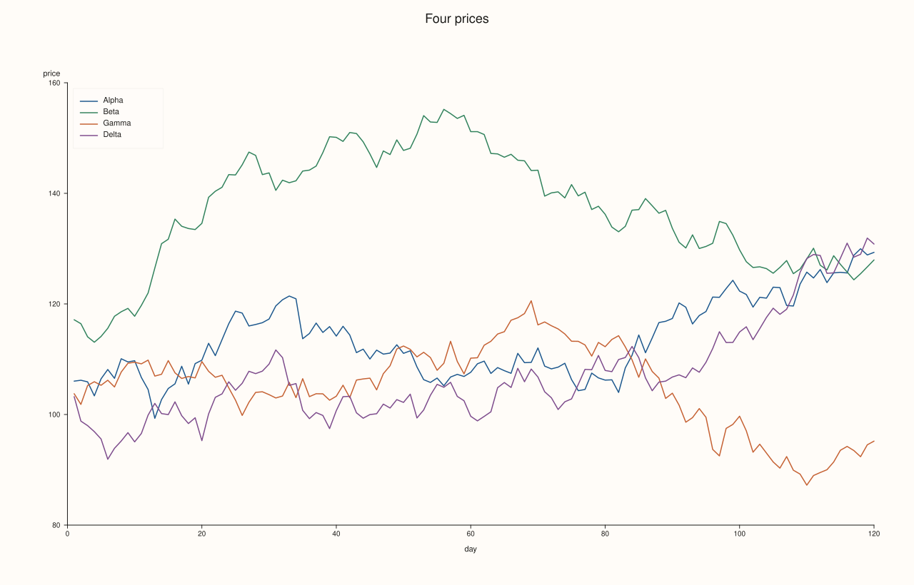

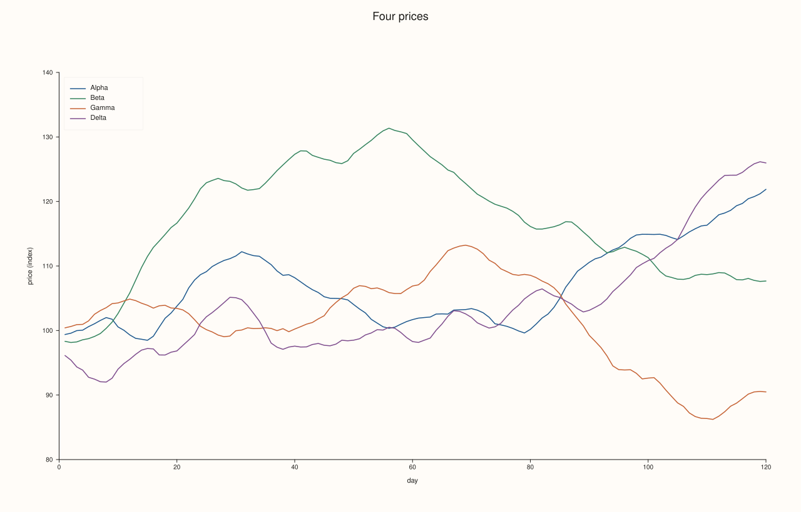

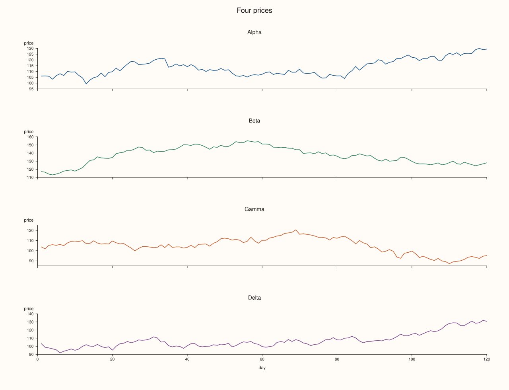

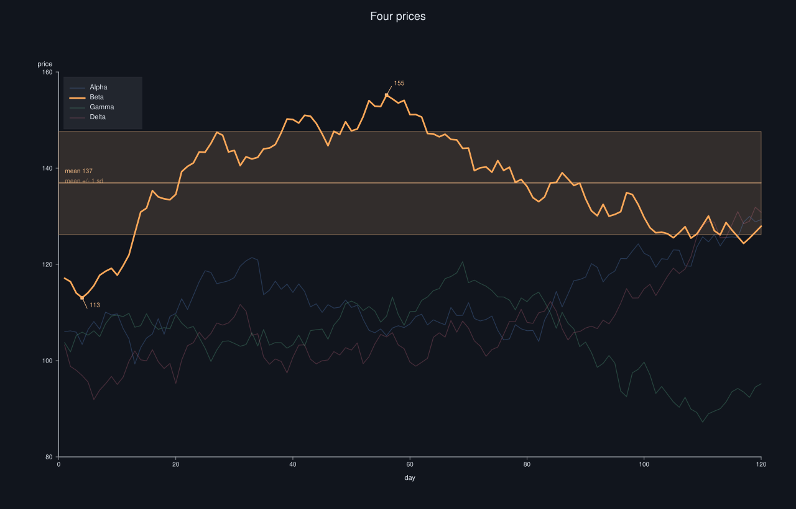

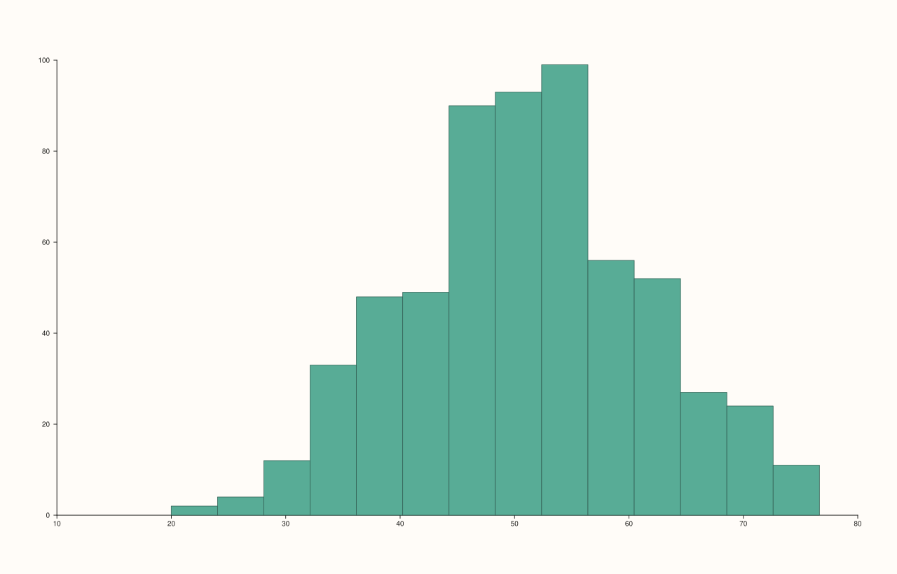

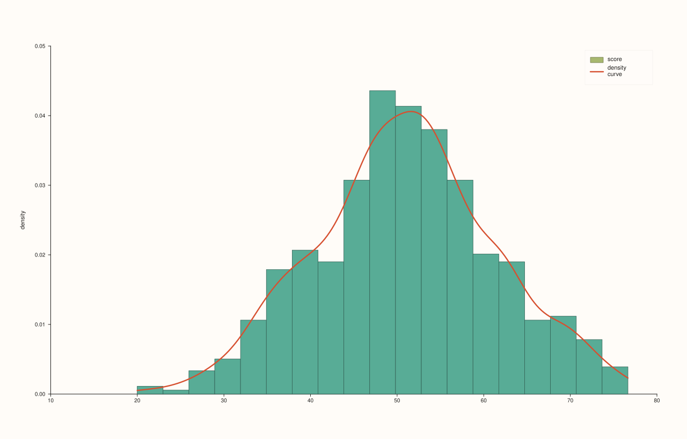

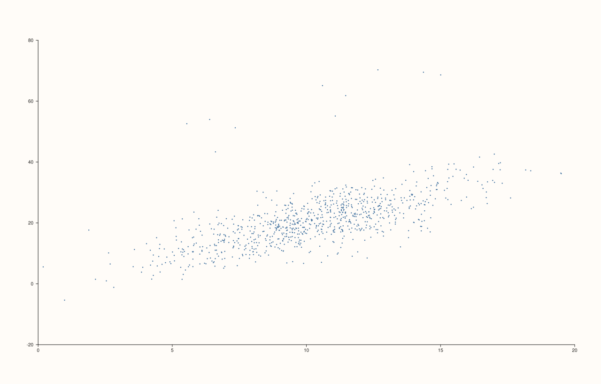

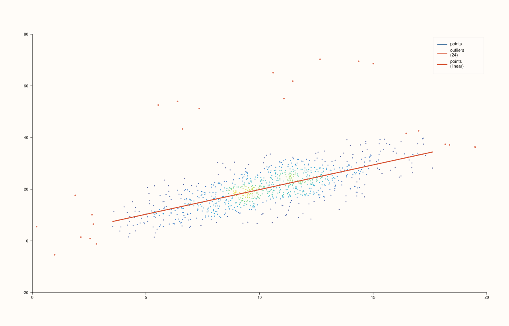

## A gallery

Each file below is the figure that the window shows after the choices named in the program's output.

```cpp
#include <pluss/pl/plusspl.h>
#include <pluss/pluss.h>

#include <cmath>
#include <cstdlib>
#include <filesystem>
#include <iostream>

using namespace pluss::pl;

static std::string out(const char *name) {
  const char *dir = std::getenv("PLUSSMA_GUIDE_ASSETS");
  return ((dir ? std::filesystem::path(dir) : std::filesystem::path(".")) / name).string();
}

static double next_uniform(unsigned long long &state) {
  state = state * 6364136223846793005ULL + 1442695040888963407ULL;
  return static_cast<double>((state >> 33) & 0xFFFFFF) / 16777216.0;
}

static double next_normal(unsigned long long &state) {
  double sum = 0.0;
  for (int i = 0; i < 12; ++i) sum += next_uniform(state);
  return sum - 6.0;
}

static void show(const char *file, const Studio &figure, const views::Choices &choices) {
  views::apply(figure, choices).save_svg(out(file));
  std::cout << file << ":";
  for (const auto &[group, option] : choices) {
    std::cout << " " << group << "=" << option;
  }
  std::cout << "\n";
}

int main() {
  unsigned long long state = 7;

  Studio prices("prices");
  Pane &lines = prices.pane2();
  auto day = pluss::series::linspace(1.0, 120.0, 120, pluss::ScalarType::Float64);
  const char *names[] = {"Alpha", "Beta", "Gamma", "Delta"};
  const double starts[] = {104.0, 115.0, 106.0, 105.0};
  for (int k = 0; k < 4; ++k) {
    std::vector<double> y(120);
    double level = starts[k];
    for (auto &v : y) {
      level += 2.0 * next_normal(state) + 0.2;
      v = level;
    }
    lines.trend(day, pluss::make_series(y, {120})).label(names[k]);
  }
  lines.legend(KeyPlace::NorthWest).x_label("day").y_label("price");

  show("view_smooth.svg", prices, {{"smooth", "ma15"}, {"ghost", "faint"}, {"marks", "extremes"}});
  show("view_index.svg", prices, {{"transform", "index"}});
  show("view_focus.svg", prices, {{"focus", "t1"}, {"guides", "sd1"}});
  show("view_panels.svg", prices, {{"layout", "grid"}, {"transform", "zscore"}});
  show("view_area.svg", prices, {{"isolate", "t2"}, {"draw", "area"}, {"guides", "iqr"}});
  show("view_steps.svg", prices, {{"window", "last25"}, {"draw", "linepoints"}});
  show("view_log.svg", prices, {{"transform", "cumsum"}, {"scale", "ylog"}});
  show("view_midnight.svg", prices, {{"theme", "midnight"}, {"focus", "t0"}});

  Studio regions("regions");
  Pane &bars = regions.pane2();
  bars.columns(std::vector<double>{1, 2, 3, 4, 5, 6, 7, 8}, std::vector<double>{42, 17, 88, 63, 29, 71, 55, 9}).label("sales");
  bars.x_categories({"North", "East", "Atlas", "Zulu", "Mid", "Bravo", "Coast", "Delta"});
  bars.x_label("region").y_label("sales");
  show("view_bars.svg", regions, {{"sort", "desc"}, {"marks", "values"}, {"guides", "mean"}});
  show("view_bars_flipped.svg", regions, {{"orient", "flip"}, {"sort", "asc"}, {"transform", "share"}});

  Studio scores("scores");
  std::vector<double> values(800);
  for (auto &v : values) v = 50.0 + 10.0 * next_normal(state);
  scores.pane2().bucket(pluss::make_series(values, {800}), 14).label("score");
  show("view_hist_curve.svg", scores, {{"bins", "auto"}, {"counts", "density"}, {"curve", "kde"}});
  show("view_hist_cumulative.svg", scores, {{"counts", "cdf"}, {"curve", "normal"}, {"guides", "iqr"}});

  Studio cloud("cloud");
  std::vector<double> x(1200), y(1200);
  for (std::size_t i = 0; i < x.size(); ++i) {
    x[i] = 10.0 + 3.0 * next_normal(state);
    y[i] = 2.0 * x[i] + 5.0 * next_normal(state) + (i % 97 == 0 ? 40.0 : 0.0);
  }
  cloud.pane2().cloud(pluss::make_series(x, {1200}), pluss::make_series(y, {1200})).label("points");
  show("view_scatter_fit.svg", cloud, {{"outliers", "highlight"}, {"fit", "linear"}, {"stats", "summary"}});
  show("view_scatter_shade.svg", cloud, {{"shade", "on"}, {"fit", "curve"}});
  return 0;
}
```

Output

```text
view_smooth.svg: ghost=faint marks=extremes smooth=ma15
view_index.svg: transform=index
view_focus.svg: focus=t1 guides=sd1
view_panels.svg: layout=grid transform=zscore
view_area.svg: draw=area guides=iqr isolate=t2
view_steps.svg: draw=linepoints window=last25
view_log.svg: scale=ylog transform=cumsum
view_midnight.svg: focus=t0 theme=midnight
view_bars.svg: guides=mean marks=values sort=desc
view_bars_flipped.svg: orient=flip sort=asc transform=share
view_hist_curve.svg: bins=auto counts=density curve=kde
view_hist_cumulative.svg: counts=cdf curve=normal guides=iqr
view_scatter_fit.svg: fit=linear outliers=highlight stats=summary
view_scatter_shade.svg: fit=curve shade=on
```
A 15-point moving average with the raw line kept behind it and the extremes marked:

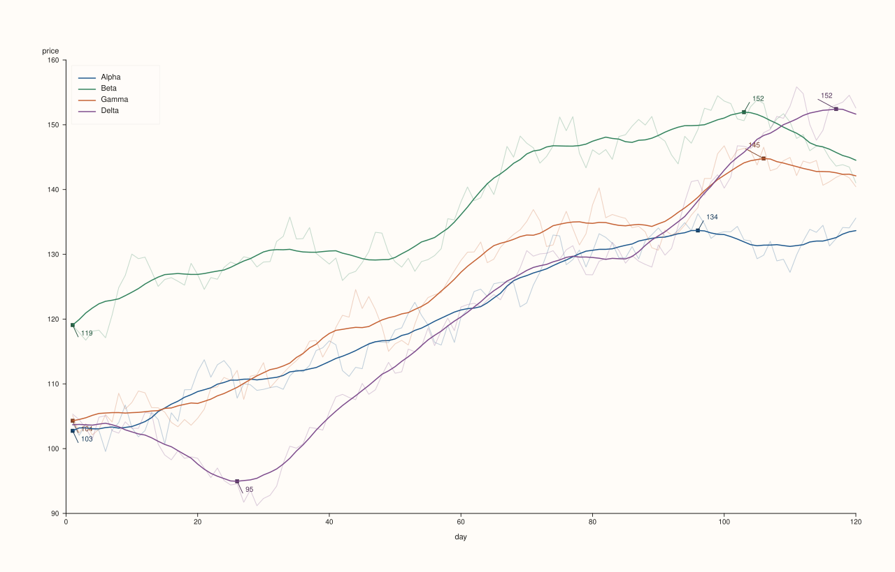

Index, start = 100:

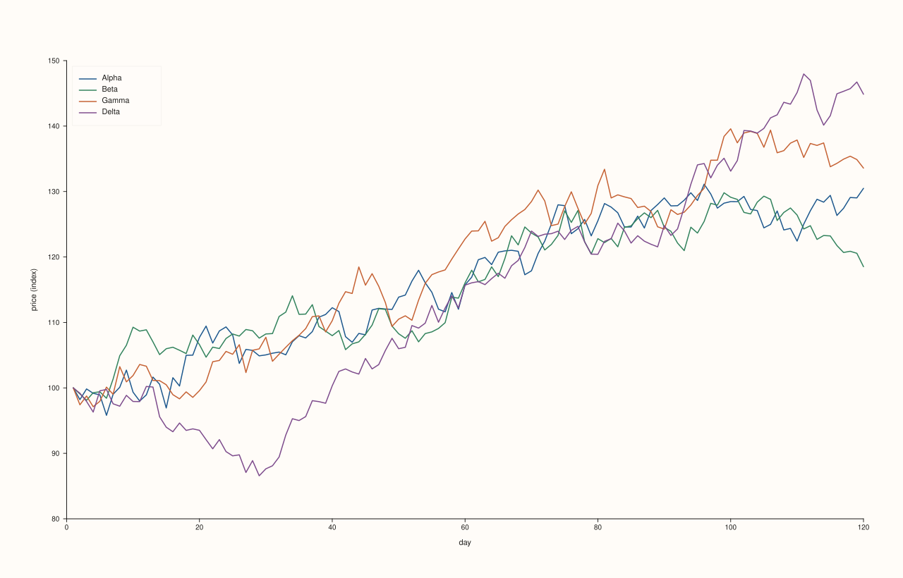

Beta in focus with a one-standard-deviation band:

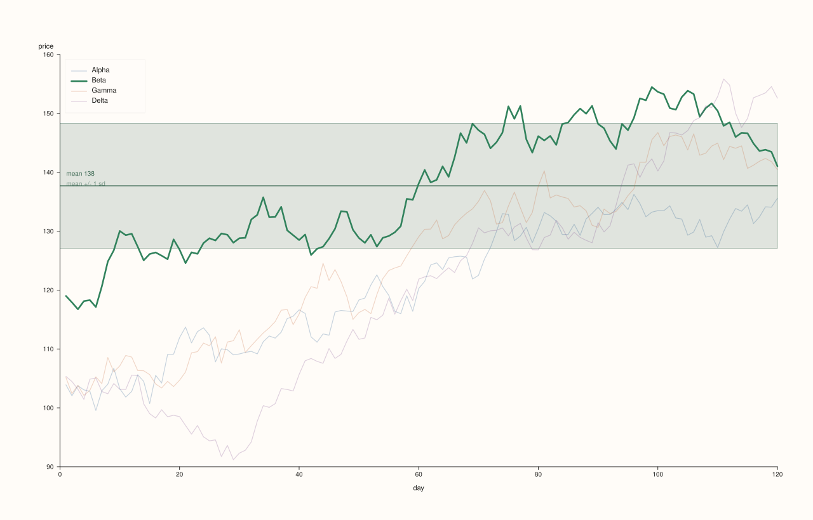

Z-scores in a grid of panels:

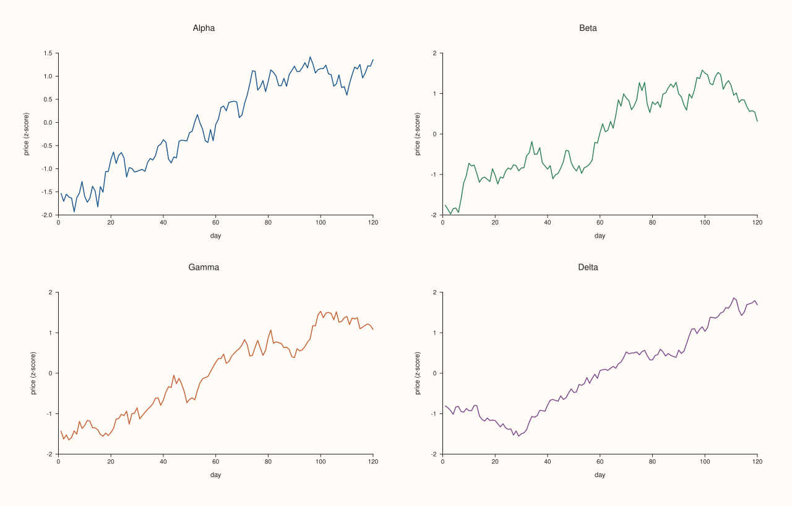

One series as a filled area with its quartile band:

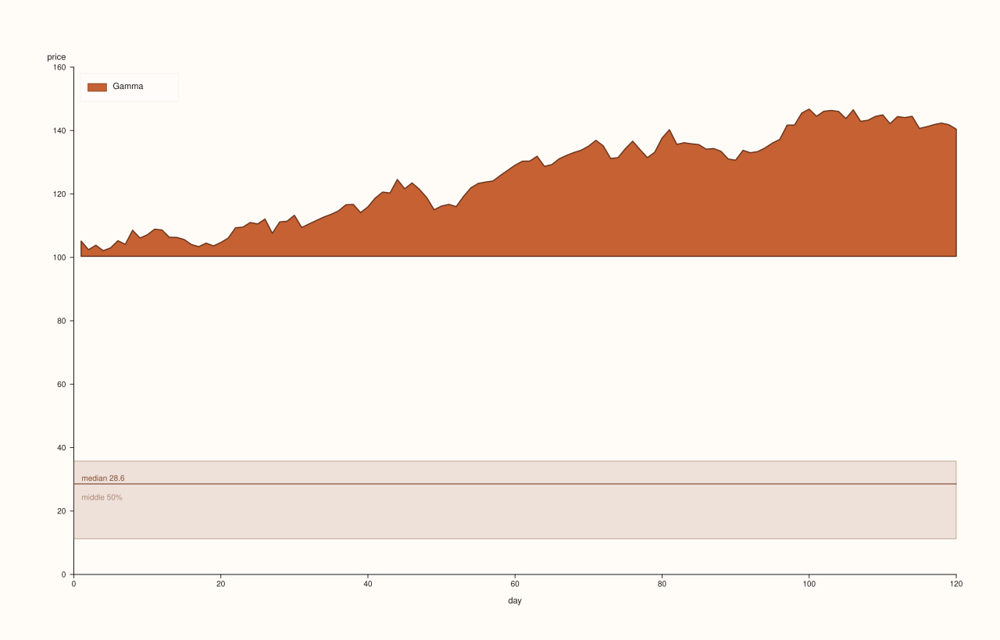

The last quarter as a line with points:

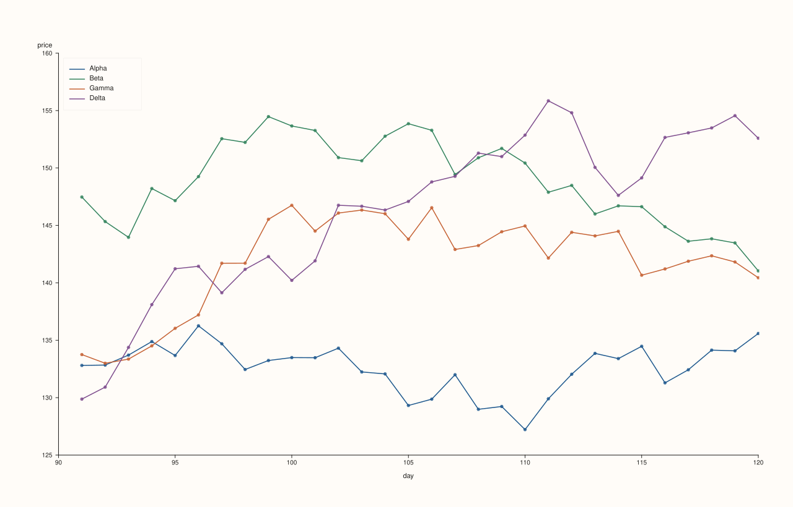

Running totals on a log axis:

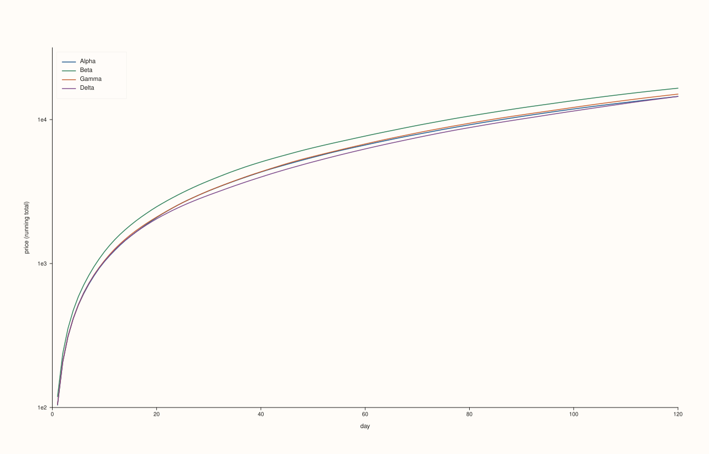

The midnight theme with the first series in focus:

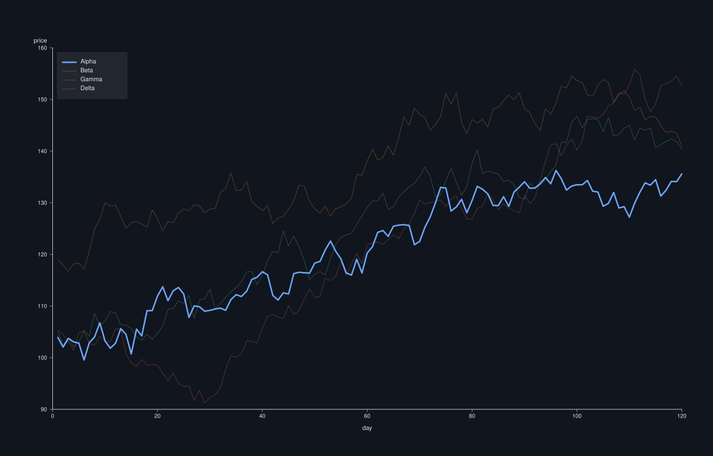

Bars sorted largest first, with their values and the mean:

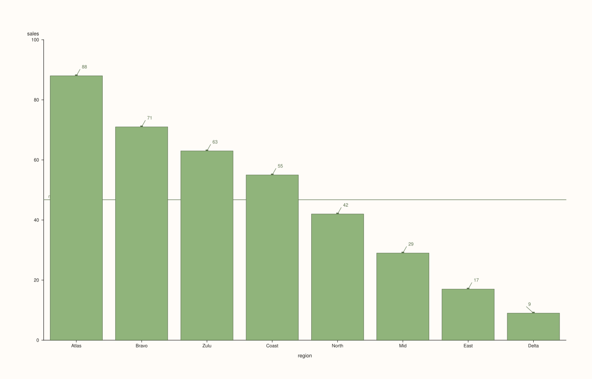

Bars turned horizontal, sorted, as shares of the total:

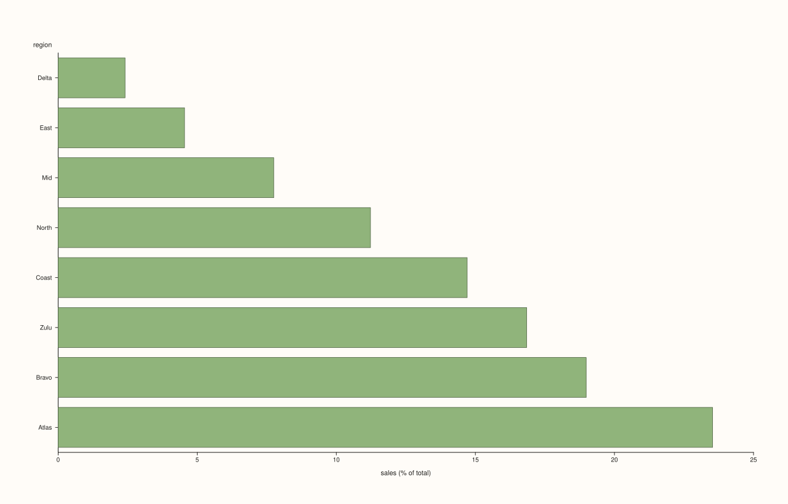

A histogram with automatic bins, density bars and a density curve:

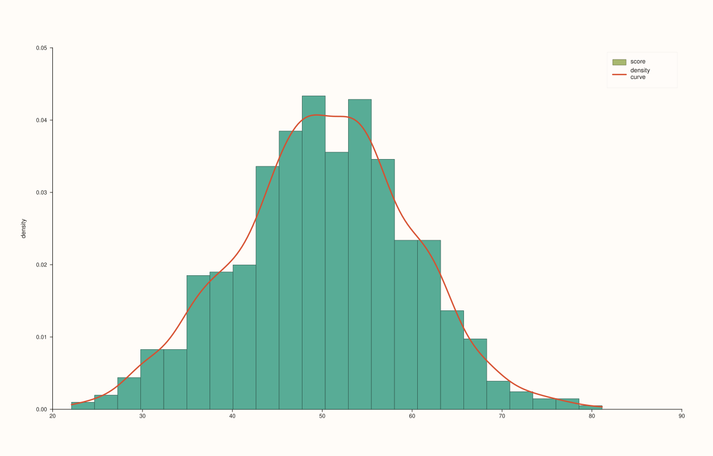

Cumulative share with a normal fit and the middle 50%:

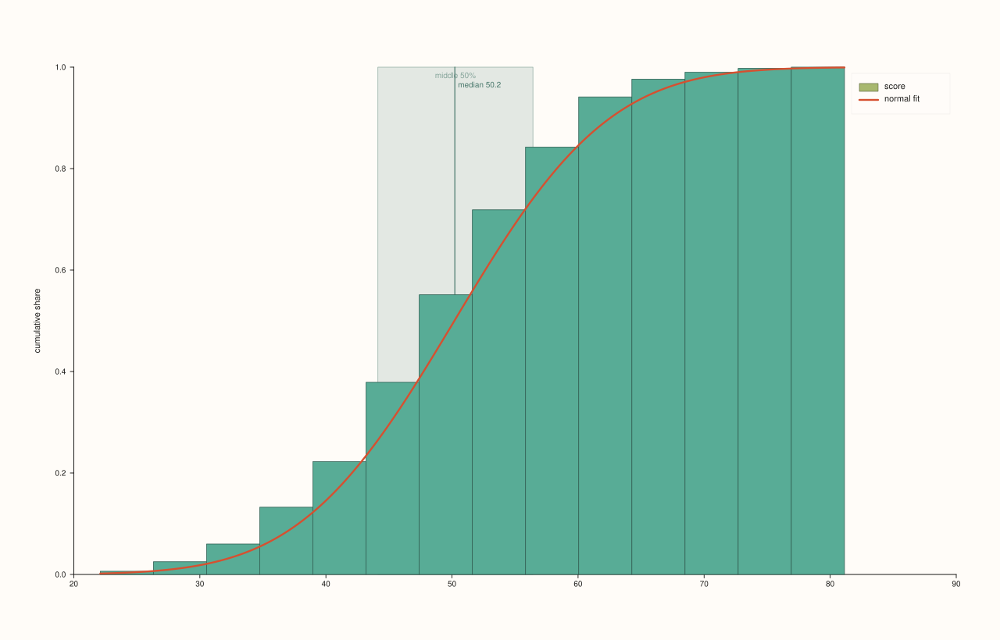

A scatter with outliers highlighted, a linear fit and the summary line:

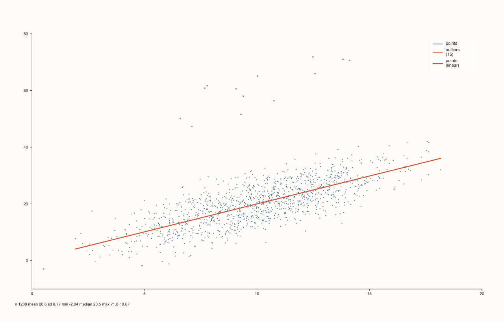

The same scatter shaded by density with a smooth curve:

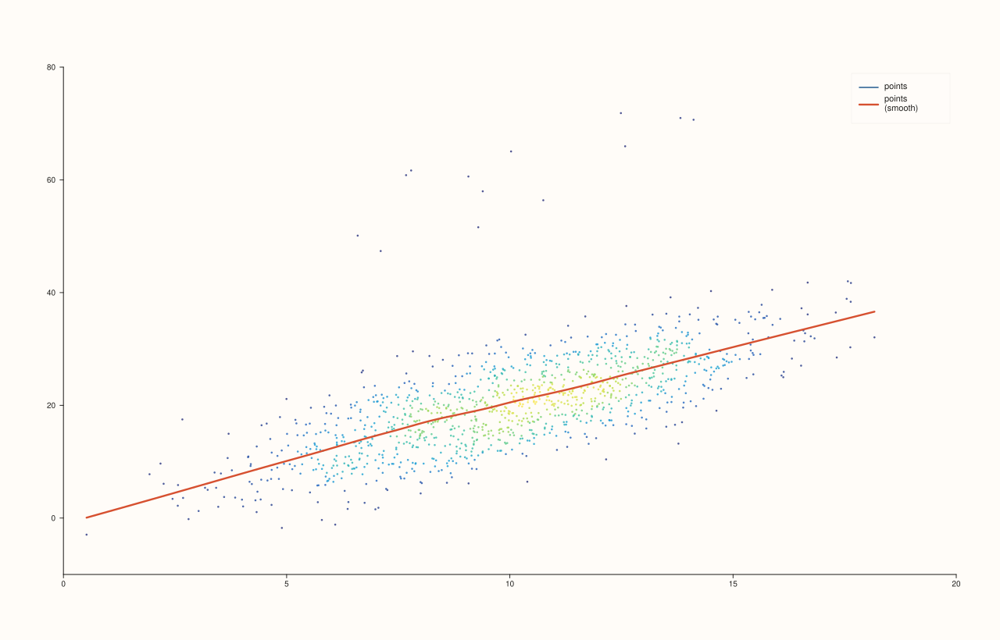
