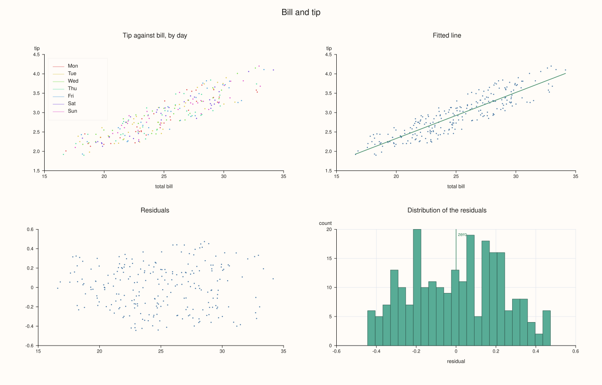
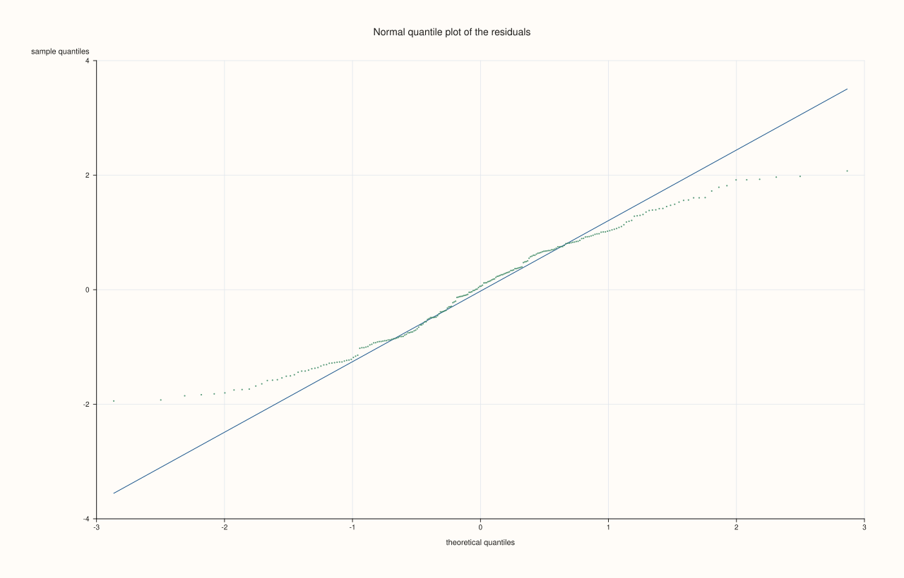
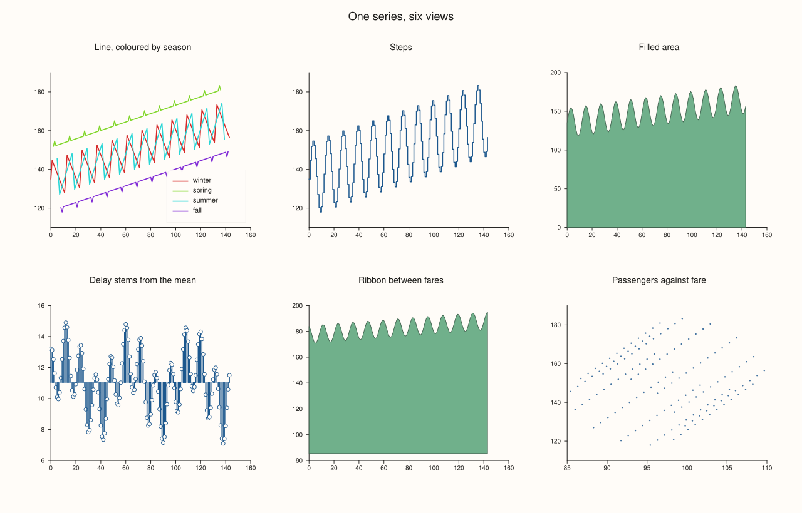
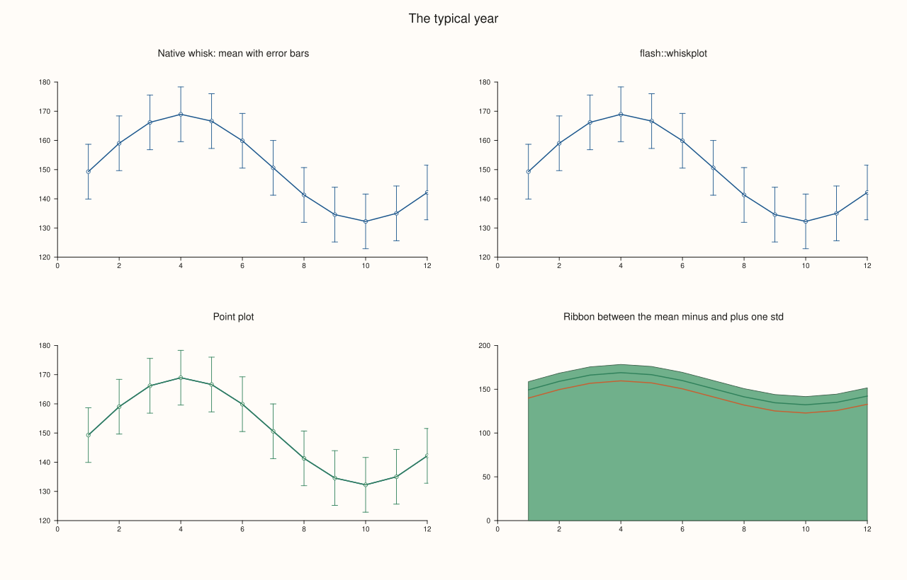

<!-- generated from relationships_and_trends.md.in by PlussMa/docs/tools/render_guide.py; edit the template -->

# Relationships and trends

[Back to PlussPl by example](../guide.md)

Two questions drive most plots of paired data: how does one quantity depend on another, and how does a quantity change over time. This page answers the first with a restaurant dataset (does a bigger bill mean a bigger tip?) and the second with monthly passenger counts, and then puts error bars and bands on a typical year.

## How it works

The relational functions take two series of the same length. `scatterplot(pane, x, y)` draws points and, given a text or numeric third argument, colours them by it. `lineplot`, `stepplot` and `areaplot` draw the same data as a line, as steps and as a filled area. `regplot` adds a fitted straight line to a scatter, and `residplot`, `resid_histplot` and `qqplot` draw what the line leaves behind. The native traces `ribbon`, `spike` and `whisk` draw a band, vertical stems and error bars. All of them are pane methods or `flash::` functions that take a pane, so they can share a mosaic.

## Does a bigger bill mean a bigger tip?

Two hundred and forty parties. The program scatters tip against bill coloured by day of the week, fits a line, plots the residuals and their histogram, and checks them with a normal quantile plot.

```cpp
#include <pluss/pl/plusspl.h>
#include <pluss/pluss.h>

#include <cmath>
#include <cstdlib>
#include <filesystem>
#include <iostream>

using namespace pluss::pl;

static std::string out(const char *name) {
  const char *dir = std::getenv("PLUSSMA_GUIDE_ASSETS");
  return ((dir ? std::filesystem::path(dir) : std::filesystem::path(".")) / name).string();
}

int main() {
  auto loaded = flash::load_dataset("tips");
  const auto tips = loaded->frame();
  auto bill = tips.features("total_bill").as_series();
  auto tip = tips.features("tip").as_series();
  auto day = tips.features("day").as_note();
  std::cout << tips.ncases() << " parties; mean bill " << bill.mean().item<double>() << ", mean tip " << tip.mean().item<double>() << "\n";

  // 1. The relationship, with one colour per day of the week.
  auto fig = studio("tips_study");
  fig.mosaic(2, 2);
  fig.headline("Bill and tip");
  auto &raw = fig.pane2("Tip against bill, by day");
  flash::scatterplot(raw, bill, tip, day);
  raw.x_label("total bill").y_label("tip");

  // 2. The straight-line fit and its numbers: the slope is the tip per unit of bill.
  auto &fit = fig.pane2("Fitted line");
  flash::regplot(fit, bill, tip);
  fit.x_label("total bill").y_label("tip");
  const double mean_x = bill.mean().item<double>(), mean_y = tip.mean().item<double>();
  const double slope = ((bill - mean_x) * (tip - mean_y)).sum().item<double>() / (bill - mean_x).square().sum().item<double>();
  const double intercept = mean_y - slope * mean_x;
  std::cout << "tip = " << intercept << " + " << slope << " x bill\n";
  std::cout << "correlation " << ((bill - mean_x) * (tip - mean_y)).sum().item<double>() / std::sqrt((bill - mean_x).square().sum().item<double>() * (tip - mean_y).square().sum().item<double>()) << "\n";

  // 3. What the line leaves: residuals against the bill (a pattern here means the line is the wrong shape) and their histogram.
  auto &residual = fig.pane2("Residuals");
  flash::residplot(residual, bill, tip);
  auto &hist = fig.pane2("Distribution of the residuals");
  flash::resid_histplot(hist, bill, tip);
  fig.show();

  // 4. A quantile-quantile plot says whether the residuals are normal: points on the diagonal mean yes.
  auto qq = studio("tips_qq");
  auto residuals = tip - (bill * slope + intercept);
  auto &q = qq.pane2("Normal quantile plot of the residuals");
  flash::qqplot(q, residuals);
  qq.show();
  std::cout << "largest residual " << residuals.abs().max().item<double>() << ", residual std " << residuals.std().item<double>() << "\n";
}
```

Output

```text
240 parties; mean bill 24.9686, mean tip 2.92192
tip = -0.0391384 + 0.118591 x bill
correlation 0.896003
largest residual 0.473359, residual std 0.228806
```




The first line gives the sizes (a mean bill of `24.97` and a mean tip of `2.92`). The fitted line is `tip = -0.04 + 0.119 x bill`: each extra unit of bill adds about `0.12` of tip, close to a flat 12 per cent, with a correlation of `0.896`. The four panes then test that story. The coloured scatter shows no day standing apart. The residuals against the bill (bottom left) should look like a shapeless cloud, and they do, spread between about `-0.45` and `+0.47`, with a standard deviation of `0.229`. Their histogram is the bell shape of the usual error model, and the quantile plot confirms it: points close to the diagonal mean the residuals behave as a normal sample.

## One series, six views

Twelve years of monthly passengers shown as a line coloured by season, as steps, as a filled area, as stems from the mean delay, as a ribbon from the lowest fare, and against the fare.

```cpp
#include <pluss/pl/plusspl.h>
#include <pluss/pluss.h>

#include <cmath>
#include <cstdlib>
#include <filesystem>
#include <iostream>

using namespace pluss::pl;

static std::string out(const char *name) {
  const char *dir = std::getenv("PLUSSMA_GUIDE_ASSETS");
  return ((dir ? std::filesystem::path(dir) : std::filesystem::path(".")) / name).string();
}

int main() {
  auto loaded = flash::load_dataset("flights");
  const auto flights = loaded->frame();
  auto passengers = flights.features("passengers").as_series();
  auto fare = flights.features("fare_index").as_series();
  auto delay = flights.features("delay_minutes").as_series();
  auto season = flights.features("season").as_note();
  const auto n = passengers.numel();
  auto month = pluss::series::arange(0, n, pluss::ScalarType::Float64);

  auto fig = studio("flights_trends");
  fig.mosaic(2, 3);
  fig.headline("One series, six views");
  auto &line = fig.pane2("Line, coloured by season");
  flash::lineplot(line, month, passengers, season);
  auto &step = fig.pane2("Steps");
  flash::stepplot(step, month, passengers);
  auto &area = fig.pane2("Filled area");
  flash::areaplot(area, month, passengers);
  auto &stem = fig.pane2("Delay stems from the mean");
  stem.spike(month, delay, delay.mean().item<double>());
  auto &ribbon = fig.pane2("Ribbon between fares");
  ribbon.ribbon(month, fare, fare.min().item<double>());
  auto &rel = fig.pane2("Passengers against fare");
  flash::relplot(rel, fare, passengers, "scatter");
  fig.show();

  // Numbers from the same series: the yearly growth and the busiest month of the final year.
  auto last_year = passengers.slice(0, n - 12, n);
  auto first_year = passengers.slice(0, 0, 12);
  std::cout << "mean passengers: first year " << first_year.mean().item<double>() << ", last year " << last_year.mean().item<double>() << "\n";
  std::cout << "busiest month of the last year: " << last_year.argmax().item<std::int64_t>() + 1 << "\n";
  std::cout << "correlation of passengers with fare: " << ((passengers - passengers.mean()) * (fare - fare.mean())).sum().item<double>() / std::sqrt((passengers - passengers.mean()).square().sum().item<double>() * (fare - fare.mean()).square().sum().item<double>()) << "\n";
}
```

Output

```text
mean passengers: first year 136.192, last year 164.792
busiest month of the last year: 4
correlation of passengers with fare: -0.000636475
```


The numbers say what the shapes do: mean passengers rise from `136.2` in the first year to `164.8` in the last, and the busiest month of the last year is April (month 4). The correlation of passengers with the fare index is `-0.0006`, essentially none, which is why the last pane is a shapeless cloud: this dataset's two series are independent. The six panes are worth comparing: the line shows the seasonal rhythm and the trend, the steps emphasise that a monthly value holds for a month, the filled area gives the series weight, and the stems show a quantity measured from a baseline (here the delay from its mean).

## The typical year, with its uncertainty

Averaging each calendar month over twelve years gives a typical year; the spread across years is the uncertainty. The program draws it four ways.

```cpp
#include <pluss/pl/plusspl.h>
#include <pluss/pluss.h>

#include <cmath>
#include <cstdlib>
#include <filesystem>
#include <iostream>

using namespace pluss::pl;

static std::string out(const char *name) {
  const char *dir = std::getenv("PLUSSMA_GUIDE_ASSETS");
  return ((dir ? std::filesystem::path(dir) : std::filesystem::path(".")) / name).string();
}


int main() {
  auto loaded = flash::load_dataset("flights");
  const auto flights = loaded->frame();
  auto passengers = flights.features("passengers").as_series();
  const auto n = passengers.numel();
  auto calendar_month = pluss::series::arange(0, n, pluss::ScalarType::Int64).remainder(12);
  auto mean = passengers.grouped_mean(calendar_month, 12);
  auto sd = passengers.grouped_std(calendar_month, 12);
  auto x = pluss::series::arange(1, 13, pluss::ScalarType::Float64);
  std::cout << "peak month " << mean.argmax().item<std::int64_t>() + 1 << " with " << mean.max().item<double>() << " passengers; trough month " << mean.argmin().item<std::int64_t>() + 1 << " with " << mean.min().item<double>() << "\n";
  std::cout << "largest spread in month " << sd.argmax().item<std::int64_t>() + 1 << " (std " << sd.max().item<double>() << ")\n";

  auto fig = studio("seasonal_bands");
  fig.mosaic(2, 2);
  fig.headline("The typical year");
  auto &bars = fig.pane2("Native whisk: mean with error bars");
  bars.whisk(x, mean, sd);
  auto &flash_bars = fig.pane2("flash::whiskplot");
  flash::whiskplot(flash_bars, x, mean, sd);
  auto &points = fig.pane2("Point plot");
  flash::pointplot(points, x, mean, sd);
  auto &band = fig.pane2("Ribbon between the mean minus and plus one std");
  band.ribbon(x, mean + sd, 0.0);
  band.trend(x, mean);
  band.trend(x, mean - sd);
  fig.show();
}
```

Output

```text
peak month 4 with 168.95 passengers; trough month 10 with 132.25
largest spread in month 1 (std 9.37443)
```


The typical year peaks in April at `168.95` passengers and bottoms out in October at `132.25`, and the month with the largest year-to-year spread is January (a standard deviation of `9.37`). The first three panes show the same means with error bars through the native `whisk` trace, `flash::whiskplot` and `flash::pointplot`; the fourth builds a band from three traces, the mean and the mean plus and minus one standard deviation.

## Decisions

- **Scatter, line or step:** a scatter when the points are unordered observations; a line when order matters; steps when a value holds until the next one.
- **Colour by a third variable:** pass it as an extra argument, and prefer a text variable with few levels.
- **Check the fit:** always look at the residuals; a pattern against the predictor means the line is the wrong shape.
- **Error bars or band:** bars for a few points, a band for a continuous curve.

## Pitfalls

The program below makes 3 mistakes on purpose and prints the message each one produces.

```cpp
#include <pluss/pl/plusspl.h>
#include <pluss/pluss.h>

#include <iostream>

using namespace pluss::pl;

template <class F> static void report(const char *what, F &&call) {
  try {
    call();
    std::cout << what << ": no error\n";
  } catch (const pluss::Error &e) {
    std::cout << what << ": " << e.message() << "\n";
  }
}

int main() {
  auto x = pluss::series::linspace(0.0, 1.0, 5, pluss::ScalarType::Float64);
  auto y = x.sin();
  auto y3 = pluss::series::linspace(0.0, 1.0, 3, pluss::ScalarType::Float64);
  auto flat = pluss::make_series({1.0, 2.0, 3.0, 4.0});
  auto matrix = pluss::series::linspace(0.0, 1.0, 20, pluss::ScalarType::Float64).reshape({4, 5});
  auto empty = pluss::series::zeros({0}, pluss::ScalarType::Float64);
  auto groups = pluss::make_note({"a", "b", "c"});
  report("a line of an empty series", [&] { auto f = studio("r"); flash::lineplot(f.pane2("a"), x, empty); });
  report("x and y of different lengths", [&] { auto f = studio("r"); flash::scatterplot(f.pane2("a"), x, y3); });
  report("a hue of the wrong length", [&] { auto f = studio("r"); flash::scatterplot(f.pane2("a"), x, y, groups); });
}
```

Output

```text
a line of an empty series: trend: empty series inputs are not supported
x and y of different lengths: cloud: series lengths must match or broadcast from scalar
a hue of the wrong length: flash::scatterplot(..., hue) requires x, y, and hue to have identical lengths
```
- **A line of an empty series:** An empty series cannot be drawn.
- **X and y of different lengths:** The two series must have the same length, or one must be a scalar.
- **A hue of the wrong length:** The hue needs one label per point.

Each message names the function that refused the input, so the fix is to correct the data before the call: check lengths and shapes where the data is built, not where it is drawn.

## Where next

Reference pages: [`flash::scatterplot`](../api/flash/scatterplot.md), [`flash::lineplot`](../api/flash/lineplot.md), [`flash::stepplot`](../api/flash/stepplot.md), [`flash::areaplot`](../api/flash/areaplot.md), [`flash::relplot`](../api/flash/relplot.md), [`flash::regplot`](../api/flash/regplot.md), [`flash::residplot`](../api/flash/residplot.md), [`flash::resid_histplot`](../api/flash/resid_histplot.md), [`flash::qqplot`](../api/flash/qqplot.md), [`flash::whiskplot`](../api/flash/whiskplot.md), [`flash::pointplot`](../api/flash/pointplot.md), [`Pane::ribbon`](../api/pane/ribbon.md), [`Pane::spike`](../api/pane/spike.md), [`Pane::whisk`](../api/pane/whisk.md). Next: [Distributions and groups](distributions_and_groups.md).
